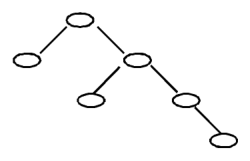

# 2019CCF 非专业级别软件能力认证第一轮（CSP-J）入门级 C++语言试题 B 卷

认证时间：2019 年 10 月 19 日 14:30~16:30

考生注意事项：

- 试题纸共有 9 页，答题纸共有 1 页，满分 100 分。请在答题纸上作答，写在试题纸上的一律无效。
- 不得使用任何电子设备（如计算器、手机、电子词典等）或查阅任何书籍资料。

## 一、单项选择题

> 共 15 题，每题 2 分，共计 30 分；每题有且仅有一个正确选项。

### 第 1 题

<!-- qid: csp-j1-2019b-001 | type: single_choice | score: 2 | answer: C | tags: topic:basics -->

中国的国家顶级域名是（ ）

- A. .ch
- B. .china
- C. .cn
- D. .chn

> **题解**
> 答案：C
> 解释：国家顶级域名按 ISO 3166 的两字母国家/地区代码分配，中国是 `.cn`。`.ch` 是瑞士（Confoederatio Helvetica），`.chn` 不是任何国家或地区代码；`.china` 是中文域名后缀，不属于国家顶级域名。故选 C。

### 第 2 题

<!-- qid: csp-j1-2019b-002 | type: single_choice | score: 2 | answer: C | tags: topic:bit,topic:number -->

二进制数 11 1011 1001 0111 和 01 0110 1110 1011 进行逻辑与运算的结果是（ ）。

- A. 01 0010 1000 1011
- B. 01 0010 1000 0001
- C. 01 0010 1000 0011
- D. 01 0010 1001 0011

> **题解**
> 答案：C
> 解释：逻辑与是逐位相与，只有对应位同时为 1，结果位才为 1。把两个数补成 16 位看分别是 `0011 1011 1001 0111`（即 `0x3B97`）与 `0001 0110 1110 1011`（即 `0x16EB`），相与得 `0x1283`，写成题面的四位一组就是 `01 0010 1000 0011`，对应 C 项。A、B、D 三项的差异都落在低位若干位上，是干扰项。

### 第 3 题

<!-- qid: csp-j1-2019b-003 | type: single_choice | score: 2 | answer: B | tags: topic:basics -->

一个 32 位整型变量占用（ ）个字节。

- A. 32
- B. 4
- C. 128
- D. 8

> **题解**
> 答案：B
> 解释：一个字节是 8 位，32 位整型占 32 ÷ 8 = 4 个字节。A 项的 32 是把「位」直接当成了「字节」，C、D 是位数与字节数的混淆项。

### 第 4 题

<!-- qid: csp-j1-2019b-004 | type: single_choice | score: 2 | answer: A | tags: topic:lang -->

若有如下程序段，其中 `s`、`a`、`b`、`c` 均已定义为整型变量,且 `a`、`c` 均已赋值（`c` 大于 0）
`s = a;`
`for (b = 1; b <= c; b++) s = s - 1;`
则与上述程序段功能等价的赋值语句是（ ）

- A. `s = a - c;`
- B. `s = b - c;`
- C. `s = a - b;`
- D. `s = s - c;`

> **题解**
> 答案：A
> 解释：循环从 `b = 1` 递增到 `b = c`，共执行 c 次，每次把 s 减 1；而 s 的初值由前面的 `s = a;` 无条件给定，所以结束时 s 就是 a − c，等价于 A 项。D 项 `s = s - c` 依赖 s 原来的值，而题中程序段与 s 的旧值无关，两者不等价；B、C 两项用到了循环变量 b，循环结束时 b 已经是 c + 1，同样不符。

### 第 5 题

<!-- qid: csp-j1-2019b-005 | type: single_choice | score: 2 | answer: D | tags: topic:bisect -->

设有 100 个已排好序的数据元素，采用折半查找时，最大比较次数为（ ）

- A. 10
- B. 6
- C. 8
- D. 7

> **题解**
> 答案：D
> 解释：折半查找每比较一次就排除掉一半元素，n 个元素的最大比较次数是 ⌈log₂(n+1)⌉。n = 100 时为 ⌈log₂101⌉ = 7（因为 2⁶ = 64 < 101 ≤ 128 = 2⁷）。A 项 10 是元素数放大到 1024 量级才会出现的值，属干扰。

### 第 6 题

<!-- qid: csp-j1-2019b-006 | type: single_choice | score: 2 | answer: C | tags: topic:ds -->

链表不具有的特点是（ ）

- A. 所需空间与线性表长度成正比
- B. 插入删除不需要移动元素
- C. 可随机访问任一元素
- D. 不必事先估计存储空间

> **题解**
> 答案：C
> 解释：链表靠指针把结点串联，要取第 k 个结点必须从表头逐个走 k − 1 步，只能顺序访问，不能像数组那样按下标直接定位，所以「可随机访问任一元素」不是它的特点，选 C。A、B、D 三项都是链表的真实优点：空间按需分配、与表长成正比；插入删除只改指针、不必移动元素；不必事先估计存储空间。

### 第 7 题

<!-- qid: csp-j1-2019b-007 | type: single_choice | score: 2 | answer: B | tags: topic:combinatorics -->

把 8 个同样的球放在 5 个同样的袋子里，允许有的袋子空着不放，问共有多少种不同的分法？（ ）提示：如果 8 个球都放在一个袋子里，无论是哪个袋子，都只算同一种分法

- A. 24
- B. 18
- C. 20
- D. 22

> **题解**
> 答案：B
> 解释：球相同、袋子也相同，所以问题等价于「把 8 拆成不超过 5 个正整数之和」有多少种拆法（袋子空着相当于部分数不足 5）。8 的分拆共 22 种，其中部分数超过 5 的有 4 种：3+1+1+1+1+1、2+2+1+1+1+1、2+1+1+1+1+1+1、1+1+1+1+1+1+1+1，22 − 4 = 18，选 B。C 项 20、D 项 22 是没把「超过 5 个袋子」的情形排除干净的干扰值，其中 22 恰好就是 8 的全部分拆数。

### 第 8 题

<!-- qid: csp-j1-2019b-008 | type: single_choice | score: 2 | answer: A | images: q008-fig1.png | tags: feat:figure,feat:formula,topic:tree -->

一棵二叉树如右图所示，若采用顺序存储结构，即用一维数组元素存储该二叉树中的结点（根结点的下标为 1，若某结点的下标为 $i$，则其左孩子位于下标 $2i$ 处、右孩子位于下标 $2i+1$ 处），则该数组的最大下标至少为（ ）。



- A. 15
- B. 12
- C. 10
- D. 6

> **题解**
> 答案：A
> 解释：顺序存储下根占下标 1，下标 i 的左右孩子分别是 2i 和 2i + 1。照图数：根在 1；根的左孩子是 2、右孩子是 3；3 的左孩子是 6、右孩子是 7；7 的右孩子是 15。最深的那条链一路走的是右孩子（1 → 3 → 7 → 15），最深的结点落在下标 15，所以数组下标至少要开到 15，选 A。注意下标 4、5、8 到 14 这些位置虽然没有结点，也要按公式留着——不能因为整棵树只有 6 个结点就只开 6 格。

### 第 9 题

<!-- qid: csp-j1-2019b-009 | type: single_choice | score: 2 | answer: D | tags: topic:number -->

100 以内最大的素数是（ ）。

- A. 89
- B. 93
- C. 91
- D. 97

> **题解**
> 答案：D
> 解释：97 是 100 以内最大的素数——√97 ≈ 9.8，只需试 2、3、5、7 四个素数，都不能整除它，即可判定为素数。A 项 89 确实是素数，但比 97 小；B 项 93 = 3 × 31，C 项 91 = 7 × 13，都是合数。

### 第 10 题

<!-- qid: csp-j1-2019b-010 | type: single_choice | score: 2 | answer: A | tags: topic:number -->

319 和 377 的最大公约数是（ ）。

- A. 29
- B. 33
- C. 31
- D. 27

> **题解**
> 答案：A
> 解释：用辗转相除法：377 = 319 × 1 + 58，319 = 58 × 5 + 29，58 = 29 × 2 + 0，最后一个非零余数是 29，所以最大公约数为 29，选 A。也可以直接分解验证：319 = 29 × 11，377 = 29 × 13，而 11 与 13 互素，故两数的公约数只有 29 一个。

### 第 11 题

<!-- qid: csp-j1-2019b-011 | type: single_choice | score: 2 | answer: B | tags: topic:math -->

新学期开学了，小胖想减肥，健身教练给小胖制定了两个训练方案。方案一：每次连续跑 3 公里可以消耗 300 千卡（耗时半小时）；方案二：每次连续跑 5 公里可以消耗 600 千卡（耗时 1 小时）。小胖每周周一到周四能抽出半小时跑步，周五到周日能抽出一小时跑步。另外，教练建议小胖每周最多跑 21 公里，否则会损伤膝盖。请问如果小胖想严格执行教练的训练方案，并且不想损伤膝盖，每周最多通过跑步消耗多少千卡？（ ）

- A. 3000
- B. 2400
- C. 2500
- D. 2520

> **题解**
> 答案：B
> 解释：周一到周四每天只有半小时，共 4 个半小时；周五到周日每天 1 小时，共 6 个半小时，全周一共 10 个半小时「槽位」。方案一占 1 槽、跑 3 公里消耗 300 千卡；方案二占 2 槽、跑 5 公里消耗 600 千卡。每公里消耗的千卡数方案二更高（120 对 100），所以优先多排方案二：安排 3 次方案二占 6 槽、跑 15 公里，再用 2 次方案一占 2 槽、跑 6 公里，合计正好 21 公里不超上限，消耗 3 × 600 + 2 × 300 = 2400 千卡，选 B。A 项 3000 是把 10 个槽全按方案一跑（30 公里）的结果，早就越过 21 公里；C 项 2500、D 项 2520 都不是 300 的整数倍，按题面方案无论怎么组合都得不到。

### 第 12 题

<!-- qid: csp-j1-2019b-012 | type: single_choice | score: 2 | answer: A | tags: topic:combinatorics -->

一副纸牌除掉大小王有 52 张牌，四种花色，每种花色 13 张。假设从这 52 张牌中随机抽取 13 张纸牌，则至少（ ）张牌的花色一致。

- A. 4
- B. 2
- C. 5
- D. 3

> **题解**
> 答案：A
> 解释：把 4 种花色看作 4 个抽屉：若每种花色都不到 4 张、即每种至多 3 张，总共最多 3 × 4 = 12 张，与抽出 13 张矛盾，所以至少有一种花色达到 4 张，选 A。C 项 5 是保证不了的——13 张可以分成 4、3、3、3 四份，最多的那种花色只有 4 张；B 项 2、D 项 3 虽然也成立，但题目问的是能保证的最大下界，4 比它们更紧。

### 第 13 题

<!-- qid: csp-j1-2019b-013 | type: single_choice | score: 2 | answer: D | tags: topic:combinatorics -->

一些数字可以颠倒过来看，例如 0、1、8 颠倒过来还是本身，6 颠倒过来是 9，9 颠倒过来还是 6，其他数字颠倒过来都不构成数字。类似的，一些多位数也可以颠倒过来看，比如 106 颠倒过来是 901。假设某个城市的车牌只由 5 位数字组成，每一位都可以取 0 到 9。请问这个城市最多有多少个车牌倒过来恰好还是原来的车牌？（ ）

- A. 60
- B. 125
- C. 100
- D. 75

> **题解**
> 答案：D
> 解释：倒过来看不变，要求第 1 位与第 5 位互为倒置、第 2 位与第 4 位互为倒置、中间第 3 位倒过来还是自己。能倒视成数字的只有 0、1、6、8、9 五个，其中中间位要自对称，只有 0、1、8 三种；两对对称位各自有 0↔0、1↔1、8↔8、6↔9、9↔6 五种配法。总数 = 3 × 5 × 5 = 75，选 D。A 项 60、C 项 100 都没有正确体现「中间位 3 种、两对对称位各 5 种」这个结构，B 项 125 = 5³ 相当于只要求每一位都能倒视、漏掉了成对约束。

### 第 14 题

<!-- qid: csp-j1-2019b-014 | type: single_choice | score: 2 | answer: D | tags: topic:tree -->

假设一棵二叉树的后序遍历序列为 DGJHEBIFCA，中序遍历序列为 DBGEHJACIF，则其前序遍历序列为（ ）。

- A. ABDEGJHCFI
- B. ABDEGHJFIC
- C. ABCDEFGHIJ
- D. ABDEGHJCFI

> **题解**
> 答案：D
> 解释：后序遍历的最后一个结点是根，所以 A 是根；在中序 DBGEHJACIF 里 A 左边的 DBGEHJ 属左子树、右边的 CIF 属右子树。左子树后序 DGJHEB 的末位 B 是它的根，中序里 B 左侧只有 D，故 D 是 B 的左孩子、GEHJ 在 B 右边；对 GEHJ 同法得根 E、左孩子 G、右孩子 H，而 H 的右孩子是 J。右子树中序 CIF、后序 IFC 得根 C，I 与 F 都在 C 右边，再由后序 IF 定出 F 在 I 之上、I 是 F 的左孩子。按「根—左—右」排出前序就是 ABDEGHJCFI，选 D。A 项把 H、J 的先后写反，B 项把右子树的根 C 排到了末尾。

### 第 15 题

<!-- qid: csp-j1-2019b-015 | type: single_choice | score: 2 | answer: C | tags: topic:basics -->

以下哪个奖项是计算机科学领域的最高奖？（ ）

- A. 鲁班奖
- B. 普利策奖
- C. 图灵奖
- D. 诺贝尔奖

> **题解**
> 答案：C
> 解释：图灵奖由美国计算机协会（ACM）于 1966 年设立，被公认为计算机科学领域的最高奖项，选 C。A 项鲁班奖是中国建筑行业的工程质量奖，B 项普利策奖是新闻与文化领域的奖项，D 项诺贝尔奖没有设数学或计算机奖项，都与题意无关。

## 二、阅读程序

> 程序输入不超过数组或字符串定义的范围；判断题正确填 √，错误填 ×；除特殊说明外，判断题 1.5 分，选择题 3 分，共计 40 分。

### (1)

<!-- group: 阅读程序(1) -->

```cpp
  1  #include <cstdio>
  2  #include <cstring>
  3  using namespace std;
  4  char st[100];
  5  int main() {
  6      scanf("%s", st);
  7      int n = strlen(st);
  8      for (int i = 1; i <= n; ++i) {
  9          if (n % i == 0) {
 10              char c = st[i - 1];
 11              if (c >= 'a')
 12                  st[i - 1] = c - 'a' + 'A';
 13          }
 14      }
 15      printf("%s", st);
 16      return 0;
 17  }
```

> **程序说明**
> 这段程序读入一个不含空白的字符串（`scanf("%s")`），然后按 1 到 n 的下标逐个检查：凡是下标 i 能整除串长 n 的位置，如果那一位是小写字母就改成大写，其余字符原样保留，最后把整个字符串输出。换句话说，它做的是「把下标为串长约数的那些小写字母变大写」。理解本题要抓住两点：一是被处理的位置只由串长的约数决定、与字符内容无关，所以「有多少个字符可能改变」就等于串长的约数个数，这一组的判断题与选择题全都围绕它展开；二是判断大写用的条件写成 `c >= 'a'`，只对小写字母成立，因此全大写输入输出不变，而输入含数字、符号也不会出错。

#### 判断题

##### 第 16 题

<!-- qid: csp-j1-2019b-016 | type: true_false | score: 1.5 | answer: F | tags: topic:string -->

输入的字符串只能由小写字母或大写字母组成。（ ）

> **题解**
> 答案：×
> 解释：题面主张输入只能由字母组成，实际上程序完全不做输入检查：它只是按下标处理读到的字符，遇到非字母字符原样保留、不报错，`scanf("%s")` 会照常把数字、符号读进来。实跑验证：输入 `a1B!Zx9` 输出 `A1B!Zx9`（退出码 0），输入 `!!!` 原样输出 `!!!`，输入 `Ab3#de` 输出 `AB3#dE`。既然含数字和符号都能正常运行，主张不成立，填 ×。

##### 第 17 题

<!-- qid: csp-j1-2019b-017 | type: true_false | score: 1.5 | answer: T | tags: feat:lineref,topic:number -->

若将第 8 行的 `i = 1` 改为 `i = 0`，程序运行时会发生错误。（ ）

> **题解**
> 答案：√
> 解释：第 8 行改成 `i = 0` 后，第 9 行第一次循环就要算 `n % i`，也就是对 0 取余；整数除零在 C++ 里是未定义行为，程序会崩。实跑验证：把该行改成 `i = 0`、其余一字不动重新编译，输入 `abcd`，进程异常退出，退出码 `-1073741795`，即十六进制的 `0xC0000094`，正是整数除零异常。故主张成立，填 √。

##### 第 18 题

<!-- qid: csp-j1-2019b-018 | type: true_false | score: 1.5 | answer: F | tags: feat:lineref,topic:number -->

若将第 8 行的 `i <= n` 改为 `i * i <= n`，程序运行结果不会改变。（ ）

> **题解**
> 答案：×
> 解释：原程序枚举 1 到 n 的每个下标、只处理能整除 n 的那些；改成 `i * i <= n` 后循环只走到 √n，大于 √n 的那一半约数被漏掉，而每个正整数至少有一个这样的约数（就是它自己）。实跑比对：长度 2 到 40 的小写字母输入里有 39 个长度的输出不同，例如 `ab` 原程序输出 `AB`、改后输出 `Ab`——长度 2 的约数 1、2 中，2 再也不会被处理。故主张为假，填 ×。

##### 第 19 题

<!-- qid: csp-j1-2019b-019 | type: true_false | score: 1.5 | answer: T | tags: topic:string -->

若输入的字符串全部由大写字母组成，那么输出的字符串就跟输入的字符串一样。（ ）

> **题解**
> 答案：√
> 解释：程序只在 `c >= 'a'` 时改写字符，而大写字母的编码小于 `'a'`，不满足这个条件，会被原样保留。实跑验证：输入 `ABCDEF`、`HELLOWORLDX` 等 3 组全大写字符串，输出与输入逐字符完全相同。故主张成立，填 √。

#### 选择题

##### 第 20 题

<!-- qid: csp-j1-2019b-020 | type: single_choice | score: 3 | answer: C | tags: topic:number -->

若输入的字符串长度为 18，那么输入的字符串跟输出的字符串相比，至多有（ ）个字符不同。

- A. 18
- B. 10
- C. 6
- D. 1

> **题解**
> 答案：C
> 解释：能在哪些位置动手完全由长度决定：只要 i 能整除 n，就处理第 i 个字符，所以「有多少个字符可能改变」就等于 n 的约数个数。18 的约数是 1、2、3、6、9、18，共 6 个，选 C。实跑多组长度为 18 的输入，实际改变的字符数最多都是 6。A 项 18 是「每个字符都可能变」的松上界，B 项 10、D 项 1 与约数个数无关。

##### 第 21 题

<!-- qid: csp-j1-2019b-021 | type: single_choice | score: 3 | answer: D | tags: topic:number -->

若输入的字符串长度为（ ），那么输入的字符串跟输出的字符串相比，至多有 36 个字符不同。

- A. 36
- B. 1
- C. 128
- D. 100000

> **题解**
> 答案：D
> 解释：至多不同字符数等于字符串长度的约数个数。逐项算约数个数：36 有 9 个（1、2、3、4、6、9、12、18、36），1 只有 1 个，128 = 2⁷ 有 8 个，而 100000 = 2⁵ × 5⁵ 的约数个数是 (5+1) × (5+1) = 36，只有 D 项满足 36，选 D。这题考的是「约数个数」这个纯数学关系，与程序处理字符的细节无关。
> 争议：原卷第 21 题问「长度为（ ）时至多 36 个字符不同」，而程序里读入字符串的数组定义是 `char st[100]`，长度 100000 的输入根本放不下，按卷面严格推，第四项无法被程序正确处理，题面自身是矛盾的。本题只能按「不同字符数 = 字符串长度的约数个数」这一数学关系作答，四个选项里只有 100000 的约数个数是 36；为验证这一点，另把 `char st[100]` 放大成 `st[200005]`（其余逻辑一字不动）实跑，才真得到 36 个不同字符。

### (2)

<!-- group: 阅读程序(2) -->

```cpp
  1  #include <cstdio>
  2  using namespace std;
  3  int n, m;
  4  int a[100], b[100];
  5
  6  int main() {
  7      scanf("%d%d", &n, &m);
  8      for (int i = 1; i <= n; ++i)
  9          a[i] = b[i] = 0;
 10      for (int i = 1; i <= m; ++i) {
 11          int x, y;
 12          scanf("%d%d", &x, &y);
 13          if (a[x] < y && b[y] < x) {
 14              if (a[x] > 0)
 15                  b[a[x]] = 0;
 16              if (b[y] > 0)
 17                  a[b[y]] = 0;
 18              a[x] = y;
 19              b[y] = x;
 20          }
 21      }
 22      int ans = 0;
 23      for (int i = 1; i <= n; ++i) {
 24          if (a[i] == 0)
 25              ++ans;
 26          if (b[i] == 0)
 27              ++ans;
 28      }
 29      printf("%d\n", ans);
 30      return 0;
 31  }
```

假设输入的 `n` 和 `m` 都是正整数，`x` 和 `y` 都是在 `[1, n]` 的范围内的整数，完成下面的判断题和单选题:

> **程序说明**
> 这段程序模拟一个「配对」过程：先读入 n、m，把数组 a、b 全部清零；再读入 m 对数 (x, y)，只要 y 比 a[x] 大、并且 x 比 b[y] 大，就先把 x 原来的伙伴和 y 原来的伙伴拆掉（把 `b[a[x]]`、`a[b[y]]` 清零），再记下 `a[x] = y`、`b[y] = x`。最后统计 a、b 两个数组里一共有多少项是 0，输出这个数目。可以把它看成「反复尝试让 x 与 y 配对，且要求新配对的编号比原来更大」的过程。抓住两处就能做全部小题：一是 a[i] 与 b[i] 的含义不同（一个是「i 配上谁」，一个是「谁配上了 i」），两者可以同时非零；二是第 13 行的条件一旦成立就会写入，是否执行第 15 行、ans 的奇偶都由此决定，而输出统计的始终是 a、b 里 0 的个数。

#### 判断题

##### 第 22 题

<!-- qid: csp-j1-2019b-022 | type: true_false | score: 1.5 | answer: T | tags: feat:formula,topic:sim -->

当 $m>0$ 时，输出的值一定小于 $2n$。（ ）

> **题解**
> 答案：√
> 解释：程序在条件成立时会写入 `a[x] = y`、`b[y] = x`，而 x、y 都至少是 1，这两个位置从此不为 0；m > 0 时首轮 a[x]、b[y] 的初值都是 0，第 13 行的两个条件必然成立，一定会写入。更一般地，取最后一次写入的那一对 (x, y)：此后再没有任何改写，a[x] 与 b[y] 一直非零，所以 ans 至多 2n − 2，一定小于 2n。穷举 n、m ≤ 4 的全部输入核对，反例 0 例，故填 √。

##### 第 23 题

<!-- qid: csp-j1-2019b-023 | type: true_false | score: 1.5 | answer: F | tags: feat:lineref,topic:sim -->

执行完第 27 行的 `++ans` 时，`ans` 一定是偶数。（ ）

> **题解**
> 答案：×
> 解释：同一个 i 上 `++ans` 可能执行两次（a[i] 为 0 一次、b[i] 为 0 又一次），ans 的奇偶并不受任何约束。实跑反例：n = 3、m = 2，依次输入 `1 2` 和 `1 3`，执行完第 27 行时 ans 出现过奇数，最终输出 4。穷举 n = 4、m = 4 的 65536 组输入，有 32189 组出现反例，故填 ×。

##### 第 24 题

<!-- qid: csp-j1-2019b-024 | type: true_false | score: 1.5 | answer: F | tags: topic:sim -->

`a[i]` 和 `b[i]` 不可能同时大于 0。（ ）

> **题解**
> 答案：×
> 解释：a 与 b 的下标含义不同——a[i] 记 i 配对到的另一头，b[i] 记 i 作为别人配对的那一头——两者可以同时非零。实跑反例：n = 1、m = 1，输入 `1 1`，第 13 行条件成立，执行 `a[1] = 1`、`b[1] = 1`，于是 a[1] 与 b[1] 同时大于 0。穷举 n ≤ 4、m ≤ 4 的全部输入，反例大量存在，故填 ×。

##### 第 25 题

<!-- qid: csp-j1-2019b-025 | type: true_false | score: 1.5 | answer: F | tags: feat:lineref,topic:sim -->

若程序执行到第 13 行时，`x` 总是小于 `y`，那么第 15 行不会被执行。（ ）

> **题解**
> 答案：×
> 解释：第 15 行 `b[a[x]] = 0;` 执行与否只看 a[x] 是否大于 0，与 x、y 的大小毫无关系。实跑反例：n = 3、m = 2，输入 `1 2` 和 `1 3`。第二轮执行到第 13 行时 x = 1、y = 3，满足 x < y，但此时 a[1] 已经在第一轮被写成 2，所以第 15 行照样执行（加计数器实测执行了 1 次），最终输出 4。故填 ×。

#### 选择题

##### 第 26 题

<!-- qid: csp-j1-2019b-026 | type: single_choice | score: 3 | answer: C | tags: feat:formula,topic:sim -->

若 `m` 个 `x` 两两不同，且 `m` 个 `y` 两两不同，则输出的值为（ ）

- A. $2n+2$
- B. $2n$
- C. $2n-2m$
- D. $2n-2$

> **题解**
> 答案：C
> 解释：x 两两不同、y 也两两不同时，每次写入 `a[x] = y`、`b[y] = x` 之前 a[x] 与 b[y] 都还是 0（各下标只会出现一次），第 15、17 行的清零分支从不触发。m 轮下来恰好建立 m 对互不相干的配对，a 侧有 m 项非零、b 侧也有 m 项非零，ans = 2n − 2m，选 C。穷举 n、m ≤ 4 中满足该条件的全部输入，反例 0 例；n = 3、m = 2 实跑输出 2 = 2 × 3 − 2 × 2。A 项 2n + 2 超过总数 2n，B 项 2n 等于一对都没消掉，D 项 2n − 2 只消掉一对。

##### 第 27 题

<!-- qid: csp-j1-2019b-027 | type: single_choice | score: 3 | answer: A | tags: feat:formula,topic:sim -->

若 `m` 个 `x` 两两不同，且 `m` 个 `y` 都相等，则输出的值为（ ）

- A. $2n-2$
- B. $2m$
- C. $2n-2m$
- D. $2n$

> **题解**
> 答案：A
> 解释：y 全都相同，所以每一轮都作用在同一个 b[y] 上：条件成立时先执行第 17 行把上一轮写下的 `a[b[y]]` 清零，再把 `b[y]` 覆盖成新的 x；x 两两不同使第 15 行从不触发。于是 m 轮之后 a、b 各只剩 1 项非零（最后一次生效的那对），ans = 2n − 2，选 A。n = 3、m = 2 实跑输出 4 = 2 × 3 − 2；穷举满足该条件的全部输入，反例 0 例。B 项 2m 与 n 无关，C 项 2n − 2m 是 m 对全部保留的情形，D 项 2n 等于一项都没消掉。

### (3)

<!-- group: 阅读程序(3) -->

```cpp
  1  #include <iostream>
  2  using namespace std;
  3  const int maxn = 10000;
  4  int n;
  5  int a[maxn];
  6  int b[maxn];
  7  int f(int l, int r, int depth) {
  8      if (l > r)
  9          return 0;
 10      int min = maxn, mink;
 11      for (int i = l; i <= r; ++i) {
 12          if (min > a[i]) {
 13              min = a[i];
 14              mink = i;
 15          }
 16      }
 17      int lres = f(l, mink - 1, depth + 1);
 18      int rres = f(mink + 1, r, depth + 1);
 19      return lres + rres + depth * b[mink];
 20  }
 21  int main() {
 22      cin >> n;
 23      for (int i = 0; i < n; ++i)
 24          cin >> a[i];
 25      for (int i = 0; i < n; ++i)
 26          cin >> b[i];
 27      cout << f(0, n - 1, 1) << endl;
 28      return 0;
 29  }
```

> **程序说明**
> 这段程序先读入 n、数组 a 与数组 b，然后调用递归函数 `f(l, r, depth)`：在区间 [l, r] 里找出最小值所在的下标 mink，把它当作当前子树的根（深度为 depth），再对左右两个子区间递归，返回值是 `depth * b[mink]` 加上两棵子树的结果。也就是说，它先按「区间最小值」把数组建成一棵二叉搜索树，再求这棵树上每个结点的「深度 × 该结点的 b 值」之和。输入是 n、a 数组、b 数组，输出是一个整数。理解本题要抓住两点：一是第 12 行的比较次数等于各结点所在区间的长度之和，也就是所有结点的深度之和，数组有序时会退化成一条链，最大为 1 + 2 + … + 100 = 5050；二是 b 是每个结点的权重，树的形态不同、总和也不同，最大与最小值要在全部形态上用区间 DP 求。

#### 判断题

##### 第 28 题

<!-- qid: csp-j1-2019b-028 | type: true_false | score: 1.5 | answer: F | tags: topic:divide -->

如果 `a` 数组有重复的数字，则程序运行时会发生错误。（ ）

> **题解**
> 答案：×
> 解释：第 10 至 16 行找的是区间最小值：`min > a[i]` 严格小于才更新，遇到与当前最小值相等的元素什么都不做，`mink` 始终是区间内的合法下标，递归出的两个子区间都比原区间短，既不会越界也不会死循环。实跑验证：n = 5、a 为 `3 1 1 2 1`、b 全 1 输出 12；n = 4、a 全为 7 输出 10，退出码都是 0。故主张为假，填 ×。

##### 第 29 题

<!-- qid: csp-j1-2019b-029 | type: true_false | score: 1.5 | answer: T | tags: topic:divide -->

如果 `b` 数组全为 0，则输出为 0。（ ）

> **题解**
> 答案：√
> 解释：函数的返回值是 `lres + rres + depth * b[mink]`，即每个结点贡献「深度 × 该结点的 b 值」。b 全为 0 时每一项贡献都是 0，所有递归分支相加仍是 0，所以输出为 0。实跑验证：n = 4、a 为 `4 2 3 1`、b 全 0，输出 `0`，故填 √。

#### 选择题

##### 第 30 题

<!-- qid: csp-j1-2019b-030 | type: single_choice | score: 3 | answer: C | tags: feat:formula,feat:lineref,topic:complexity -->

当 $n=100$ 时，最坏情况下，与第 12 行的比较运算执行的次数最接近的是：（ ）。

- A. 6
- B. 100
- C. 5000
- D. 600

> **题解**
> 答案：C
> 解释：第 12 行是区间内层循环里的比较，长度 L 的区间要比较 L 次，所以「第 12 行的比较次数」等于所有结点所在区间长度之和，也等于所有结点的深度之和（根深度为 1）。想让它最大就要让递归尽量退化：数组递增或递减时每次取到的最小值都在区间端点，递归成一条链，深度依次为 1 到 100，总和 1 + 2 + … + 100 = 5050。实跑递增、递减、先增后减三种输入都得到 5050，最接近的选项是 C 的 5000。A 项 6、B 项 100 都小了至少一个数量级，D 项 600 也小了 8 倍多。

##### 第 31 题

<!-- qid: csp-j1-2019b-031 | type: single_choice | score: 3 | answer: D | tags: feat:formula,feat:lineref,topic:complexity -->

当 $n=100$ 时，最好情况下，与第 12 行的比较运算执行的次数最接近的是：（ ）。

- A. 5000
- B. 6
- C. 100
- D. 600

> **题解**
> 答案：D
> 解释：比较总次数同样是所有结点的深度之和，想让它最小就要让递归尽量平衡——每次把当前区间的最小值放在中点，深度接近 log₂100。用区间 DP 在 n = 100 的全部二叉搜索树形态上求最小值得 580，按这个思路构造数组实跑也恰好是 580，最接近的选项是 D 的 600。A 项 5000 是上一小题的最坏值，B 项 6、C 项 100 与 580 相差太远。

##### 第 32 题

<!-- qid: csp-j1-2019b-032 | type: single_choice | score: 3 | answer: A | tags: feat:formula,topic:tree -->

当 $n=10$ 时，若 `b` 数组满足，对任意 $0 \le i < n$，都有 $b[i] = i + 1$，那么输出最大为（ ）。

- A. 385
- B. 383
- C. 384
- D. 386

> **题解**
> 答案：A
> 解释：输出是 Σ 深度 × b 值。b[i] = i + 1 随下标递增，要让总和最大就得让下标大（即 b 大）的结点尽量深：把数组排成递增（或递减）时每次取到的最小值都在区间端点，递归成一条链，下标 i 的结点深度正好是 i + 1，输出 Σ (i+1) × (i+1) = 1² + 2² + … + 10² = 385，选 A。用区间 DP 在 n = 10 的全部形态上求最大值同样是 385，实跑 a 取 0 到 9 也得到 385。B 项 383、C 项 384、D 项 386 与正确值只差一两分，靠估算是分不出来的，必须逐项相乘求和才能排除。

##### 第 33 题

<!-- qid: csp-j1-2019b-033 | type: single_choice | score: 4 | answer: D | tags: feat:formula,topic:tree -->

（4 分）当 $n=100$ 时，若 `b` 数组满足，对任意 $0 \le i < n$，都有 $b[i] = 1$，那么输出最小为（ ）。

- A. 582
- B. 579
- C. 581
- D. 580

> **题解**
> 答案：D
> 解释：b[i] 全为 1，输出就是所有结点的深度之和，也就是第 12 行比较的总次数；求它的最小值等价于让 100 个结点的二叉搜索树深度和最小，平衡时取到。用区间 DP 在全部形态上求得最小值 580，按「每次把当前最小值放在区间中点」构造数组实跑同样得到 580，选 D。A 项 582、B 项 579、C 项 581 都紧贴正确值，只有精确算出 580 才能排除。

## 三、完善程序

> 单选题，每小题 3 分，共计 30 分。

### (1)

<!-- group: 完善程序(1) -->

（矩阵变幻）有一个奇幻的矩阵，在不停的变幻，其变幻方式为：数字 0 变成矩阵 $[0 0; 0 1]$，数字 1 变成矩阵 $[1 1; 1 0]$。最初该矩阵只有一个元素 0，变幻 $n$ 次后，矩阵会变成什么样？

例如，矩阵最初为：$[0]$；矩阵变幻 1 次后：$[0 0; 0 1]$；矩阵变幻 2 次后：

$$
[0 0 0 0; 0 1 0 1; 0 0 1 1; 0 1 1 0]
$$

输入一行一个不超过 10 的正整数 $n$。输出变幻 $n$ 次后的矩阵。

试补全程序。

提示：
`<<` 表示二进制左移运算符，例如 $(11)_2 << 2 = (1100)_2$；
而 `^` 表示二进制异或运算符，它将两个参与运算的数中的每个对应的二进制位一一进行比较，若两个二进制位相同，则运算结果的对应二进制位为 0，反之为 1。

```cpp
  1  #include <cstdio>
  2  using namespace std;
  3  int n;
  4  const int max_size = 1 << 10;
  5
  6  int res[max_size][max_size];
  7
  8  void recursive(int x, int y, int n, int t) {
  9      if (n == 0) {
 10          res[x][y] = ①;
 11          return;
 12      }
 13      int step = 1 << (n - 1);
 14      recursive(②, n - 1, t);
 15      recursive(x, y + step, n - 1, t);
 16      recursive(x + step, y, n - 1, t);
 17      recursive(③, n - 1, !t);
 18  }
 19
 20  int main() {
 21      scanf("%d", &n);
 22      recursive(0, 0, ④);
 23      int size = ⑤;
 24      for (int i = 0; i < size; ++i) {
 25          for (int j = 0; j < size; ++j)
 26              printf("%d", res[i][j]);
 27          puts("");
 28      }
 29      return 0;
 30  }
```

> **程序说明**
> 这段程序要按「数字 0 变成三处 0、右下角 1 的 2 × 2 矩阵，数字 1 变成三处 1、右下角 0 的 2 × 2 矩阵」的规则，把一个起始数字 0 反复变幻 n 次，输出变换后的 2ⁿ × 2ⁿ 矩阵（逐位输出、每行换行）。做法是分治：`recursive(x, y, n, t)` 填出左上角在 (x, y)、边长 2ⁿ 的方块，它把方块分成四个边长 2ⁿ⁻¹ 的象限，左上、右上、左下三个象限照抄 t，右下象限取反后继续递归，直到 n = 0 时写下一个数。理解本题的关键是：每个空都对应「哪个象限、什么位置、什么数字」三点之一——①是递归到底要写下的数字，②③是象限坐标与数字，④是起始的层数与数字，⑤是输出边长；把候选代进代码编译运行，只有一种填法能让 n = 1 输出 `00`、`01` 两行，n = 2 输出题面那个 4 × 4 矩阵。

##### 第 34 题

<!-- qid: csp-j1-2019b-034 | type: single_choice | score: 3 | answer: C | tags: feat:circnum,topic:divide -->

①处应填（ ）

- A. `1`
- B. `n % 2`
- C. `t`
- D. `0`

> **题解**
> 答案：C
> 解释：`recursive(x, y, n, t)` 要填出左上角在 (x, y)、边长 2ⁿ 的方块，t 是这一块代表的数字。对照变幻规则：数字 0 变成的 2 × 2 矩阵里三处是 0、右下角是 1，数字 1 变成的矩阵三处是 1、右下角是 0——两种情形都是三个象限照抄 t、右下象限取反，程序里右下象限正好传 `!t`，所以递到 n = 0 时直接把 t 写进 `res[x][y]`。把四个候选代进去实跑：填 `1` 时 n = 1 输出的两行是 `11` 和 `11`；填 `0`，或填 `n % 2`（n = 0 时它的值也是 0）时输出的两行是 `00` 和 `00`，都得不到题面要求的 `00` 和 `01`；只有填 `t` 的输出与题面完全一致，故选 C。

##### 第 35 题

<!-- qid: csp-j1-2019b-035 | type: single_choice | score: 3 | answer: D | tags: feat:circnum,topic:divide -->

②处应填（ ）

- A. `x - step, y`
- B. `x, y - step`
- C. `x - step, y - step`
- D. `x, y`

> **题解**
> 答案：D
> 解释：四个递归调用按顺序填四个象限：第 15 行 `x, y + step` 是右上、第 16 行 `x + step, y` 是左下，第 17 行带 `!t` 的必然是右下，那么第 14 行的②就是左上角，坐标正是 (x, y)，选 D。实跑代入：填 `x, y` 时 n = 2 输出的 4 × 4 矩阵与题面逐位相同；填 `x - step, y` 或 `x - step, y - step` 会把数据写到方块外（输出为空），填 `x, y - step` 则把矩阵整体错位，与题面不符。

##### 第 36 题

<!-- qid: csp-j1-2019b-036 | type: single_choice | score: 3 | answer: A | tags: feat:circnum,topic:divide -->

③处应填（ ）

- A. `x + step, y + step`
- B. `x, y - step`
- C. `x - step, y`
- D. `x - step, y - step`

> **题解**
> 答案：A
> 解释：承接上一空：四个象限里最后处理的那个（第 17 行）是右下角，坐标为 (x + step, y + step)，并且要传取反后的 `!t`，选 A。实跑代入：填它时 n = 2 输出 `0000`、`0101`、`0011`、`0110` 四行，与题面的 4 × 4 矩阵逐位相同；另外三个候选都指回已经填过的象限或方块之外，输出与题面不符。

##### 第 37 题

<!-- qid: csp-j1-2019b-037 | type: single_choice | score: 3 | answer: C | tags: feat:circnum,topic:divide -->

④处应填（ ）

- A. `n - 1, 0`
- B. `n - 1, n % 2`
- C. `n, 0`
- D. `n, n % 2`

> **题解**
> 答案：C
> 解释：main 里要从边长 2ⁿ 的整块开始填，且起始数字是 0（题面「最初该矩阵只有一个元素 0」），所以递归层数传 n、初值 t 传 0，即 `n, 0`，选 C。若传 `n - 1`，只能填出边长 2ⁿ⁻¹ 的块，与变幻 n 次后应得的 2ⁿ × 2ⁿ 不符；t 传 `n % 2`（n 为奇数时为 1）会让最外层的起始数字变成 1，与「最初为 0」矛盾。实跑代入，只有 `n, 0` 能让 n = 1 输出 `00` 与 `01`、n = 2 输出题面的 4 × 4 矩阵。

##### 第 38 题

<!-- qid: csp-j1-2019b-038 | type: single_choice | score: 3 | answer: B | tags: feat:circnum,topic:divide -->

⑤处应填（ ）

- A. `n + 1`
- B. `1 << n`
- C. `1 << (n - 1)`
- D. `1 << (n + 1)`

> **题解**
> 答案：B
> 解释：`size` 是输出矩阵的边长：起始为 1，每变幻一次翻倍，变幻 n 次后是 2ⁿ，用位运算写就是 `1 << n`，选 B。实跑代入：`n + 1` 与边长无关；`1 << (n - 1)` 在 n = 1 时只有 1，只输出 1 行 1 个字符；`1 << (n + 1)` 会输出边长 2ⁿ⁺¹ 的矩阵，多出大片空白。只有 `1 << n` 的输出与题面一致。

### (2)

<!-- group: 完善程序(2) -->

（计数排序）计数排序是一个广泛使用的排序方法。下面的程序使用双关键字计数排序，将 $n$ 对 10000 以内的整数，从小到大排序。

例如有三对整数（3,4）、（2,4）、（3,3），那么排序之后应该是（2,4）、（3,3）、（3,4）。

输入第一行为 $n$，接下来 $n$ 行，第 $i$ 行有两个数 $a[i]$ 和 $b[i]$，分别表示第 $i$ 对整数的第一关键字和第二关键字。

从小到大排序后输出。

数据范围 $1 \le n \le 10^7,1 \le a[i],b[i] \le 10^4$。

提示：应先对第二关键字排序，再对第一关键字排序。数组 `ord[]` 存储第二关键字排序的结果，数组 `res[]` 存储双关键字排序的结果。

试补全程序。

```cpp
  1  #include <cstdio>
  2  #include <cstring>
  3  using namespace std;
  4  const int maxn = 10000000;
  5  const int maxs = 10000;
  6
  7  int n;
  8  unsigned a[maxn], b[maxn], res[maxn], ord[maxn];
  9  unsigned cnt[maxs + 1];
 10
 11  int main() {
 12      scanf("%d", &n);
 13      for (int i = 0; i < n; ++i)
 14          scanf("%d%d", &a[i], &b[i]);
 15      memset(cnt, 0, sizeof(cnt));
 16      for (int i = 0; i < n; ++i)
 17          ①;  // 利用 cnt 数组统计数量
 18      for (int i = 0; i < maxs; ++i)
 19          cnt[i + 1] += cnt[i];
 20      for (int i = 0; i < n; ++i)
 21          ②;  // 记录初步排序结果
 22      memset(cnt, 0, sizeof(cnt));
 23      for (int i = 0; i < n; ++i)
 24          ③;  // 利用 cnt 数组统计数量
 25      for (int i = 0; i < maxs; ++i)
 26          cnt[i + 1] += cnt[i];
 27      for (int i = n - 1; i >= 0; --i)
 28          ④;  // 记录最终排序结果
 29      for (int i = 0; i < n; ++i)
 30          printf("%d %d\n", ⑤);
 31      return 0;
 32  }
```

> **程序说明**
> 这段程序用双关键字计数排序把 n 对整数从小到大排序。它先按第二关键字 b 统计出现次数、做前缀和，用 `ord[]` 记下按 b 排好之后的元素下标；再按第一关键字 a 统计、做前缀和，并且从后往前遍历（`for (int i = n - 1; i >= 0; --i)`）把最终次序写进 `res[]`——这样相同第一关键字的元素能保持第二关键字已有的先后，正是计数排序的稳定性写法。最后按 `res[i]` 反查原始数据，输出每一对。输入是 n 与 n 对整数，输出是排序后的 n 行。理解本题的关键是分清两个数组的分工：`ord[]` 存的是按第二关键字排好后的下标，`res[]` 存的是最终排序后的下标；凡是需要「原始下标」的地方都要用 i 或 `ord[i]` 去取，写 `a[i]` 还是 `a[ord[i]]` 取决于当前处在哪一轮。

##### 第 39 题

<!-- qid: csp-j1-2019b-039 | type: single_choice | score: 3 | answer: D | tags: feat:circnum,topic:sort -->

①处应填（ ）

- A. `++cnt[a[i]]`
- B. `++cnt[i]`
- C. `++cnt[a[i] * maxs + b[i]]`
- D. `++cnt[b[i]]`

> **题解**
> 答案：D
> 解释：题面提示「应先对第二关键字排序」，所以第一轮统计的必须是第二关键字 b 的出现次数，①填 `++cnt[b[i]]`，后面的前缀和与 `ord[]` 才是按 b 排出来的。实跑代入：A 项 `++cnt[a[i]]`、B 项 `++cnt[i]`、C 项 `++cnt[a[i] * maxs + b[i]]` 都会在题面例子或随机数据上给出错误次序，只有 D 在题面例子、n = 1、重复关键字、3000 组随机数据四种用例上全部与正确的双关键字排序一致。

##### 第 40 题

<!-- qid: csp-j1-2019b-040 | type: single_choice | score: 3 | answer: C | tags: feat:circnum,topic:sort -->

②处应填（ ）

- A. `ord[--cnt[b[i]]] = a[i]`
- B. `ord[--cnt[a[i]]] = b[i]`
- C. `ord[--cnt[b[i]]] = i`
- D. `ord[--cnt[a[i]]] = i`

> **题解**
> 答案：C
> 解释：第 18、19 行已经把 cnt 变成前缀和，`--cnt[b[i]]` 得到的是「第二关键字为 b[i] 的元素该排第几位」，②要把元素下标记进 `ord[]`，这样后面才能按这个下标取回 a、b 两个关键字，所以填 `ord[--cnt[b[i]]] = i`，选 C。A 项存的是 `a[i]`、B 项存的是 `b[i]`，存进去之后就再也无法定位回原始数据；D 项按 `a[i]` 定位是拿第一关键字去排第二关键字，方向错了。实跑四种用例，只有 C 全部正确。

##### 第 41 题

<!-- qid: csp-j1-2019b-041 | type: single_choice | score: 3 | answer: B | tags: feat:circnum,topic:sort -->

③处应填（ ）

- A. `++cnt[a[i] * maxs + b[i]]`
- B. `++cnt[a[i]]`
- C. `++cnt[b[i]]`
- D. `++cnt[i]`

> **题解**
> 答案：B
> 解释：第二轮统计的是第一关键字。此时元素已按第二关键字排好、顺序记在 `ord[]` 里，但统计阶段只关心各关键值出现多少次、与遍历顺序无关，所以直接扫原始下标统计 a[i] 即可，③填 `++cnt[a[i]]`，选 B。A 项 `++cnt[a[i] * maxs + b[i]]` 把两个关键字混成一个复合键，C 项统计的仍是第二关键字，D 项统计的是下标本身，实跑都给不出正确的排序结果。

##### 第 42 题

<!-- qid: csp-j1-2019b-042 | type: single_choice | score: 3 | answer: A | tags: feat:circnum,topic:sort -->

④处应填（ ）

- A. `res[--cnt[a[ord[i]]]] = ord[i]`
- B. `res[--cnt[b[ord[i]]]] = ord[i]`
- C. `res[--cnt[a[i]]] = ord[i]`
- D. `res[--cnt[b[i]]] = ord[i]`

> **题解**
> 答案：A
> 解释：这一轮要把最终次序写进 `res[]`，而第 27 行是从后往前遍历，配合前缀和的 `--cnt[...]` 正是计数排序保证稳定性的写法。遍历顺序是第二关键字排好的次序，所以第 i 个元素的下标是 `ord[i]`：用它的第一关键字 `a[ord[i]]` 查前缀和定位，再把下标 `ord[i]` 写进 `res[]`，即 `res[--cnt[a[ord[i]]]] = ord[i]`，选 A。B 项取的是 `b[ord[i]]`（第二关键字），C 项、D 项把 `i` 当成元素下标，都会错位。实跑四种用例，只有 A 全部正确。

##### 第 43 题

<!-- qid: csp-j1-2019b-043 | type: single_choice | score: 3 | answer: B | tags: feat:circnum,topic:sort -->

⑤处应填（ ）

- A. `a[res[ord[i]]], b[res[ord[i]]]`
- B. `a[res[i]], b[res[i]]`
- C. `a[ord[res[i]]], b[ord[res[i]]]`
- D. `a[i], b[i]`

> **题解**
> 答案：B
> 解释：排序后第 i 行应输出排在第 i 位的元素的两个关键字，而 `res[i]` 存的就是「排在第 i 位的元素在原始输入里的下标」，所以要用 `a[res[i]]`、`b[res[i]]` 反查原始数据，选 B。A 项 `a[res[ord[i]]]` 与 C 项 `a[ord[res[i]]]` 都在已经取到原始下标之后又套了一层，指到别处；D 项 `a[i], b[i]` 等于原样输出、根本没有排序。实跑只有 B 的输出与正确的双关键字排序逐行相同。

