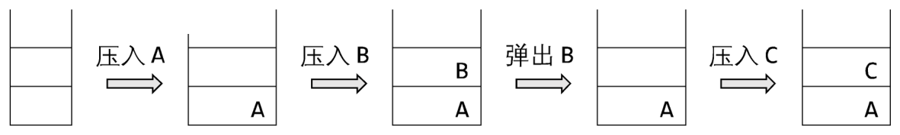

# 2020 CCF 非专业级别软件能力认证第一轮（CSP-J）入门级 C++语言试题

认证时间：2020 年 10 月 11 日 14:30~16:30

考生注意事项：

- 试题纸共有 10 页，答题纸共有 1 页，满分 100 分。请在答题纸上作答，写在试题纸上的一律无效。
- 不得使用任何电子设备（如计算器、手机、电子词典等）或查阅任何书籍资料。

## 一、单项选择题

> 共 15 题，每题 2 分，共计 30 分；每题有且仅有一个正确选项。

### 第 1 题

<!-- qid: csp-j1-2020-001 | type: single_choice | score: 2 | answer: A | tags: topic:basics -->

在内存储器中每个存储单元都被赋予一个唯一的序号，称为（ ）。

- A. 地址
- B. 序号
- C. 下标
- D. 编号

> **题解**
> 答案：A
> 解释：内存储器由大量存储单元组成，为了能单独定位每一个单元，给每个单元编一个唯一的序号，这个序号就叫地址，CPU 靠它读写指定的单元。B 项「序号」与 D 项「编号」都只是泛称，不是内存单元这一序号的专门名称；C 项「下标」指的是数组元素在数组里的相对位置，与存储单元的编号不是一回事。故选 A。

### 第 2 题

<!-- qid: csp-j1-2020-002 | type: single_choice | score: 2 | answer: A | tags: topic:basics -->

编译器的主要功能是（ ）。

- A. 将源程序翻译成机器指令代码
- B. 将源程序重新组合
- C. 将低级语言翻译成高级语言
- D. 将一种高级语言翻译成另一种高级语言

> **题解**
> 答案：A
> 解释：编译器的作用是把用高级语言写的源程序整体翻译成目标程序，也就是机器指令代码，选 A。B 项「将源程序重新组合」不是编译器的职责描述；C 项方向恰好反了——把低级语言翻译成高级语言是反编译；D 项「一种高级语言翻译成另一种高级语言」是转译，也不属于编译器的定义。

### 第 3 题

<!-- qid: csp-j1-2020-003 | type: single_choice | score: 2 | answer: D | tags: topic:lang -->

设 `x=true, y=true, z=false`，以下逻辑运算表达式值为真的是（ ）。

- A. (y∨z)∧x∧z
- B. x∧(z∨y)∧z
- C. (x∧y)∧z
- D. (x∧y)∨(z∨x)

> **题解**
> 答案：D
> 解释：逐项把 x = true、y = true、z = false 代进去算：A 项 (y∨z)∧x∧z = (T∨F)∧T∧F = F；B 项 x∧(z∨y)∧z = T∧(F∨T)∧F = F；C 项 (x∧y)∧z = T∧F = F；D 项 (x∧y)∨(z∨x) = T∨(F∨T) = T。只有 D 的值为真，故选 D。

### 第 4 题

<!-- qid: csp-j1-2020-004 | type: single_choice | score: 2 | answer: C | tags: topic:basics -->

现有一张分辨率为 2048×1024 像素的 32 位真彩色图像。请问要存储这张图像，需要多大的存储空间？（ ）。

- A. 16MB
- B. 4MB
- C. 8MB
- D. 32MB

> **题解**
> 答案：C
> 解释：32 位真彩色就是每个像素占 32 bit，即 4 字节。像素总数 2048 × 1024 = 2¹¹ × 2¹⁰ = 2²¹，乘 4 字节得 2²³ = 8 388 608 字节，正好 8 MB，选 C。A 项 16MB 相当于按每像素 64 位算，D 项 32MB 按每像素 128 位算，B 项 4MB 只有每像素 16 位，都与题面的 32 位不符。

### 第 5 题

<!-- qid: csp-j1-2020-005 | type: single_choice | score: 2 | answer: C | tags: feat:formula,topic:sort -->

冒泡排序算法的伪代码如下：

```
输入：数组 L, n ≥ 1。输出：按非递减顺序排序的 L。
算法 BubbleSort：
1.  FLAG ← n        //标记被交换的最后元素位置
2.  while FLAG > 1 do
3.      k ← FLAG - 1
4.      FLAG ← 1
5.      for j = 1 to k do
6.          if L(j) > L(j+1) then do
7.              L(j) ↔ L(j+1)
8.              FLAG ← j
```

对 $n$ 个数用以上冒泡排序算法进行排序，**最少**需要比较多少次？（ ）。

- A. $n^2$
- B. $n-2$
- C. $n-1$
- D. $n$

> **题解**
> 答案：C
> 解释：这份伪代码里的 FLAG 记「最后一次交换发生的位置」，若某一趟一次都没交换，FLAG 就一直留在 1，while 的条件 FLAG > 1 不成立，排序立刻收工。所以比较次数最少的情形是输入本来就已有序：第一趟做 k = n − 1 次比较、不做任何交换，就此结束，共 n − 1 次。照这份伪代码把全部排列跑一遍取最小值，n = 1 到 7 分别得 0、1、2、3、4、5、6，正是 n − 1，选 C。A 项 n² 是常规冒泡的比较次数上界，D 项 n 比正确值多 1，B 项 n − 2 则把那一趟少算了一次。

### 第 6 题

<!-- qid: csp-j1-2020-006 | type: single_choice | score: 2 | answer: B | tags: feat:formula,topic:divide -->

设 $A$ 是 $n$ 个实数的数组，考虑下面的递归算法：

```
XYZ (A[1..n])
1.  if  n=1 then return A[1]
2.  else    temp ← XYZ (A[1..n-1])
3.          if  temp < A[n]
4.          then return  temp
5.          else return  A[n]
```

请问算法 XYZ 的输出是什么？（ ）。

- A. $A$ 数组的平均
- B. $A$ 数组的最小值
- C. $A$ 数组的中值
- D. $A$ 数组的最大值

> **题解**
> 答案：B
> 解释：递归的返回值是「前 n − 1 个元素的最小值」与「第 n 个元素」中较小的那个：n = 1 时直接返回 A[1]，规模更大时先用递归求出前 n − 1 个的最小值，再与 A[n] 比一次并保留较小者。逐层这样扩展下去，最后得到的就是整个数组的最小值，选 B。A 项平均、C 项中值、D 项最大值都不符合「每层只取较小者」这一行为——程序里没有任何求和、排序或取较大值的操作。

### 第 7 题

<!-- qid: csp-j1-2020-007 | type: single_choice | score: 2 | answer: A | tags: topic:ds -->

链表不具有的特点是（ ）。

- A. 可随机访问任一元素
- B. 不必事先估计存储空间
- C. 插入删除不需要移动元素
- D. 所需空间与线性表长度成正比

> **题解**
> 答案：A
> 解释：链表靠指针把结点串起来，要取第 k 个结点只能从表头出发走 k − 1 步，只能顺序访问，不能像数组那样按下标直接定位，所以「可随机访问任一元素」不是链表的特点，选 A。B、C、D 三项都是链表的真实优点：空间按需分配、与表长成正比；插入删除只改指针、不必移动元素；不必事先估计存储空间。

### 第 8 题

<!-- qid: csp-j1-2020-008 | type: single_choice | score: 2 | answer: A | tags: topic:graph -->

有 10 个顶点的无向图**至少**应该有（ ）条边才能确保是一个连通图。

- A. 9
- B. 10
- C. 11
- D. 12

> **题解**
> 答案：A
> 解释：连通图的边数最少时它恰好是一棵树：从一个顶点出发，每接入一个新顶点至少要多一条边，10 个顶点要全部接上就得接入 9 个新顶点，故至少 9 条边就够；反过来 9 条边时正好是一棵生成树，少一条必然出现孤立顶点。所以「至少」应为 9，选 A。B、C、D 三项的边数都比 9 多，不可能是最少的那个值。

### 第 9 题

<!-- qid: csp-j1-2020-009 | type: single_choice | score: 2 | answer: A | tags: topic:number -->

二进制数 1011 转换成十进制数是（ ）。

- A. 11
- B. 10
- C. 13
- D. 12

> **题解**
> 答案：A
> 解释：把二进制数按权展开相加：1011 的四个位从高到低是 2³、2²、2¹、2⁰ 位，各位数字为 1、0、1、1，于是 1 × 8 + 0 × 4 + 1 × 2 + 1 × 1 = 8 + 2 + 1 = 11，选 A。B 项 10、C 项 13、D 项 12 与这个和都不相等，逐位加全只有 11 一种结果。

### 第 10 题

<!-- qid: csp-j1-2020-010 | type: single_choice | score: 2 | answer: A | tags: topic:combinatorics -->

五个小朋友并排站成一列，其中有两个小朋友是双胞胎，如果要求这两个双胞胎必须相邻，则有（ ）种不同排列方法？

- A. 48
- B. 36
- C. 24
- D. 72

> **题解**
> 答案：A
> 解释：把必须相邻的两个双胞胎捆成一个整体，它再与另外 3 个小朋友一起排，共 4 个「单元」，有 4! = 24 种排法；双胞胎内部两人还可以左右互换，又有 2! = 2 种。总数 24 × 2 = 48，选 A。C 项 24 恰好就是 4!，漏掉了内部的 2 种互换；D 项 72 = 24 × 3、B 项 36 = 24 × 1.5，都与捆绑法的因子对不上。

### 第 11 题

<!-- qid: csp-j1-2020-011 | type: single_choice | score: 2 | answer: A | images: q011-fig1.png | tags: feat:figure,topic:ds -->

下图中所使用的数据结构是（ ）。



- A. 栈
- B. 队列
- C. 二叉树
- D. 哈希表

> **题解**
> 答案：A
> 解释：图中依次是「压入 A」「压入 B」「弹出 B」「压入 C」：后压进去的 B 反而先被弹出，正是后进先出，所以这种数据结构是栈，选 A。队列是先进先出，弹出的就该是最先压入的 A，与图不符；C 项二叉树与 D 项哈希表都不存在「压入／弹出同一端」这种按顺序进出的行为。

### 第 12 题

<!-- qid: csp-j1-2020-012 | type: single_choice | score: 2 | answer: D | tags: topic:tree -->

独根树的高度为 1。具有 61 个结点的完全二叉树的高度为（ ）。

- A. 7
- B. 8
- C. 5
- D. 6

> **题解**
> 答案：D
> 解释：高度为 h 的完全二叉树最多有 2ʰ − 1 个结点（此时是满二叉树）。2⁵ − 1 = 31 < 61，说明 5 层装不下 61 个结点；2⁶ − 1 = 63 ≥ 61，6 层装得下，而且完全二叉树必须占满前 5 层才会长到第 6 层，所以高度是 6，选 D。C 项 5 层最多只放 31 个结点，A 项 7 层对应上界 2⁷ − 1 = 127，B 项 8 更大。

### 第 13 题

<!-- qid: csp-j1-2020-013 | type: single_choice | score: 2 | answer: C | tags: feat:table,topic:number -->

干支纪年法是中国传统的纪年方法，由 10 个天干和 12 个地支组合成 60 个天干地支。由公历年份可以根据以下公式和表格换算出对应的天干地支。

**天干 =（公历年份）除以 10 所得余数**
**地支 =（公历年份）除以 12 所得余数**

| 天干 | 甲 | 乙 | 丙 | 丁 | 戊 | 己 | 庚 | 辛 | 壬 | 癸 |  |  |
|---|---|---|---|---|---|---|---|---|---|---|---|---|
|  | 4 | 5 | 6 | 7 | 8 | 9 | 0 | 1 | 2 | 3 |  |  |
| 地支 | 子 | 丑 | 寅 | 卯 | 辰 | 巳 | 午 | 未 | 申 | 酉 | 戌 | 亥 |
|  | 4 | 5 | 6 | 7 | 8 | 9 | 10 | 11 | 0 | 1 | 2 | 3 |

例如，今年是 2020 年，2020 除以 10 余数为 0，查表为“庚”；2020 除以 12，余数为 4，查表为“子”，所以今年是庚子年。

请问 1949 年的天干地支是（ ）

- A. 己酉
- B. 己亥
- C. 己丑
- D. 己卯

> **题解**
> 答案：C
> 解释：1949 除以 10 余 9，查天干表得「己」；1949 除以 12 得 12 × 162 = 1944，余 5，查地支表得「丑」，合起来是「己丑」，选 C。用题面自己给的例子验一遍方法：2020 除以 10 余 0 查得「庚」、除以 12 余 4 查得「子」，正是庚子，说明查表方向没弄反。A 项「酉」对应余数 9、B 项「亥」对应 11、D 项「卯」对应 6，都不是 1949 除以 12 的余数 5。

### 第 14 题

<!-- qid: csp-j1-2020-014 | type: single_choice | score: 2 | answer: A | tags: topic:combinatorics -->

10 个三好学生名额分配到 7 个班级，每个班级至少有一个名额，一共有（ ）种不同的分配方案。

- A. 84
- B. 72
- C. 56
- D. 504

> **题解**
> 答案：A
> 解释：每个班至少 1 个名额，先给 7 个班各分 1 个，还剩 10 − 7 = 3 个名额可以任意分给这 7 个班（同一个班还能再得多个）。用隔板法数这种分法：C(3 + 7 − 1, 7 − 1) = C(9, 6) = 84，等价写法是 C(10 − 1, 7 − 1) = C(9, 6)，选 A。C 项 56 = C(8, 3)，相当于误以为剩下那 3 个名额每班至多再得一个；D 项 504 是 56 的 9 倍，量级偏大；B 项 72 不是 84 的分解。

### 第 15 题

<!-- qid: csp-j1-2020-015 | type: single_choice | score: 2 | answer: A | tags: topic:combinatorics -->

有五副不同颜色的手套（共 10 只手套，每副手套左右手各 1 只），一次性从中取 6 只手套，请问恰好能配成两副手套的不同取法有（ ）种。

- A. 120
- B. 180
- C. 150
- D. 30

> **题解**
> 答案：A
> 解释：恰好配成两副手套，就是先完整取走 2 副（左右手都取），再从剩下的 3 副里挑 2 副各取一只，且这两只不能来自同一副（否则会多出第三副）。完整 2 副的选法 C(5, 2) = 10；剩下部分先选哪 2 副各出一只，C(3, 2) = 3，每副出左手还是右手有 2 种，共 3 × 2² = 12。总数 10 × 12 = 120，选 A。D 项 30 = 10 × 3，正好漏乘了左右手的 2² = 4；B 项 180 与 C 项 150 都不是 120 的正确分解。

## 二、阅读程序

> 程序输入不超过数组或字符串定义的范围；判断题正确填 √，错误填 ×；除特殊说明外，判断题 1.5 分，选择题 3 分，共计 40 分。

### (1)

<!-- group: 阅读程序(1) -->

```cpp
 01  #include <cstdlib>
 02  #include <iostream>
 03  using namespace std;
 04
 05  char encoder[26] = {'C', 'S', 'P', 0};
 06  char decoder[26];
 07
 08  string st;
 09
 10  int main() {
 11    int k = 0;
 12    for (int i = 0; i < 26; ++i)
 13      if (encoder[i] != 0) ++k;
 14    for (char x = 'A'; x <= 'Z'; ++x) {
 15      bool flag = true;
 16      for (int i = 0; i < 26; ++i)
 17        if (encoder[i] == x) {
 18          flag = false;
 19          break;
 20        }
 21      if (flag) {
 22        encoder[k] = x;
 23        ++k;
 24      }
 25    }
 26    for (int i = 0; i < 26; ++i)
 27      decoder[encoder[i] - 'A'] = i + 'A';
 28    cin >> st;
 29    for (int i = 0; i < st.length(); ++i)
 30      st[i] = decoder[st[i] - 'A'];
 31    cout << st;
 32    return 0;
 33  }
```

> **程序说明**
> 这段程序做的是一张 26 个字母的替换表：先把 `C`、`S`、`P` 摆在前三位、其余字母按字母序接在后面组成 `encoder`，再用 `decoder[encoder[i] - 'A'] = i + 'A'` 把这张表反过来填进 `decoder`，最后读入一个不含空白的字符串，逐字符换成 `decoder` 里对应的字母输出。输入是一个字符串，输出是同长度的字符串。理解这一组要抓住两点：一是它只是逐字符替换，而且 `encoder` 与 `decoder` 互为逆表，所以「输入与输出是否一定不同」取决于表里有没有不动点（`T` 到 `Z` 恰好都是不动点）；二是 `decoder` 的下标由 `st[i] - 'A'` 算出，只有大写字母才落在 0 到 25 之内，其它字符会越界。第 12 行与第 26 行的循环上界分别决定「数出几个已占位字母」和「登记几个字母」，改动它们后果不同。

#### 判断题

##### 第 16 题

<!-- qid: csp-j1-2020-016 | type: true_false | score: 1.5 | answer: T | tags: topic:string -->

输入的字符串应当只由大写字母组成，否则在访问数组时**可能**越界。（ ）

> **题解**
> 答案：√
> 解释：第 30 行把每个字符当作 `decoder[st[i] - 'A']` 的下标用，而 `decoder` 只有 26 个元素，合法下标是 0 到 25。小写字母 `'a'` 算出 `'a' - 'A'` = 32，已经超出 25，程序会读到数组之外；数字与符号算出来的值同样不在范围内。所以「输入应当只由大写字母组成，否则在访问数组时可能越界」成立，填 √。实测把 `'a' - 'A'` 的值打出来就是 32，而 `sizeof decoder` 是 26 字节。

##### 第 17 题

<!-- qid: csp-j1-2020-017 | type: true_false | score: 1.5 | answer: F | tags: topic:string -->

若输入的字符串不是空串，则输入的字符串与输出的字符串**一定不**一样。（ ）

> **题解**
> 答案：×
> 解释：程序做的是按 `encoder`／`decoder` 这对互逆的表逐字符替换，而这张表里有不动点：`T`、`U`、`V`、`W`、`X`、`Y`、`Z` 恰好换回去还是自己。有非空输入使输出与输入相同，「不是空串就一定不一样」自然不成立，填 ×。实跑输入 `T` 输出 `T`、输入 `U` 输出 `U`，都是反例。故主张为假。

##### 第 18 题

<!-- qid: csp-j1-2020-018 | type: true_false | score: 1.5 | answer: T | tags: feat:lineref,topic:string -->

将第 12 行的 `i < 26` 改为 `i < 16`，程序运行结果**不会**改变。（ ）

> **题解**
> 答案：√
> 解释：第 12 行所在循环的作用只是数一数 `encoder` 里已经排好的字母有几个：`encoder[i] != 0` 就 ++k。而 `encoder` 的前 3 项是 `C`、`S`、`P`，第 4 项起是 0，上界从 26 缩到 16 照样能扫到前 3 个非零项并停在 k = 3。后面给 `decoder` 填表的过程与这个上界无关，输出不变，填 √。实跑对比 235 组输入，改前改后差异 0 组。

##### 第 19 题

<!-- qid: csp-j1-2020-019 | type: true_false | score: 1.5 | answer: F | tags: feat:lineref,topic:string -->

将第 26 行的 `i < 26` 改为 `i < 16`，程序运行结果**不会**改变。（ ）

> **题解**
> 答案：×
> 解释：第 26 行 `decoder[encoder[i] - 'A'] = i + 'A';` 要负责把 26 个字母全部登记进 `decoder`，上界从 26 改成 16 后只填了前 16 项，剩下的 10 项仍是全局数组的初值 0，凡是用到这些下标的字符都会被换成空字节 `'\0'`。实跑对比 235 组输入，有 206 组输出不同，例如原本该输出 `Q` 的位置变成了空字节。故主张不成立，填 ×。

#### 单选题

##### 第 20 题

<!-- qid: csp-j1-2020-020 | type: single_choice | score: 3 | answer: A | tags: topic:string -->

若输出的字符串为“ABCABCA”，则下列说法**正确**的是（ ）。

- A. 输入的字符串中既有 S 又有 P
- B. 输入的字符串中既有 S 又有 B
- C. 输入的字符串中既有 A 又有 P
- D. 输入的字符串中既有 A 又有 B

> **题解**
> 答案：A
> 解释：由 `decoder[encoder[i] - 'A'] = i + 'A'` 可知，输出字母 `A`、`B`、`C` 分别来自输入字符 `encoder[0]`、`encoder[1]`、`encoder[2]`，也就是 `C`、`S`、`P`。输出 `ABCABCA` 里 `A`、`B`、`C` 三种字符都出现了，所以输入里必然同时含有 `C`、`S`、`P`，即「既有 S 又有 P」，选 A。实跑输入 `CSPCSPC` 确实得到 `ABCABCA`。B、C、D 三项都要求输入含 `A` 或 `B`，而输出里的 `A`、`B` 只能由输入 `C`、`S` 换出来，故都不成立。

##### 第 21 题

<!-- qid: csp-j1-2020-021 | type: single_choice | score: 3 | answer: D | tags: topic:string -->

若输出的字符串为“CSPCSPCSPCSP”，则下列说法**正确**的是（ ）。

- A. 输入的字符串中既有 P 又有 K
- B. 输入的字符串中既有 J 又有 R
- C. 输入的字符串中既有 J 又有 K
- D. 输入的字符串中既有 P 又有 R

> **题解**
> 答案：D
> 解释：同理，输出 `C` 只能来自输入 `encoder[2]` 即 `P`，输出 `S` 来自 `encoder[18]` 即 `R`，输出 `P` 来自 `encoder[15]` 即 `N`。输出 `CSPCSPCSPCSP` 三种字符齐备，输入里就必然同时含有 `P` 和 `R`（还会含 `N`），选 D。实跑输入 `PRNPRNPRNPRN` 输出正是 `CSPCSPCSPCSP`。A 项与 C 项要求输入含 `K`、B 项要求含 `J`，而输出只用到了三个字母，对应不上这两个字符。

### (2)

<!-- group: 阅读程序(2) -->

```cpp
 01  #include <iostream>
 02  using namespace std;
 03
 04  long long n, ans;
 05  int k, len;
 06  long long d[1000000];
 07
 08  int main() {
 09    cin >> n >> k;
 10    d[0] = 0;
 11    len = 1;
 12    ans = 0;
 13    for (long long i = 0; i < n; ++i) {
 14      ++d[0];
 15      for (int j = 0; j + 1 < len; ++j) {
 16        if (d[j] == k) {
 17          d[j] = 0;
 18          d[j + 1] += 1;
 19          ++ans;
 20        }
 21      }
 22      if (d[len - 1] == k) {
 23        d[len - 1] = 0;
 24        d[len] = 1;
 25        ++len;
 26        ++ans;
 27      }
 28    }
 29    cout << ans << endl;
 30    return 0;
 31  }
```

**假设输入的 $n$ 是不超过 $2^{62}$ 的正整数，$k$ 都是不超过 10000 的正整数，完成下面的判断题和单选题：**

> **程序说明**
> 这段程序在用数组 `d` 模拟一个 k 进制计数器：`d[0]` 是最低位，`len` 是当前位数；外层循环执行 n 次，每次给 `d[0]` 加 1，内层从低位往高位扫一遍，遇到 `d[j] == k` 就把这一位清零、向高位进 1，并把进位次数记进 `ans`，末尾再补一次最高位的检查。输入是两个正整数 n 和 k，输出 `ans`，也就是「从 0 一直加到 n」在 k 进制下发生的进位总次数。理解这一组要抓住三点：`len` 表示 n 在 k 进制下的位数；k = 1 时程序退化成每轮恰好进位一次、`ans` 恰好等于 n；k ≥ 2 时进位总数有闭式 Σ⌊n/kᵗ⌋（t 取 1、2、…），题目给出的几个大数量级只能用这个闭式算。

#### 判断题

##### 第 22 题

<!-- qid: csp-j1-2020-022 | type: true_false | score: 1.5 | answer: F | tags: topic:number -->

若 `k=1`，则输出 `ans` 时，`len=n`。（ ）

> **题解**
> 答案：×
> 解释：`d` 是计数器的各位（`d[0]` 是最低位），`len` 是当前位数，外层每轮给 `d[0]` 加 1。k = 1 时程序退化成每轮恰好进位一次，位数也随之外扩：n = 1 时 `len` 就到 2，n = 3 时 `len` 是 2，都不等于 n。实跑 k = 1、n = 1 到 12，`len` 一律是 2，与 n 全不相等。故主张不成立，填 ×。

##### 第 23 题

<!-- qid: csp-j1-2020-023 | type: true_false | score: 1.5 | answer: F | tags: feat:formula,topic:number -->

若 `k>1`，则输出 `ans` 时，`len` 一定小于 $n$。（ ）

> **题解**
> 答案：×
> 解释：`len` 表示 n 在 k 进制下的位数，而位数完全可能不小于 n：n = 1 在任意 k > 1 下都只有 1 位，`len` = 1 = n；n = 2、k = 2 时 2 写成二进制是 `10`，共两位，`len` = 2 = n。实跑扫遍 k = 2 到 5、n = 1 到 39，满足 `len >= n` 的反例有 (1, 2)、(2, 2)、(1, 3)、(1, 4)、(1, 5) 等多组。故「一定小于 n」不成立，填 ×。

##### 第 24 题

<!-- qid: csp-j1-2020-024 | type: true_false | score: 1.5 | answer: T | tags: feat:formula,topic:number -->

若 `k>1`，则输出 `ans` 时，$k^{len}$ 一定大于 $n$。（ ）

> **题解**
> 答案：√
> 解释：`len` 恰是 n 在 k 进制下的位数，由位数的意义就有 k^(len−1) ≤ n < k^len，右边这个严格不等号说明 k^len 一定大于 n（n 若等于 k^len，位数就要多一位）。例如 n = 3³⁰ 写成三进制是 1 后面跟 30 个 0，共 31 位，k^len = 3³¹ > 3³⁰。实跑扫遍 k = 2 到 5、n = 1 到 3999，`k^len <= n` 的反例一个也没有。故主张成立，填 √。

#### 单选题

##### 第 25 题

<!-- qid: csp-j1-2020-025 | type: single_choice | score: 3 | answer: D | tags: feat:formula,topic:number -->

若输入的 $n$ 等于 $10^{15}$，输入的 $k$ 为 1，则输出等于（ ）。

- A. 1
- B. $(10^{30}-10^{15})/2$
- C. $(10^{30}+10^{15})/2$
- D. $10^{15}$

> **题解**
> 答案：D
> 解释：k = 1 时内层的条件 `d[j] == k` 就是 `d[j] == 1`，而每轮 `++d[0]` 恰好把 `d[0]` 变成 1，于是每轮都在内层被命中一次：`ans` 每轮加 1，`d[1]` 则一路涨到 n 却再也遇不到 1。所以 `ans` 恰好等于 n，n = 10¹⁵ 时输出就是 10¹⁵，选 D。实跑 k = 1、n = 1 到 12，输出逐一是 1、2、…、12，与 n 完全相等。A 项 1 只在 n = 1 时才成立，B、C 两项是 k ≥ 2 时才会出现的量级。

##### 第 26 题

<!-- qid: csp-j1-2020-026 | type: single_choice | score: 3 | answer: B | tags: feat:formula,topic:number -->

若输入的 $n$ 等于 205,891,132,094,649（即 $3^{30}$），输入的 $k$ 为 3，则输出等于（ ）。

- A. $3^{30}$
- B. $(3^{30}-1)/2$
- C. $3^{30}-1$
- D. $(3^{30}+1)/2$

> **题解**
> 答案：B
> 解释：程序统计的是「从 0 一直加到 n」在 k 进制下发生的进位总次数，闭式为 ans = Σ⌊n/kᵗ⌋（t 取 1、2、…）。n = 3³⁰、k = 3 时每一项 ⌊3³⁰/3ᵗ⌋ = 3^(30−t)，相加得 3²⁹ + 3²⁸ + … + 3⁰ = (3³⁰ − 1)/(3 − 1) = (3³⁰ − 1)/2 = 102 945 566 047 324，选 B。A 项 3³⁰ 是 n 本身，相当于一次进位都不算；C 项 3³⁰ − 1 正是正确答案的 2 倍；D 项把减号写成了加号。

##### 第 27 题

<!-- qid: csp-j1-2020-027 | type: single_choice | score: 3 | answer: D | tags: feat:formula,topic:number -->

若输入的 $n$ 等于 100,010,002,000,090，输入的 $k$ 为 10，则输出等于（ ）。

- A. 11,112,222,444,543
- B. 11,122,222,444,453
- C. 11,122,222,444,543
- D. 11,112,222,444,453

> **题解**
> 答案：D
> 解释：同样用闭式 ans = Σ⌊n/10ᵗ⌋。n = 100 010 002 000 090，把除以 10¹ 到 10¹⁴ 的商逐项相加：10001000200009 + 1000100020000 + … + 10 + 1 = 11 112 222 444 453，选 D。A 项与 D 项只差末三位（A 是 `543`，正确是 `453`），B 项与 C 项把第二组数字写成 `12` 而正确值是 `11`——四个选项的差别都落在数字位上，逐位相加就能排除。

### (3)

<!-- group: 阅读程序(3) -->

```cpp
 01  #include <algorithm>
 02  #include <iostream>
 03  using namespace std;
 04
 05  int n;
 06  int d[50][2];
 07  int ans;
 08
 09  void dfs(int n, int sum) {
 10    if (n == 1) {
 11      ans = max(sum, ans);
 12      return;
 13    }
 14    for (int i = 1; i < n; ++i) {
 15      int a = d[i - 1][0], b = d[i - 1][1];
 16      int x = d[i][0], y = d[i][1];
 17      d[i - 1][0] = a + x;
 18      d[i - 1][1] = b + y;
 19      for (int j = i; j < n - 1; ++j)
 20        d[j][0] = d[j + 1][0], d[j][1] = d[j + 1][1];
 21      int s = a + x + abs(b - y);
 22      dfs(n - 1, sum + s);
 23      for (int j = n - 1; j > i; --j)
 24        d[j][0] = d[j - 1][0], d[j][1] = d[j - 1][1];
 25      d[i - 1][0] = a, d[i - 1][1] = b;
 26      d[i][0] = x, d[i][1] = y;
 27    }
 28  }
 29
 30  int main() {
 31    cin >> n;
 32    for (int i = 0; i < n; ++i)
 33      cin >> d[i][0];
 34    for (int i = 0; i < n; ++i)
 35      cin >> d[i][1];
 36    ans = 0;
 37    dfs(n, 0);
 38    cout << ans << endl;
 39    return 0;
 40  }
```

**假设输入的 $n$ 是不超过 50 的正整数，`d[i][0]`、`d[i][1]` 都是不超过 10000 的正整数，完成下面的判断题和单选题：**

> **程序说明**
> 这段程序用深度优先搜索枚举「把 n 个块两两合并成一块」的所有顺序：每个块有两个属性（读入时先给全部 `d[i][0]`，再给全部 `d[i][1]`），合并相邻两块时把两块的属性分别相加，代价记作「两块 `d[...][0]` 之和加上两块 `d[...][1]` 之差的绝对值」，递归到只剩一块时用 `ans` 记下所有顺序里总代价的最大值。输入是 n 与两行整数，输出就是这个最大总代价。理解这一组要抓住两点：代价只依赖被合并两块的和，所以合并顺序不同结果就不同，要求精确值得用区间动态规划（原程序是 (n−1)! 条分支的暴搜，大 n 跑不动）；判断「输出与输入值的大小关系」「全 0 输入输出什么」这类命题时，只要盯住代价公式里 `abs(b - y)` 那一项就够了。

#### 判断题

##### 第 28 题

<!-- qid: csp-j1-2020-028 | type: true_false | score: 1.5 | answer: F | tags: feat:formula,topic:search -->

若输入 $n$ 为 0，此程序**可能**会死循环或发生运行错误。（ ）

> **题解**
> 答案：×
> 解释：n = 0 时 main 里两个读入数组的循环一次也不执行，接着调用 `dfs(0, 0)`：函数内 `n == 1` 不成立，随后那个 `for (int i = 1; i < 0; ++i)` 也不执行，函数直接返回，`ans` 保持 0 输出。整个过程正常结束，既不会死循环也不会越界。实跑输入 `0`，程序输出 `0`、正常退出。故主张不成立，填 ×。

##### 第 29 题

<!-- qid: csp-j1-2020-029 | type: true_false | score: 1.5 | answer: T | tags: feat:formula,topic:search -->

若输入 $n$ 为 20，接下来的输入全为 0，则输出为 0。（ ）

> **题解**
> 答案：√
> 解释：每步合并的代价是 `s = a + x + abs(b - y)`。输入全为 0 时每个块的 `d[i][0]` 与 `d[i][1]` 都是 0，合并后新块的两个和仍然都是 0，所以每一步的代价都是 0 + 0 + |0 − 0| = 0，递归到只剩一块时 `ans` 仍是初值。程序是 (n−1)! 条分支的暴搜，实跑 n = 8 与 n = 13 的全 0 输入输出都是 `0`，n = 14 起 25 秒内不返回；用区间 DP 算 n = 20、全 0 同样是 0。故主张成立，填 √。

##### 第 30 题

<!-- qid: csp-j1-2020-030 | type: true_false | score: 1.5 | answer: F | tags: topic:search -->

输出的数**一定不**小于输入的 `d[i][0]` 和 `d[i][1]` 的任意一个。（ ）

> **题解**
> 答案：×
> 解释：`ans` 累加的是合并代价，与输入值本身没有必然的大小关系。最小反例取 n = 1：`dfs` 第一句就判定 `n == 1`，用 `ans = max(0, 0)` 结束，输出 0，而输入的 `d[i][0]` 与 `d[i][1]` 都是 5，0 < 5。实跑输入 `1`、`5`、`5` 输出 `0`。故「输出的数一定不小于输入的任一值」不成立，填 ×。

#### 单选题

##### 第 31 题

<!-- qid: csp-j1-2020-031 | type: single_choice | score: 3 | answer: B | tags: feat:formula,topic:search -->

若输入的 $n$ 为 20，接下来的输入是 20 个 9 和 20 个 0，则输出为（ ）。

- A. 1890
- B. 1881
- C. 1908
- D. 1917

> **题解**
> 答案：B
> 解释：这组输入的 `d[i][0]` 全为 9、`d[i][1]` 全为 0，每一步的代价就只剩 x 侧：`s = 9 × (块1大小) + 9 × (块2大小) + 0 = 9 × 两块大小之和`。要让总和最大，就让每次合并都是「已经合并出来的大块」再吸收右边一个单元素块，合并后的大小依次是 2、3、…、20，总代价 9 × (2 + 3 + … + 20) = 9 × 209 = 1881，选 B。A 项 1890、C 项 1908、D 项 1917 与 1881 只差几十，靠估算是分不出来的，得把 209 算准。

##### 第 32 题

<!-- qid: csp-j1-2020-032 | type: single_choice | score: 3 | answer: C | tags: feat:formula,topic:search -->

若输入的 $n$ 为 30，接下来的输入是 30 个 0 和 30 个 5，则输出为（ ）。

- A. 2000
- B. 2010
- C. 2030
- D. 2020

> **题解**
> 答案：C
> 解释：这组输入的 `d[i][0]` 全为 0、`d[i][1]` 全为 5，代价只剩 y 侧：`s = |5 × 块1大小 − 5 × 块2大小| = 5 × 两块大小之差`（x 侧的和为 0）。先把两个单元素块合并（大小之差为 0、代价也是 0），再把这个越来越大的块依次吸收单元素块，大小差依次为 1、2、…、28，总代价 5 × (1 + 2 + … + 28) = 5 × 406 = 2030，选 C。A 项 2000、B 项 2010、D 项 2020 都比这个最大值小，只有把 406 算准才能选对。

##### 第 33 题

<!-- qid: csp-j1-2020-033 | type: single_choice | score: 4 | answer: C | tags: feat:formula,topic:search -->

（4 分）若输入的 $n$ 为 15，接下来的输入是 15 到 1，以及 15 到 1，则输出为（ ）。

- A. 2440
- B. 2220
- C. 2240
- D. 2420

> **题解**
> 答案：C
> 解释：两个数组完全相同，都是 15、14、…、1，所以合并两块的代价 `s = (S₁ + S₂) + |S₁ − S₂| = 2 × max(S₁, S₂)`，就是两块元素和里较大者的两倍。这一族输入的输出有明显规律：把 n ≤ 13 的实测值排出来是 0、4、16、40、80、140、224、336、480、660、880、1144、1456，恰好满足 2n(n + 1)(n − 1)/3，代入 n = 15 得 2 × 15 × 16 × 14 ÷ 3 = 2240，选 C。同一结果也用原程序把 14! 条合并顺序穷举过，同样是 2240。

## 三、完善程序

> 单选题，每小题 3 分，共计 30 分。

### (1)

<!-- group: 完善程序(1) -->

（质因数分解）给出正整数 $n$，请输出将 $n$ 质因数分解的结果，结果从小到大输出。

例如：输入 `n=120`，程序应该输出 2 2 2 3 5，表示 $120=2\times 2\times 2\times 3\times 5$。输入保证 $2\le n\le 10^9$。提示：先从小到大枚举变量 $i$，然后用 $i$ 不停试除 $n$ 来寻找所有的质因子。

试补全程序。

```cpp
 01  #include <cstdio>
 02  using namespace std;
 03
 04  int n, i;
 05
 06  int main() {
 07    scanf("%d", &n);
 08    for(i = ①; ② <= n; i ++) {
 09      ③ {
 10        printf("%d ", i);
 11        n = n / i;
 12      }
 13    }
 14    if(④)
 15      printf("%d ", ⑤);
 16    return 0;
 17  }
```

> **程序说明**
> 这段程序对输入的正整数 n 做质因数分解，并把质因子从小到大输出。做法是从 2 开始枚举 i：只要 `i * i <= n` 就检查 i 能否整除 n，能整除就用 `while` 反复除、每除一次打印一个 i（同一个质因子出现几次就打印几次），除不动了再换下一个 i；循环结束时若 n 还大于 1，说明剩下的 n 本身就是一个大于根号 n 的质因子，最后补打印它。输入保证 2 ≤ n ≤ 10⁹，输出是一串递增的质因子，例如 120 输出 `2 2 2 3 5`。理解这一组要抓住三点：试除只需枚举到根号 n（循环结束后至多剩一个质因子）、同一个质因子要用 `while` 除干净、末尾那次补打印不能少。

##### 第 34 题

<!-- qid: csp-j1-2020-034 | type: single_choice | score: 3 | answer: C | tags: feat:circnum,topic:number -->

①处应填（ ）

- A. `1`
- B. `n - 1`
- C. `2`
- D. `0`

> **题解**
> 答案：C
> 解释：质因数要从最小的质数 2 开始试除，故 ① 填 `2`。若填 `1`，`n % 1 == 0` 恒成立、`n = n / 1` 又不改变 n，程序会一直打印 1 停不下来；若填 `0`，`n % 0` 是整数除以零，程序直接崩溃；若填 `n - 1`，条件 `(n-1)² <= n` 对 n ≥ 3 不成立，循环一次也不跑，结果只打印 n 本身（实跑 n = 120 输出 `120`）。实跑把 5 个空全量代入 1024 种组合、各喂 32 组输入，只有从 2 起步的这一支能全部得到正确分解式。

##### 第 35 题

<!-- qid: csp-j1-2020-035 | type: single_choice | score: 3 | answer: C | tags: feat:circnum,topic:number -->

②处应填（ ）

- A. `n / i`
- B. `n / (i * i)`
- C. `i * i`
- D. `i * i * i`

> **题解**
> 答案：C
> 解释：② 是循环条件 `② <= n`，要表达的是「i 只试到根号 n」，写成 `i * i` 就是 i² ≤ n，即 i ≤ √n。之所以到根号 n 就够：若 n 有因子大于 √n，必有一个配套因子小于 √n，在枚举到它时就已经被除掉了；循环结束时剩下的部分至多含一个大于 √n 的质因子。A 项 `n / i` 随 i 增大而变小，`… <= n` 恒成立，n 被除到 1 之后循环再也退不出来（实跑 A 项卡死）；B 项 `n / (i * i)` 会在 i = 65536 时让 `i * i` 溢出成 0，触发整数除零、进程立刻以退出码 `0xC0000094` 崩掉，并不是卡死；D 项 `i * i * i` 把上界收到 n 的三次方根，像 121 = 11 × 11 这样的输入会漏掉因子，最后打印 `121`。

##### 第 36 题

<!-- qid: csp-j1-2020-036 | type: single_choice | score: 3 | answer: C | tags: feat:circnum,topic:number -->

③处应填（ ）

- A. `if (n % i == 0)`
- B. `if (i * i <= n)`
- C. `while (n % i == 0)`
- D. `while (i * i <= n)`

> **题解**
> 答案：C
> 解释：同一个质因子可能的出现多次（120 = 2 × 2 × 2 × 3 × 5），所以 ③ 必须是循环 `while (n % i == 0)`，每除一次打印一个 i，直到除不尽为止。若换成 A 项 `if (n % i == 0)`，每个 i 最多除一次，120 会输出 `2 3 4 5`（i = 4 被当成了因子）；B 项 `if (i * i <= n)` 判断的是 i² 与 n 的大小而不是能否整除，实跑同样输出 `2 3 4 5`；D 项 `while (i * i <= n)` 更会连除多次不该除的 i，实跑输出 `2 2 2 2 2 3`。

##### 第 37 题

<!-- qid: csp-j1-2020-037 | type: single_choice | score: 3 | answer: A | tags: feat:circnum,topic:number -->

④处应填（ ）

- A. `n > 1`
- B. `n <= 1`
- C. `i < n / i`
- D. `i + i <= n`

> **题解**
> 答案：A
> 解释：循环退出时 i² 已经超过 n，此时若 n 里剩下的部分仍大于 1，它就是一个大于根号 n 的质因子（例如 120 除尽 2、3 后剩 5，或者输入本身就是素数），要补打印出来，所以 ④ 填 `n > 1`。B 项 `n <= 1` 只在 n 已经变成 1 时成立，而那正是无需再打印的情形；C 项 `i < n / i` 与 D 项 `i + i <= n` 都在比较 i 与 n，可此时 n 已是待输出的因子本身，与 i 的大小无关——实跑这两项都会漏掉末尾的因子，n = 120 只输出 `2 2 2 3`。

##### 第 38 题

<!-- qid: csp-j1-2020-038 | type: single_choice | score: 3 | answer: C | tags: feat:circnum,topic:number -->

⑤处应填（ ）

- A. `2`
- B. `n / i`
- C. `n`
- D. `i`

> **题解**
> 答案：C
> 解释：⑤ 要打印的就是循环结束后剩下的那个质因子，也就是变量 `n` 本身，故填 `n`。A 项 `2` 会无条件打印一个 2（实跑 n = 120 输出 `2 2 2 3 2`）；B 项 `n / i` 打印的是商（实跑输出 `1`）；D 项 `i` 打印的是循环变量，可循环结束时 i 已经超过 √n，根本不是 n 的因子（实跑输出 `4`）。只有 `n` 能让 120 得到 `2 2 2 3 5`。

### (2)

<!-- group: 完善程序(2) -->

（最小区间覆盖）给出 $n$ 个区间，第 $i$ 个区间的左右端点是 $[a_i, b_i]$。现在要在这些区间中选出若干个，使得区间 $[0, m]$ 被所选区间的并覆盖（即每一个 $0\le i\le m$ 都在某个所选的区间中）。保证答案存在，求所选区间个数的最小值。

输入第一行包含两个整数 $n$ 和 $m$（$1\le n\le 5000$，$1\le m\le 10^9$）。

接下来 $n$ 行，每行两个整数 $a_i$，$b_i$（$0\le a_i, b_i\le m$）。

提示：使用贪心法解决这个问题。先用 $\Theta(n^2)$ 的时间复杂度排序，然后贪心选择这些区间。

试补全程序。

```cpp
 01  #include <iostream>
 02
 03  using namespace std;
 04
 05  const int MAXN = 5000;
 06  int n, m;
 07  struct segment { int a, b; } A[MAXN];
 08
 09  void sort() // 排序
 10  {
 11    for (int i = 0; i < n; i++)
 12      for (int j = 1; j < n; j++)
 13        if (①)
 14        {
 15          segment t = A[j];
 16          ②
 17        }
 18  }
 19
 20  int main()
 21  {
 22    cin >> n >> m;
 23    for (int i = 0; i < n; i++)
 24      cin >> A[i].a >> A[i].b;
 25    sort();
 26    int p = 1;
 27    for (int i = 1; i < n; i++)
 28      if (③)
 29        A[p++] = A[i];
 30    n = p;
 31    int ans = 0, r = 0;
 32    int q = 0;
 33    while (r < m)
 34    {
 35      while (④)
 36        q++;
 37      ⑤;
 38      ans++;
 39    }
 40    cout << ans << endl;
 41    return 0;
 42  }
```

> **程序说明**
> 这段程序求最小区间覆盖：在给出的 n 个区间里选若干个，使它们的并覆盖 [0, m]，问最少要选几个。做法分三步：先用冒泡把区间按左端点升序排好（题目要求的 Θ(n²) 排序）；再把「被前一个保留区间完全包住」的区间删掉，只留下右端点严格变大的那些，压缩之后剩下的区间左、右端点都随下标严格递增；最后贪心扫描，用 `r` 记录已经覆盖到的右端，每轮把所有左端点不超过 r 的区间都纳入，取其中最远的右端点去推进 `r`，并把答案加一，直到 r ≥ m。输入是 n、m 与 n 个区间，输出是最少区间数。理解这一组要抓住两点：排序是为了让「左端点不超过 r」的区间连续成一段；压缩是为了让「最远的右端点」恰好就是扫描到的最后一个区间。

##### 第 39 题

<!-- qid: csp-j1-2020-039 | type: single_choice | score: 3 | answer: B | tags: feat:circnum,topic:sort -->

①处应填（ ）

- A. `A[j].b > A[j - 1].b`
- B. `A[j].a < A[j - 1].a`
- C. `A[j].a > A[j - 1].a`
- D. `A[j].b < A[j - 1].b`

> **题解**
> 答案：B
> 解释：后面「删掉被包含区间」与贪心扫描都要求数组按左端点从小到大排好，所以 ① 应填 `A[j].a < A[j - 1].a`：内层冒泡时若相邻两个区间的左端点逆序就交换，走完一遍数组就按左端点升序了。A 项 `A[j].b > A[j - 1].b` 与 D 项 `A[j].b < A[j - 1].b` 比较的是右端点，排完左端点仍是乱的；C 项方向相反，会把数组排成降序，「左端点小的先被看到」这个前提就没了。实跑把 5 个空全量代入 1024 种组合、在 37 组实例上对拍，只有 `①=B ②=D ③=A ④=A ⑤=B` 这一组在全部实例上都得到最小覆盖数。

##### 第 40 题

<!-- qid: csp-j1-2020-040 | type: single_choice | score: 3 | answer: D | tags: feat:circnum,topic:sort -->

②处应填（ ）

- A. `A[j + 1] = A[j]; A[j] = t;`
- B. `A[j - 1] = A[j]; A[j] = t;`
- C. `A[j] = A[j + 1]; A[j + 1] = t;`
- D. `A[j] = A[j - 1]; A[j - 1] = t;`

> **题解**
> 答案：D
> 解释：内层已经先执行 `segment t = A[j];` 把当前元素存进了临时变量，接下来要完成的就是交换：`A[j] = A[j - 1]; A[j - 1] = t;`，即 D 项。A 项往 `A[j + 1]` 写，而 j 最大取到 n − 1，会越界写到数组之外；B 项先把 `A[j - 1]` 覆写成 `A[j]`，两个位置都变成原来的 `A[j]`，`A[j - 1]` 被丢掉；C 项取的是更靠后的 `A[j + 1]`，交换方向反了。实跑只有 D 能配合 ① 得到按左端点升序的数组。

##### 第 41 题

<!-- qid: csp-j1-2020-041 | type: single_choice | score: 3 | answer: A | tags: feat:circnum,topic:sort -->

③处应填（ ）

- A. `A[i].b > A[p - 1].b`
- B. `A[i].b < A[i - 1].b`
- C. `A[i].b > A[i - 1].b`
- D. `A[i].b < A[p - 1].b`

> **题解**
> 答案：A
> 解释：这一段做的是压缩：`p` 指向下一个待填的位置，`A[p - 1]` 就是最后一个被保留下来的区间。数组已按左端点升序，若新区间 `A[i]` 的右端点不比 `A[p - 1]` 更大，它就被 `A[p - 1]` 完全包住、留着没有意义，故 ③ 填 `A[i].b > A[p - 1].b`。B 项 `A[i].b < A[i - 1].b` 比较的对象与符号都错——它与 C 项一样比的是 `A[i - 1]`，而不是「最后一个保留的区间」`A[p - 1]`，方向也反了；D 项比较的对象对、符号反了；C 项比的是 `A[i - 1]`，那是刚刚可能已被丢掉的位置，不是「最后一个保留的区间」——实跑 ③=C 的那一支还会在部分实例上死循环。压缩后剩下的区间左、右端点都严格递增，这正是后面贪心能直接取「扫描到的最后一个区间」的前提。

##### 第 42 题

<!-- qid: csp-j1-2020-042 | type: single_choice | score: 3 | answer: A | tags: feat:circnum,topic:greedy -->

④处应填（ ）

- A. `q + 1 < n && A[q + 1].a <= r`
- B. `q + 1 < n && A[q + 1].b <= r`
- C. `q < n && A[q].a <= r`
- D. `q < n && A[q].b <= r`

> **题解**
> 答案：A
> 解释：`r` 是当前已经覆盖到的右端，`q` 是正在考察的区间下标。内层循环要把所有还能接上的区间都纳入考虑，条件是「下一个区间存在」且「它的左端点不超过 r」，即 `q + 1 < n && A[q + 1].a <= r`，所以 ④ 填 A：它表示下一个区间与已覆盖段相交或相切。B 项比的是右端点 `b`，与「能不能接上」无关；C 项与 D 项从 `A[q]`（上一轮已经用过的那个区间）开始判断，循环停下时 `q` 会落在「第一个接不上的区间」上，紧接着的 ⑤ 就会取到错误的下标。
> 争议：本组题面把「区间 [0, m] 被所选区间的并覆盖」解释为「每一个 0 ≤ i ≤ m 都在某个所选的区间中」，照这个括注读是整数点覆盖：[0, 1] 与 [2, 4] 的并就覆盖了 0 到 4。而 ④ 的答案 `q + 1 < n && A[q + 1].a <= r` 要求下一个区间与已覆盖段相交或相切，用的是连续区间的语义，比整数点严格。两者在有些输入上结果不同：n = 4、m = 4、区间为 [2, 4]、[1, 1]、[1, 2]、[0, 1] 时，程序输出 3，而按整数点覆盖只要 2 个（取 [0, 1] 与 [2, 4]）。本题问的是四个候选填哪一个，选项里没有整数点语义所需的写法（那要比较 `r + 1`），能让这套贪心成立的只有 A，故答案仍取 A。

##### 第 43 题

<!-- qid: csp-j1-2020-043 | type: single_choice | score: 3 | answer: B | tags: feat:circnum,topic:greedy -->

⑤处应填（ ）

- A. `r = max(r, A[q + 1].b)`
- B. `r = max(r, A[q].b)`
- C. `r = max(r, A[q + 1].a)`
- D. `q++`

> **题解**
> 答案：B
> 解释：内层循环停下时 `q` 正好指向「最后一个能接上的区间」。由于 ③ 的压缩保证剩下的区间左、右端点都严格递增，`A[q].b` 就是这些区间里最远的右端，所以 ⑤ 填 `r = max(r, A[q].b)`，把已覆盖范围向右推。A 项用的是 `A[q + 1]`，它要么越界、要么正是那个接不上的区间；C 项取左端点 `a`，不能用来扩展覆盖范围；D 项 `q++` 根本没有更新 `r`，外层 `while (r < m)` 永远成立，程序会死循环。

