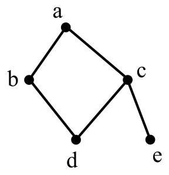

# 2021 CCF 非专业级别软件能力认证第一轮（CSP-J1）入门级 C++语言试题

认证时间：2021 年 9 月 19 日 14:30~16:30

考生注意事项：

- 试题纸共有 12 页，答题纸共有 1 页，满分 100 分。请在答题纸上作答，写在试题纸上的一律无效。
- 不得使用任何电子设备（如计算器、手机、电子词典等）或查阅任何书籍资料。

## 一、单项选择题

> 共 15 题，每题 2 分，共计 30 分；每题有且仅有一个正确选项。

### 第 1 题

<!-- qid: csp-j1-2021-001 | type: single_choice | score: 2 | answer: D | tags: topic:basics -->

以下不属于面向对象程序设计语言的是（ ）。

- A. C++
- B. Python
- C. Java
- D. C

> **题解**
> 答案：D
> 解释：面向对象语言的核心是能定义类与对象：C++ 常被称作「带类的 C」，Python 与 Java 都以类为基本组织单位，三者都支持封装、继承与多态；只有 C 是过程式语言，程序由函数和数据构成，没有类与对象的概念，选 D。把 C 与 C++ 混为一谈是这题最常见的失分点。

### 第 2 题

<!-- qid: csp-j1-2021-002 | type: single_choice | score: 2 | answer: B | tags: topic:basics -->

以下奖项与计算机领域最相关的是（ ）。

- A. 奥斯卡奖
- B. 图灵奖
- C. 诺贝尔奖
- D. 普利策奖

> **题解**
> 答案：B
> 解释：图灵奖由美国计算机协会（ACM）于 1966 年设立，公认为计算机科学领域的最高奖项，选 B。A 项奥斯卡奖是电影艺术奖，C 项诺贝尔奖没有设数学或计算机奖项，D 项普利策奖属新闻与文化领域，三项都与计算机无关。

### 第 3 题

<!-- qid: csp-j1-2021-003 | type: single_choice | score: 2 | answer: A | tags: topic:basics -->

目前主流的计算机储存数据最终都是转换成（ ）数据进行储存。

- A. 二进制
- B. 十进制
- C. 八进制
- D. 十六进制

> **题解**
> 答案：A
> 解释：计算机内部用晶体管的高低电平两个状态表示信息，天然对应 0 与 1，所以数字、文字、图像、声音最终都编码成二进制数存放，选 A。十进制、八进制、十六进制只是书写与阅读时更方便的形式（十六进制还常用来缩写二进制串），并不是存储时的形态。

### 第 4 题

<!-- qid: csp-j1-2021-004 | type: single_choice | score: 2 | answer: C | tags: feat:formula,topic:complexity -->

以比较作为基本运算，在 N 个数中找出最大数，最坏情况下所需要的最少的比较次数为（ ）。

- A. $N^2$
- B. $N$
- C. $N-1$
- D. $N+1$

> **题解**
> 答案：C
> 解释：以比较作为基本运算找最大值，先看下界：最后被确定为最大值的那个数，必须先把其余 N − 1 个数排除掉，而一次比较最多只能排除一个候选（比较中较小的那个），所以至少需要 N − 1 次。再看能不能做到：擂台法先把第一个数当擂主，剩下 N − 1 个数各与擂主比一次、大的留下，正好用 N − 1 次完成。上下界相合，答案是 N − 1，选 C。A 项 N² 是两两比较的暴力上界，B 项 N 比下界多一次，D 项 N + 1 多两次，都比 N − 1 大。

### 第 5 题

<!-- qid: csp-j1-2021-005 | type: single_choice | score: 2 | answer: D | tags: topic:ds -->

对于入栈顺序为 a, b, c, d, e 的序列，下列（ ）不是合法的出栈序列。

- A. a, b, c, d, e
- B. e, d, c, b, a
- C. b, a, c, d, e
- D. c, d, a, e, b

> **题解**
> 答案：D
> 解释：出栈必须遵循后进先出：某个元素要出栈，压在它上面的元素必须先出栈。D 项 `c, d, a, e, b` 里 a 排在 b 前面——弹出 c 之后栈中自底向上是 a、b，接着把 d 压入再弹出，此时 b 仍压在 a 上面，所以 a 不可能先于 b 出栈，矛盾。其余三项都能给出具体操作：A 项压一个弹一个；B 项 a 到 e 全部入栈后依次弹出；C 项压入 a、b 后先弹 b 再弹 a，随后 c、d、e 各自压入即弹出。穷举全部 42 种合法出栈序列，D 项也不在其中，选 D。

### 第 6 题

<!-- qid: csp-j1-2021-006 | type: single_choice | score: 2 | answer: D | tags: topic:graph -->

对于有 n 个顶点、m 条边的无向连通图 (m>n)，需要删掉（ ）条边才能使其成为一棵树。

- A. n-1
- B. m-n
- C. m-n-1
- D. m-n+1

> **题解**
> 答案：D
> 解释：n 个顶点的树恰好有 n − 1 条边，所以要从 m 条边删到只剩 n − 1 条，删掉 m − (n − 1) = m − n + 1 条，选 D。A 项 n − 1 是树应有的边数、不是要删的条数；B 项 m − n 与 C 项 m − n − 1 都比正确值小，删完还剩 n 条或 n + 1 条边，比树多出边来（必然含环）。

### 第 7 题

<!-- qid: csp-j1-2021-007 | type: single_choice | score: 2 | answer: C | tags: topic:number -->

二进制数 101.11 对应的十进制数是（ ）。

- A. 6.5
- B. 5.5
- C. 5.75
- D. 5.25

> **题解**
> 答案：C
> 解释：按位权展开：整数部分 101 是 1 × 4 + 0 × 2 + 1 × 1 = 5；小数部分 .11 的位权依次是 1/2 与 1/4，即 1 × 0.5 + 1 × 0.25 = 0.75。合起来 5.75，选 C。B 项 5.5 与 D 项 5.25 都是把小数位的位权记错（如把 .11 当成 0.5 或 0.25），A 项 6.5 连整数部分也多算了 1。

### 第 8 题

<!-- qid: csp-j1-2021-008 | type: single_choice | score: 2 | answer: A | tags: topic:tree -->

如果一棵二叉树只有根结点，那么这棵二叉树高度为 1。请问高度为 5 的完全二叉树有（ ）种不同的形态？

- A. 16
- B. 15
- C. 17
- D. 32

> **题解**
> 答案：A
> 解释：高度为 5 的完全二叉树，前 4 层必须是满的，共 1 + 2 + 4 + 8 = 15 个结点；第 5 层的结点数可以取 1 到 16 中任意一个值，而每给定一个结点数形态就唯一确定，所以共 16 种，选 A。B 项 15 是前 4 层的结点数，C 项 17 与 D 项 32 都超出第 5 层可能的结点数（第 5 层最多 16 个）。

### 第 9 题

<!-- qid: csp-j1-2021-009 | type: single_choice | score: 2 | answer: B | tags: topic:ds -->

表达式 `a*(b+c)*d` 的后缀表达式为( )，其中 `*` 和 `+` 是运算符。

- A. `**a+bcd`
- B. `abc+*d*`
- C. `abc+d**`
- D. `*a*+bcd`

> **题解**
> 答案：B
> 解释：中缀转后缀要按运算顺序重排：先算括号内的 `b+c`，写作 `bc+`；再算 `a*(b+c)`，得到 `abc+*`；最后乘 d，得到 `abc+*d*`，选 B。A 项 `**a+bcd` 与 D 项 `*a*+bcd` 都以双目运算符开头，任何合法后缀式都不会这样；C 项 `abc+d**` 对应的结构是 `a*((b+c)*d)`，虽然值相同，但 `*` 从左到右结合，题面 `a*(b+c)*d` 的结构是 `(a*(b+c))*d`，只有 B 项与它一致。

### 第 10 题

<!-- qid: csp-j1-2021-010 | type: single_choice | score: 2 | answer: B | tags: topic:combinatorics -->

6 个人，两个人组一队，总共组成三队，不区分队伍的编号。不同的组队情况有（ ）种。

- A. 10
- B. 15
- C. 30
- D. 20

> **题解**
> 答案：B
> 解释：先分队、再除掉队伍的顺序：从 6 人里选出第一队有 C(6,2) = 15 种，剩下 4 人里选出第二队有 C(4,2) = 6 种，最后 2 人自动成为第三队，共 15 × 6 × 1 = 90 种；三队不编号，这 90 种里每 3! = 6 种其实是同一个分组，所以 90 ÷ 6 = 15，选 B。C 项 30 相当于只除以 3（把 3! 当成了 3），A 项 10 与 D 项 20 都不是正确的组合数。

### 第 11 题

<!-- qid: csp-j1-2021-011 | type: single_choice | score: 2 | answer: B | tags: topic:greedy -->

在数据压缩编码中的哈夫曼编码方法，在本质上是一种（ ）的策略。

- A. 枚举
- B. 贪心
- C. 递归
- D. 动态规划

> **题解**
> 答案：B
> 解释：哈夫曼编码每一步都从当前所有结点里挑出权值最小的两个合并，重复到只剩一个根，取的都是当下最优、之后不再回头修改，这正是贪心的特征，选 B。A 项枚举要把所有方案都试一遍，C 项递归说的是函数自己调用自己这种形式，D 项动态规划要求把问题拆成有重叠的子问题并保存中间结果，哈夫曼建树过程中没有这一步。

### 第 12 题

<!-- qid: csp-j1-2021-012 | type: single_choice | score: 2 | answer: A | tags: topic:combinatorics -->

由 1，1，2，2，3 这五个数字组成不同的三位数有（ ）种。

- A. 18
- B. 15
- C. 12
- D. 24

> **题解**
> 答案：A
> 解释：按所用数字的重复情况分类：三个数字互不相同只能用 1、2、3，排列有 3! = 6 个；恰好两个数字相同，重复的那个可以是 1 或 2（2 种），另一个不同的数字从剩下的两个里挑（2 种），再把单独那个数字安排在 3 个位置之一（3 种），共 2 × 2 × 3 = 12 个。合计 6 + 12 = 18，选 A。B 项 15、C 项 12、D 项 24 都没有处理好「有两个数字各出现两次」带来的重复计数。

### 第 13 题

<!-- qid: csp-j1-2021-013 | type: single_choice | score: 2 | answer: C | tags: topic:sim -->

考虑如下递归算法

```
solve(n)
    if n<=1 return 1
    else if n>=5 return n*solve(n-2)
    else return n*solve(n-1)
```

则调用 `solve(7)` 得到的返回结果为（ ）。

- A. 105
- B. 840
- C. 210
- D. 420

> **题解**
> 答案：C
> 解释：照着定义逐层展开：`solve(7)` 因 7 大于等于 5，返回 7 × `solve(5)`；5 也大于等于 5，返回 5 × `solve(3)`；3 落在 1 与 5 之间，返回 3 × `solve(2)`；`solve(2)` 返回 2 × `solve(1)`；`solve(1)` 因 n 小于等于 1 返回 1。于是 `solve(7)` = 7 × 5 × 3 × 2 × 1 = 210，选 C。A 项 105 漏掉了最后的因子 2，D 项 420 与 B 项 840 分别比正确值多乘了一个 2 和两个 2。

### 第 14 题

<!-- qid: csp-j1-2021-014 | type: single_choice | score: 2 | answer: B | images: q014-fig1.png | tags: feat:figure,topic:graph -->

以 a 为起点，对右边的无向图进行深度优先遍历，则 b、 c、 d、 e 四个点中有可能作为最后一个遍历到的点的个数为（ ）。



- A. 1
- B. 2
- C. 3
- D. 4

> **题解**
> 答案：B
> 解释：DFS 先走哪个分支由邻接表里邻居的先后决定，题面没有限定这个顺序，所以凡可能出现的次序都要算。图中 5 个点 5 条边：a 连 b 与 c，b 连 a 与 d，c 连 a、d、e，d 连 b 与 c，e 只连 c。把所有可能的邻接次序都枚举一遍（另用状态机穷举交叉校验），得到 3 条访问序列 `abdce`、`acdbe`、`acedb`，末位分别是 e、e、b，所以 b 与 e 都可能最后被访问到，共 2 个，选 B。A 项 1 是漏掉「在 c 处先走 e、回头再走 d」那一支（正是它让 b 成为末位）的结果；c 一定先于 e 被访问（e 只连 c），而 d 的两个邻点是 b 与 c、只要 b 还没访问过，走到 d 后就必须接着访问 b，所以 c 与 d 当不了末位。

### 第 15 题

<!-- qid: csp-j1-2021-015 | type: single_choice | score: 2 | answer: B | tags: topic:sim -->

有四个人要从 A 点坐一条船过河到 B 点，船一开始在 A 点。该船一次最多可坐两个人。已知这四个人中每个人独自坐船的过河时间分别为 1, 2, 4, 8, 且两个人坐船的过河时间为两人独自过河时间的较大者。则最短（ ）时间可以让四个人都过河到 B 点（包括从 B 点把船开回 A 点的时间）。

- A. 14
- B. 15
- C. 16
- D. 17

> **题解**
> 答案：B
> 解释：最优方案是让最快的 1 号当摆渡人、把最慢的两个人一起送过去：1 与 2 过河（2 分钟），1 划回（1 分钟），4 与 8 过河（8 分钟），2 划回（2 分钟），1 与 2 再过河（2 分钟），总计 2 + 1 + 8 + 2 + 2 = 15，选 B。用状态空间最短路实跑（状态为两岸的人员与船在哪一侧）同样得到 15。常见的错法是让 1 号逐个带人过河，得到 2 + 1 + 4 + 1 + 8 = 16，即 C 项；A 项 14 小于最优值、达不到，D 项 17 比最优解多 2。

## 二、阅读程序

> 程序输入不超过数组或字符串定义的范围；判断题正确填 √，错误填 ×；除特殊说明外，判断题 1.5 分，选择题 3 分，共计 40 分。

### (1)

<!-- group: 阅读程序(1) -->

```cpp
 01  #include <iostream>
 02  using namespace std;
 03
 04  int n;
 05  int a[1000];
 06
 07  int f(int x)
 08  {
 09      int ret = 0;
 10      for (; x; x &= x - 1) ret++;
 11      return ret;
 12  }
 13
 14  int g(int x)
 15  {
 16      return x & -x;
 17  }
 18
 19  int main()
 20  {
 21      cin >> n;
 22      for (int i = 0; i < n; i++) cin >> a[i];
 23      for (int i = 0; i < n; i++)
 24          cout << f(a[i]) + g(a[i]) << ' ';
 25      cout << endl;
 26      return 0;
 27  }
```

> **程序说明**
> 这段程序读入一个整数 n 与 n 个整数，对每个数依次输出 `f(x) + g(x)`：`f` 用 `x &= x - 1` 反复清掉最低位的 1，数出二进制里 1 的个数；`g` 用 `x & -x` 取出最低位那个 1 所代表的数值。也就是说，每个输入数贡献「二进制中 1 的个数」与「最低位 1 的数值」之和，输出是一行同样多的整数。理解这一组要抓住两点：一是 `x &= x - 1` 对 0 和负数也都在有限步内结束、不会死循环，而 `x & -x` 依赖补码表示；二是数组只定义了 `int a[1000]`，判断会不会越界要盯住这一点。

#### 判断题

##### 第 16 题

<!-- qid: csp-j1-2021-016 | type: true_false | score: 1.5 | answer: F | tags: topic:lang -->

输入的 n 等于 1001 时，程序不会发生下标越界。（ ）

> **题解**
> 答案：×
> 解释：`a` 的定义是 `int a[1000]`，合法下标只有 0 到 999，而第 22 行 `for (int i = 0; i < n; i++) cin >> a[i];` 在 n = 1001 时会执行到 i = 1000，也就是写入 `a[1000]`，已经越界。实跑验证：用一份只加了下标检查的副本运行，输入 1001 个 7，第一行就打印出下标 i = 1000 越界的提示。所以「不会发生下标越界」为假，填 ×。卷首说「程序输入不超过数组或字符串定义的范围」，那是对一般数据的约定，本题正是特意要问越界的情形。

##### 第 17 题

<!-- qid: csp-j1-2021-017 | type: true_false | score: 1.5 | answer: F | tags: topic:bit -->

输入的 `a[i]` 必须全为正整数，否则程序将陷入死循环。（ ）

> **题解**
> 答案：×
> 解释：`f` 的循环 `for (; x; x &= x - 1) ret++` 每轮清掉 x 最低位的 1，而 `g` 只做一次 `x & -x`、根本不循环，所以无论 x 是 0 还是负数，程序都在有限步内结束。实跑验证：输入 `1 0` 输出 `0`，输入 `1 -5` 输出 `32`，输入 `3 -1 -65536 0` 输出 `33 65552 0`，三次都正常退出。所以「`a[i]` 必须全为正整数，否则死循环」为假，填 ×。负数在补码里是一串 1，`x &= x - 1` 对它们照样逐位清下去。

##### 第 18 题

<!-- qid: csp-j1-2021-018 | type: true_false | score: 1.5 | answer: F | tags: topic:bit -->

当输入为“5 2 11 9 16 10”时，输出为“3 4 3 17 5”。（ ）

> **题解**
> 答案：×
> 解释：逐项按程序算：`f` 数二进制里 1 的个数，`g` 取最低位 1 的数值。题面输入是 `5 2 11 9 16 10`，第一个 5 是元素个数 n，真正的数据是 2、11、9、16、10：2 = 10 有 1 个 1、最低位 1 是 2，输出 1 + 2 = 3；11 = 1011 有 3 个 1，输出 3 + 1 = 4；9 = 1001 输出 2 + 1 = 3；16 = 10000 输出 1 + 16 = 17；10 = 1010 输出 2 + 2 = 4。实跑该输入得到 `3 4 3 17 4`，而题面写的是 `3 4 3 17 5`，最后一项应当是 4，故命题为假，填 ×。

##### 第 19 题

<!-- qid: csp-j1-2021-019 | type: true_false | score: 1.5 | answer: T | tags: topic:bit -->

当输入为“1 511998”时，输出为“18”。（ ）

> **题解**
> 答案：√
> 解释：把 511998 写成二进制是 1111100111111111110，其中 1 的个数是 16（`f` 的输出），最低位那个 1 表示 2（`g` 的输出），所以结果是 16 + 2 = 18。实跑该输入输出正是 `18`，与题面一致，故命题为真，填 √。

##### 第 20 题

<!-- qid: csp-j1-2021-020 | type: true_false | score: 1.5 | answer: F | tags: topic:lang -->

将源代码中 `g` 函数的定义（14-17 行）移到 `main` 函数的后面，程序可以正常编译运行。（ ）

> **题解**
> 答案：×
> 解释：第 24 行 `cout << f(a[i]) + g(a[i])` 用到了 `g`，而 C++ 要求函数在调用处之前已经声明；把 `g` 的定义挪到 `main` 之后，编译到 `main` 时 `g` 还是未知的名字。实跑验证：把第 14 到 17 行的 `g` 剪切到文件末尾、其余一字不动，重新编译报 `error: 'g' was not declared in this scope`，编译失败。所以「可以正常编译运行」为假，填 ×。要让函数写在调用处之后，需要在 `main` 之前补一句函数声明。

#### 单选题

##### 第 21 题

<!-- qid: csp-j1-2021-021 | type: single_choice | score: 3 | answer: B | tags: topic:bit -->

当输入为“2 -65536 2147483647”时，输出为（ ）。

- A. “65532 33”
- B. “65552 32”
- C. “65535 34”
- D. “65554 33”

> **题解**
> 答案：B
> 解释：−65536 的 32 位补码是 `0xFFFF0000`，里面有 16 个 1，最低位的 1 在第 16 位上（值为 65536），第一项输出 16 + 65536 = 65552；2147483647 是 `0x7FFFFFFF`，二进制是 31 个 1、最低位的 1 就是 1，第二项输出 31 + 1 = 32。实跑该输入输出 `65552 32`，选 B。A 项 65532 33、C 项 65535 34、D 项 65554 33 的前后两个数都与「16 + 65536」「31 + 1」这两个和对不上。

### (2)

<!-- group: 阅读程序(2) -->

```cpp
 01  #include <iostream>
 02  #include <string>
 03  using namespace std;
 04
 05  char base[64];
 06  char table[256];
 07
 08  void init()
 09  {
 10      for (int i = 0; i < 26; i++) base[i] = 'A' + i;
 11      for (int i = 0; i < 26; i++) base[26 + i] = 'a' + i;
 12      for (int i = 0; i < 10; i++) base[52 + i] = '0' + i;
 13      base[62] = '+', base[63] = '/';
 14
 15      for (int i = 0; i < 256; i++) table[i] = 0xff;
 16      for (int i = 0; i < 64; i++) table[base[i]] = i;
 17      table['='] = 0;
 18  }
 19
 20  string decode(string str)
 21  {
 22      string ret;
 23      int i;
 24      for (i = 0; i < str.size(); i += 4) {
 25          ret += table[str[i]] << 2 | table[str[i + 1]] >> 4;
 26          if (str[i + 2] != '=')
 27              ret += (table[str[i + 1]] & 0x0f) << 4 | table[str[i + 2]] >> 2;
 28          if (str[i + 3] != '=')
 29              ret += table[str[i + 2]] << 6 | table[str[i + 3]];
 30      }
 31      return ret;
 32  }
 33
 34  int main()
 35  {
 36      init();
 37      cout << int(table[0]) << endl;
 38
 39      string str;
 40      cin >> str;
 41      cout << decode(str) << endl;
 42      return 0;
 43  }
```

> **程序说明**
> 这段程序构造 Base64 的编码表 `base`（A–Z、a–z、0–9、`+`、`/`）与逆表 `table`，把 `=` 映射成 0、其余位置留成 `0xff`。`decode` 每次取输入串的 4 个字符，按 Base64 的规则把它们拼成 3 个字节，遇到 `=` 就跳过对应的输出字节。`main` 先输出 `table[0]` 的值，再读入一个不含空白的字符串并输出解码结果。理解这一组要抓住两点：一是编码表与逆表是两张不同的表，`table[0]` 之所以是 −1，是因为下标 0 从未被单独赋值、保持着填充用的 `0xff`，而此环境的 `char` 是有符号的；二是即使输入全是合法字符，拼出来的字节也可能超出字母数字的范围，位运算的 8 位截断是看懂输出的关键。

#### 判断题

##### 第 22 题

<!-- qid: csp-j1-2021-022 | type: true_false | score: 1.5 | answer: F | tags: topic:string -->

输出的第二行一定是由小写字母、大写字母、数字和“+”、“/”、“=”构成的字符串。（ ）

> **题解**
> 答案：×
> 解释：`init` 把 `table` 里没有被赋成编码值的位置留成 `0xff`，但即使输入全是合法字符，拼出的字节也可能落在字符集之外：四个字符的 `table` 值都是 63 时，第一个字节是 63 << 2 | 63 >> 4 = 252 | 3 = 255，后两个字节同样是 255。实跑验证：输入 `////`，输出的第二行三个字节就是 `FF FF FF`，它既不是大小写字母、数字，也不是 `+`、`/`、`=`。所以「一定由那些字符构成」为假，填 ×。

##### 第 23 题

<!-- qid: csp-j1-2021-023 | type: true_false | score: 1.5 | answer: T | tags: topic:string -->

可能存在输入不同，但输出的第二行相同的情形。（ ）

> **题解**
> 答案：√
> 解释：`table` 把 `=` 映射成 0，而第 26、28 行遇到 `=` 时会跳过对应的输出字节，所以输入里 `=` 出现在哪里并不改变结果。实跑验证：输入 `AAAA` 与 `A=AA`，两次输出的全部字节完全相同（第一行 `-1`，第二行三个 0 字节）。输入不同而输出的第二行相同，故命题为真，填 √。

##### 第 24 题

<!-- qid: csp-j1-2021-024 | type: true_false | score: 1.5 | answer: T | tags: topic:string -->

输出的第一行为“-1”。（ ）

> **题解**
> 答案：√
> 解释：第 15 行先把 `table` 的 256 个元素统统填成 `0xff`，随后两行只给 `base` 里的 64 个字符赋编码值、给 `=` 赋 0，下标 0（也就是字符 `'\0'`）从未被单独改过，仍保持 `0xff`。本机的 `char` 是有符号的，`0xff` 转成 `int` 就是 −1。实跑验证：无论输入什么，输出的第一行都是 `-1`，故命题为真，填 √。

#### 单选题

##### 第 25 题

<!-- qid: csp-j1-2021-025 | type: single_choice | score: 3 | answer: B | tags: feat:formula,topic:complexity -->

设输入字符串长度为 n，`decode` 函数的时间复杂度为（ ）。

- A. $\Theta(\sqrt{n})$
- B. $\Theta(n)$
- C. $\Theta(n \log n)$
- D. $\Theta(n^2)$

> **题解**
> 答案：B
> 解释：`decode` 的循环是 `for (i = 0; i < str.size(); i += 4)`：长度为 n 的串一共走 n/4 轮，每轮只做几次位运算与字符拼接，都是常数时间，所以总时间与 n 成正比，即 Θ(n)，选 B。A 项 Θ(√n) 比实际轮数还少，C 项 Θ(n log n) 与 D 项 Θ(n²) 都远超实际——循环变量步长是常数 4，不改变增长的量级。

##### 第 26 题

<!-- qid: csp-j1-2021-026 | type: single_choice | score: 3 | answer: B | tags: topic:string -->

当输入为“Y3Nx”时，输出的第二行为（ ）。

- A. “csp”
- B. “csq”
- C. “CSP”
- D. “Csp”

> **题解**
> 答案：B
> 解释：`Y3Nx` 是一组 4 个字符，查表得 `Y` = 24、`3` = 55、`N` = 13、`x` = 49。第一个字节是 24 << 2 | 55 >> 4 = 96 | 3 = 99，即 `c`；第二个字节是 (55 & 15) << 4 | 13 >> 2 = 7 << 4 | 3 = 115，即 `s`；第三个字节是 13 << 6 | 49，其中 13 << 6 = 832 截成 8 位是 64，64 | 49 = 113，即 `q`。合起来是 `csq`。实跑该输入，第二行正是 `csq`，选 B。A 项 `csp` 与 C 项 `CSP`、D 项 `Csp` 都有字符或大小写不符。

##### 第 27 题

<!-- qid: csp-j1-2021-027 | type: single_choice | score: 3.5 | answer: C | tags: topic:string -->

（3.5 分）当输入为“Y2NmIDIwMjE=”时，输出的第二行为（ ）。

- A. “ccf2021”
- B. “ccf2022”
- C. “ccf 2021”
- D. “ccf 2022”

> **题解**
> 答案：C
> 解释：`Y2NmIDIwMjE=` 共 12 个字符，分 3 组解出 8 个字节：`63 63 66 20 32 30 32 31`，正好是 `ccf 2021`（`ccf` 与 `2021` 之间有一个空格）；最后一组 `MjE=` 末位是 `=`，按第 28 行的规则少输出一个字节。实跑该输入，第二行正是 `ccf 2021`，选 C。A 项 `ccf2021` 少一个空格，B 项 `ccf2022` 与 D 项 `ccf 2022` 的年份数字不符。

### (3)

<!-- group: 阅读程序(3) -->

```cpp
 01  #include <iostream>
 02  using namespace std;
 03
 04  const int n = 100000;
 05  const int N = n + 1;
 06
 07  int m;
 08  int a[N], b[N], c[N], d[N];
 09  int f[N], g[N];
 10
 11  void init()
 12  {
 13      f[1] = g[1] = 1;
 14      for (int i = 2; i <= n; i++) {
 15          if (!a[i]) {
 16              b[m++] = i;
 17              c[i] = 1, f[i] = 2;
 18              d[i] = 1, g[i] = i + 1;
 19          }
 20          for (int j = 0; j < m && b[j] * i <= n; j++) {
 21              int k = b[j];
 22              a[i * k] = 1;
 23              if (i % k == 0) {
 24                  c[i * k] = c[i] + 1;
 25                  f[i * k] = f[i] / c[i * k] * (c[i * k] + 1);
 26                  d[i * k] = d[i];
 27                  g[i * k] = g[i] * k + d[i];
 28                  break;
 29              }
 30              else {
 31                  c[i * k] = 1;
 32                  f[i * k] = 2 * f[i];
 33                  d[i * k] = g[i];
 34                  g[i * k] = g[i] * (k + 1);
 35              }
 36          }
 37      }
 38  }
 39
 40  int main()
 41  {
 42      init();
 43
 44      int x;
 45      cin >> x;
 46      cout << f[x] << ' ' << g[x] << endl;
 47      return 0;
 48  }
```

假设输入的 `x` 是不超过 1000 的自然数，完成下面的判断题和单选题：

> **程序说明**
> 这段程序用线性筛（欧拉筛）预处理 1 到 100000 上的两个数论函数：`f[i]` 是 i 的约数个数，`g[i]` 是 i 的全部约数之和；`a` 是合数标记，`b` 依次存素数，`c` 记 i 的最小质因子的指数，`d` 是「把最小质因子全部除掉之后那部分」的约数和。`main` 读入一个不超过 1000 的自然数 x，输出 `f[x]` 与 `g[x]`。关键做法是每个合数只在「i 乘上它的最小质因子」时被筛一次：`i % k == 0` 时按指数递推，否则 k 是新质因子、`f` 翻倍、`g` 乘以 `k + 1`。理解这一组要抓住 `c` 记的是指数而不是约数个数，这正是 `f[i] / c[i * k]` 总能整除的原因。

#### 判断题

##### 第 28 题

<!-- qid: csp-j1-2021-028 | type: true_false | score: 1.5 | answer: T | tags: feat:lineref,topic:number -->

若输入不为“1”，把第 13 行删去不会影响输出的结果。（ ）

> **题解**
> 答案：√
> 解释：第 13 行 `f[1] = g[1] = 1;` 只写了 f[1] 与 g[1] 两个初值，而第 14 行起的循环从 i = 2 开始，内层用到的 `f[i]`、`g[i]` 里的下标始终不小于 2（`b[j]` 是已筛出的素数，也不小于 2），所以这两个初值在后继计算中根本不会被读取。实跑验证：把第 13 行删掉后重新编译，对 x = 2 到 1000 的输出与原程序逐字节比对，结果完全相同。故命题为真，填 √。

##### 第 29 题

<!-- qid: csp-j1-2021-029 | type: true_false | score: 2 | answer: F | tags: feat:lineref,topic:number -->

（2 分）第 25 行的 `f[i] / c[i * k]` 可能存在无法整除而向下取整的情况。（ ）

> **题解**
> 答案：×
> 解释：`c[i * k]` 记的是 `i * k` 的最小质因子的指数，在 `i % k == 0` 时它等于 `c[i] + 1`；`f[i]` 是 i 的约数个数，其因式分解里恰好含有因子 `c[i] + 1`，所以 `f[i] / c[i * k]` 总能整除，不存在需要向下取整的情形。实跑验证：在筛法里插桩统计，i 跑到 100000 全程「`f[i]` 不能被 `c[i * k]` 整除」的次数是 0。故命题为假，填 ×。

##### 第 30 题

<!-- qid: csp-j1-2021-030 | type: true_false | score: 2 | answer: F | tags: topic:number -->

（2 分）在执行完 `init()` 后，`f` 数组不是单调递增的，但 `g` 数组是单调递增的。（ ）

> **题解**
> 答案：×
> 解释：先说 `f`：f[4] = 3（4 的约数是 1、2、4），f[5] = 2，确实不是单调递增，这半句成立。但 `g` 也不是单调递增：g[4] = 1 + 2 + 4 = 7，g[5] = 1 + 5 = 6，同样在 i = 5 处下降。用探针程序实跑找第一个下降点，`f` 与 `g` 都出现在 x = 5。所以「但 `g` 数组是单调递增的」为假，整句为假，填 ×。

#### 单选题

##### 第 31 题

<!-- qid: csp-j1-2021-031 | type: single_choice | score: 3 | answer: A | tags: feat:formula,topic:complexity -->

`init` 函数的时间复杂度为（ ）。

- A. $\Theta(n)$
- B. $\Theta(n \log n)$
- C. $\Theta(n\sqrt{n})$
- D. $\Theta(n^2)$

> **题解**
> 答案：A
> 解释：这是线性筛：每个合数只在它的最小质因子首次出现时被标记一次，第 20 行 `for (int j = 0; j < m && b[j] * i <= n; j++)` 的总执行次数与 n 同阶。实跑统计 n = 100000 时内层循环体的总次数是 90407，约为 0.9n，所以时间复杂度是 Θ(n)，选 A。B 项 Θ(n log n) 是埃氏筛的量级，C 项 Θ(n√n) 与 D 项 Θ(n²) 都远大于实测值。

##### 第 32 题

<!-- qid: csp-j1-2021-032 | type: single_choice | score: 3 | answer: C | tags: topic:number -->

在执行完 `init()` 后，`f[1]`, `f[2]`, `f[3]` …… `f[100]` 中有（ ）个等于 2。

- A. 23
- B. 24
- C. 25
- D. 26

> **题解**
> 答案：C
> 解释：`f[i]` 是 i 的约数个数，`f[i] = 2` 说明 i 只有 1 与它本身两个约数，也就是 i 为素数。100 以内的素数有 2、3、5、7、11、13、17、19、23、29、31、37、41、43、47、53、59、61、67、71、73、79、83、89、97，共 25 个，选 C。实跑统计 f[1] 到 f[100] 里等于 2 的个数也是 25；另写一份直接算约数个数的暴力程序，在 1 到 100000 上与筛法零失配。A 项 23、B 项 24、D 项 26 都只差一两个，靠估算是分不出来的。

##### 第 33 题

<!-- qid: csp-j1-2021-033 | type: single_choice | score: 4 | answer: C | tags: topic:number -->

（4 分）当输入为“1000”时，输出为（ ）。

- A. “15 1340”
- B. “15 2340”
- C. “16 2340”
- D. “16 1340”

> **题解**
> 答案：C
> 解释：1000 = 2³ × 5³，所以约数个数 `f[1000]` = (3 + 1) × (3 + 1) = 16，全部约数之和 `g[1000]` = (1 + 2 + 4 + 8) × (1 + 5 + 25 + 125) = 15 × 156 = 2340。实跑输入 `1000`，输出正是 `16 2340`，选 C。A 项 15 1340 与 B 项 15 2340 的第一个数 15 只是 2³ 那一部分的约数和，D 项 16 1340 把正确的 2340 写成了 1340。

## 三、完善程序

> 单选题，每小题 3 分，共计 30 分。

### (1)

<!-- group: 完善程序(1) -->

（Josephus 问题）有 $n$ 个人围成一个圈，依次标号 0 至 $n-1$。从 0 号开始，依次 0, 1, 0, 1, … 交替报数，报到 1 的人会离开，直至圈中只剩下一个人。求最后剩下人的编号。

试补全模拟程序。

```cpp
 01  #include <iostream>
 02
 03  using namespace std;
 04
 05  const int MAXN = 1000000;
 06  int F[MAXN];
 07
 08  int main() {
 09      int n;
 10      cin >> n;
 11      int i = 0, p = 0, c = 0;
 12      while (①) {
 13          if (F[i] == 0) {
 14              if (②) {
 15                  F[i] = 1;
 16                  ③;
 17              }
 18              ④;
 19          }
 20          ⑤;
 21      }
 22      int ans = -1;
 23      for (i = 0; i < n; i++)
 24          if (F[i] == 0)
 25              ans = i;
 26      cout << ans << endl;
 27      return 0;
 28  }
```

> **程序说明**
> 这段程序模拟约瑟夫问题：n 个人围成一圈依次标号 0 到 n − 1，从 0 号开始交替报 0、1，报到 1 的人离开，直到圈里只剩一个人，输出他的编号。`F[i]` 记 i 是否已经离开，`i` 是当前看到的位置，`p` 是这一轮该报的数，`c` 是已经离开的人数。做法就是朴素模拟：每轮先看当前位置的人是否还在圈里，在的话按 `p` 判断要不要淘汰、淘汰时累加人数，然后把报数取反，最后把位置在圈上推进一步（取模回绕）。理解这一组要抓住三点：循环的终止条件是「已离开 n − 1 人」而不是位置走到哪里；报数只在遇到还在圈里的人时翻转，被淘汰的人不影响 0、1 的交替；下标必须取模回绕，否则会越走越远。

##### 第 34 题

<!-- qid: csp-j1-2021-034 | type: single_choice | score: 3 | answer: D | tags: feat:circnum,topic:sim -->

①处应填（ ）

- A. `i < n`
- B. `c < n`
- C. `i < n - 1`
- D. `c < n - 1`

> **题解**
> 答案：D
> 解释：`c` 记的是已经离开的人数：③ 每淘汰一个人就让它加一，而圈里只剩一人时正好要离开 n − 1 人，所以循环条件是 `c < n - 1`，选 D。A 项 `i < n` 拿位置当条件，而位置会被 ⑤ 取模回绕，实跑 n = 1 时循环停不下来；B 项 `c < n` 的边界多了一个，实跑 n = 1 时输出 −1（正确应为 0）；C 项 `i < n - 1` 同样拿位置当条件，实跑 n = 2 时输出 1（正确应为 0）。

##### 第 35 题

<!-- qid: csp-j1-2021-035 | type: single_choice | score: 3 | answer: C | tags: feat:circnum,topic:sim -->

②处应填（ ）

- A. `i % 2 == 0`
- B. `i % 2 == 1`
- C. `p`
- D. `!p`

> **题解**
> 答案：C
> 解释：`p` 是当前位置该报的数，初值 0，每看过一个还在圈里的人就由 ④ 取反，于是报数在 0 与 1 之间交替，正是题面的报数规则；所以第 14 行判断「报到 1」要填 `p`，选 C。A 项 `i % 2 == 0` 与 B 项 `i % 2 == 1` 看的是位置 i 的奇偶，而离开的人会被跳过，位置与报数并不总是同奇偶：实跑 A 项在 n = 2 时输出 1、B 项在 n = 3 时死循环；D 项 `!p` 把 0 与 1 对调，实跑 n = 2 时输出 1（正确应为 0）。

##### 第 36 题

<!-- qid: csp-j1-2021-036 | type: single_choice | score: 3 | answer: C | tags: feat:circnum,topic:sim -->

③处应填（ ）

- A. `i++`
- B. `i = (i + 1) % n`
- C. `c++`
- D. `p ^= 1`

> **题解**
> 答案：C
> 解释：③ 紧跟在第 15 行 `F[i] = 1;` 之后，这一句刚把一个人标记为离开，计数器就该加一，所以填 `c++`，选 C。A 项 `i++` 与 B 项 `i = (i + 1) % n` 都在这里多推一次下标，而位置由 ⑤ 统一推进，重复推进会让位置跳过本该被淘汰的人，实跑这两种填法在 n = 2 时就再也凑不满离开人数、循环停不下来；D 项 `p ^= 1` 与 ④ 重复，却没有人再给 `c` 加一，实跑 n = 2 时同样停不下来。

##### 第 37 题

<!-- qid: csp-j1-2021-037 | type: single_choice | score: 3 | answer: D | tags: feat:circnum,topic:sim -->

④处应填（ ）

- A. `i++`
- B. `i = (i + 1) % n`
- C. `c++`
- D. `p ^= 1`

> **题解**
> 答案：D
> 解释：④ 每遇到一个还在圈里的人都执行一次，作用是把报数取反——无论这一轮报的是 0 还是 1，下一个还在圈里的人都要报相反的数，这就是「0, 1, 0, 1 交替」的实现，填 `p ^= 1`，选 D。A 项 `i++` 与 B 项 `i = (i + 1) % n` 改的是位置，而位置由 ⑤ 负责推进，这里再推一次会跳过本该被处理的下标，实跑 n = 2 时死循环；C 项 `c++` 把「离开人数」也加在这条路上，等于每个还在圈里的人都记成一次离开，实跑 n = 2 时输出 1（正确应为 0）。

##### 第 38 题

<!-- qid: csp-j1-2021-038 | type: single_choice | score: 3 | answer: B | tags: feat:circnum,topic:sim -->

⑤处应填（ ）

- A. `i++`
- B. `i = (i + 1) % n`
- C. `c++`
- D. `p ^= 1`

> **题解**
> 答案：B
> 解释：⑤ 是每轮循环末尾都要执行的位置推进：下标加一，走到 n 之后绕回 0，所以填 `i = (i + 1) % n`，选 B。A 项 `i++` 不会回绕，实跑 n = 4 时下标越过 n 继续往前走，输出 2（正确应为 0）；C 项 `c++` 等于把位置推进换成了计数，实跑 n = 2 时输出 1（正确应为 0）；D 项 `p ^= 1` 让位置永远停在原地，实跑 n = 2 时同一个位置被反复处理，循环停不下来。

### (2)

<!-- group: 完善程序(2) -->

（矩形计数）平面上有 $n$ 个关键点，求有多少个四条边都和 x 轴或者 y 轴平行的矩形，满足四个顶点都是关键点。给出的关键点可能有重复，但完全重合的矩形只计一次。

试补全枚举算法。

```cpp
 01  #include <iostream>
 02
 03  using namespace std;
 04
 05  struct point {
 06      int x, y, id;
 07  };
 08
 09  bool equals(point a, point b) {
 10      return a.x == b.x && a.y == b.y;
 11  }
 12
 13  bool cmp(point a, point b) {
 14      return ①;
 15  }
 16
 17  void sort(point A[], int n) {
 18      for (int i = 0; i < n; i++)
 19          for (int j = 1; j < n; j++)
 20              if (cmp(A[j], A[j - 1])) {
 21                  point t = A[j];
 22                  A[j] = A[j - 1];
 23                  A[j - 1] = t;
 24              }
 25  }
 26
 27  int unique(point A[], int n) {
 28      int t = 0;
 29      for (int i = 0; i < n; i++)
 30          if (②)
 31              A[t++] = A[i];
 32      return t;
 33  }
 34
 35  bool binary_search(point A[], int n, int x, int y) {
 36      point p;
 37      p.x = x;
 38      p.y = y;
 39      p.id = n;
 40      int a = 0, b = n - 1;
 41      while (a < b) {
 42          int mid = ③;
 43          if (④)
 44              a = mid + 1;
 45          else
 46              b = mid;
 47      }
 48      return equals(A[a], p);
 49  }
 50
 51  const int MAXN = 1000;
 52  point A[MAXN];
 53
 54  int main() {
 55      int n;
 56      cin >> n;
 57      for (int i = 0; i < n; i++) {
 58          cin >> A[i].x >> A[i].y;
 59          A[i].id = i;
 60      }
 61      sort(A, n);
 62      n = unique(A, n);
 63      int ans = 0;
 64      for (int i = 0; i < n; i++)
 65          for (int j = 0; j < n; j++)
 66              if (⑤ && binary_search(A, n, A[i].x, A[j].y) && binary_search(A, n, A[j].x, A[i].y)) {
 67                  ans++;
 68              }
 69      cout << ans << endl;
 70      return 0;
 71  }
```

> **程序说明**
> 这段程序统计「四条边都平行于坐标轴的矩形」的个数：给定 n 个可能有重复的关键点，矩形要求四个顶点都是关键点，完全重合的矩形只算一次。做法是先把点按 (x, y) 字典序排序、就地去掉重复点，再枚举所有点对 (i, j)：只要 i 在 j 的左下方（x 与 y 都更小），就用 (A[i].x, A[j].y) 与 (A[j].x, A[i].y) 这两个「另外两角」在有序数组里做二分查找，两个都找到就说明这一对构成一个矩形。输入是 n 与 n 个点的坐标，输出是矩形个数。理解这一组要抓住两点：排序的比较函数必须让数组按 (x, y) 严格有序、且对重合的点返回假，二分才找得到目标点；取中点必须向下取中，否则区间不缩小会死循环。

##### 第 39 题

<!-- qid: csp-j1-2021-039 | type: single_choice | score: 3 | answer: B | tags: feat:circnum,topic:sort -->

①处应填（ ）

- A. `a.x != b.x ? a.x < b.x : a.id < b.id`
- B. `a.x != b.x ? a.x < b.x : a.y < b.y`
- C. `equals(a, b) ? a.id < b.id : a.x < b.x`
- D. `equals(a, b) ? a.id < b.id : (a.x != b.x ? a.x < b.x : a.y < b.y)`

> **题解**
> 答案：B
> 解释：`cmp` 同时供排序与二分使用，要求数组按 (x, y) 的字典序严格递增，所以 `cmp(a, b)` 要表示「a 排在 b 前面」，而且两点重合时必须返回假——填 B 项 `a.x != b.x ? a.x < b.x : a.y < b.y`。A 项在 x 相同时改比 `id`，数组就不再按 y 有序；C 项在 x 相同时既不算小也不算大，排序结果自相矛盾；D 项虽然主序正确，但重合时返回 `id` 的比较结果，而二分构造的目标点 `p.id` 取的是 n、比任何真实下标都大，于是「与目标点重合」会被判成「排在目标点之前」，二分越过目标点、最后的 `equals` 校验失败。实跑用例：单位矩形四个角 (0,0)、(0,1)、(1,0)、(1,1) 应当算出 1 个，A、C、D 三项都得到 0。

##### 第 40 题

<!-- qid: csp-j1-2021-040 | type: single_choice | score: 3 | answer: D | tags: feat:circnum,topic:sim -->

②处应填（ ）

- A. `i == 0 || cmp(A[i], A[i - 1])`
- B. `t == 0 || equals(A[i], A[t - 1])`
- C. `i == 0 || !cmp(A[i], A[i - 1])`
- D. `t == 0 || !equals(A[i], A[t - 1])`

> **题解**
> 答案：D
> 解释：`unique` 要在排好序的数组上就地去掉重复点：`t` 是已经写出的不同点个数，`A[t - 1]` 是上一个写出的点，所以只有「当前点与上一个写出的点不重合」时才写出，即第 30 行填 `t == 0 || !equals(A[i], A[t - 1])`，选 D（`t == 0` 保证第一个点一定写出）。A 项比的是相邻的原始位置，而数组已经排好序，`cmp(A[i], A[i - 1])` 恒为假，结果只剩下第一个点；B 项把 `!` 丢了，反而只留下与前一个重复的点；C 项对有序数组来说几乎恒为真，等于没去重——实跑带重复点的用例，它把 1 个矩形数成了 4 个。

##### 第 41 题

<!-- qid: csp-j1-2021-041 | type: single_choice | score: 3 | answer: C | tags: feat:circnum,topic:bisect -->

③处应填（ ）

- A. `b - (b - a) / 2 + 1`
- B. `(a + b + 1) >> 1`
- C. `(a + b) >> 1`
- D. `a + (b - a + 1) / 2`

> **题解**
> 答案：C
> 解释：第 42 行取的中点必须向下取中：第 46 行在不满足条件时执行 `b = mid`，若取上取中，a 与 b 相邻时 mid 就等于 b，这一句不改变区间，`while (a < b)` 会一直成立、死循环。所以填 `(a + b) >> 1`，选 C。A 项 `b - (b - a) / 2 + 1` 在 b = a + 1 时算出 mid = b + 1，直接越出数组；B 项 `(a + b + 1) >> 1` 与 D 项 `a + (b - a + 1) / 2` 都是上取中，实跑都在 a 与 b 相邻时死循环。

##### 第 42 题

<!-- qid: csp-j1-2021-042 | type: single_choice | score: 3 | answer: B | tags: feat:circnum,topic:bisect -->

④处应填（ ）

- A. `!cmp(A[mid], p)`
- B. `cmp(A[mid], p)`
- C. `cmp(p, A[mid])`
- D. `!cmp(p, A[mid])`

> **题解**
> 答案：B
> 解释：第 43 行要在「A[mid] 排在目标点前面」时把左边界推到 mid + 1，所以条件正是 `cmp(A[mid], p)`，选 B。C 项 `cmp(p, A[mid])` 把两个参数写反了：它为真说明目标点在 A[mid] 之前，此时应当缩右边界，程序却去推左边界；A 项 `!cmp(A[mid], p)` 与 D 项 `!cmp(p, A[mid])` 在外面套了取反，方向同样反了。方向一错，二分就找不到目标点。实跑单位矩形用例，A、C、D 三项都得到 0（正确应为 1）。

##### 第 43 题

<!-- qid: csp-j1-2021-043 | type: single_choice | score: 3 | answer: D | tags: feat:circnum,topic:sim -->

⑤处应填（ ）

- A. `A[i].x == A[j].x`
- B. `A[i].id < A[j].id`
- C. `A[i].x == A[j].x && A[i].id < A[j].id`
- D. `A[i].x < A[j].x && A[i].y < A[j].y`

> **题解**
> 答案：D
> 解释：矩形四条边都平行于坐标轴，所以做对角线的那两个点必须一个在左下、一个在右上，即 x 与 y 都要严格一大一小，第 66 行填 `A[i].x < A[j].x && A[i].y < A[j].y`，选 D。这样每个矩形恰好被数一次：另一条对角线的方向相反、条件不成立。A 项只要求两点 x 相同，两点落在同一条竖线上，另外两个「角」查到的就是这两个点自己，凑出的是退化图形——实跑单个点 (1,1) 时它就输出 1（正确应为 0）；B 项与 C 项拿 `id` 当判据，与点的位置无关，实跑单位矩形用例分别输出 6 与 2（正确应为 1）。

