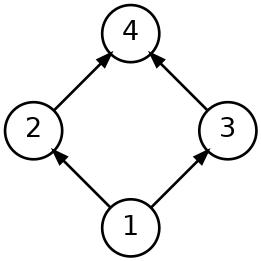

# 2023 CCF 非专业级别软件能力认证第一轮（CSP-J1）入门级 C++语言试题

认证时间：2023 年 9 月 16 日 09:30~11:30

考生注意事项：

- 试题纸共有 10 页，答题纸共有 1 页，满分 100 分。请在答题纸上作答，写在试题纸上的一律无效。
- 不得使用任何电子设备（如计算器、手机、电子词典等）或查阅任何书籍资料。

## 一、单项选择题

> 共 15 题，每题 2 分，共计 30 分；每题有且仅有一个正确选项。

### 第 1 题

<!-- qid: csp-j1-2023-001 | type: single_choice | score: 2 | answer: B | tags: topic:lang -->

在 C++ 中，下面哪个关键字用于声明一个变量，其值不能被修改？（ ）

- A. unsigned
- B. const
- C. static
- D. mutable

> **题解**
> 答案：B
> 解释：`const` 修饰的变量在初始化之后不能再被赋值，正是「值不能被修改」的含义，选 B。A 项 `unsigned` 只规定整数类型不带符号位，与能否修改无关；C 项 `static` 决定的是存储期与链接属性，变量本身照样可以改；D 项 `mutable` 恰好相反，它是为了在 `const` 成员函数里仍能修改某个成员而设的。逐项编译验证：把类型换成 `unsigned`、把关键字换成 `static` 后赋值都能编过（变量确实被改成了 2），只有 `const` 报 `error: assignment of read-only variable 'b'`。

### 第 2 题

<!-- qid: csp-j1-2023-002 | type: single_choice | score: 2 | answer: D | tags: feat:formula,topic:number -->

八进制数 $12345670_8$ 和 $07654321_8$ 的和为（ ）。

- A. $22222221_8$
- B. $21111111_8$
- C. $22111111_8$
- D. $22222211_8$

> **题解**
> 答案：D
> 解释：两个数都是八进制，按「逢八进一」逐位相加，结果是 `22222211₈`，选 D。换成十进制核对：`12345670₈` = 2739128，`07654321₈` = 2054353，两数之和是 4793481，把它转回八进制正好是 `22222211₈`。A 项 4793489、B 项 4493897、C 项 4756041 与正确的 4793481 都差在进位位上，是把某一列的进位漏掉或多算一次的结果。

### 第 3 题

<!-- qid: csp-j1-2023-003 | type: single_choice | score: 2 | answer: A | tags: topic:lang -->

阅读下述代码，请问修改 `data` 的 `value` 成员以存储 3.14，正确的方式是（ ）。

```
union Data {
    int num;
    float value;
    char symbol;
};
union Data data;
```

- A. `data.value = 3.14;`
- B. `value.data = 3.14;`
- C. `data->value = 3.14;`
- D. `value->data = 3.14;`

> **题解**
> 答案：A
> 解释：`data` 是 `union Data` 类型的对象，不是指针，访问成员要用点号，所以是 `data.value = 3.14;`，选 A。B 项 `value.data` 与 D 项 `value->data` 把对象名和成员名写反了；C 项 `data->value` 用了箭头运算符，那是给指针用的。逐个候选编译验证：A 通过并输出 `data.value=3.14`，B、D 报 `'value' was not declared in this scope`，C 报 `base operand of '->' has non-pointer type`。

### 第 4 题

<!-- qid: csp-j1-2023-004 | type: single_choice | score: 2 | answer: A | tags: topic:ds -->

假设有一个链表的节点定义如下：

```
struct Node {
    int data;
    Node* next;
};
```

现在有一个指向链表头部的指针：`Node* head`。如果想要在链表中插入一个新节点，其成员 `data` 的值为 42，并使新节点成为链表的第一个节点，下面哪个操作是正确的？（ ）

- A. `Node* newNode = new Node; newNode->data = 42; newNode->next = head; head = newNode;`
- B. `Node* newNode = new Node; head->data = 42; newNode->next = head; head = newNode;`
- C. `Node* newNode = new Node; newNode->data = 42; head->next = newNode;`
- D. `Node* newNode = new Node; newNode->data = 42; newNode->next = head;`

> **题解**
> 答案：A
> 解释：在表头插入要把三步做全：让新结点的 `next` 指向原来的头结点，再把头指针改指新结点——A 项 `newNode->next = head; head = newNode;` 正是这个顺序，选 A。D 项漏掉了 `head = newNode`，新结点挂不上链表，头还是原来那个；B 项写成 `head->data = 42`，改的是旧头结点里的数据；C 项 `head->next = newNode` 把新结点接到第一个结点后面，还丢掉了原来的第二个结点。实测建一个 [10, 20] 的链表后依次执行四个候选：A 输出 `42 -> 10 -> 20`，C 输出 `10 -> 42`，D 输出 `10 -> 20`，只有 A 符合题意。

### 第 5 题

<!-- qid: csp-j1-2023-005 | type: single_choice | score: 2 | answer: C | tags: topic:tree -->

根节点的高度为 1，一棵拥有 2023 个节点的三叉树高度至少为（ ）。

- A. 6
- B. 7
- C. 8
- D. 9

> **题解**
> 答案：C
> 解释：根高度为 1、每个结点最多 3 个孩子的树，高度 h 时最多有 1 + 3 + 3² + … + 3⁽ʰ⁻¹⁾ = (3ʰ − 1) ÷ 2 个结点。h = 7 时是 (2187 − 1) ÷ 2 = 1093 个，装不下 2023 个；h = 8 时是 (6561 − 1) ÷ 2 = 3280 个，够用，所以高度至少为 8，选 C。A 项 6 对应 364 个、B 项 7 对应 1093 个，都不到 2023；D 项 9 虽然也装得下，但问的是最小值。

### 第 6 题

<!-- qid: csp-j1-2023-006 | type: single_choice | score: 2 | answer: B | tags: topic:combinatorics -->

小明在某一天中依次有七个空闲时间段，他想要选出至少一个空闲时间段来练习唱歌，但他希望任意两个练习的时间段之间都有至少两个空闲的时间段让他休息。则小明一共有（ ）种选择时间段的方案。

- A. 31
- B. 18
- C. 21
- D. 33

> **题解**
> 答案：B
> 解释：把选中的时间段按下标从小到大排，要求两两相差至少 3。选 k 个时，从第 2 个起每个下标都要比前一个大 3，也就是比「紧挨着」多占 2 个位置，把第 2、3、…、k 个下标分别减去 2、4、…、2(k − 1) 后，问题变成从 7 − 2(k − 1) 个位置里任取 k 个。于是：k = 1 有 7 种，k = 2 有 C(5,2) = 10 种，k = 3 有 C(3,3) = 1 种，k ≥ 4 时为 0 种，合计 7 + 10 + 1 = 18，选 B。暴力枚举 7 个下标的所有 127 个非空子集，满足条件的正好 18 个；A 项 31 = 2⁷ − 1 是完全不设间隔限制的选法数，C 项 21、D 项 33 与枚举结果不符。

### 第 7 题

<!-- qid: csp-j1-2023-007 | type: single_choice | score: 2 | answer: C | tags: topic:sim -->

以下关于高精度运算的说法错误的是（ ）。

- A. 高精度计算主要是用来处理大整数或需要保留多位小数的运算。
- B. 大整数除以小整数的处理的步骤可以是，将被除数和除数对齐，从左到右逐位尝试将除数乘以某个数，通过减法得到新的被除数，并累加商。
- C. 高精度乘法的运算时间只与参与运算的两个整数中长度较长者的位数有关。
- D. 高精度加法运算的关键在于逐位相加并处理进位。

> **题解**
> 答案：C
> 解释：A、B、D 三项都是高精度运算的常规事实：用来处理超出内置类型范围的大整数或高精度小数、除法可以从左到右逐位试商、加法的关键是逐位相加并处理进位。C 项说「高精度乘法的运算时间只与参与运算的两个整数中长度较长者的位数有关」，把短的那个因数完全忽略了，所以错误，选 C。实测同一台机器上把较长操作数固定为 2000 位：2000 位数乘 1 位数耗时 0.065 ms，乘 4 位数 0.117 ms，乘 2000 位数 42.856 ms——耗时随着较短那个因数的位数在增长，可见与两个操作数的位数都有关。

### 第 8 题

<!-- qid: csp-j1-2023-008 | type: single_choice | score: 2 | answer: A | tags: topic:ds -->

后缀表达式 `6 2 3 + - 3 8 2 / + * 2 ^ 3 +` 对应的中缀表达式是（ ）。

- A. `((6 - (2 + 3)) * (3 + 8 / 2)) ^ 2 + 3`
- B. `6 - 2 + 3 * 3 + 8 / 2 ^ 2 + 3`
- C. `(6 - (2 + 3)) * ((3 + 8 / 2) ^ 2) + 3`
- D. `6 - ((2 + 3) * (3 + 8 / 2)) ^ 2 + 3`

> **题解**
> 答案：A
> 解释：后缀表达式用栈还原：遇到数就压栈，遇到运算符就弹出两个操作数、算出结果再压回去。按 `6 2 3 + - 3 8 2 / + * 2 ^ 3 +` 走一遍，还原出的中缀表达式是 `((6 - (2 + 3)) * (3 + 8 / 2)) ^ 2 + 3`，选 A。这里有个陷阱：A 项与 C 项的**数值**恰好都是 52（A 是先乘 7 再平方，C 是先平方再乘 1），只算数值分不出 A 与 C，必须比较括号结构——C 项把 `^ 2` 只作用在 `(3 + 8 / 2)` 上而不是整个乘积上。B 项把括号全丢了，D 项把 `(2 + 3)` 与 `(3 + 8 / 2)` 的乘积当成了 `6 -` 的减数，结构都不对。

### 第 9 题

<!-- qid: csp-j1-2023-009 | type: single_choice | score: 2 | answer: D | tags: feat:formula,topic:number -->

数 $101010_2$ 和 $166_8$ 的和为（ ）。

- A. $10110000_2$
- B. $236_8$
- C. $158_{10}$
- D. $A0_{16}$

> **题解**
> 答案：D
> 解释：先把两个数都化成十进制：`101010₂` = 32 + 8 + 2 = 42，`166₈` = 1 × 64 + 6 × 8 + 6 = 118，和是 160。160 写成十六进制是 `A0₁₆`（10 × 16 + 0），选 D。逐个核对另外三项：`10110000₂` = 176，`236₈` = 2 × 64 + 3 × 8 + 6 = 158，`158₁₀` 就是 158，都不等于 160。

### 第 10 题

<!-- qid: csp-j1-2023-010 | type: single_choice | score: 2 | answer: A | tags: topic:tree -->

假设有一组字符{a,b,c,d,e,f}，对应的频率分别为 5%、9%、12%、13%、16%、45%。请问以下哪个选项是字符 a,b,c,d,e,f 分别对应的一组哈夫曼编码？（ ）

- A. 1111, 1110, 101, 100, 110, 0
- B. 1010, 1001, 1000, 011, 010, 00
- C. 000, 001, 010, 011, 10, 11
- D. 1010, 1011, 110, 111, 00, 01

> **题解**
> 答案：A
> 解释：哈夫曼编码要看码长分布：频率越高的字符码长越短。频率依次是 5%、9%、12%、13%、16%、45%，自下而上合并得到的最优加权码长（Σ 频率 × 码长）是 224。A 项的码长依次是 4、4、3、3、3、1，加权长 5 × 4 + 9 × 4 + 12 × 3 + 13 × 3 + 16 × 3 + 45 × 1 = 20 + 36 + 36 + 39 + 48 + 45 = 224，正好等于最优值，而且六个码字 `0`、`100`、`101`、`110`、`1110`、`1111` 互不为前缀，合法，故选 A。B 项加权长 281、C 项 239、D 项 253 都大于 224，都不是最优编码；它们还把频率 45% 的字符（码长 2 到 3）拖长了，与「高频短码」的原则相悖。

### 第 11 题

<!-- qid: csp-j1-2023-011 | type: single_choice | score: 2 | answer: A | tags: topic:tree -->

给定一棵二叉树，其前序遍历结果为：ABDECFG，中序遍历结果为：DEBACFG。请问这棵树的正确后序遍历结果是什么？（ ）

- A. EDBFGCA
- B. EDBGCFA
- C. DEBGFCA
- D. DBEGFCA

> **题解**
> 答案：A
> 解释：由前序串的第一个字符定根，再用中序串把它左右两侧切成两棵子树，对子树递归做同样的划分，最后按「左子树—右子树—根」的顺序写出后序。前序 `ABDECFG` 的首字符是 `A`，所以 `A` 是根；答案 A 项 `EDBFGCA` 对应的中序串是 `DEBAFCG`，按它切分：`A` 左边 `DEB` 是左子树（前序为 `BDE`，得 `B` 为根、`D` 为其左孩子、`E` 为 `D` 的右孩子），`A` 右边 `FCG` 是右子树（前序为 `CFG`，得 `C` 为根、`F` 为其左孩子、`G` 为 `C` 的右孩子）。左右两棵子树的后序分别是 `EDB` 与 `FGC`，接上根 `A` 就是 `EDBFGCA`，选 A。B 项把 `G`、`F` 的先后颠倒，D 项把 `DB` 写到了最前面，与划分结果都不符。
> 争议：卷面印的是前序 `ABDECFG`、中序 `DEBACFG`，但按这组数据划分（`A` 为根，左子树 `DEB`，右子树 `CFG`；右子树中 `C` 为根、`F` 为 `C` 的右孩子、`G` 为 `F` 的右孩子）推出的后序是 `EDBGFCA`，而 `EDBGFCA` 不在 A–D 任何一个选项里。枚举 7 个结点的全部 429 种二叉树形状、把前序固定为 `ABDECFG`，没有任何一棵树同时满足中序为 `DEBACFG` 且后序落在选项中；官方答案表给的是 A（`EDBFGCA`），它对应的中序是 `DEBAFCG`——`C` 与 `F` 两个字符互换了位置，也就是说答案与卷面数据不配套。试卷上印的确实是 `DEBACFG`（逐字符核对过印刷坐标），不是看错或抄错。所以这道题按卷面数据推不出所给答案，答案仍按官方记为 A，学员不必在这道题上花时间。

### 第 12 题

<!-- qid: csp-j1-2023-012 | type: single_choice | score: 2 | answer: B | images: q012-fig1.png | tags: feat:figure,topic:graph -->

考虑一个有向无环图，该图包含 4 条有向边：(1,2), (1,3), (2,4)和(3,4)。以下哪个选项是这个有向无环图的一个有效的拓扑排序？（ ）



- A. 4, 2, 3, 1
- B. 1, 2, 3, 4
- C. 1, 2, 4, 3
- D. 2, 1, 3, 4

> **题解**
> 答案：B
> 解释：拓扑排序要让每条有向边的起点都排在终点前面。本题的边是 (1,2)、(1,3)、(2,4)、(3,4)，所以 1 必须在 2、3 之前，2、3 必须在 4 之前。B 项 `1, 2, 3, 4` 满足全部四条边，选 B。C 项把 4 排在 3 前面，违反边 (3,4)；D 项把 2 排在 1 前面，违反边 (1,2)；A 项把 1 放在最后，违反的边更多。逐个代入四条边检查是最稳的做法。

### 第 13 题

<!-- qid: csp-j1-2023-013 | type: single_choice | score: 2 | answer: B | tags: topic:basics -->

在计算机中，以下哪个选项描述的数据存储容量最小？（ ）

- A. 字节（byte）
- B. 比特（bit）
- C. 字（word）
- D. 千字节（kilobyte）

> **题解**
> 答案：B
> 解释：按定义比大小：1 比特（bit）是二进制的一位，是最小的单位；1 字节（byte）= 8 比特；1 个字（word）通常指计算机一次能处理的位数，PC 上不小于 2 字节；1 千字节（kilobyte）= 1024 字节。从小到大依次是bit < byte < word < KB，所以最小的是比特，选 B。A 项字节是比特的 8 倍，C 项字不小于字节，D 项千字节是这四个里最大的。

### 第 14 题

<!-- qid: csp-j1-2023-014 | type: single_choice | score: 2 | answer: A | tags: topic:combinatorics -->

一个班级有 10 个男生和 12 个女生。如果要选出一个 3 人的小组，并且小组中必须至少包含 1 个女生，那么有多少种可能的组合？（ ）

- A. 1420
- B. 1770
- C. 1540
- D. 2200

> **题解**
> 答案：A
> 解释：用「全部选法减去一个女生都没有的选法」：全班 22 人里选 3 人共有 C(22,3) = 1540 种；一个女生都没有就是从 10 个男生里选 3 人，共 C(10,3) = 120 种。所以至少含 1 个女生的选法是 1540 − 120 = 1420 种，选 A。C 项 1540 是没有排除「3 人全是男生」的情形；B 项 1770 与 D 项 2200 都大于 22 人选 3 人的总数 1540，一眼可知不可能。

### 第 15 题

<!-- qid: csp-j1-2023-015 | type: single_choice | score: 2 | answer: D | tags: topic:basics -->

以下哪个不是操作系统？（ ）

- A. Linux
- B. Windows
- C. Android
- D. HTML

> **题解**
> 答案：D
> 解释：操作系统负责管理硬件、调度进程并提供程序运行环境：Linux、Windows、Android 都是操作系统，HTML 是用来描述网页结构的标记语言，本身不能启动计算机，选 D。A、B、C 三项都能直接装在机器上并管理硬件，只有 HTML 需要浏览器来解释。

## 二、阅读程序

> 程序输入不超过数组或字符串定义的范围；判断题正确填 √，错误填 ×；除特殊说明外，判断题 1.5 分，选择题 3 分，共计 40 分。

### (1)

<!-- group: 阅读程序(1) -->

```cpp
 01  #include <iostream>
 02  #include <cmath>
 03  using namespace std;
 04
 05  double f(double a, double b, double c) {
 06      double s = (a + b + c) / 2;
 07      return sqrt(s * (s - a) * (s - b) * (s - c));
 08  }
 09
 10  int main() {
 11      cout.flags(ios::fixed);
 12      cout.precision(4);
 13
 14      int a, b, c;
 15      cin >> a >> b >> c;
 16      cout << f(a, b, c) << endl;
 17      return 0;
 18  }
```

假设输入的所有数都为不超过 1000 的正整数，完成下面的判断题和单选题：

> **程序说明**
> 这段程序读入三个正整数 a、b、c，按海伦公式算出以它们为三边的三角形面积并输出：先求半周长 `s = (a + b + c) / 2`，再算 `sqrt(s * (s - a) * (s - b) * (s - c))`；main 里先设成定点输出、保留 4 位小数，所以结果一律是 4 位小数的形式。这一组题都围着一个公式展开。理解本组要抓住两点：一是三个数只有满足「任意两边之和大于第三边」时括号里的四个因子才都非负，否则被开方的乘积为负、`sqrt` 得到 `nan`——「总是输出四位小数」这类说法就是在这里被否掉的；二是第 7 行只是把四个因子相乘，交换相乘的顺序不改变数学结果，浮点末位的差别在保留 4 位小数之后看不出来。

#### 判断题

##### 第 16 题

<!-- qid: csp-j1-2023-016 | type: true_false | score: 2 | answer: T | tags: topic:math -->

（2 分）当输入为“2 2 2”时，输出为“1.7321”。（ ）

> **题解**
> 答案：√
> 解释：代入 `2 2 2`：半周长 s = (2 + 2 + 2) ÷ 2 = 3，被开方的乘积是 3 × 1 × 1 × 1 = 3，开方得 1.7320508…，程序设成了定点输出、保留 4 位小数，所以打印 `1.7321`，主张成立，填 √。实跑该输入，输出正是 `1.7321`，退出码 0。

##### 第 17 题

<!-- qid: csp-j1-2023-017 | type: true_false | score: 2 | answer: T | tags: feat:lineref,topic:math -->

（2 分）将第 7 行中的 `(s - b) * (s - c)` 改为 `(s - c) * (s - b)` 不会影响程序运行的结果。（ ）

> **题解**
> 答案：√
> 解释：第 7 行把 `(s - b) * (s - c)` 改成 `(s - c) * (s - b)`，只是交换两个因子的相乘顺序，数学上乘法的交换律保证结果相同。浮点乘法确实不满足结合律，末位可能有差别，但本题问的是「程序运行的**结果**」，也就是打印出来的四位小数。实跑验证：a、b、c 各取 1 到 300 的 2700 万组输入，两种写法的打印输出差异为 0 处（其中约 1337 万组在 double 的末位上不同，四舍五入到 4 位小数后无一例外）。故主张成立，填 √。

##### 第 18 题

<!-- qid: csp-j1-2023-018 | type: true_false | score: 2 | answer: F | tags: topic:math -->

（2 分）程序总是输出四位小数。（ ）

> **题解**
> 答案：×
> 解释：四位小数只对能正常算出的值才成立：当三个数不能构成三角形时，`s - a`、`s - b`、`s - c` 里会出现负数，被开方的乘积为负，`sqrt` 返回 `nan`，输出就不是四位小数了。实跑反例：输入 `1 1 100`，输出是 `nan`。故「程序总是输出四位小数」为假，填 ×。

#### 单选题

##### 第 19 题

<!-- qid: csp-j1-2023-019 | type: single_choice | score: 3 | answer: A | tags: topic:math -->

当输入为“3 4 5”时，输出为（ ）。

- A. “6.0000”
- B. “12.0000”
- C. “24.0000”
- D. “30.0000”

> **题解**
> 答案：A
> 解释：代入 `3 4 5`：s = (3 + 4 + 5) ÷ 2 = 6，被开方的乘积是 6 × 3 × 2 × 1 = 36，开方得 6，按 4 位小数输出 `6.0000`，选 A，实跑输出正是 `6.0000`。B 项 `12.0000` 是三条边的周长，C 项 `24.0000` 是周长的两倍，D 项 `30.0000` 是把边换成 5、12、13 时的面积，都与 3-4-5 的面积无关。

##### 第 20 题

<!-- qid: csp-j1-2023-020 | type: single_choice | score: 3 | answer: B | tags: topic:math -->

当输入为“5 12 13”时，输出为（ ）。

- A. “24.0000”
- B. “30.0000”
- C. “60.0000”
- D. “120.0000”

> **题解**
> 答案：B
> 解释：代入 `5 12 13`：s = (5 + 12 + 13) ÷ 2 = 15，被开方的乘积是 15 × 10 × 3 × 2 = 900，开方得 30，按 4 位小数输出 `30.0000`，选 B，实跑输出正是 `30.0000`。这里有个巧合容易看走眼：5、12、13 的周长也正好是 30，而 C 项 `60.0000` 是周长的两倍、D 项 `120.0000` 是周长的四倍、A 项 `24.0000` 是较短直角边的两倍，都是绕着这些数字编出来的干扰值。

### (2)

<!-- group: 阅读程序(2) -->

```cpp
 01  #include <iostream>
 02  #include <vector>
 03  #include <algorithm>
 04  using namespace std;
 05
 06  int f(string x, string y) {
 07      int m = x.size();
 08      int n = y.size();
 09      vector<vector<int>> v(m+1, vector<int>(n+1, 0));
 10      for (int i = 1; i <= m; i++) {
 11          for (int j = 1; j <= n; j++) {
 12              if (x[i-1] == y[j-1]) {
 13                  v[i][j] = v[i-1][j-1] + 1;
 14              } else {
 15                  v[i][j] = max(v[i-1][j], v[i][j-1]);
 16              }
 17          }
 18      }
 19      return v[m][n];
 20  }
 21
 22  bool g(string x, string y) {
 23      if (x.size() != y.size()) {
 24          return false;
 25      }
 26      return f(x + x, y) == y.size();
 27  }
 28
 29  int main() {
 30      string x, y;
 31      cin >> x >> y;
 32      cout << g(x, y) << endl;
 33      return 0;
 34  }
```

> **程序说明**
> 这段程序判断第二个字符串能否由第一个字符串循环移位得到。`f(x, y)` 用动态规划求两个串的最长公共子序列长度：`v[i][j]` 是第一个串前 i 个字符与第二个串前 j 个字符的最长公共子序列长度，两个字符相同时取左上角加 1，不同时取上方与左方的较大者，答案在 `v[m][n]`。`g(x, y)` 先要求两串等长，再看第二个串是不是 `x + x` 的子序列——长度相同时，这恰好等价于「第二个串是第一个串的一次循环移位」。输入两个不含空白的字符串，输出 `0` 或 `1`。理解本组要抓住两点：一是 `f` 求的是**子序列**（可以不连续）而不是子串，`abc` 与 `acb` 的返回值是 2 而最长公共子串只有 1；二是 `g` 里传给 `f` 的第一个参数是拼接后的串、第二个参数是原来的第二个串，所以表的行数是 `2n + 1`、列数是 `n + 1`，把 `v[m][n]` 换成 `v[n][m]` 就等于拿列下标 `2n` 去访问只有 `n + 1` 列的表，会越界。

#### 判断题

##### 第 21 题

<!-- qid: csp-j1-2023-021 | type: true_false | score: 1.5 | answer: T | tags: topic:string -->

`f` 函数的返回值小于等于 `min(n,m)`。（ ）

> **题解**
> 答案：√
> 解释：`f` 是求最长公共子序列的动态规划：`v[i][j]` 表示第一个串前 i 个字符与第二个串前 j 个字符的最长公共子序列长度，它显然不会超过 i 与 j 中较小的那个，所以返回的 `v[m][n]` 不超过两个串长的较小者，主张成立，填 √。实跑 20 万组随机字符串，`f > min(|x|,|y|)` 一次都没有出现（`f == min(|x|,|y|)` 出现了 100141 次，说明这个上界是能取到的），与结论一致。

##### 第 22 题

<!-- qid: csp-j1-2023-022 | type: true_false | score: 1.5 | answer: F | tags: topic:string -->

`f` 函数的返回值等于两个输入字符串的最长公共子串的长度。（ ）

> **题解**
> 答案：×
> 解释：`f` 求的是最长公共**子序列**——字符可以不连续，只要保持原有先后即可；最长公共**子串**要求字符连续，两者一般不同。实跑反例：`x = abc`、`y = acb`，`f` 返回 2（公共子序列 `ab` 或 `ac`），而最长公共子串只有 1（单独的 `a`、`b` 或 `c`）。故主张为假，填 ×。

##### 第 23 题

<!-- qid: csp-j1-2023-023 | type: true_false | score: 1.5 | answer: T | tags: topic:string -->

当输入两个完全相同的字符串时，`g` 函数的返回值总是 `true`。（ ）

> **题解**
> 答案：√
> 解释：两串完全相同时，`g` 先判断长度相等（成立），再判断第二个串是否为 `x + x` 的子序列：把 `y` 对齐到第二个 `x` 的位置，`x + x` 从第 |x| 个字符往后正好就是完整的 `y`，所以 `f(x + x, y)` 能取到 |y|，返回 `true`。实跑验证：输入 `abcde abcde` 输出 `1`。故主张成立，填 √。

#### 单选题

##### 第 24 题

<!-- qid: csp-j1-2023-024 | type: single_choice | score: 3 | answer: D | tags: feat:lineref,topic:string -->

将第 19 行中的 `v[m][n]` 替换为 `v[n][m]`，那么该程序（ ）。

- A. 行为不变
- B. 只会改变输出
- C. 一定非正常退出
- D. 可能非正常退出

> **题解**
> 答案：D
> 解释：第 19 行的 `v[m][n]` 取的是第 `m` 行第 `n` 列，改成 `v[n][m]` 就变成第 `n` 行第 `m` 列。`g` 里调用的是`f(x + x, y)`：第一个参数长度是 `2n`、第二个是 `n`，于是 `m = 2n`、`n = n`，表的列数只有 `n + 1`，而列下标要用到 `2n`，越界了。越界未必立刻崩：实测带边界检查的构建（加了 `-D_GLIBCXX_ASSERTIONS`）在输入 `csp-j p-jcs` 时直接非正常退出，退出码 `3221226505`，而不带检查的构建只是读到垃圾、照常退出，所以只能说「可能」非正常退出，选 D。A、B 两项说行为不变或只会改变输出，忽略了越界；C 项说「一定」非正常退出，与不带检查就能跑完的事实不符。

##### 第 25 题

<!-- qid: csp-j1-2023-025 | type: single_choice | score: 3 | answer: B | tags: topic:string -->

当输入为“csp-j p-jcs”时，输出为（ ）。

- A. “0”
- B. “1”
- C. “T”
- D. “F”

> **题解**
> 答案：B
> 解释：两串长度都是 5，只要看第二个串是不是 `x + x` 的子序列。`x = csp-j`，`x + x = csp-jcsp-j`，在其中从前往后依次取到 `p`、`-`、`j`、`c`、`s`（拼接串的第 3、4、5、6、7 个字符），第二个串能全部匹配，`f` 返回 5 等于它的长度，`g` 输出 `1`，选 B，实跑输出 `1`。C 项 `T`、D 项 `F` 是布尔值的字面量，而程序输出的是整数 `0` 或 `1`，不会是这两个字符。

##### 第 26 题

<!-- qid: csp-j1-2023-026 | type: single_choice | score: 3 | answer: D | tags: topic:string -->

当输入为“csppsc spsccp”时，输出为（ ）。

- A. “T”
- B. “F”
- C. “0”
- D. “1”

> **题解**
> 答案：D
> 解释：`x = csppsc`、`y = spsccp`，两串都是 6 个字符，只需判断第二个串是不是 `x + x` 的子序列。`x + x = csppsccsppsc`，在其中从前往后依次取到 `s`、`p`、`s`、`c`、`c`、`p`（拼接串的第 2、3、5、6、7、9 个字符），六个字符全部匹配，`f` 返回 6 等于第二个串的长度，`g` 输出 `1`，选 D，实跑输出 `1`。A 项 `T`、B 项 `F` 是布尔字面量，不会出现在输出里；C 项 `0` 表示判定为「不是循环移位」，与匹配成功矛盾。

### (3)

<!-- group: 阅读程序(3) -->

```cpp
 01  #include <iostream>
 02  #include <cmath>
 03  using namespace std;
 04
 05  int solve1(int n) {
 06      return n * n;
 07  }
 08
 09  int solve2(int n) {
 10      int sum = 0;
 11      for (int i = 1; i <= sqrt(n); i++) {
 12          if (n % i == 0) {
 13              if (n/i == i) {
 14                  sum += i*i;
 15              } else {
 16                  sum += i*i + (n/i)*(n/i);
 17              }
 18          }
 19      }
 20      return sum;
 21  }
 22
 23  int main() {
 24      int n;
 25      cin >> n;
 26      cout << solve2(solve1(n)) << " " << solve1(solve2(n)) << endl;
 27      return 0;
 28  }
```

假设输入的 n 是绝对值不超过 1000 的整数，完成下面的判断题和单选题：

> **程序说明**
> 这段程序读入一个整数 n，输出两个数：`solve2(solve1(n))` 与 `solve1(solve2(n))`。其中 `solve1(n)` 就是 n 的平方；`solve2(n)` 求 n 的所有因子的平方和——它只枚举 i 到 √n，凡是 i 整除 n 就同时把 `i²` 与 `(n/i)²` 加进去，遇到 i 等于 `n/i`（n 是完全平方数）时只加一次，这正是第 13、14 行那个分支的作用。理解本组要抓住两点：一是 `solve2` 的数学含义是「因子平方和」，记住它就能推出质数 p 有 `solve2(p) = p² + 1`、`solve2(p²) = 1 + p² + p⁴`；二是两个函数的嵌套方向相反，第一项是「先把 n 平方再求因子平方和」，第二项是「先求因子平方和再平方」，两者一般不相等（n = 5 时是 651 与 676），本组的判断题与最后一题都靠这一点。

#### 判断题

##### 第 27 题

<!-- qid: csp-j1-2023-027 | type: true_false | score: 1.5 | answer: T | tags: topic:number -->

如果输入的 n 为正整数，`solve2` 函数的作用是计算 n 所有的因子的平方和。（ ）

> **题解**
> 答案：√
> 解释：`solve2(n)` 枚举 i 从 1 到 √n，凡是 i 整除 n 就把 `i²` 与 `(n/i)²` 一起累加——`i` 与 `n/i` 正好是一对因子，`i` 等于 `n/i` 时只加一次不重复；而每一对因子都在 i ≤ √n 的范围内被枚举到一次，所以恰好把 n 的每个因子的平方加进了总和，也就是所有因子的平方和，主张成立，填 √。实跑核对：n 从 1 到 2000，`solve2(n)` 与「n 的所有因子平方和」逐一相等。

##### 第 28 题

<!-- qid: csp-j1-2023-028 | type: true_false | score: 1.5 | answer: T | tags: feat:lineref,topic:number -->

第 13-14 行的作用是避免 n 的平方根因子 i（或 n/i）进入第 16 行而被计算两次。（ ）

> **题解**
> 答案：√
> 解释：当 n 是完全平方数时 √n 本身也是一个因子，此时 `i == n/i`。如果没有第 13、14 行那个分支，程序会走到第 16 行执行 `sum += i*i + (n/i)*(n/i)`，把同一个平方算两遍；有这个分支后相等时只加一次，所以它的作用正是避免完全平方根因子被重复计算，主张成立，填 √。实跑对照：把 13、14 行删掉后，n = 4 的输出由 21 变成 25（多算了一个 2² = 4），n = 25 由 651 变成 676（多算了一个 5² = 25）；n 从 2 到 1000 共有 30 处输出发生变化，全都发生在完全平方数上。

##### 第 29 题

<!-- qid: csp-j1-2023-029 | type: true_false | score: 1.5 | answer: T | tags: feat:formula,topic:number -->

如果输入的 n 为质数，`solve2(n)` 的返回值为 $n^2 + 1$。（ ）

> **题解**
> 答案：√
> 解释：质数 p 的因子只有 1 和 p 两个，所以 `solve2(p) = 1² + p² = p² + 1`，主张成立，填 √。实跑核对：300 以内的 62 个质数全部满足 `solve2(p) = p² + 1`。

#### 单选题

##### 第 30 题

<!-- qid: csp-j1-2023-030 | type: single_choice | score: 4 | answer: B | tags: feat:formula,topic:number -->

（4 分）如果输入的 n 为质数 p 的平方，那么 `solve2(n)` 的返回值为（ ）。

- A. $p^2 + p + 1$
- B. $n^2 + n + 1$
- C. $n^2 + 1$
- D. $p^4 + 2p^2 + 1$

> **题解**
> 答案：B
> 解释：n = p² 时 n 的因子只有 1、p、p² 三个，所以 `solve2(n)` 返回 1² + p² + (p²)² = 1 + p² + p⁴。B 项的 `n² + n + 1` 把 n 代成 p² 正好是 p⁴ + p² + 1，与它相等，选 B。实跑核对：p = 2（n = 4）得 21 = 16 + 4 + 1，p = 3（n = 9）得 91 = 81 + 9 + 1，p = 5（n = 25）得 651 = 625 + 25 + 1。A 项 p² + p + 1 漏掉了 p⁴ 项，C 项 n² + 1 漏掉了 p² 项，D 项 p⁴ + 2p² + 1 多算了一个 p²。

##### 第 31 题

<!-- qid: csp-j1-2023-031 | type: single_choice | score: 3 | answer: D | tags: topic:number -->

当输入为正整数时，第一项减去第二项的差值一定（ ）。

- A. 大于 0
- B. 大于等于 0 且不一定大于 0
- C. 小于 0
- D. 小于等于 0 且不一定小于 0

> **题解**
> 答案：D
> 解释：记 S(n) 为 n 的所有因子平方和，则 `solve2(n) = S(n)`，第一项是 S(n²)、第二项是 S(n)²。n² 的每一个因子都能写成 n 的两个因子之积，所以把 S(n) 平方展开后出现的每一项都对应 n² 的某个因子；而 n > 1 时（设 p 是 n 的质因子，p² 在展开式里会由 1 × p² 与 p × p 两种拆法各出现一次）展开式里一定有重复多算的项，于是 S(n)² 严格大于 S(n²)。所以差值一定小于等于 0，而 n = 1 时两项都是 1、差正好为 0，等号确实能取到，「不一定小于 0」成立，选 D。实跑核对：n = 5 时第一项 `solve2(25)` = 651、第二项 `solve2(5)²` = 26² = 676，差 −25；用任意精度整数把 n 从 1 算到 2000，差值大于 0 出现 0 次、小于 0 出现 1999 次、等于 0 只在 n = 1 出现。A 项与 C 项把符号写反，B 项说差值可能大于 0，都与上面的精确计算不符。
> 争议：卷面程序里 `solve2` 的返回值类型是 `int`，而 `solve2(n*n)` 的真值在 n 较大时会超过 32 位有符号整数的上限 `2147483647`，程序打印出来的数已经被截断过了。直接编译运行原程序、输入接近 1000 的 n 就会看到与答案相反的结果：实测输入 `1000` 输出 `1529681003 -1593842416`，第一项减第二项为正，看起来像是 A 项才对——那是整数溢出造成的假象，不是答案有误。判断这道题要用数学上的精确值，或者只用 n 较小、结果不溢出的输入：用任意精度整数重算，n 从 1 到 2000 的差值从不大于 0。因此答案仍取 D，但不要拿 n 接近 1000 的输入去跑原程序来验这道题，会误判。

##### 第 32 题

<!-- qid: csp-j1-2023-032 | type: single_choice | score: 3 | answer: C | tags: topic:number -->

当输入为“5”时，输出为（ ）。

- A. “651 625”
- B. “650 729”
- C. “651 676”
- D. “652 625”

> **题解**
> 答案：C
> 解释：输入 5：`solve1(5)` = 25，25 的因子是 1、5、25，平方和为 1 + 25 + 625 = 651，所以第一项是 651；`solve2(5)` = 1 + 25 = 26，`solve1(26)` = 676，所以第二项是 676。输出 `651 676`，选 C，实跑输入 `5` 的输出正是 `651 676`。A 项的第二项 625 等于 25²，是漏掉了因子 1 的平方；B 项第一项 650、D 项第一项 652 与第一项的精确值 651 不符。

## 三、完善程序

> 单选题，每小题 3 分，共计 30 分。

### (1)

<!-- group: 完善程序(1) -->

（寻找被移除的元素）问题：原有长度为 n+1、公差为 1 的等差升序数列；将数列输入到程序的数组时移除了一个元素，导致长度为 n 的升序数组可能不再连续，除非被移除的是第一个或最后一个元素。需要在数组不连续时，找出被移除的元素。

试补全程序。

```cpp
 01  #include <iostream>
 02  #include <vector>
 03
 04  using namespace std;
 05
 06  int find_missing(vector<int>& nums) {
 07      int left = 0, right = nums.size() - 1;
 08      while (left < right) {
 09          int mid = left + (right - left) / 2;
 10          if (nums[mid] == mid + ①) {
 11              ②;
 12          } else {
 13              ③;
 14          }
 15      }
 16      return ④;
 17  }
 18
 19  int main() {
 20      int n;
 21      cin >> n;
 22      vector<int> nums(n);
 23      for (int i = 0; i < n; i++) cin >> nums[i];
 24      int missing_number = find_missing(nums);
 25      if (missing_number == ⑤) {
 26          cout << "Sequence is consecutive" << endl;
 27      } else {
 28          cout << "Missing number is " << missing_number << endl;
 29      }
 30      return 0;
 31  }
```

> **程序说明**
> 这段程序在一个由等差数列移除一个元素后得到的升序数组里，找出被移除的那个数。做法是二分：`left`、`right` 是当前还可能有缺口的区间端点；`nums[mid] == mid + nums[0]` 说明从数组开头到 `mid` 这一段仍然连续，缺口在 `mid` 之后，于是把左端点推到 `mid + 1`；否则缺口在 `mid` 处或之前，把右端点收到 `mid`——收成 `mid` 而不是 `mid - 1`，因为 `mid` 本身可能就是缺口那一格。循环在 `left == right` 时停下，这个位置就是第一个不满足 `nums[i] == nums[0] + i` 的下标，缺失的数就是 `left + nums[0]`；main 里把它与最后一个元素 `nums[n-1]` 比较，相等就说明数组本身连续（被移除的是首项或末项）。理解本组要抓住两点：一是 `nums[0]` 是原数列的首项而不是常数 1，首项不一定从 1 开始；二是二分结束时有 `left == right`，所以 `left + nums[0]` 与 `right + nums[0]` 取到同一个值。

##### 第 33 题

<!-- qid: csp-j1-2023-033 | type: single_choice | score: 3 | answer: B | tags: feat:circnum,topic:bisect -->

①处应填（ ）

- A. `1`
- B. `nums[0]`
- C. `right`
- D. `left`

> **题解**
> 答案：B
> 解释：第 10 行比较的是 `nums[mid]` 与 `mid + ①`。数组是原来的等差数列挖掉一个元素后剩下的，它的第 i 项在原数列里应当是「首项 + i」，所以比较的基准是数组首项 `nums[0]`，①填 `nums[0]`，选 B。题面只说公差为 1，没说首项是 1，所以不能写常数 `1`。实跑反例：输入 `2 0 2`（n = 2，数组是 0 和 2，即原数列 0、1、2 中移除了 1），填 `1` 时程序输出 `Missing number is 0`，而正确答案是 `Missing number is 1`。把四个候选逐个填回程序跑 336 个用例，只有 `nums[0]` 全部正确；`1` 与 `right` 在最初十来个用例之内就出错，`left` 出错更早。

##### 第 34 题

<!-- qid: csp-j1-2023-034 | type: single_choice | score: 3 | answer: A | tags: feat:circnum,topic:bisect -->

②处应填（ ）

- A. `left = mid + 1`
- B. `right = mid - 1`
- C. `right = mid`
- D. `left = mid`

> **题解**
> 答案：A
> 解释：条件 `nums[mid] == mid + nums[0]` 成立，说明从数组开头到 `mid` 这一段还是完整的等差数列，缺的元素只可能在 `mid` 之后，所以要把左端点推到 `mid + 1`，②填 `left = mid + 1`，选 A。其余三个候选都让区间往错的方向缩：`right = mid - 1` 会把可能是缺口的位置跳过去，`right = mid` 取的是右半边，而 `left = mid` 在 `mid == left` 时区间根本不收缩、会卡成死循环。把四个候选逐个填回程序跑 336 个用例（覆盖不同的首项、长度与缺口位置），只有 A 全部正确，其余都在最初十来个用例之内就给出错误输出或超时。

##### 第 35 题

<!-- qid: csp-j1-2023-035 | type: single_choice | score: 3 | answer: C | tags: feat:circnum,topic:bisect -->

③处应填（ ）

- A. `left = mid + 1`
- B. `right = mid - 1`
- C. `right = mid`
- D. `left = mid`

> **题解**
> 答案：C
> 解释：条件不成立，说明 `nums[mid]` 已经不等于它该在的值，缺口就在 `mid` 处或它之前，所以要把右端点收到 `mid`，③填 `right = mid`，选 C。注意不能写成 `right = mid - 1`——`mid` 这个位置本身可能就是缺口的那一格，把它跳过去就再也找不到答案了。而 `left = mid + 1` 是把左端点往缺口的方向推，同样会漏掉缺口；`left = mid` 则会让区间不再收缩、陷入死循环。把四个候选逐个填回程序跑 336 个用例，只有 `right = mid` 全部正确，另外三个都在最初二十来个用例之内出错或超时。

##### 第 36 题

<!-- qid: csp-j1-2023-036 | type: single_choice | score: 3 | answer: A | tags: feat:circnum,topic:bisect -->

④处应填（ ）

- A. `left + nums[0]`
- B. `right + nums[0]`
- C. `mid + nums[0]`
- D. `right + 1`

> **题解**
> 答案：A
> 解释：循环结束时 `left == right`，这个下标就是第一个不再满足「第 i 项等于首项加 i」的位置，而缺失的数正是这个位置上本来应该有的值，也就是 `left + nums[0]`，④填 `left + nums[0]`，选 A。把四个候选逐个填回程序跑 336 个用例：`left + nums[0]` 全部正确；`mid + nums[0]` 连编译都过不了（`mid` 是在 `while` 循环体内声明的，出了循环就超出作用域）；`right + 1` 在第二个用例（输入 `1 0`）上就出错——`right` 是下标不是数值，加 1 得到 1，程序会输出 `Missing number is 0`，而正确答案是 `Sequence is consecutive`。
> 争议：这一空客观上有一个与 A 功能等价的候选：把 `left + nums[0]` 与 `right + nums[0]` 分别填回程序跑 336 个用例，两者都是全部正确，因为 `while (left < right)` 退出时恒有 `left == right`，两个表达式取到同一个值——也就是说这道题有两个都能做对的选项。官方答案记的是 A（也是通常的写法），这道题的答案就取 A。另外两个候选都可以排除：`mid + nums[0]` 连编译都过不了（`mid` 出了 `while` 循环就超出作用域），`right + 1` 只在第一个用例上侥幸通过，第二个用例（输入 `1 0`）就出错。

##### 第 37 题

<!-- qid: csp-j1-2023-037 | type: single_choice | score: 3 | answer: D | tags: feat:circnum,topic:bisect -->

⑤处应填（ ）

- A. `nums[0]+n`
- B. `nums[0]+n-1`
- C. `nums[0]+n+1`
- D. `nums[n-1]`

> **题解**
> 答案：D
> 解释：main 里把 `find_missing` 的返回值与 ⑤ 比较，相等就说明数组本身连续（被移除的是第一个或最后一个元素），所以 ⑤ 应当是「数组连续时最后一个元素应有的值」，也就是最后一个元素本身 `nums[n-1]`，选 D。把四个候选逐个填回程序跑 336 个用例：`nums[n-1]` 全部正确；`nums[0]+n` 与 `nums[0]+n+1` 第一个用例就错（长度 n 的数组末项只比首项大 n − 1，不是 n 或 n + 1）；`nums[0]+n-1` 在前九个用例上侥幸通过，第十个用例（输入 `2 0 2`，数组是 0 和 2）就把「有缺口」误判成了连续——它算出的 `0 + 2 - 1 = 1` 恰好等于被移除的那个数 1，于是程序错报「连续」。

### (2)

<!-- group: 完善程序(2) -->

（编辑距离）给定两个字符串，每次操作可以选择删除（Delete）、插入（Insert）、替换（Replace）一个字符，求将第一个字符串转换为第二个字符串所需要的最少操作次数。

试补全动态规划算法。

```cpp
 01  #include <iostream>
 02  #include <string>
 03  #include <vector>
 04  using namespace std;
 05
 06  int min(int x, int y, int z) {
 07      return min(min(x, y), z);
 08  }
 09
 10  int edit_dist_dp(string str1, string str2) {
 11      int m = str1.length();
 12      int n = str2.length();
 13      vector<vector<int>> dp(m + 1, vector<int>(n + 1));
 14
 15      for (int i = 0; i <= m; i++) {
 16          for (int j = 0; j <= n; j++) {
 17              if (i == 0)
 18                  dp[i][j] = ①;
 19              else if (j == 0)
 20                  dp[i][j] = ②;
 21              else if (③)
 22                  dp[i][j] =④;
 23              else
 24                  dp[i][j] = 1 + min(dp[i][j - 1], dp[i - 1][j], ⑤);
 25          }
 26      }
 27      return dp[m][n];
 28  }
 29
 30  int main() {
 31      string str1, str2;
 32      cin >> str1 >> str2;
 33      cout << "Minimum number of operations: "
 34          << edit_dist_dp(str1, str2) << endl;
 35  return 0;
 36  }
```

> **程序说明**
> 这段程序求把一个字符串变成另一个字符串所需的最少操作次数，允许删除、插入、替换一个字符，也就是经典的编辑距离。`dp[i][j]` 表示第一个串的前 i 个字符与第二个串的前 j 个字符的编辑距离：`i == 0` 时只能靠逐个插入，值是 `j`；`j == 0` 时只能靠逐个删除，值是 `i`；两边最后一个字符相同时这一步不花代价，直接取左上角 `dp[i-1][j-1]`；不同时在「插入」「删除」「替换」三种走法里取最小的再加 1，其中替换的代价来自 `dp[i-1][j-1]`。输入两个不含空白的字符串，输出最少操作次数。理解本组要抓住两点：一是下标错位——`dp` 的第 i 行对应 `str1[i-1]`，所以判断字符是否相同要写 `str1[i-1] == str2[j-1]`，写成 `str1[i]` 就整体错开一格；二是三条转移项分别对应 `dp[i][j-1]`（插入）、`dp[i-1][j]`（删除）与 `dp[i-1][j-1]`（替换），替换那一项写错整张表都会跟着错。

##### 第 38 题

<!-- qid: csp-j1-2023-038 | type: single_choice | score: 3 | answer: A | tags: feat:circnum,topic:dp -->

①处应填（ ）

- A. `j`
- B. `i`
- C. `m`
- D. `n`

> **题解**
> 答案：A
> 解释：`i == 0` 表示第一个串取空前缀，要把它变成第二个串的前 `j` 个字符，只能一个字符一个字符地插入，需要 `j` 次操作，所以 `dp[0][j] = j`，①填 `j`，选 A。把四个候选逐个填回程序跑 117 个用例：`j` 全部正确（输入 `a ba` 时输出 1）；`i` 在第四个用例（输入 `a` 与 `ba`）上就出错，输出 `0` 而正确答案是 `1`——空前缀那一行要求的是列数，而 `i` 在这一行恒为 0；`m`、`n` 是两个串的总长度，在一整行里是定值，第一个用例就错。

##### 第 39 题

<!-- qid: csp-j1-2023-039 | type: single_choice | score: 3 | answer: B | tags: feat:circnum,topic:dp -->

②处应填（ ）

- A. `j`
- B. `i`
- C. `m`
- D. `n`

> **题解**
> 答案：B
> 解释：`j == 0` 表示第二个串取空前缀，要把它变成空串只能把第一个串的前 `i` 个字符逐个删掉，需要 `i` 次操作，所以 `dp[i][0] = i`，②填 `i`，选 B。把四个候选逐个填回程序跑 117 个用例：`i` 全部正确；`j`、`m` 在最初几十个用例内就出错（这一列要随行号变化，而它们要么恒为 0、要么是固定总长）；`n` 能撑到第 84 个用例才出错，是因为它在部分用例里与 `i` 数值恰好相同，一旦长度不同就露馅。

##### 第 40 题

<!-- qid: csp-j1-2023-040 | type: single_choice | score: 3 | answer: A | tags: feat:circnum,topic:dp -->

③处应填（ ）

- A. `str1[i - 1] == str2[j - 1]`
- B. `str1[i] == str2[j]`
- C. `str1[i - 1] != str2[j - 1]`
- D. `str1[i] != str2[j]`

> **题解**
> 答案：A
> 解释：`dp[i][j]` 对应第一个串的前 `i` 个字符与第二个串的前 `j` 个字符，它们的最后一个字符分别是 `str1[i-1]` 与 `str2[j-1]`，所以判断两边末字符相同要写 `str1[i - 1] == str2[j - 1]`，③填它，选 A。B 项 `str1[i] == str2[j]`、D 项 `str1[i] != str2[j]` 都多错位了一格；C 项虽然下标对，却用了 `!=`，把「相同」和「不同」两条分支彻底对调。把四个候选逐个填回程序跑 117 个用例，只有 A 全部正确，其余三个里 `str1[i] == str2[j]` 在第二个用例就出错，两种 `!=` 的写法第一个用例就错。

##### 第 41 题

<!-- qid: csp-j1-2023-041 | type: single_choice | score: 3 | answer: B | tags: feat:circnum,topic:dp -->

④处应填（ ）

- A. `dp[i - 1][j - 1] + 1`
- B. `dp[i - 1][j - 1]`
- C. `dp[i - 1][j]`
- D. `dp[i][j - 1]`

> **题解**
> 答案：B
> 解释：两个末字符相同，这一步不需要任何操作，代价直接沿用左上角 `dp[i-1][j-1]`（也就是两个串都去掉这一个字符后的编辑距离），④填 `dp[i - 1][j - 1]`，选 B。A 项 `dp[i-1][j-1] + 1` 多加了 1，等于把「字符本来就相同」也当成一次操作；C 项 `dp[i-1][j]` 与 D 项 `dp[i][j-1]` 分别对应「删一个」和「插一个」，在字符相同时用它们会得到偏大的值。把四个候选逐个填回程序跑 117 个用例，只有 B 全部正确，A、C、D 都是第一个用例就错。

##### 第 42 题

<!-- qid: csp-j1-2023-042 | type: single_choice | score: 3 | answer: C | tags: feat:circnum,topic:dp -->

⑤处应填（ ）

- A. `dp[i][j] + 1`
- B. `dp[i - 1][j - 1] + 1`
- C. `dp[i - 1][j - 1]`
- D. `dp[i][j]`

> **题解**
> 答案：C
> 解释：末字符不同时，`1 + min(...)` 里的三项分别对应三种操作：「插入一个字符」取 `dp[i][j-1]`、「删除一个字符」取 `dp[i-1][j]`、剩下那一项就是「替换最后一个字符」，代价来自左上角 `dp[i-1][j-1]`。所以 ⑤填 `dp[i - 1][j - 1]`，选 C。A 项 `dp[i][j] + 1` 与 D 项 `dp[i][j]` 都是自己引用自己——此刻 `dp[i][j]` 还没算出来，用未初始化的值；B 项 `dp[i-1][j-1] + 1` 多加了 1，而 `min` 外面已经加过一次。把四个候选逐个填回程序跑 117 个用例，只有 C 全部正确；A、B、D 都只能在最初几个用例上侥幸蒙对，很快出错。

