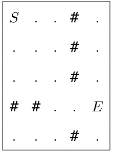

# 2026 CCF 非专业级别软件能力认证第一轮（CSP-J1）入门级 C++ 语言试题

认证时间：2026 年 9 月 19 日 09:30~11:30

考生注意事项：

- 试题纸共有 12 页，答题纸共有 1 页，满分 100 分。请在答题纸上作答，写在试题纸上的一律无效。
- 不得使用任何电子设备（如计算器、手机、电子词典等）或查阅任何书籍资料。

## 一、单项选择题

> 共 15 题，每题 2 分，共计 30 分；每题有且仅有一个正确选项。

### 第 1 题

<!-- qid: csp-j1-2026-001 | type: single_choice | score: 2 | answer: B | tags: topic:lang -->

下列 C++ 数据类型中，能够精确存储 10¹⁸ + 1 这个整数的是（ ）。

- A. float
- B. long long
- C. double
- D. int

> **题解**
> 答案：B
> 解释：10¹⁸ + 1 是 19 位的十进制整数。`int` 只有 32 位（上限 2147483647，仅 10 位），装不下；`float` 有效数字约 7 位、`double` 约 15 到 16 位，存 19 位整数都会丢精度；`long long` 是 64 位有符号整数，上限约 9.22 × 10¹⁸，能精确存下 10¹⁸ + 1，选 B。

### 第 2 题

<!-- qid: csp-j1-2026-002 | type: single_choice | score: 2 | answer: D | tags: topic:number -->

十六进制数 2F5 转换为八进制数是（ ）。

- A. 1364
- B. 1635
- C. 1405
- D. 1365

> **题解**
> 答案：D
> 解释：先化成十进制：2F5₁₆ = 2 × 256 + 15 × 16 + 5 = 757。再除以 8 取余倒排：757 ÷ 8 = 94 余 5，94 ÷ 8 = 11 余 6，11 ÷ 8 = 1 余 3，1 ÷ 8 = 0 余 1，逆序读出 1365，选 D。回代验算：1 × 512 + 3 × 64 + 6 × 8 + 5 = 757。A 项 1364、B 项 1635、C 项 1405 与该值都不等。

### 第 3 题

<!-- qid: csp-j1-2026-003 | type: single_choice | score: 2 | answer: C | tags: topic:lang -->

执行下列 C++ 代码，输出是（ ）。

```cpp
 01  int a = 7, b = 3;
 02  std::cout << a / b * b + a % b;
```

- A. 9
- B. 10
- C. 7
- D. 6

> **题解**
> 答案：C
> 解释：两个运算数都是 `int`，所以 `a / b` 是整数除法、直接截掉小数：7 / 3 = 2，于是 `a / b * b` = 2 × 3 = 6；`a % b` = 7 % 3 = 1；相加得 7，选 C。把这两行原样编译运行，输出就是 `7`。A 项 9 与 D 项 6 与「先整除、再取模」的正确运算顺序都不符，是运算顺序上的干扰值。

### 第 4 题

<!-- qid: csp-j1-2026-004 | type: single_choice | score: 2 | answer: C | tags: topic:ds -->

初始时栈为空，将 1、2、3、4 依次入栈，入栈过程中允许随时出栈。下列出栈序列中不可能出现的是（ ）。

- A. 2，4，3，1
- B. 1，2，3，4
- C. 3，1，2，4
- D. 1，4，3，2

> **题解**
> 答案：C
> 解释：按「后进先出」逐项检验。C 项以 3 开头：能先出 3 说明 1、2、3 都已在栈内，此时栈顶压着 2，3 出栈后下一个只能出 2，不可能出 1，所以 C 不可能，选 C。A 项可行：1 入、2 入 2 出、3 入 4 入、4 出 3 出 1 出；B 项入一个出一个；D 项 1 入 1 出，2、3、4 依次入栈后按 4、3、2 出。穷举全部入出栈方案核对，也只有 C 得不到。

### 第 5 题

<!-- qid: csp-j1-2026-005 | type: single_choice | score: 2 | answer: B | tags: topic:tree -->

一棵有 100 个结点的完全二叉树，其叶子结点个数是（ ）。

- A. 49
- B. 50
- C. 64
- D. 51

> **题解**
> 答案：B
> 解释：完全二叉树按下标编号后，结点 i 有左孩子当且仅当 2i ≤ n。n = 100 时 1 到 50 号结点有孩子，51 到 100 号没有，叶子数为 100 − 50 = 50，选 B。写成公式就是「叶子数 = n − ⌊n / 2⌋」：100 − 50 = 50。A 项 49 比正确值少 1，是「非叶子数再减一」之类的错算结果。

### 第 6 题

<!-- qid: csp-j1-2026-006 | type: single_choice | score: 2 | answer: D | tags: topic:combinatorics -->

执行下列代码后 s 的值是（ ）。

```cpp
 01  int s = 0;
 02  for (int i = 1; i <= 100; i++)
 03      if (i % 3 == 0 || i % 5 == 0)
 04          s += i;
```

- A. 3048
- B. 2733
- C. 2318
- D. 2418

> **题解**
> 答案：D
> 解释：用容斥原理：3 的倍数之和 3 + 6 + … + 99 = 1683，5 的倍数之和 5 + 10 + … + 100 = 1050，15 的倍数被加了两次共 15 + 30 + … + 90 = 315，所以答案是 1683 + 1050 − 315 = 2418，选 D。把这段代码原样编译运行，输出同样是 `2418`。

### 第 7 题

<!-- qid: csp-j1-2026-007 | type: single_choice | score: 2 | answer: D | tags: topic:dp -->

上楼梯每步可上 1 级、2 级或 3 级，从地面（可视为第 0 级）走到第 8 级台阶共有多少种不同走法（ ）。

- A. 44
- B. 121
- C. 149
- D. 81

> **题解**
> 答案：D
> 解释：设 f(i) 为走到第 i 级的走法数，最后一步可能是 1、2 或 3 级，所以 f(i) = f(i−1) + f(i−2) + f(i−3)，初值 f(0) = 1、f(1) = 1、f(2) = 2。逐项推：f(3) = 4、f(4) = 7、f(5) = 13、f(6) = 24、f(7) = 44、f(8) = 81，选 D。A 项 44 恰好是第 7 级的答案，少推一步就会选它。

### 第 8 题

<!-- qid: csp-j1-2026-008 | type: single_choice | score: 2 | answer: C | images: q008-fig1.png | tags: feat:figure,topic:graph -->

下图为 5 × 5 网格，行号、列号均从 0 开始，# 为障碍，. 为可通行格：



从 S 出发做广度优先搜索（BFS）：初始时把 S 入队；每次取出队首格子，按“上、下、左、右”（上 = 行号减 1，下 = 行号加 1，左 = 列号减 1，右 = 列号加 1）的顺序遍历它的四个相邻格子，越界、障碍或已访问的格子跳过，其余格子标记为已访问并入队。当 E 第一次入队时，已经入队过的格子（含 S 和 E）共有多少个（ ）。

- A. 15
- B. 12
- C. 14
- D. 13

> **题解**
> 答案：C
> 解释：按「上、下、左、右」的次序把 BFS 队列一格一格写出来（括号内为入队次序）：(0,0) S、1 (1,0)、2 (0,1)、3 (2,0)、4 (1,1)、5 (0,2)、6 (2,1)、7 (1,2)、8 (2,2)、9 (3,2)、10 (4,2)、11 (3,3)、12 (4,1)、13 (3,4) E——E 第一次入队时共 14 个格子，选 C。关键是中间一列的 # 把上方两行卡住，只能从 (2,2) 向下钻到 (3,2) 再展开，靠目测很容易数成 13 或 15。实跑同一套规则的程序，得到的入队格子也是这 14 个。

### 第 9 题

<!-- qid: csp-j1-2026-009 | type: single_choice | score: 2 | answer: B | tags: feat:formula,topic:number -->

满足 $1 \le n \le 100$ 且 $\gcd(n, 60) = 6$ 的正整数 $n$ 共有多少个（ ）。

- A. 8
- B. 6
- C. 4
- D. 5

> **题解**
> 答案：B
> 解释：设 n = 6t，则 gcd(n, 60) = 6 · gcd(t, 10)，要等于 6 就必须 gcd(t, 10) = 1，即 t 既不是 2 的倍数也不是 5 的倍数；n ≤ 100 给出 t ≤ 16。t 可取 1、3、7、9、11、13 共 6 个，对应 n 为 6、18、42、54、66、78，选 B。把 1 到 100 逐个枚举核对，也正好是这 6 个。

### 第 10 题

<!-- qid: csp-j1-2026-010 | type: single_choice | score: 2 | answer: A | tags: topic:dp -->

某国硬币面值为 1 元、4 元、6 元且数量不限，凑出 9 元最少需要多少枚（ ）。

- A. 3
- B. 4
- C. 5
- D. 2

> **题解**
> 答案：A
> 解释：直接枚举可行组合：4 + 4 + 1 = 9 元正好 3 枚；改用 6 元要先拿 6、剩下 3 只能用三个 1 元，共 4 枚；全用 1 元要 9 枚。最少是 3 枚，选 A。这题也说明「先拿大面值」的贪心不成立（6 + 1 + 1 + 1 要 4 枚），必须枚举着看。

### 第 11 题

<!-- qid: csp-j1-2026-011 | type: single_choice | score: 2 | answer: A | tags: topic:lang -->

执行下列代码，输出是（ ）。

```cpp
 01  int a[5] = {1, 3, 5, 7, 9};
 02  int *p = a + 2;
 03  *(p - 1) = p[0] + p[2];
 04  p[1] = *(a + 1) - a[0];
 05  cout << a[1] << "," << a[3];
```

- A. 14,13
- B. 8,13
- C. 14,7
- D. 14,2

> **题解**
> 答案：A
> 解释：`p = a + 2` 指向 a[2] = 5。第一条赋值 `*(p - 1) = p[0] + p[2]` 即 a[1] = a[2] + a[4] = 5 + 9 = 14，a[1] 被改写；第二条赋值 `p[1] = *(a + 1) - a[0]` 即 a[3] = a[1] − a[0] = 14 − 1 = 13。此时 a[1] 已经是 14，不能用最初的 3 去算。输出 14,13，选 A。C 项 14,7 正是漏掉「a[1] 已被改写」的结果。

### 第 12 题

<!-- qid: csp-j1-2026-012 | type: single_choice | score: 2 | answer: D | tags: topic:bisect -->

在含 1000 个互不相同元素的升序数组中，用二分法查找给定值（返回元素位置或报告不存在），最坏情况下需要与数组元素比较多少次（ ）。

- A. 500
- B. 9
- C. 11
- D. 10

> **题解**
> 答案：D
> 解释：二分查找每比较一次就把候选区间缩小一半，n 个元素的最坏比较次数是 ⌈log₂(n + 1)⌉。n = 1000 时 2⁹ = 512 < 1001 ≤ 1024 = 2¹⁰，所以最坏要比较 10 次，选 D。A 项 500 是「每轮排除一半元素数」的误算，C 项 11 把上界多加了一次。

### 第 13 题

<!-- qid: csp-j1-2026-013 | type: single_choice | score: 2 | answer: C | tags: feat:formula,topic:math -->

数组 $a[1..n]$ 的前缀和数组 $s$（即 $s[i] = a[1] + a[2] + \cdots + a[i]$）满足 $s[i] = 3i^2 + i$。则 $a[10]$ 的值是（ ）。

- A. 252
- B. 310
- C. 58
- D. 61

> **题解**
> 答案：C
> 解释：前缀和反求原数组用差分：a[i] = s[i] − s[i−1]。代入公式：s[10] = 3 × 10² + 10 = 310，s[9] = 3 × 9² + 9 = 252，a[10] = 310 − 252 = 58，选 C。A 项 252、B 项 310 分别是 s[9] 和 s[10] 本身，正好是忘了做差分的人会选的干扰值。

### 第 14 题

<!-- qid: csp-j1-2026-014 | type: single_choice | score: 2 | answer: A | tags: topic:math -->

数轴上有 7 个点，坐标分别为 1、3、4、7、10、15、20。在数轴上选取一个整数坐标点 P，使 P 到这 7 个点的距离之和最小，这个最小距离和是（ ）。

- A. 37
- B. 42
- C. 40
- D. 38

> **题解**
> 答案：A
> 解释：绝对值距离之和最小的点落在中位数上：7 个点的中位数是第 4 个点，P = 7。代入计算：|7−1| + |7−3| + |7−4| + |7−10| + |7−15| + |7−20| = 6 + 4 + 3 + 0 + 3 + 8 + 13 = 37，选 A。把 P 从 1 到 20 逐个整点试算，最小值也确实出现在 P = 7 处、等于 37。

### 第 15 题

<!-- qid: csp-j1-2026-015 | type: single_choice | score: 2 | answer: B | tags: topic:graph -->

一个无向图有 10 个顶点，其中 4 个顶点的度为 3，其余顶点的度均为 4，则该图的边数是（ ）。

- A. 36
- B. 18
- C. 17
- D. 20

> **题解**
> 答案：B
> 解释：握手定理：无向图中所有顶点的度数之和等于边数的两倍。度数之和 = 4 × 3 + 6 × 4 = 12 + 24 = 36，边数 = 36 ÷ 2 = 18，选 B。A 项 36 是忘记除以 2 的结果。

## 二、阅读程序

> 程序输入不超过数组或字符串定义的范围；判断题正确填 √，错误填 ×；除特殊说明外，判断题 1.5 分，选择题 3 分，共计 40 分。

### (1)

<!-- group: 阅读程序(1) -->

```cpp
 01  #include <iostream>
 02  using namespace std;
 03  int main() {
 04      int n;
 05      cin >> n;
 06      int x = 1, y = 1;
 07      while (n > 0) {
 08          if (n % 2 == 0) {
 09              ++x;
 10          } else {
 11              ++x;
 12              ++y;
 13          }
 14          n = n / 2;
 15      }
 16      cout << x << ' ' << y << endl;
 17      return 0;
 18  }
```

以下问题均假定输入的 $n$ 为不超过 $2^{31} - 1$ 的非负整数。

> **程序说明**
> 这段程序读入一个非负整数 n，然后反复执行 `n = n / 2`，同时用两个计数器记账：x 从 1 起，每转一圈（也就是每处理一个二进制位）加一；y 也从 1 起，只在当前 n 是奇数（最低位是 1）时加一。循环结束时 x 等于 n 的二进制位数加一，y 等于 n 的二进制里 1 的个数加一。理解本组要抓住两点：一是两个数各在数什么——「总位数」与「1 的个数」，任何数的二进制中 1 的个数都不会超过位数，所以 x 不小于 y 恒成立；二是死循环的成因——n 为 0 时 `n / 2` 仍是 0，把条件放宽到 `n >= 0` 后循环永远无法退出。

#### 判断题

##### 第 16 题

<!-- qid: csp-j1-2026-016 | type: true_false | score: 1 | answer: T | tags: topic:number -->

（1 分）当输入为 3 时，程序输出为 3 3。（ ）

> **题解**
> 答案：√
> 解释：3 的二进制是 11：n = 3 是奇数，`++x`、`++y` 各一次后 n 变成 1；n = 1 仍是奇数，再各加一次后 n 变成 0 退出循环。x = 1 + 2 = 3、y = 1 + 2 = 3，输出 3 3。把程序原样编译运行，输入 3 的输出就是 `3 3`，故主张成立，填 √。

##### 第 17 题

<!-- qid: csp-j1-2026-017 | type: true_false | score: 1.5 | answer: F | tags: feat:lineref,topic:number -->

将第 11 行的 `++x;` 删除后，程序输出的两个数一定相等。（ ）

> **题解**
> 答案：×
> 解释：删掉第 11 行的 `++x;` 后，偶数步只加 x、奇数步只加 y，两者不再同步。实跑反例：输入 1 只走奇数分支，输出 `1 2`，两个数不相等；输入 3 输出 `1 3`、输入 7 输出 `1 4`，都不相等。存在反例，主张为假，填 ×。

##### 第 18 题

<!-- qid: csp-j1-2026-018 | type: true_false | score: 1.5 | answer: T | tags: topic:number -->

假设输入为非负整数，则程序输出的第一个数一定不小于第二个数。（ ）

> **题解**
> 答案：√
> 解释：循环每转一圈处理一个二进制位：x 记「总步数 + 1」，y 只在本位为 1 时加一，记「1 的个数 + 1」。任何数的二进制里 1 的个数都不会超过位数，所以 x ≥ y 恒成立；n = 0 时两数同为 1，也满足。实跑穷举 n 从 0 到 2²⁰ − 1 共一百多万个输入，没有一次出现 x < y，故填 √。

#### 单选题

##### 第 19 题

<!-- qid: csp-j1-2026-019 | type: single_choice | score: 3 | answer: A | tags: feat:lineref,topic:number -->

将第 7 行的 `while (n > 0)` 改为 `while (n >= 0)` 后，程序可能出现的问题是（ ）。

- A. 陷入死循环
- B. 输出结果比原来大
- C. 输出结果比原来小
- D. 输出结果不受影响

> **题解**
> 答案：A
> 解释：n = 0 时原循环一次都不进；改成 `n >= 0` 后会进入循环体，`n % 2 == 0` 成立、执行 `++x`，而 `n = n / 2` 结果仍是 0，条件永远成立，程序停不下来。实跑验证：把该行改成 `n >= 0`、其余一字不动重新编译，输入 6 后进程持续运行无法结束（只能超时强杀），选 A。B、C、D 三项都假设程序还能正常输出，与死循环不符。

##### 第 20 题

<!-- qid: csp-j1-2026-020 | type: single_choice | score: 3 | answer: C | tags: topic:number -->

当输入为 6 时，输出为（ ）。

- A. 3 3
- B. 4 2
- C. 4 3
- D. 5 2

> **题解**
> 答案：C
> 解释：6 的二进制是 110：n = 6 偶数，x 加一得 2，n 变 3；n = 3 奇数，x、y 各加一得 x = 3、y = 2，n 变 1；n = 1 奇数，再加一得 x = 4、y = 3，n 变 0 退出，输出 4 3，选 C。实跑输入 6 的输出就是 `4 3`。A 项 3 3 是输入 3 的结果，B 项 4 2 位数对但 1 的个数少算了一次。

##### 第 21 题

<!-- qid: csp-j1-2026-021 | type: single_choice | score: 3 | answer: C | tags: feat:formula,topic:number -->

若输入 $n$ 依次取遍 $0, 1, 2, \ldots, 2^{31} - 1$ 中的所有整数，则程序输出的第二个数恰好为 2 的次数为（ ）。

- A. 16
- B. 30
- C. 31
- D. 32

> **题解**
> 答案：C
> 解释：输出的第二个数恰好为 2，意思是二进制里恰好有一个 1（y = 1 的个数 + 1），即 n 是 2 的幂；n = 1 算一个，n = 0 的二进制里没有 1、不算。0 到 2³¹ − 1 之间这样的数正是 2⁰ 到 2³⁰ 共 31 个，选 C。把卷面程序改成循环统计后实跑，从 0 数到 2³¹ − 1 的结果就是 31；D 项 32 多算了 2³¹，它已经超出范围。

### (2)

<!-- group: 阅读程序(2) -->

```cpp
 01  #include <algorithm>
 02  #include <iostream>
 03  #include <string>
 04  using namespace std;
 05  int a[100007], b[100007], c[100007], carry[100007];
 06  string input_str;
 07  int a_len, b_len;
 08  int main() {
 09      cin >> input_str;
 10      a_len = input_str.size();
 11      for (int i = 0; i < a_len; i++) {
 12          a[i] = input_str[a_len - i - 1] - '0';
 13      }
 14      cin >> input_str;
 15      b_len = input_str.size();
 16      for (int i = 0; i < b_len; i++) {
 17          b[i] = input_str[b_len - i - 1] - '0';
 18      }
 19      carry[0] = 0;
 20      for (int i = 0; i < max(a_len, b_len) + 1; i++) {
 21          c[i] = a[i] + b[i] + carry[i];
 22          if (c[i] >= 10) {
 23              carry[i + 1] = 1;
 24              c[i] -= 10;
 25          } else {
 26              carry[i + 1] = 0;
 27          }
 28      }
 29      for (int i = max(a_len, b_len); i >= 0; i--) {
 30          cout << c[i];
 31      }
 32      cout << endl;
 33      return 0;
 34  }
```

本题输入的两个数均为非负整数，位数不超过 100000，可能包含前导零。

> **程序说明**
> 这段程序用字符串读入两个非负整数（位数不超过 100000、允许前导零），把它们倒序存进整型数组（低位在前），再逐位相加并处理进位，最后从最高位到最低位输出结果。输出长度固定为两数位数的较大值加一，也就是 max(a_len, b_len) + 1 位，所以高位常常会多出一个 0——本组六道题全都围绕这个「多输出一位」和进位规则展开。理解本组要抓住两点：一是进位 carry[i] 的来龙去脉，第 21 行把它加进本位和，第 22 行判断本位是否满 10、满 10 才把 carry[i + 1] 置 1；二是输出不裁剪前导零，例 123 + 456 会输出 `0579` 而不是 `579`。

#### 判断题

##### 第 22 题

<!-- qid: csp-j1-2026-022 | type: true_false | score: 1.5 | answer: T | tags: topic:sim -->

当输入为 123 456 时，程序输出为 0579。（ ）

> **题解**
> 答案：√
> 解释：两数倒序存成低位在前：3 + 6 = 9、2 + 5 = 7、1 + 4 = 5，第二次循环多走一位得到 0，输出从高位到低位即 0、5、7、9，拼成 `0579`。实跑输入 `123 456`，输出正是 `0579`，故填 √。

##### 第 23 题

<!-- qid: csp-j1-2026-023 | type: true_false | score: 1.5 | answer: F | tags: topic:sim -->

假设输入的两个数均不含前导零，则程序输出的结果也一定不会含有前导零。（ ）

> **题解**
> 答案：×
> 解释：程序固定输出 max(a_len, b_len) + 1 位，只要最高位没有进位，就会多输出一个 0。实跑反例：输入 `111 222`（两数都不含前导零）输出 `0333`；输入 `234 543` 输出 `0777`；输入 `100 100` 输出 `0200`。主张为假，填 ×。

##### 第 24 题

<!-- qid: csp-j1-2026-024 | type: true_false | score: 1.5 | answer: F | tags: feat:lineref,topic:sim -->

将第 21 行改为 `c[i]=a[i]+b[i];` 后，程序输出的结果一定比原来的结果小。（ ）

> **题解**
> 答案：×
> 解释：去掉进位 `carry[i]` 后本位不再接收低位的进位。实跑比对：输入 `123 456` 时改前改后输出都是 `0579`——这一组没有任何进位，结果与原程序完全相同，并不比原来小，主张为假，填 ×。有进位时结果甚至会变小（输入 `5 5` 时原程序输出 `10`、改后输出 `00`），但「一定比原来小」只要找到一个相等的反例就已不成立。

#### 单选题

##### 第 25 题

<!-- qid: csp-j1-2026-025 | type: single_choice | score: 3 | answer: B | tags: topic:sim -->

当输入为 12345 678 时，输出为（ ）。

- A. 012923
- B. 013023
- C. 13023
- D. 130230

> **题解**
> 答案：B
> 解释：12345 + 678 = 13023，程序把两数倒序对齐逐位相加：5 + 8 = 13 写 3 进 1、4 + 7 + 1 = 12 写 2 进 1、3 + 6 + 1 = 10 写 0 进 1、2 + 1 = 3、1 照抄，最高位再补一个 0，输出 `013023`，选 B。实跑输入 `12345 678` 的输出就是 `013023`。A 项 012923、C 项 13023、D 项 130230 与逐位结果都不符。

##### 第 26 题

<!-- qid: csp-j1-2026-026 | type: single_choice | score: 3 | answer: A | tags: feat:lineref,topic:sim -->

将第 22 行的 `if (c[i]>=10)` 改为 `if (c[i]>10)` 后，当输入为 95 15 时，输出为（ ）。

- A. 01010
- B. 110
- C. 140
- D. 1410

> **题解**
> 答案：A
> 解释：把 `>= 10` 改成 `> 10` 后，恰好等于 10 的位不再进位、也不减 10：个位 5 + 5 = 10 保留 10，十位 9 + 1 = 10 也保留 10，最高位补 0，输出从高位到低位即 0、10、10，拼成 `01010`，选 A。实跑改后的程序、输入 `95 15`，输出正是 `01010`。

##### 第 27 题

<!-- qid: csp-j1-2026-027 | type: single_choice | score: 3 | answer: C | tags: feat:formula,topic:sim -->

假设输入的两个数均为 $n$ 位正整数（不含前导零），且它们的和小于 $10^n$，则程序输出的字符串一定满足（ ）。

- A. 第一个字符一定不为 `'0'`
- B. 长度一定为 $n$
- C. 长度一定为 $n + 1$，且第一个字符为 `'0'`
- D. 长度可能为 $n + 2$

> **题解**
> 答案：C
> 解释：和小于 10ⁿ 说明最高位不会产生进位，c[n] 必为 0；而输出固定从 c[n] 打到 c[0]，所以字符串长度恒为 n + 1、第一个字符恒为 '0'，选 C。A 项与事实相反；B 项长度是 n + 1 不是 n；D 项要输出到 c[n + 1]，程序根本没有这一位。随机抽 183 组满足条件的输入实跑，输出长度全部是 n + 1、首字符全部是 0。

### (3)

<!-- group: 阅读程序(3) -->

```cpp
 01  #include <iostream>
 02  using namespace std;
 03  bool check_prime(int x) {
 04      if (x <= 1) return false;
 05      for (int i = 2; i * i <= x; i++) {
 06          if (x % i == 0) return false;
 07      }
 08      return true;
 09  }
 10  int n;
 11  void search_result(int x) {
 12      if (!check_prime(x)) return;
 13      if (x >= n) {
 14          cout << x << endl;
 15          return;
 16      }
 17      for (int i = 0; i <= 9; i++) {
 18          search_result(x * 10 + i);
 19      }
 20  }
 21  int main() {
 22      cin >> n;
 23      for (int i = 1; i <= 9; i++) search_result(i);
 24      return 0;
 25  }
```

> **程序说明**
> 这段程序用递归搜索一类特殊的数：从 1 到 9 每个数字出发，先判断当前数是不是质数，不是就直接返回；一旦当前数不小于 n 就把它输出、不再深入；否则在末尾再追加一位数字 0 到 9 继续递归。这类数叫「右截断素数」——每一步截掉末位后剩下的数仍然是素数，程序把这一步落在递归入口的 check_prime 判断上。理解本组要抓住两点：一是输出顺序是深度优先搜索的顺序而不是大小顺序（例如 n = 24 时先输出 233、239，再输出 29）；二是每个输出的大于等于 10 的数，删去末位得到的数正是它的上一层搜索节点，必然也是素数。

#### 判断题

##### 第 28 题

<!-- qid: csp-j1-2026-028 | type: true_false | score: 1.5 | answer: F | tags: topic:search -->

当输入为 10 时，程序的输出共有 10 行。（ ）

> **题解**
> 答案：×
> 解释：n = 10 时输出的都是不小于 10 的右截断素数：23、29、31、37、53、59、71、73、79，共 9 行而不是 10 行。实跑输入 10 输出正是这 9 行，主张为假，填 ×。

##### 第 29 题

<!-- qid: csp-j1-2026-029 | type: true_false | score: 1.5 | answer: T | tags: feat:formula,topic:search -->

若输入的 $n$ 不大于 5，则程序的输出中一定包含 5。（ ）

> **题解**
> 答案：√
> 解释：n ≤ 5 时从 5 出发调用 search_result(5)：5 是素数，且 5 ≥ n 成立，就会被输出并返回。实跑输入 1 到 5，每一组的输出里都含有数字 5（例如输入 1 输出 2、3、5、7；输入 5 输出 23、29、31、37、5、7），故填 √。

##### 第 30 题

<!-- qid: csp-j1-2026-030 | type: true_false | score: 1.5 | answer: T | tags: feat:formula,feat:lineref,topic:search -->

若输入的 $n$ 大于 10，将第 17 行的 `for (int i=0;i<=9;i++)` 改为 `for (int i=1;i<=9;i+=2)` 后，程序的输出结果一定不变。（ ）

> **题解**
> 答案：√
> 解释：程序的输出一定是大于 10 的素数，个位只可能是 1、3、7、9——追加偶数或 5 得到的数必然被 2 或 5 整除、过不了素数判断，永远进不了输出。把循环改成只走奇数后，最多再走一个以 5 结尾的分支，同样会被拦下。实跑比对：n = 11、24、50、200、1000 五组输入，改动前后输出逐行完全相同，故填 √。

#### 单选题

##### 第 31 题

<!-- qid: csp-j1-2026-031 | type: single_choice | score: 3 | answer: B | tags: feat:lineref,topic:search -->

当输入为 24 时，程序输出的第 3 行为（ ）。

- A. 23
- B. 29
- C. 31
- D. 239

> **题解**
> 答案：B
> 解释：按搜索顺序展开：从 2 出发（2 < 24），先试接到 3 得到 23，23 仍小于 24，继续接成 233、239 并输出前两行；回到 2 的循环后接着接到 9 得到 29，29 ≥ 24，输出第 3 行 29，选 B。实跑输入 24，输出的前三行依次是 `233`、`239`、`29`。C 项 31 是按大小排序的产物，本题输出的是搜索顺序。

##### 第 32 题

<!-- qid: csp-j1-2026-032 | type: single_choice | score: 3 | answer: D | tags: feat:formula,topic:search -->

下列关于该程序输出的说法中，正确的是（ ）。

- A. 输出的数一定按照从小到大的顺序排列
- B. 随着输入 $n$ 的增大，输出的行数一定不会增加
- C. 输出的数的个位数字只可能是 3 或 7
- D. 输出的每个大于等于 10 的数，十进制下删去它的末位数字后得到的数一定是质数

> **题解**
> 答案：D
> 解释：逐项看：A 错，输出是深度优先顺序（n = 200 时 233、239 之后是 29，不是升序）；B 错，行数会随 n 增大而增多（n = 10 输出 9 行、n = 200 输出 14 行）；C 错，个位还可能是 1 或 9（如 311、59）；D 对，每个输出的数在递归链上都要求「截一截末位仍是素数」，删掉末位正是它的上一层节点，一定是质数。实跑 n = 200 的全部 14 个输出逐个校验，D 项无例外，选 D。

##### 第 33 题

<!-- qid: csp-j1-2026-033 | type: single_choice | score: 3 | answer: C | tags: topic:search -->

当输入为 200 时，程序输出的行数为（ ）。

- A. 12
- B. 13
- C. 14
- D. 15

> **题解**
> 答案：C
> 解释：n = 200 时输出的是全部三位右截断素数：233、239、293、311、313、317、373、379、593、599、719、733、739、797，共 14 行，选 C。实跑输入 200 得到的行数就是 14。A 项 12、B 项 13 少算了尾部的 733、739、797 一类，D 项 15 多算一行。

## 三、完善程序

> 单选题，每小题 3 分，共计 30 分。

### (1)

<!-- group: 完善程序(1) -->

给定 $n, m$，再给定一个 $mn$ 进制下的数 $A$，其各个数位上的数按照从高位到低位的顺序给出，请你将其转化为 $n$ 进制，并同样按照从高位到低位的顺序输出。

输入的第一行依次为 $n$、$m$ 和 $A$ 的位数 $d$，接下来 $d$ 个数 $a_d, a_{d-1}, \ldots, a_1$ 从高位到低位描述各个数位上的数。

数据满足 $2 \le n, m \le 10$，$1 \le d \le 18$，$0 \le A < 2^{63}$；对于所有 $1 \le i \le d$，$0 \le a_i < mn$。

以下程序按“逐位除以 $n$”的方法完成进制转换。请补全程序。

```cpp
 01  #include <iostream>
 02
 03  constexpr int N = 100005;
 04  long long b[N];
 05
 06  int main() {
 07      long long n, m, d;
 08      std::cin >> n >> m >> d;
 09      int len = 1;
 10      for (int i = 0; i < d; i++) {
 11          long long x;
 12          std::cin >> x;
 13          for (int j = len; j >= 1; j--)
 14              b[j] = ①;
 15          b[0] = ②;
 16          len++;
 17          for (int j = 0; j < len; j++)
 18              if (b[j] >= n) {
 19                  b[j + 1] += ③;
 20                  b[j] = ④;
 21                  if (j + 1 == len) len++;
 22              }
 23      }
 24      while (⑤) len--;
 25      for (int i = len - 1; i >= 0; i--)
 26          std::cout << b[i] << ' ';
 27      return 0;
 28  }
```

> **程序说明**
> 这段程序把一个 m·n 进制下的数（两个变量相乘的「复合进制」）转换为 n 进制。输入先给 n、m 和位数 d，再按高位到低位给出 d 个数字；程序的思路是每读入一位 x，就把已有的结果整体乘 m·n 再加 x：数组 b 按 n 进制存放（低位在前），乘 n 用整体后移一位实现，所以 ① 处写 b[j - 1] * m，随后统一进位——本位除以 n 的商进高位、余数留在本位，最后删掉高位多余的 0。理解本组要抓住两点：一是「移位等价于乘 n」，移位与乘 m 合起来就是乘 m·n；二是 ⑤ 的边界，删去高位零必须保留至少一位，结果本身就是 0 时也不能删空。

##### 第 34 题

<!-- qid: csp-j1-2026-034 | type: single_choice | score: 3 | answer: D | tags: feat:circnum,topic:number -->

①处应填（ ）。

- A. b[j] * n
- B. b[j] * m
- C. b[j - 1] * n
- D. b[j - 1] * m

> **题解**
> 答案：D
> 解释：数组 b 按 n 进制存数、低位在前，「把已有结果乘 m·n」分两步做：乘 n 等价于整体后移一位，乘 m 则让每一位都乘 m。第 13、14 行的搬动从高位往低位走（j 从 len 递减），用的是同一次循环里还没被覆盖的 b[j - 1]，所以 ① 填 b[j - 1] * m，选 D。把四个候选分别代进代码编译运行：A、B 用 b[j] 会把本位的旧值卷进来，C 少乘了 m，在 17 组输入上都算错；只有 D 与独立写的大整数进制转换结果逐组一致。

##### 第 35 题

<!-- qid: csp-j1-2026-035 | type: single_choice | score: 3 | answer: B | tags: feat:circnum,topic:number -->

②处应填（ ）。

- A. x * n
- B. x
- C. 0
- D. m

> **题解**
> 答案：B
> 解释：第 12 行刚把一位数字读进 x，②要把这一位放到结果的最低位，也就是 b[0]，填 x 本身，选 B。A 项先乘 n 把值放大，C 项把 x 丢掉，D 项把进制数 m 当成了新数字。代入实跑：填 A 时输出会多出一个尾 0（如输入 2、3、4 位数字 1 0 2 5，输出末尾多一个 0），填 C 输出恒为 0，只有 B 与参考结果一致。

##### 第 36 题

<!-- qid: csp-j1-2026-036 | type: single_choice | score: 3 | answer: D | tags: feat:circnum,topic:number -->

③处应填（ ）。

- A. b[j] / m
- B. b[j] % n
- C. b[j] % m
- D. b[j] / n

> **题解**
> 答案：D
> 解释：本位 b[j] 超过 n − 1 时要向高位进位，把商 b[j] / n 加到 b[j + 1]，即 ③ 填 b[j] / n，选 D。A 项除以 m、B 项取模丢掉了商、C 项先对 m 取模，都不能完成 n 进制进位。代入实跑：填 B、C 时输出位数或数值与参考完全不符，只有 D 在全部用例上与参考一致。

##### 第 37 题

<!-- qid: csp-j1-2026-037 | type: single_choice | score: 3 | answer: B | tags: feat:circnum,topic:number -->

④处应填（ ）。

- A. b[j] / m
- B. b[j] % n
- C. b[j] % m
- D. b[j] / n

> **题解**
> 答案：B
> 解释：进位之后本位要保留除以 n 的余数，落在 0 到 n − 1 之间，即 b[j] = b[j] % n，选 B。A 项对 m 取余、C 项与 n 进制无关、D 项保留商会把本位值撑爆。代入实跑：填 C 时输出里出现超过 n − 1 的「位」（2 进制下算出 2 这样的数），填 D 输出长度暴涨，只有 B 全对。

##### 第 38 题

<!-- qid: csp-j1-2026-038 | type: single_choice | score: 3 | answer: C | tags: feat:circnum,topic:number -->

⑤处应填（ ）。

- A. len > 0 && b[len - 1] == 0
- B. len > 0 && b[0] == 0
- C. len > 1 && b[len - 1] == 0
- D. len > 1 && b[0] == 0

> **题解**
> 答案：C
> 解释：⑤要删掉高位多余的 0，同时保证至少保留一位：b 的最高位在 b[len - 1]，所以条件写成 len > 1 && b[len - 1] == 0，选 C。A 项没有「至少留一位」的底线，结果本身是 0 时（例如输入只有数字 0）会把唯一的一位也删掉、输出空白；B 项看的是 b[0]（最低位），会误删个位；D 项既看错位置又少了保留条件。代入实跑：A 在 17 组里错 1 组、B 错 5 组、D 错 4 组，只有 C 全对。

### (2)

<!-- group: 完善程序(2) -->

给定一个长度为 $n$ 的字符串，其中每个字符都是一个十六进制数位。例如，字符串 016A 表示十进制下的四个数 0, 1, 6, 10。

现在请选择 $k$ 个（$k$ 是你选定的数）切分位置 $p_1, p_2, \ldots, p_k$，其中 $1 \le k < n$，且 $1 \le p_1 < p_2 < \cdots < p_k < n$。再令 $p_0 = 0$，$p_{k+1} = n$。

对于每个 $0 \le i \le k$，计算第 $p_i + 1$ 个数到第 $p_{i+1}$ 个数的平均值，记作 $b_i$。你的目标是使 $b_0, b_1, \ldots, b_k$ 中最大值与最小值之差尽可能小，并输出这个最小值。

其中 $2 \le n \le 20$。输入字符串中的字符只可能是 0—9 或 A—F。本题假定字符采用 ASCII 编码。输出答案时保留小数点后 6 位。

以下程序通过递归枚举所有可能的连续分段方案。请补全程序。

```cpp
 01  #include <algorithm>
 02  #include <iomanip>
 03  #include <iostream>
 04
 05  using namespace std;
 06
 07  constexpr int N = 25;
 08
 09  int n, a[N];
 10  char s[N];
 11
 12  double ans = 1e100;
 13
 14  int value(char c) { return ①; }
 15
 16  void split(int l, int cnt, double mnb, double mxb) {
 17      if (l > n) {
 18          if (cnt == 0) return;
 19          ans = min(ans, mxb - mnb);
 20          return;
 21      }
 22      int sum = 0;
 23      for (②) {
 24          sum += a[r];
 25          double nwb = ③;
 26          split(④);
 27      }
 28  }
 29
 30  int main() {
 31      cin >> n >> s + 1;
 32      for (int i = 1; i <= n; ++i)
 33          a[i] = value(s[i]);
 34      split(⑤);
 35      cout << fixed << setprecision(6) << ans;
```

> **程序说明**
> 这段程序用递归枚举把字符串切成若干连续段的所有方案，求各段平均值的最大值与最小值之差的最小值。split(l, cnt, mnb, mxb) 的含义是：从位置 l 开始切下一段，cnt 记录已经切了几刀（用来排除一刀都不切的情形），mnb、mxb 携带到目前为止各段平均值的最小值和最大值；函数里枚举本段的终点 r（从 l 到 n），累加 a[l..r] 的和并算出本段平均值 nwb，再在 r + 1 处递归。理解本组要抓住两点：一是平均值必须用浮点除法算，先乘 1.0 或写成浮点表达式，整数除法会把小数截掉；二是字符串按 s + 1 读入、a[i] 对应字符 s[i]，枚举的终点 r 要能取到 n，最后一段才能收尾。

##### 第 39 题

<!-- qid: csp-j1-2026-039 | type: single_choice | score: 3 | answer: B | tags: feat:circnum,topic:search -->

①处应填（ ）。

- A. c - (c < '9' ? '0' : 'A' - 10)
- B. c - (c < 'A' ? '0' : 'A' - 10)
- C. c - (c < 'A' ? 'A' - 10 : '0')
- D. c - (c < 'A' ? '0' : 'A' + 10)

> **题解**
> 答案：B
> 解释：十六进制字符转数值：'0' 到 '9' 减 '0'，'A' 到 'F' 再减 'A' 加 10。四个候选都写成「c 减去一个由条件挑出来的常量」：条件成立时该常量是 '0'、否则是 'A' - 10，即 c - (c < 'A' ? '0' : 'A' - 10)，选 B。A 项条件写成 c < '9'，字符 '9' 会被错误地判去减 'A' - 10、得 2；C 项两个分支写反；D 项写成 'A' + 10，对 'A' 得到 −10。代入实跑：填 A 时含 '9' 的用例结果出错（C0251908FC 输出 0.375000、正确 0.5），C、D 在 016A 上分别输出 10.333333、1.000000（正确 5.666667），只有 B 在全部 20 组用例上与参考一致。
> 争议：有的流传解析（https://noi.hnai.net/csp/461.html）把这段程序抄成了另一个版本：转换函数叫 get_val、循环里直接写 sum += get_val(s[r])，第 ① 组选项是 c <= '9' ? c - '0' : c - 'A' + 10 一类的条件表达式，答案记 A；本卷按试卷原文的代码与选项作答，答案取 B。依据：把本卷卷面的四个候选逐一填进代码编译运行，选项 A 在含字符 '9' 的输入上出错（C0251908FC 一组输出 0.375000、正确 0.500000），C、D 也在多个用例上偏离；只有 B 与独立枚举全部切分方案的参考程序在 20 组输入上逐组一致。

##### 第 40 题

<!-- qid: csp-j1-2026-040 | type: single_choice | score: 3 | answer: D | tags: feat:circnum,topic:search -->

②处应填（ ）。

- A. int r = l + 1; r <= n; ++r
- B. int r = l; r < n; ++r
- C. int r = l; r <= n; r += 2
- D. int r = l; r <= n; ++r

> **题解**
> 答案：D
> 解释：②是枚举本段终点 r 的 for 初始化。段允许只含一个字符（r 从 l 开始），也必须能结束在字符串末尾（r 取到 n），所以是 int r = l; r <= n; ++r，选 D。A 项从 l + 1 开始、段长至少 2，n = 2 这类情形枚举不到任何分段；B 项永远到不了 n，最后一段收不了尾；C 项步长 2 漏掉一半的段长。代入实跑：A 在 20 组里错 19 组，B 全部错误（输出停在初始的 1e100），C 错 15 组，只有 D 全对。
> 争议：有的流传解析（https://noi.hnai.net/csp/461.html）给出的选项集与本卷不同：它把 int r = l; r <= n; r++ 排在第 A 位、答案记 A；本卷把同一表达式写作 int r = l; r <= n; ++r、排在第 D 位，答案取 D。两个版本的其余代码与选项也有出入，不能只把字母搬过来。依据：代入实跑，A 项使每一段的长度至少为 2、在 20 组用例里错 19 组，只有 D 全对。

##### 第 41 题

<!-- qid: csp-j1-2026-041 | type: single_choice | score: 3 | answer: C | tags: feat:circnum,topic:search -->

③处应填（ ）。

- A. sum / (r - l + 1) * 1.0
- B. sum * 1.0 / (r - l) + 1
- C. sum * 1.0 / (r - l + 1)
- D. (sum - a[r]) * 1.0 / (r - l + 1)

> **题解**
> 答案：C
> 解释：③是当前段的平均值：sum 是在 r 推进时累加出来的 a[l..r] 之和，段长是 r - l + 1，所以 nwb = sum * 1.0 / (r - l + 1)，选 C。A 项先做整数除法（sum / (r - l + 1)）再乘 1.0，小数已经被截掉；B 项分母少了 1 还额外加 1；D 项把 a[r] 减掉、分子少一位但分母仍是全长。代入实跑：A 在 016A 上输出 5.000000、B 输出 0.000000、D 输出 0.000000（正确 5.666667），只有 C 全对。
> 争议：有的流传解析（https://noi.hnai.net/csp/461.html）的 ③ 候选写作 1.0*sum/(r-l+1)、答案记 B；本卷卷面的 ③ 候选是 sum * 1.0 / (r - l + 1)、答案取 C。两式语义相同、写法不同，属于同一道题的另一版打稿，本卷按试卷原文的选项作答。依据：代入实跑，A 项先做整数除法会截掉小数（016A 输出 5.000000、正确 5.666667），B、D 也都在用例上偏离，只有 C 在全部 20 组用例上全对。

##### 第 42 题

<!-- qid: csp-j1-2026-042 | type: single_choice | score: 3 | answer: A | tags: feat:circnum,topic:search -->

④处应填（ ）。

- A. r + 1, cnt + (r < n), min(mnb, nwb), max(mxb, nwb)
- B. r + 1, cnt + (r <= n), min(mnb, nwb), max(mxb, nwb)
- C. r + 1, cnt + (r < n), max(mnb, nwb), min(mxb, nwb)
- D. r + 1, cnt + (r <= n), max(mnb, nwb), min(mxb, nwb)

> **题解**
> 答案：A
> 解释：④是递归调用的四个实参：下一段从 r + 1 开始；切分数只在「本段没有到末尾」时加一（r < n 表示这段后面还切了一刀）；同时把当前段的平均值 nwb 并进最小值 mnb、最大值 mxb，即 r + 1, cnt + (r < n), min(mnb, nwb), max(mxb, nwb)，选 A。B 项用 r <= n 计数，把最后一段也算成了一刀，一刀不切的情形会被误当成分过段；C、D 项把 min 和 max 写反，答案要么为负要么停在初值。代入实跑：B、C、D 分别错 18、20、20 组，只有 A 全对。
> 争议：有的流传解析（https://noi.hnai.net/csp/461.html）把对应的空记作 r+1, cnt+1, min(minb,nwb), max(maxb,nwb)、答案记 A；本卷这一空的正确项是 r + 1, cnt + (r < n), min(mnb, nwb), max(mxb, nwb)、答案也取 A。文字上的差别来自整段代码的记法：对方把初始切分数写死在 main 里为 −1、每段固定加一，本卷从 0 起、只在段后还有内容时加一。依据：代入实跑本卷的四个候选，B、C、D 分别错 18、20、20 组，只有 A 在 20 组用例上全对。

##### 第 43 题

<!-- qid: csp-j1-2026-043 | type: single_choice | score: 3 | answer: D | tags: feat:circnum,topic:search -->

⑤处应填（ ）。

- A. 0, 0, 1e100, -1e100
- B. 0, 0, -1e100, 1e100
- C. 1, 0, -1e100, 1e100
- D. 1, 0, 1e100, -1e100

> **题解**
> 答案：D
> 解释：⑤是 main 里第一次调用 split 的实参：从下标 1 开始、切分数 cnt 初值 0（一刀还没切）、最小值 mnb 初始化成极大值 1e100、最大值 mxb 初始化成极小值 −1e100，即 1, 0, 1e100, -1e100，选 D。A 项从下标 0 开始，会把没有赋值的 a[0] 卷进第一段；B 项两个极值初值写反；C 项起点对但初值写成 −1e100，最大值会一直停在初值。代入实跑：A、B、C 三组在全部 20 组用例上都算错，只有 D 全对。
> 争议：有的流传解析（https://noi.hnai.net/csp/461.html）的版本里根本没有这一空：它的 main 直接写死调用 split(1, -1, 1e100, -1e100)，五个空的选项集与本卷完全不同，全卷答案记 A A A B A。本卷按试卷原文的代码与选项作答，这一空填 1, 0, 1e100, -1e100、取 D。依据：代入实跑本卷的四个候选，A、B、C 三组在全部 20 组用例上都算错，只有 D 全对。

