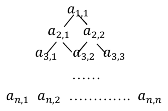

# 2019CCF 非专业级别软件能力认证第一轮（CSP-S）提高级 C++语言试题 B 卷

认证时间：2019 年 10 月 19 日 09:30~11:30

考生注意事项：

- 试题纸共有 10 页，答题纸共有 1 页，满分 100 分。请在答题纸上作答，写在试题纸上的一律无效。
- 不得使用任何电子设备（如计算器、手机、电子词典等）或查阅任何书籍资料。

## 一、单项选择题

> 共 15 题，每题 2 分，共计 30 分；每题有且仅有一个正确选项。

### 第 1 题

<!-- qid: csp-s1-2019b-001 | type: single_choice | score: 2 | answer: C | tags: topic:lang -->

若有定义：`int a=7; float x=2.5, y=4.7;` 则表达式 `x+a%3*(int)(x+y)%2` 的值是：（ ）

- A. 0.000000
- B. 2.750000
- C. 3.500000
- D. 2.500000

> **题解**
> 答案：C
> 解释：乘、除、取余同级、从左往右算，且 `(int)(x+y)` 是强制类型转换，先把 `x+y` 截成整数。代入 a = 7、x = 2.5、y = 4.7：`a % 3` = 7 % 3 = 1，`(int)(x+y)` = `(int)7.2` = 7，于是 `a%3*(int)(x+y)%2` = 1 × 7 % 2 = 1；再加上 x 得 2.5 + 1 = 3.5，写成六位小数就是 `3.500000`，选 C。B 项 2.750000 相当于把取余那一步算错、只加到 x 上的一部分，D 项 2.500000 是整段后缀都没算。

### 第 2 题

<!-- qid: csp-s1-2019b-002 | type: single_choice | score: 2 | answer: D | tags: topic:basics -->

下列属于图像文件格式的有（ ）

- A. MPEG
- B. WMV
- C. AVI
- D. JPEG

> **题解**
> 答案：D
> 解释：JPEG 是静止图像压缩标准（联合图像专家组制定），属于图像文件格式，选 D。A 项 MPEG 是运动图像的压缩标准，B 项 WMV、C 项 AVI 都是微软的音视频格式，三者都属于视频格式。

### 第 3 题

<!-- qid: csp-s1-2019b-003 | type: single_choice | score: 2 | answer: C | tags: topic:bit,topic:number -->

二进制数 11 1011 1001 0111 和 01 0110 1110 1011 进行逻辑或运算的结果是（ ）。

- A. 11 1111 1111 1101
- B. 11 1111 1101 1111
- C. 11 1111 1111 1111
- D. 10 1111 1111 1111

> **题解**
> 答案：C
> 解释：按位或是逐位取或：对应位只要有一个是 1，结果位就是 1。两个数都是 14 位，`11 1011 1001 0111` 与 `01 0110 1110 1011` 逐位对下来每一位至少有一个 1，结果就是 14 位全 1 的 `11 1111 1111 1111`，选 C。换成十六进制核一遍更快：`0x3B97 | 0x16EB` = `0x3FFF`，正是 14 个 1。A、B、D 三项都各有一位是 0，与逐位取或的结果不符。
> 争议：卷面把运算符写成「逻辑或」，但逻辑或是布尔运算：两个非零的二进制数作逻辑或，结果只可能是 1（真），四个选项里没有 1；只有按「按位或」（逐位取或）来理解才能得到所给答案，另一份参考答案也在题后注明原题应读作按位或。本卷按按位或作答、取 C：两个数都是 14 位，逐位取或的结果是 `11 1111 1111 1111`。

### 第 4 题

<!-- qid: csp-s1-2019b-004 | type: single_choice | score: 2 | answer: D | tags: topic:basics -->

编译器的功能是（ ）

- A. 将低级语言翻译成高级语言
- B. 将源程序重新组合
- C. 将一种编程语言翻译成自然语言
- D. 将一种语言（通常是高级语言）翻译成另一种语言（通常是低级语言）

> **题解**
> 答案：D
> 解释：编译器的任务是把源程序（通常用高级语言写成）翻译成目标程序（通常是低级语言、机器指令），选 D。A 项把方向说反了；B 项「重新组合」是链接器做的事；C 项译成自然语言不是编译器的功能。

### 第 5 题

<!-- qid: csp-s1-2019b-005 | type: single_choice | score: 2 | answer: D | tags: topic:lang -->

设变量 `x` 为 `float` 型且已赋值，则以下语句中能将 `x` 中的数值保留到小数点后两位，并将第三位四舍五入的是（ ）

- A. `x=(x*100+0.5)/100.0;`
- B. `x=(x/100+0.5)*100.0;`
- C. `x=x*100+0.5/100.0;`
- D. `x=(int)(x*100+0.5)/100.0;`

> **题解**
> 答案：D
> 解释：要对小数点后第三位四舍五入，必须先把小数点右移两位、加 0.5 后取整（取整这一步同时完成了截断与进位），再除回 100。D 项 `x=(int)(x*100+0.5)/100.0;` 三步齐全，选 D。A 项 `x*100+0.5` 之后直接除以 100，没有取整，小数位原样留着；B 项先除 100 再乘 100 等于把小数点来回搬，数值跑到 50 附近（如 3.14159 → 53.14159）；C 项因为 `/` 优先级高于 `+`，实际算的是 `x*100+0.005`，把数放大了 100 倍。

### 第 6 题

<!-- qid: csp-s1-2019b-006 | type: single_choice | score: 2 | answer: C | tags: topic:combinatorics -->

由数字 1, 1, 2, 4, 8, 8 所组成的不同的 4 位数的个数是（ ）。

- A. 98
- B. 104
- C. 102
- D. 100

> **题解**
> 答案：C
> 解释：按「取出的 4 个数字是哪几个」分类最清楚：取 `{1,2,4,8}` 四个互不相同的数字，排列数 4! = 24；取 `{1,1,8,8}` 两对相同数字，排列数 4! ÷ (2! × 2!) = 6；剩下 6 种取法各含一对相同数字（`{1,1,2,4}`、`{1,1,2,8}`、`{1,1,4,8}`、`{1,2,8,8}`、`{1,4,8,8}`、`{2,4,8,8}`），每种 4! ÷ 2! = 12 个，共 6 × 12 = 72。合计 24 + 6 + 72 = 102，选 C。B 项 104、D 项 100 与 102 只差一两个，靠估算是分不出来的。

### 第 7 题

<!-- qid: csp-s1-2019b-007 | type: single_choice | score: 2 | answer: A | tags: topic:sort -->

排序的算法很多，若按排序的稳定性和不稳定性分类，则（ ）是不稳定排序。

- A. 快速排序
- B. 直接插入排序
- C. 归并排序
- D. 冒泡排序

> **题解**
> 答案：A
> 解释：稳定排序要求关键字相同的元素在排序后保持原来的先后次序。快速排序在划分时把元素跨区间交换，相同关键字的相对次序会被打乱（例如以最小元素为轴划分一次，两个相等的元素就可能互换位置），是不稳定排序，选 A。直接插入、归并、冒泡都是稳定排序。

### 第 8 题

<!-- qid: csp-s1-2019b-008 | type: single_choice | score: 2 | answer: A | tags: topic:graph -->

G 是一个非连通无向图（没有重边和自环），共有 28 条边，则该图至少有（ ）个顶点。

- A. 9
- B. 8
- C. 10
- D. 11

> **题解**
> 答案：A
> 解释：非连通图至少有 2 个连通块。把 n 个顶点分成「1 个孤立点 + 其余 n − 1 个点」时边数最多，为 C(n−1, 2)（其余点两两相连，没有重边自环）。n = 8 时最多 C(7, 2) = 21 条，不够 28 条；n = 9 时最多 C(8, 2) = 28 条，正好够（8 个点构成完全图 K₈，第 9 个点孤立）。所以至少 9 个顶点，选 A。

### 第 9 题

<!-- qid: csp-s1-2019b-009 | type: single_choice | score: 2 | answer: B | tags: topic:combinatorics -->

一些数字可以颠倒过来看，例如 0、1、8 颠倒过来还是本身，6 颠倒过来是 9，9 颠倒过来还是 6，其他数字颠倒过来都不构成数字。类似的，一些多位数也可以颠倒过来看，比如 106 颠倒过来是 901。假设某个城市的车牌只有 5 位数字，每一位都可以取 0 到 9。请问这个城市有多少个车牌倒过来恰好还是原来的车牌，并且车牌上的 5 位数能被 3 整除？（ ）

- A. 20
- B. 25
- C. 30
- D. 40

> **题解**
> 答案：B
> 解释：倒过来还是自己，要求第 1 位与第 5 位互为倒置、第 2 位与第 4 位互为倒置、中间一位倒过来还是自己：中间位只能取 0、1、8，每一对对称位有 0↔0、1↔1、8↔8、6↔9、9↔6 共 5 种配法，一共 3 × 5 × 5 = 75 个候选。能被 3 整除只看各位数字之和能否被 3 整除，逐个统计这 75 个候选，数字和为 3 的倍数的共 25 个（如 `00000`、`01110`、`06090`、`08880`、`09060`），选 B。A 项 20、C 项 30、D 项 40 都偏离了这个计数结果。

### 第 10 题

<!-- qid: csp-s1-2019b-010 | type: single_choice | score: 2 | answer: B | tags: topic:combinatorics -->

一次期末考试，某班有 15 人数学得满分，有 12 人语文得满分，并且有 4 人语、数都是满分，那么这个班至少有一门得满分的同学有多少人？（ ）。

- A. 21
- B. 23
- C. 22
- D. 20

> **题解**
> 答案：B
> 解释：用容斥原理：至少一门满分的人数 = 数学满分 15 + 语文满分 12 − 两门都满分 4 = 23，选 B。A 项 21、C 项 22、D 项 20 都没有把这 4 个被重复数了两遍的同学正确地减掉一次。

### 第 11 题

<!-- qid: csp-s1-2019b-011 | type: single_choice | score: 2 | answer: C | tags: feat:formula,topic:complexity,topic:sort -->

设 A 和 B 是两个长为 $n$ 的有序数组，现在需要将 A 和 B 合并成一个排好序的数组，请问任何以元素比较作为基本运算的归并算法，在最坏情况下至少要做多少次比较？（ ）。

- A. $n^2$
- B. $n \log n$
- C. $2n-1$
- D. $2n$

> **题解**
> 答案：C
> 解释：归并时每取一个元素都要比较一次，而一旦某一方已经取空，剩下的元素就可以直接搬到结果里、不必再比较。最坏情况是直到某一方只剩最后一个元素时才开始「一方已空」，此前一共比较了 2n − 2 次，最后再比一次确定末尾，共 2n − 1 次，选 C。例如 A = 1, 3, 5、B = 2, 4, 6 时比较 5 次，正是 2 × 3 − 1。B 项 n log n 是排序的复杂度量级，A 项 n²、D 项 2n 都比最坏情况更大。

### 第 12 题

<!-- qid: csp-s1-2019b-012 | type: single_choice | score: 2 | answer: C | tags: topic:graph -->

以下哪个结构可以用来存储图（ ）

- A. 二叉树
- B. 队列
- C. 邻接矩阵
- D. 栈

> **题解**
> 答案：C
> 解释：邻接矩阵是一个 n × n 的方阵，第 i 行第 j 列记录顶点 i 与 j 之间有没有边（无向图对称，带权图则存权值），是存储图最基本的结构，选 C。二叉树、栈、队列本身只描述树形或线性次序，不能表示任意两点之间是否相连。

### 第 13 题

<!-- qid: csp-s1-2019b-013 | type: single_choice | score: 2 | answer: D | tags: topic:greedy -->

以下哪些算法不属于贪心算法？（ ）

- A. Dijkstra 算法
- B. Prim 算法
- C. Kruskal 算法
- D. Floyd 算法

> **题解**
> 答案：D
> 解释：Dijkstra、Prim、Kruskal 都是「每步取当前最优」的贪心算法：Dijkstra 每次取当前最短的未确定点，Prim、Kruskal 每次取当前最短的可用边。Floyd 用三重循环做矩阵递推（`d[i][j] = min(d[i][j], d[i][k] + d[k][j])`），是动态规划，不属于贪心，选 D。

### 第 14 题

<!-- qid: csp-s1-2019b-014 | type: single_choice | score: 2 | answer: D | tags: topic:math -->

有一个等比数列，共有奇数项，其中第一项和最后一项分别是 2 和 118098，中间一项是 486，请问以下哪个数是可能的公比？（ ）

- A. 2
- B. 5
- C. 4
- D. 3

> **题解**
> 答案：D
> 解释：设共有 2k + 1 项、公比为 q，则中间一项是 `2q^k = 486`，即 `q^k = 243 = 3⁵`，取 q = 3、k = 5 时项数 2 × 5 + 1 = 11 为奇数，末项为 `2 × 3¹⁰ = 2 × 59049 = 118098`，与题面完全吻合，选 D。A 项的 2 要求 `2^k = 243`，无整数解；B 项 5、C 项 4 同样解不出整数 k，与末项对不上。

### 第 15 题

<!-- qid: csp-s1-2019b-015 | type: single_choice | score: 2 | answer: A | images: q015-fig1.png | tags: feat:figure,feat:formula,topic:dp -->

有正实数构成的数字三角形排列形式如图所示。第一行的数为 $a_{1,1}$；第二行的数从左到右依次为 $a_{2,1}, a_{2,2}$，第 $n$ 行的数为 $a_{n,1}, a_{n,2}, \ldots, a_{n,n}$。从 $a_{1,1}$ 开始，每一行的数 $a_{i,j}$ 只有两条边可以分别通向下一行的两个数 $a_{i+1,j}$ 和 $a_{i+1,j+1}$。用动态规划算法找出一条从 $a_{1,1}$ 向下通到 $a_{n,1}, a_{n,2}, \ldots, a_{n,n}$ 中某个数的路径，使得该路径上的数之和最大。



令 $C[i][j]$ 是从 $a_{1,1}$ 到 $a_{i,j}$ 的路径上的数的最大和，并且 $C[i][0]=C[0][j]=0$，则 $C[i][j]=$（ ）。

- A. $\max\{C[i-1][j-1], C[i-1][j]\} + a_{i,j}$
- B. $\max\{C[i-1][j-1], C[i-1][j]\} + 1$
- C. $C[i-1][j-1] + C[i-1][j]$
- D. $\max\{C[i][j-1], C[i-1][j]\} + a_{i,j}$

> **题解**
> 答案：A
> 解释：走到 `a[i][j]` 的最后一步只能来自上一行的 `a[i-1][j-1]` 或 `a[i-1][j]`，所以到 `a[i][j]` 的最大和就是这两个前驱最大和的较大者再加当前格，即 `max{C[i-1][j-1], C[i-1][j]} + a[i][j]`，选 A。B 项加的是常数 1，把当前格的值丢了；C 项把两个前驱相加，等于同时走了两条路；D 项取的是同一行的 `C[i][j-1]`，而 `(i, j-1)` 一步到不了 `(i, j)`。用枚举全部 2^(n−1) 条路径的暴力法与该递推式比对 2000 组随机三角形，结果完全一致。

## 二、阅读程序

> 程序输入不超过数组或字符串定义的范围；判断题正确填 √，错误填 ×；除特殊说明外，判断题 1.5 分，选择题 4 分，共计 40 分。

### (1)

<!-- group: 阅读程序(1) -->

```cpp
  1  #include <cstdio>
  2  using namespace std;
  3  int n;
  4  int a[100];
  5
  6  int main() {
  7      scanf("%d", &n);
  8      for (int i = 1; i <= n; ++i)
  9          scanf("%d", &a[i]);
 10      int ans = 1;
 11      for (int i = 1; i <= n; ++i) {
 12          if (i > 1 && a[i] < a[i - 1])
 13              ans = i;
 14          while (ans < n && a[i] >= a[ans + 1])
 15              ++ans;
 16          printf("%d\n", ans);
 17      }
 18      return 0;
 19  }
```

> **程序说明**
> 这段程序读入 n 与 n 个整数，然后对每个 i 输出一个整数：它是「从 a[i] 往右、a[i] 一直不小于后面元素」的最远下标，也就是第一个比 a[i] 大的元素的前一个位置。程序用一个 ans 变量代替每轮重新扫描——若 a[i] < a[i-1] 就把 ans 重置为 i，再用 while 从 ans 往后推，由于 ans 只增不减，整体是线性的，递减输入时才会退化成 n²/2 次比较。输入是第一行 n、第二行 n 个整数，输出 n 行。理解这一组要抓住两点：一是 ans 的准确含义（后面几道判断题都在它身上做文章，比如 ans − i > 2 必然包含 a[i+1] ≤ a[i]）；二是 ans 只增不减、每轮只往前挪，这决定了复杂度是 O(n) 还是 O(n²)。

#### 判断题

##### 第 16 题

<!-- qid: csp-s1-2019b-016 | type: true_false | score: 1 | answer: F | tags: feat:lineref,topic:sim -->

（1 分）第 16 行输出 `ans` 时，`ans` 的值一定大于 `i`。（ ）

> **题解**
> 答案：×
> 解释：第 16 行每轮输出的 ans 并不总大于 i。实跑验证：输入第一行 `5`、第二行 `3 1 2 5 4`，输出依次是 `3`、`2`、`3`、`5`、`5`——第二轮 i = 2 时 ans = 2，与 i 相等，「一定大于 i」不成立。故填 ×。ans 的含义是「从 a[i] 往右、a[i] 一直不小于后面元素的最远下标」，i = 2 时 a[2] = 1 小于 a[3] = 2，所以它停在自己身上。

##### 第 17 题

<!-- qid: csp-s1-2019b-017 | type: true_false | score: 1 | answer: T | tags: topic:sim -->

（1 分）程序输出的 `ans` 小于等于 `n`。（ ）

> **题解**
> 答案：√
> 解释：ans 只有两个来源：重置时取 i（1 ≤ i ≤ n），扩展时被 `ans < n` 挡住，所以它始终落在 1 到 n 之间，不会超过 n。穷举 n ≤ 6、数组取值 1 到 3 的全部输入（共 6015 个输出值），ans > n 出现 0 次，故填 √。

##### 第 18 题

<!-- qid: csp-s1-2019b-018 | type: true_false | score: 1.5 | answer: T | tags: feat:lineref,topic:sim -->

若将第 12 行的 `<` 改为 `!=`，程序输出的结果不会改变。（ ）

> **题解**
> 答案：√
> 解释：改成 `!=` 后，只有 `a[i] > a[i-1]` 这种新情形会多执行一次 `ans = i`。但这不会改变结果：a[i] 比 a[i-1] 大，凡是上一轮 a[i-1] 能「罩住」的位置（下标 i 到上一轮 ans 之间）a[i] 当然也罩得住，从 i 继续往后推进得到的终点与原来相同——第 16 行输出的始终是「从 a[i] 起 a[i] 不小于后续元素的最远下标」。穷举 n ≤ 7、取值 1 到 3 的 3279 组输入，输出完全没有差异，故填 √。

##### 第 19 题

<!-- qid: csp-s1-2019b-019 | type: true_false | score: 1.5 | answer: T | tags: feat:formula,feat:lineref,topic:sim -->

当程序执行到第 16 行时，若 $ans - i > 2$，则 $a[i+1] \le a[i]$。（ ）

> **题解**
> 答案：√
> 解释：第 16 行输出时 ans 的含义是「从 a[i] 往右、a[i] 一直不小于后面元素的最远下标」。ans − i > 2 说明 ans 至少走到了 i + 1，而按这个含义，能走到 i + 1 就意味着 a[i] ≥ a[i+1]，即 a[i+1] ≤ a[i]。穷举 n ≤ 8、取值 1 到 3 的全部输入，命中前提 ans − i > 2 共 19692 次，反例 0 次，故填 √。

#### 选择题

##### 第 20 题

<!-- qid: csp-s1-2019b-020 | type: single_choice | score: 3 | answer: A | tags: feat:formula,topic:complexity,topic:sim -->

（3 分）若输入的 `a` 数组是一个严格单调递增的数列，此程序的时间复杂度是（ ）。

- A. $O(n)$
- B. $O(\log n)$
- C. $O(n^2)$
- D. $O(n \log n)$

> **题解**
> 答案：A
> 解释：a 严格单调递增时，比较 `a[i] >= a[ans+1]` 等价于 `i >= ans+1`，于是每轮 ans 只从 i − 1 推进到 i 就停下，while 循环体全程序一共只执行 n − 1 次。实跑递增输入：n = 100、200、400、800 时 while 体分别执行 99、199、399、799 次，与 n 同步增长，是 O(n)，选 A。B 项 O(log n) 比实测小，C 项 O(n²) 是递减输入的最坏情形，D 项 O(n log n) 也偏大。

##### 第 21 题

<!-- qid: csp-s1-2019b-021 | type: single_choice | score: 4 | answer: B | tags: feat:formula,topic:complexity,topic:sim -->

最坏情况下，此程序的时间复杂度是（ ）。

- A. $O(\log n)$
- B. $O(n^2)$
- C. $O(n \log n)$
- D. $O(n)$

> **题解**
> 答案：B
> 解释：最坏情况是递减输入：每轮 a[i] < a[i-1] 都把 ans 重置成 i，再从 i 一路比较到 n，while 体执行约 n − i 次，n 轮合计约 n(n−1)/2 次。实跑递减输入：n = 100 时 4950 次，n = 200 时 19900 次，n = 400 时 79800 次，与 n² 的比值稳定在 0.5 左右，即约 n²/2 次，是 O(n²)，选 B。A 项 O(log n)、D 项 O(n) 都远小于实测次数，C 项 O(n log n) 也盖不住 n²/2。

### (2)

<!-- group: 阅读程序(2) -->

```cpp
  1  #include <iostream>
  2  using namespace std;
  3
  4  const int maxn = 1000;
  5  int n;
  6  int fa[maxn], cnt[maxn];
  7
  8  int getRoot(int v) {
  9      if (fa[v] == v) return v;
 10      return getRoot(fa[v]);
 11  }
 12
 13  int main() {
 14      cin >> n;
 15      for (int i = 0; i < n; ++i) {
 16          fa[i] = i;
 17          cnt[i] = 1;
 18      }
 19      int ans = 0;
 20      for (int i = 0; i < n - 1; ++i) {
 21          int a, b, x, y;
 22          cin >> a >> b;
 23          x = getRoot(a);
 24          y = getRoot(b);
 25          ans += cnt[x] * cnt[y];
 26          fa[x] = y;
 27          cnt[y] += cnt[x];
 28      }
 29      cout << ans << endl;
 30      return 0;
 31  }
```

> **程序说明**
> 这段程序读入 n 与 n − 1 对整数 (a, b)，用并查集的思路把点合并起来：fa 记录父指针、cnt 记录集合大小（根结点的 cnt 才是有效的），每次把 a、b 所在集合的根 x、y 找出来，累加 `cnt[x] * cnt[y]`，再把 x 挂到 y 上、把两个大小相加。它可以理解为「每合并两个集合，就把两边规模的乘积累加」，输入恰好连成一棵树时总和就是全部点对数 C(n, 2)。输入是第一行 n、随后 n − 1 行两个整数，输出一个整数。理解这一组要抓住两点：一是 getRoot 没有路径压缩，链可以很长，这正是复杂度的关键；二是 a、b 必须落在 `[0, n-1]` 内（它们直接被当作数组下标用），而 cnt 并不是「集合大小」的可靠快照——被并入的 cnt 不清零，同一个集合会被反复计入，这让 cnt 能超过 n。

#### 判断题

##### 第 22 题

<!-- qid: csp-s1-2019b-022 | type: true_false | score: 1 | answer: T | tags: topic:ds -->

（1 分）输入的 `a` 和 `b` 值应在 `[0, n-1]` 的范围内。（ ）

> **题解**
> 答案：√
> 解释：这句话是对输入范围的约定，也是后面两小题的共同前提：程序把 a、b 直接当作 `fa`、`cnt` 的下标使用（第 23、24 行的 `getRoot(a)`、`getRoot(b)`），而这两个数组只在 0 到 n − 1 上初始化过，输入一旦越界，读到的就是没赋过值的单元、结果与输入的真实含义无关。实跑把 a 取成 n（n = 3 时输入 `3 1`）：程序不报错，但 `fa[3]` 从未初始化、`getRoot` 直接把它当成 0，输出已无意义。所以「输入应在 `[0, n-1]` 内」作为对输入的约定成立，填 √。

##### 第 23 题

<!-- qid: csp-s1-2019b-023 | type: true_false | score: 1 | answer: F | tags: feat:lineref,topic:ds -->

（1 分）第 16 行改成 `fa[i] = 0;`，不影响程序运行结果。（ ）

> **题解**
> 答案：×
> 解释：第 16 行改成 `fa[i] = 0;` 后，所有点一开始就指向 0，getRoot 的结果全变，输出自然不同。实跑反例：n = 3，两条边依次是 `1 1`、`0 0`，原程序输出 `2`，改后输出 `5`。故填 ×。

##### 第 24 题

<!-- qid: csp-s1-2019b-024 | type: true_false | score: 1.5 | answer: T | tags: feat:formula,topic:ds -->

若输入的 `a` 和 `b` 值均在 `[0, n-1]` 的范围内，则对于任意 $0 \le i < n$，都有 $0 \le fa[i] < n$。（ ）

> **题解**
> 答案：√
> 解释：`fa[i]` 的取值只有两种来源：初始化时的 i（0 ≤ i < n）与合并时的 `fa[x] = y`，而 x、y 都是 getRoot 的返回值。getRoot 只在 `fa[v] == v` 时停下，也就是只会返回本身是根的下标；从任意 v 沿父指针回溯，每个下标都在 0 到 n − 1 内，所以 fa 的值永远不越界。穷举 n ≤ 6、a 与 b 均取 `[0, n-1]` 的 604181 组输入，`fa[i]` 出界 0 次，故填 √。

##### 第 25 题

<!-- qid: csp-s1-2019b-025 | type: true_false | score: 1.5 | answer: F | tags: feat:formula,topic:ds -->

若输入的 `a` 和 `b` 值均在 `[0, n-1]` 的范围内，则对于任意 $0 \le i < n$，都有 $1 \le cnt[i] \le n$。（ ）

> **题解**
> 答案：×
> 解释：cnt 只在合并时做 `cnt[y] += cnt[x]`，被并入的 `cnt[x]` 并不清零，同一批点的大小会被反复累加，所以 cnt 可以超过 n。实跑反例：n = 5，四条边依次为 `0 1`、`1 2`、`2 3`、`0 3`，最后 `cnt[3] = 8`，远大于 n = 5——第 4 条边的两端根都是 3，等于把 `cnt[3]` 自己加了自己一遍。故填 ×。

#### 选择题

##### 第 26 题

<!-- qid: csp-s1-2019b-026 | type: single_choice | score: 4 | answer: C | tags: feat:formula,feat:lineref,topic:ds -->

当 $n$ 等于 50 时，若 `a`、`b` 的值都在 `[0,49]` 的范围内，且在第 25 行时 `x` 总是不等于 `y`，那么输出为（ ）。

- A. 1250
- B. 1276
- C. 1225
- D. 1176

> **题解**
> 答案：C
> 解释：「在第 25 行时 x 总是不等于 y」意味着每条边都连在两个不同的集合上，49 条边不会成环，正好把 50 个点连成一棵树；而每次 `ans += cnt[x] * cnt[y]` 加的就是「这条边新联通起来的点对数」，整棵树把所有点并成一堆，总和就是全部点对数 C(50, 2) = 50 × 49 ÷ 2 = 1225，选 C。实跑输入 n = 50、边依次为 `0 1`、`1 2` … `48 49`，输出正是 `1225`。A 项 1250、B 项 1276、D 项 1176 都不是 C(50, 2)。

##### 第 27 题

<!-- qid: csp-s1-2019b-027 | type: single_choice | score: 4 | answer: A | tags: feat:formula,topic:complexity,topic:ds -->

此程序的时间复杂度是（ ）。

- A. $O(n^2)$
- B. $O(\log n)$
- C. $O(n)$
- D. $O(n \log n)$

> **题解**
> 答案：A
> 解释：每次合并都要调用 getRoot 沿父指针回溯，而程序没有路径压缩，链可以拉得很长。最坏构造是每次都把新点接到 0 号点上（边依次 `0 1`、`0 2` … `0 n-1`），让每次查询都走满整条链：实跑 n = 200、400、800、1600、3200 时 getRoot 调用次数分别为 20099、80199、320399、1280799、5121599，与 n² 的比值稳定在 0.5，即约 n²/2 次，是 O(n²)，选 A。B 项 O(log n)、C 项 O(n)、D 项 O(n log n) 都远小于实测。

### (3)

<!-- group: 阅读程序(3) -->

本题 $t$ 是 $s$ 的子序列的意思是：从 $s$ 中删去若干个字符，可以得到 $t$；特别的，如果 $s=t$，那么 $t$ 也是 $s$ 的子序列；空串是任何串的子序列。例如 "acd" 是 "abcde" 的子序列，"acd" 是 "acd" 的子序列，但 "adc" 不是 "abcde" 的子序列。

$s[x..y]$ 表示 $s[x] \ldots s[y]$ 共 $y-x+1$ 个字符构成的字符串，若 $x>y$ 则 $s[x..y]$ 是空串。$t[x..y]$ 同理。

```cpp
  1  #include <iostream>
  2  #include <string>
  3  using namespace std;
  4  const int maxl = 202;
  5  string s, t;
  6  int pre[maxl], suf[maxl];
  7
  8  int main() {
  9      cin >> s >> t;
 10      int slen = s.length(), tlen = t.length();
 11      for (int i = 0, j = 0; i < slen; ++i) {
 12          if (j < tlen && s[i] == t[j]) ++j;
 13          pre[i] = j; // t[0..j-1]是s[0..i]的子序列
 14      }
 15      for (int i = slen - 1, j = tlen - 1; i >= 0; --i) {
 16          if (j >= 0 && s[i] == t[j]) --j;
 17          suf[i] = j; // t[j+1..tlen-1]是s[i..slen-1]的子序列
 18      }
 19      suf[slen] = tlen - 1;
 20      int ans = 0;
 21      for (int i = 0, j = 0, tmp = 0; i <= slen; ++i) {
 22          while (j <= slen && tmp >= suf[j] + 1) ++j;
 23          ans = max(ans, j - i - 1);
 24          tmp = pre[i];
 25      }
 26      cout << ans << endl;
 27      return 0;
 28  }
```

提示：

- $t[0..pre[i]-1]$ 是 $s[0..i]$ 的子序列；
- $t[suf[i]+1..tlen-1]$ 是 $s[i..slen-1]$ 的子序列。

> **程序说明**
> 这段程序读入两个字符串 s、t，求「最多能删掉多长的连续一段，使剩下的 s 仍包含 t 作为子序列」。它先正着扫出 pre[i]（扫到 s[i] 时 t 已经匹配了多少个字符），再倒着扫出 suf[i]（从 s[i] 起还要从 t 的哪个位置往前匹配），最后用双指针把「前缀匹配」与「后缀匹配」拼起来：第 22 行让 j 前进到后缀还能接上的位置，第 23 行的 `j - i - 1` 就是删掉 s[i..j-1] 这一段后剩下的字符仍能拼出 t 的段长，ans 取最大值。输入是两行字符串 s、t，输出一个整数。理解这一组要抓住两点：一是 pre 与 suf 各自刻画一头、必须拼起来才能判断删段可行；二是答案必定不超过 slen − tlen（删完剩下的字符个数不能少于 t 的长度），这一条直接决定了两道最小值选择题。

#### 判断题

##### 第 28 题

<!-- qid: csp-s1-2019b-028 | type: true_false | score: 1 | answer: T | tags: feat:formula,topic:string -->

（1 分）程序输出时，`suf` 数组满足：对任意 $0 \le i < slen$，$suf[i] \le suf[i+1]$。（ ）

> **题解**
> 答案：√
> 解释：suf 是从 i = slen − 1 倒着算出来的：每轮 i 减 1，j 只会不动或再减 1（匹配上时才 `--j`），所以 i 变小时 suf[i] 不会变大，即 suf[i] ≤ suf[i+1]；边界 `suf[slen] = tlen - 1` 也不小于 suf[slen−1]。穷举 slen ≤ 8、tlen ≤ 5 的 31620 组输入，suf[i] > suf[i+1] 出现 0 次，故填 √。

##### 第 29 题

<!-- qid: csp-s1-2019b-029 | type: true_false | score: 2 | answer: F | tags: feat:formula,topic:string -->

（2 分）当 $t$ 是 $s$ 的子序列时，输出一定不为 0。（ ）

> **题解**
> 答案：×
> 解释：t 是 s 的子序列时输出仍可能为 0。实跑反例：s = `b`、t = `b`（两个串相同，t 当然是 s 的子序列），程序输出 `0`——因为此时删掉任何一个非空连续段都会破坏 t，最长可删段长度为 0。故填 ×。

##### 第 30 题

<!-- qid: csp-s1-2019b-030 | type: true_false | score: 2 | answer: F | tags: feat:formula,feat:lineref,topic:string -->

（2 分）程序运行到第 23 行时，"$j - i - 1$" 一定不小于 0。（ ）

> **题解**
> 答案：×
> 解释：`j - i - 1` 并不总不小于 0。实跑反例：s = `b`、t = `a`，程序跑到第二轮（i = 1）时第 23 行处 j = 0、i = 1，`j - i - 1` = −2。故填 ×。

##### 第 31 题

<!-- qid: csp-s1-2019b-031 | type: true_false | score: 2 | answer: F | tags: feat:formula,topic:string -->

（2 分）当 $t$ 是 $s$ 的子序列时，`pre` 数组和 `suf` 数组满足：对任意 $0 \le i < slen$，$pre[i] > suf[i+1] + 1$。（ ）

> **题解**
> 答案：×
> 解释：实跑反例：s = `a`、t = `a`（t 是 s 的子序列），i = 0 处 `pre[0] = 1`（s 的前 0 个字符已经匹配完 t 的第 0 个字符），而 `suf[1] = tlen - 1 = 0`，`pre[0] > suf[1] + 1` 即 1 > 1 不成立。故填 ×。

#### 选择题

##### 第 32 题

<!-- qid: csp-s1-2019b-032 | type: single_choice | score: 4 | answer: C | tags: topic:string -->

若 `tlen=10`，输出为 0，则 `slen` 最小为（ ）。

- A. 12
- B. 0
- C. 1
- D. 10

> **题解**
> 答案：C
> 解释：输出为 0 只要求「删掉任何一个非空连续段都会破坏 t」，slen 取 1 就能做到：实跑 s = `a`、t = `abcdefghij`（tlen = 10），输出 `0`。slen 也不能取 0——程序用 `cin >> s` 读入，读不到空串，所以最小值是 1，选 C。D 项 10 要靠 s 与 t 等长时才出现 0，A 项 12 是「输出为 2」的门槛，都不是最小。

##### 第 33 题

<!-- qid: csp-s1-2019b-033 | type: single_choice | score: 4 | answer: D | tags: topic:string -->

若 `tlen=10`，输出为 2，则 `slen` 最小为（ ）。

- A. 1
- B. 10
- C. 0
- D. 12

> **题解**
> 答案：D
> 解释：删掉一段长 L 之后剩下的 slen − L 个字符仍要含 t 的 10 个字符作为子序列，所以 L ≤ slen − 10；输出为 2 就要求 slen ≥ 12。slen = 11 时 L 至多为 1，穷举 slen = 11、tlen = 10、字母表只取 {a, b} 的全部 2048 × 1024 组输入，最大输出只有 1，取不到 2；而 slen = 12 做得到：实跑 s = `abcdefghijkl`、t = `cdefghijkl`，输出 `2`。故选 D。

## 三、完善程序

> 单选题，每小题 3 分，共计 30 分。

### (1)

<!-- group: 完善程序(1) -->

（匠人的自我修养）一个匠人决定要学习 $n$ 个新技术。要想成功学习一个新技术，他不仅要拥有一定的经验值，而且还必须要先学会若干个相关的技术。学会一个新技术之后，他的经验值会增加一个对应的值。给定每个技术的学习条件和习得后获得的经验值，给定他已有的经验值，请问他最多能学会多少个新技术。

输入第一行有两个数，分别为新技术个数 $n$（$1 \le n \le 10^3$），以及已有经验值（$\le 10^7$）。

接下来 $n$ 行。第 $i$ 行的两个正整数，分别表示学习第 $i$ 个技术所需的最低经验值（$\le 10^7$），以及学会第 $i$ 个技术后可获得的经验值（$\le 10^4$）。

接下来 $n$ 行。第 $i$ 行的第一个数 $m_i$（$0 \le m_i < n$），表示第 $i$ 个技术的相关技术数量。紧跟着 $m$ 个两两不同的数，表示第 $i$ 个技术的相关技术编号。

输出最多能学会的新技术个数。

下面的程序以 $O(n^2)$ 的时间复杂度完成这个问题，试补全程序。

```cpp
  1  #include <cstdio>
  2  using namespace std;
  3  const int maxn = 1001;
  4
  5  int n;
  6  int cnt[maxn];
  7  int child[maxn][maxn];
  8  int unlock[maxn];
  9  int points;
 10  int threshold[maxn], bonus[maxn];
 11
 12  bool find() {
 13      int target = -1;
 14      for (int i = 1; i <= n; ++i)
 15          if (① && ②) {
 16              target = i;
 17              break;
 18          }
 19      if (target == -1)
 20          return false;
 21      unlock[target] = -1;
 22      ③;
 23      for (int i = 0; i < cnt[target]; ++i)
 24          ④;
 25      return true;
 26  }
 27
 28  int main() {
 29      scanf("%d%d", &n, &points);
 30      for (int i = 1; i <= n; ++i) {
 31          cnt[i] = 0;
 32          scanf("%d%d", &threshold[i], &bonus[i]);
 33      }
 34      for (int i = 1; i <= n; ++i) {
 35          int m;
 36          scanf("%d", &m);
 37          ⑤;
 38          for (int j = 0; j < m; ++j) {
 39              int fa;
 40              scanf("%d", &fa);
 41              child[fa][cnt[fa]] = i;
 42              ++cnt[fa];
 43          }
 44      }
 45      int ans = 0;
 46      while (find())
 47          ++ans;
 48      printf("%d\n", ans);
 49      return 0;
 50  }
```

> **程序说明**
> 这段程序求「匠人最多能学会多少个新技术」：每个技术有经验门槛 threshold、学会后加 bonus 点经验，还有若干前置技术。程序先把每个技术的未满足前置数写进 unlock（初始值就是它的前置个数 m），并把它登记到每个前置的 child 列表里、同时把该前置的 cnt 加 1（记下它有几个后继）。之后反复调用 find()：扫出第一个「前置全部学完（unlock 为 0）且经验够（points 不小于门槛）」的技术，把它学掉——unlock 置 −1 表示已学、经验加上 bonus、再让每个后继的未满足前置数减 1——每轮只学一个，直到找不到为止，学的个数就是答案。输入是 n、已有经验、每个技术的门槛与收益、每个技术的前置列表，输出一个整数。理解这一组要抓住两点：一是 unlock 有三种含义（正数＝还差几个前置、0＝可以学、−1＝已学），第 14 行的条件必须把「可以学」与「已学」分开；二是学一个技术要做三件事——加经验、标记已学、给后继解锁，五处填空正好对应这三点。

##### 第 34 题

<!-- qid: csp-s1-2019b-034 | type: single_choice | score: 3 | answer: A | tags: feat:circnum,topic:sim -->

①处应填（ ）

- A. `unlock[i] == 0`
- B. `unlock[i] <= 0`
- C. `unlock[i] >= 0`
- D. `unlock[i] == -1`

> **题解**
> 答案：A
> 解释：①要挑出「前置已全部学完」的技术。unlock[i] 记的是还没满足的前置个数，只有等于 0 才表示可以学；而 −1 是 find() 给已学技术打的标记（第 21 行 `unlock[target] = -1`），必须排除。实跑 4000 组随机数据统计不符组数：填 A 全对；填 B `unlock[i] <= 0` 会把已学的（−1）再挑出来学，1824 组不符；填 C `unlock[i] >= 0` 会挑到前置还没学完的，2278 组不符；填 D `unlock[i] == -1` 恰好只挑已学的，1824 组不符。故选 A。

##### 第 35 题

<!-- qid: csp-s1-2019b-035 | type: single_choice | score: 3 | answer: B | tags: feat:circnum,topic:sim -->

②处应填（ ）

- A. `threshold[i] > points`
- B. `points >= threshold[i]`
- C. `threshold[i] >= points`
- D. `points > threshold[i]`

> **题解**
> 答案：B
> 解释：②要判断经验够不够：门槛是 threshold[i]，要求 `points >= threshold[i]`，填 B。实跑 4000 组随机数据：B 全对；A 项 `threshold[i] > points` 与 C 项 `threshold[i] >= points` 都把不等号方向写反（分别 3035、2961 组不符）；D 项 `points > threshold[i]` 少了「经验正好等于门槛」的情形，362 组不符。故选 B。

##### 第 36 题

<!-- qid: csp-s1-2019b-036 | type: single_choice | score: 3 | answer: C | tags: feat:circnum,topic:sim -->

③处应填（ ）

- A. `bonus[target] = 0`
- B. `--cnt[target]`
- C. `points += bonus[target]`
- D. `target = -1`

> **题解**
> 答案：C
> 解释：③是「学会之后加经验」，填 `points += bonus[target]`。实跑 4000 组随机数据：C 全对；A 项 `bonus[target] = 0` 把收益抹掉，422 组不符；B 项 `--cnt[target]` 改坏了「target 有几个后继」这个计数（第 23 行还要拿它当循环上界），628 组不符；D 项 `target = -1` 会让第 23 行去读 `cnt[-1]`，663 组不符。故选 C。

##### 第 37 题

<!-- qid: csp-s1-2019b-037 | type: single_choice | score: 3 | answer: D | tags: feat:circnum,topic:sim -->

④处应填（ ）

- A. `unlock[child[target][i]] = 0`
- B. `cnt[child[target][i]] = 0`
- C. `cnt[child[target][i]] -= 1`
- D. `unlock[child[target][i]] -= 1`

> **题解**
> 答案：D
> 解释：④是「给 target 的每个后继解锁」，即把后继还没满足的前置数减 1：`unlock[child[target][i]] -= 1`，填 D。实跑 4000 组随机数据：D 全对；A 项直接置 0 相当于一次解锁到底（忽略了后继还有别的未学前置），984 组不符；B 项把后继的 `cnt` 置 0、C 项把 `cnt` 减 1，都破坏了后继列表的长度记录，各 543 组不符。故选 D。

##### 第 38 题

<!-- qid: csp-s1-2019b-038 | type: single_choice | score: 3 | answer: C | tags: feat:circnum,topic:sim -->

⑤处应填（ ）

- A. `unlock[i] = 0`
- B. `unlock[i] = -1`
- C. `unlock[i] = m`
- D. `unlock[i] = cnt[i]`

> **题解**
> 答案：C
> 解释：⑤要把技术 i 的未满足前置数初始化成它的前置个数，也就是刚读入的 m，填 `unlock[i] = m`。实跑 4000 组随机数据：C 全对；A 项 `unlock[i] = 0` 让所有技术一上来就能学（前置形同虚设），2432 组不符；B 项 `unlock[i] = -1` 把所有技术都标成已学，一个也学不了，1824 组不符；D 项 `unlock[i] = cnt[i]` 取的是「i 已被登记为多少技术的前置」，与前置个数无关，2118 组不符。故选 C。

### (2)

<!-- group: 完善程序(2) -->

（取石子）Alice 和 Bob 两个人在玩取石子游戏。他们制定了 $n$ 条取石子的规则，第 $i$ 条规则为：如果剩余石子的个数大于等于 `a[i]` 且大于等于 `b[i]`，那么他们可以取走 `b[i]` 个石子。他们轮流取石子。如果轮到某个人取石子，而他无法按照任何规则取走石子，那么他就输了。一开始石子有 $m$ 个。请问先取石子的人是否有必胜的方法？

输入第一行有两个正整数，分别为规则个数 $n$（$1 \le n \le 64$），以及石子个数 $m$（$\le 10^7$）。

接下来 $n$ 行。第 $i$ 行有两个正整数 `a[i]` 和 `b[i]`。（$1 \le a[i] \le 10^7, 1 \le b[i] \le 64$）

如果先取石子的人必胜，那么输出 "Win"，否则输出 "Loss"。

提示：

可以使用动态规划解决这个问题。由于 `b[i]` 不超过 64，所以可以使用 64 位无符号整数去压缩必要的状态。

`status` 是胜负状态的二进制压缩，`trans` 是状态转移的二进制压缩。

试补全程序。

代码说明：

"~" 表示二进制补码运算符，它将每个二进制位的 0 变为 1、1 变为 0；

而 "^" 表示二进制异或运算符，它将两个参与运算的数中的每个对应的二进制位一一进行比较，若两个二进制位相同，则运算结果的对应二进制位为 0，反之为 1。

`ull` 标识符表示它前面的数字是 `unsigned long long` 类型。

```cpp
  1  #include <cstdio>
  2  #include <algorithm>
  3  using namespace std;
  4
  5  const int maxn = 64;
  6
  7  int n, m;
  8  int a[maxn], b[maxn];
  9  unsigned long long status, trans;
 10  bool win;
 11
 12  int main() {
 13      scanf("%d%d", &n, &m);
 14      for (int i = 0; i < n; ++i)
 15          scanf("%d%d", &a[i], &b[i]);
 16      for (int i = 0; i < n; ++i)
 17          for (int j = i + 1; j < n; ++j)
 18              if (a[i] > a[j]) {
 19                  swap(a[i], a[j]);
 20                  swap(b[i], b[j]);
 21              }
 22      status = ①;
 23      trans = 0;
 24      for (int i = 1, j = 0; i <= m; ++i) {
 25          while (j < n && ②) {
 26              ③;
 27              ++j;
 28          }
 29          win = ④;
 30          ⑤;
 31      }
 32      puts(win ? "Win" : "Loss");
 33      return 0;
 34  }
```

> **程序说明**
> 这段程序判断取石子游戏里先手是否必胜：规则 i 允许在剩余石子不少于 a[i] 时取走 b[i] 个，无法行动者输。程序先把规则按 a 升序排好，再从 i = 1 到 m 逐个石子数推下去：规则在 i 恰好等于它的 a 时被记进掩码 trans 的第 b − 1 位，且一直保留；status 的第 k 位存的是「剩余 i − k − 1 个石子时先手是否必胜」的滚动状态，第 29 行用 `~status & trans` 判断是否存在一步走到对手必败的局面，得到 win；第 30 行再把 status 左移一位、把 win 放进最低位。最后按 win 输出 `Win` 或 `Loss`。输入是 n、m 与 n 条规则，输出一个单词。理解这一组要抓住两点：一是两个 64 位整数的分工——trans 是「每步能取多少」的掩码，status 是最近 64 个位置的胜负窗口；二是 bit b − 1 与 status 的对齐关系：trans 的第 b − 1 位正好对着「取走 b 个之后剩下的局面」，所以 ④ 要把 status 取反再与 trans 相与。

##### 第 39 题

<!-- qid: csp-s1-2019b-039 | type: single_choice | score: 3 | answer: D | tags: feat:circnum,topic:bit,topic:dp -->

①处应填（ ）

- A. `~0ull`
- B. `1`
- C. `0`
- D. `~0ull ^ 1`

> **题解**
> 答案：D
> 解释：①是 status 的初值。status 的第 k 位代表「剩余 i − k − 1 个石子时先手是否必胜」，i = 1 时最低位（k = 0）对应 0 个石子——轮到谁取谁就输，应当是 0；而 k ≥ 1 的那些位对应「负数个石子」，这些走法本来就走不了，必须置 1，才能让第 29 行的 `~status & trans` 把它们否掉。`~0ull ^ 1` 正是「除最低位以外全是 1」，填 D。实跑 4000 组随机数据：D 全对；A 项 `~0ull` 把最低位也置成 1（等于说 0 个石子时先手必胜），422 组不符；B 项 `1`、C 项 `0` 分别 897、723 组不符。故选 D。

##### 第 40 题

<!-- qid: csp-s1-2019b-040 | type: single_choice | score: 3 | answer: C | tags: feat:circnum,topic:bit,topic:dp -->

②处应填（ ）

- A. `a[j] > i`
- B. `a[j] != i`
- C. `a[j] == i`
- D. `a[j] < i`

> **题解**
> 答案：C
> 解释：②是「哪条规则从当前 i 开始可用」。规则已按 a 升序排好、j 只增不减，而 trans 是按位累积的（置上就一直保留），所以只要在 i 恰好等于 a[j] 时把它加进来即可，填 `a[j] == i`。实跑 4000 组随机数据：C 全对；A 项 `a[j] > i`、B 项 `a[j] != i`、D 项 `a[j] < i` 分别 1765、1639、1019 组不符。故选 C。

##### 第 41 题

<!-- qid: csp-s1-2019b-041 | type: single_choice | score: 3 | answer: B | tags: feat:circnum,topic:bit,topic:dp -->

③处应填（ ）

- A. `trans += 1ull << (b[j] - 1)`
- B. `trans |= 1ull << (b[j] - 1)`
- C. `status |= 1ull << (b[j] - 1)`
- D. `status += 1ull << (b[j] - 1)`

> **题解**
> 答案：B
> 解释：③是把「可以取 b[j] 个」记进转移掩码：`trans |= 1ull << (b[j] - 1)`，第 b[j] − 1 位正好对着「取走 b[j] 个之后剩下的那个局面」。实跑 4000 组随机数据：B 全对；A 项用 `+=`，两条规则的 b 相同时同一位会被加两次、进位污染高位，419 组不符；C 项、D 项写的是 status（把历史胜负值当成规则掩码用），各 2410 组不符。故选 B。

##### 第 42 题

<!-- qid: csp-s1-2019b-042 | type: single_choice | score: 3 | answer: A | tags: feat:circnum,topic:bit,topic:dp -->

④处应填（ ）

- A. `~status & trans`
- B. `~status | trans`
- C. `status | trans`
- D. `status & trans`

> **题解**
> 答案：A
> 解释：④要判断「能不能走到一个让对手必败的局面」：status 的对应位是那个局面的胜负值，取反后再与「这一步能走」的掩码 trans 相与，只要还剩一位为 1，就说明存在一步制胜，填 `~status & trans`。实跑 4000 组随机数据：A 全对；B 项 `~status | trans`、C 项 `status | trans` 各 1590 组不符；D 项 `status & trans` 求的是「走到对手必胜的局面」，1922 组不符。故选 A。

##### 第 43 题

<!-- qid: csp-s1-2019b-043 | type: single_choice | score: 3 | answer: D | tags: feat:circnum,topic:bit,topic:dp -->

⑤处应填（ ）

- A. `status = trans >> 1 ^ win`
- B. `trans = status ^ trans | win`
- C. `trans = status | trans ^ win`
- D. `status = status << 1 ^ win`

> **题解**
> 答案：D
> 解释：⑤要把刚算出的 win 记进滚动窗口：status 左移一位（原来的第 k 位挪到第 k + 1 位，正好与新下标对齐），再把 win 放进最低位，即 `status = status << 1 ^ win`。左移之后最低位必为 0，所以这里的 `^` 与 `|=` 等价。实跑 4000 组随机数据：D 全对；A 项 `trans >> 1 ^ win` 把结果写进了 trans、毁掉规则掩码，1400 组不符；B 项、C 项也都写错了变量，分别 2137、2405 组不符。故选 D。

