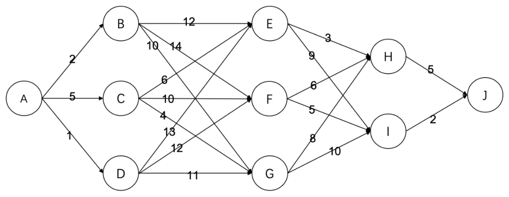

# 2021 CCF 非专业级别软件能力认证第一轮（CSP-S1）提高级 C++语言试题

认证时间：2021 年 9 月 19 日 09:30~11:30

考生注意事项：

- 试题纸共有 16 页，答题纸共有 1 页，满分 100 分。请在答题纸上作答，写在试题纸上的一律无效。
- 不得使用任何电子设备（如计算器、手机、电子词典等）或查阅任何书籍资料。

## 一、单项选择题

> 共 15 题，每题 2 分，共计 30 分；每题有且仅有一个正确选项。

### 第 1 题

<!-- qid: csp-s1-2021-001 | type: single_choice | score: 2 | answer: A | tags: topic:basics -->

在 Linux 系统终端中，用于列出当前目录下所含的文件和子目录的命令为（ ）。

- A. `ls`
- B. `cd`
- C. `cp`
- D. `all`

> **题解**
> 答案：A
> 解释：`ls` 命令用于列出当前目录下的文件和子目录，选 A。B 项 `cd` 是切换当前工作目录，C 项 `cp` 是复制文件或目录，D 项 `all` 并不是 Linux 的命令。

### 第 2 题

<!-- qid: csp-s1-2021-002 | type: single_choice | score: 2 | answer: B | tags: feat:formula,topic:number -->

二进制数 $00101010_2$ 和 $00010110_2$ 的和为（ ）。

- A. $00111100_2$
- B. $01000000_2$
- C. $00111100_2$
- D. $01000010_2$

> **题解**
> 答案：B
> 解释：把两个二进制数当成十进制看是 42 与 22，相加得 64；64 写成 8 位二进制是 `01000000₂`，选 B。A 项与 C 项都是 `00111100₂`，等于十进制的 60；D 项 `01000010₂` 等于 66，都不是 42 + 22 的和。

### 第 3 题

<!-- qid: csp-s1-2021-003 | type: single_choice | score: 2 | answer: A | tags: topic:basics -->

在程序运行过程中，如果递归调用的层数过多，可能会由于（ ）引发错误。

- A. 系统分配的栈空间溢出
- B. 系统分配的队列空间溢出
- C. 系统分配的链表空间溢出
- D. 系统分配的堆空间溢出

> **题解**
> 答案：A
> 解释：递归调用每深入一层，都要在系统分配的栈上保存一份现场（返回地址与局部变量），层数过多就会把栈空间耗尽，引发栈溢出，选 A。B 项队列、C 项链表是数据结构而不是运行时分给的存储区域；D 项堆是 `new` 和 `malloc` 申请动态内存的地方，与函数调用现场的保存无关。

### 第 4 题

<!-- qid: csp-s1-2021-004 | type: single_choice | score: 2 | answer: C | tags: topic:sort -->

以下排序方法中，（ ）是不稳定的。

- A. 插入排序
- B. 冒泡排序
- C. 堆排序
- D. 归并排序

> **题解**
> 答案：C
> 解释：堆排序在筛选时会把相距很远的元素直接换到前面，相等元素的先后可能被颠倒，所以不稳定，选 C。实跑反例：对 `5a 5b 3`（a 先出现）做升序堆排序，排完以后两个 5 变成了 `5b` 在前、`5a` 在后。插入排序与冒泡排序只在相邻元素逆序时才交换，归并排序在合并时优先取左边的元素，三者都能保持相等元素原来的相对次序。

### 第 5 题

<!-- qid: csp-s1-2021-005 | type: single_choice | score: 2 | answer: C | tags: feat:formula,topic:complexity -->

以比较为基本运算，对于 $2n$ 个数，同时找到最大值和最小值，最坏情况下需要的最小的比较次数为（ ）。

- A. $4n-2$
- B. $3n+1$
- C. $3n-2$
- D. $2n+1$

> **题解**
> 答案：C
> 解释：先把 2n 个数两两配对、比 n 次，分成 n 个较小者和 n 个较大者；最小值一定在较小者里，还要比 n − 1 次，最大值同理在较大者里比 n − 1 次。合计 n + (n − 1) + (n − 1) = 3n − 2，选 C。A 项 4n − 2 相当于每个元素都和当前的最大值、最小值各比一次，比这个下界多出近一倍；B 项 3n + 1、D 项 2n + 1 都不符合「先配对、再各比 n − 1 次」这个结构。

### 第 6 题

<!-- qid: csp-s1-2021-006 | type: single_choice | score: 2 | answer: C | tags: feat:formula,topic:ds -->

现有一个地址区间为 0～10 的哈希表，对于出现冲突情况，会往后找第一个空的地址存储（到 10 冲突了就从 0 开始往后），现在要依次存储（0，1, 2，3，4，5，6，7），哈希函数为 $h(x)=x^2 \bmod 11$。请问 7 存储在哈希表哪个地址中（ ）。

- A. 5
- B. 6
- C. 7
- D. 8

> **题解**
> 答案：C
> 解释：依次算哈希值并线性探测（冲突就往后找第一个空位，到 10 之后再绕回 0）：0 落在 0、1 落在 1、2 落在 4、3 落在 9、4 落在 5、5 落在 3；轮到 6 时 h(6) = 36 mod 11 = 3，而 3、4、5 都被占了，于是落在 6；轮到 7 时 h(7) = 49 mod 11 = 5，而 5、6 都被占了，落在 7，选 C。D 项 8 是漏掉「6 已经占用了 6 号地址」才会得到的落点。

### 第 7 题

<!-- qid: csp-s1-2021-007 | type: single_choice | score: 2 | answer: C | tags: topic:graph -->

G 是一个非连通简单无向图（没有自环和重边），共有 36 条边，则该图至少有（ ）个点。

- A. 8
- B. 9
- C. 10
- D. 11

> **题解**
> 答案：C
> 解释：n 个点的完全图有 n(n − 1) / 2 条边。9 个点的完全图正好是 9 × 8 / 2 = 36 条边，但完全图是连通的，题目要求图非连通，所以还得再加一个孤立点，至少 10 个点；9 个点无论怎么非连通也凑不出 36 条边（最多是 8 点完全图的 28 条边再加一个孤立点），选 C。A 项 8 点最多 28 条边，D 项 11 点比最小值大。

### 第 8 题

<!-- qid: csp-s1-2021-008 | type: single_choice | score: 2 | answer: B | tags: topic:tree -->

令根结点的高度为 1，则一棵含有 2021 个结点的二叉树的高度至少为（ ）。

- A. 10
- B. 11
- C. 12
- D. 2021

> **题解**
> 答案：B
> 解释：高度为 h 的二叉树的结点数最多是「每层都填满」时的 2ʰ − 1 个。2¹⁰ − 1 = 1023 < 2021 ≤ 2¹¹ − 1 = 2047，所以装下 2021 个结点至少要 11 层，选 B。A 项 10 层最多只能放 1023 个结点，D 项 2021 是把树退化成一条链时才需要的高度，不是最小。

### 第 9 题

<!-- qid: csp-s1-2021-009 | type: single_choice | score: 2 | answer: D | tags: topic:tree -->

前序遍历和中序遍历相同的二叉树为且仅为（ ）。

- A. 只有 1 个点的二叉树
- B. 根结点没有左子树的二叉树
- C. 非叶子结点只有左子树的二叉树
- D. 非叶子结点只有右子树的二叉树

> **题解**
> 答案：D
> 解释：前序遍历是「根 — 左 — 右」，中序遍历是「左 — 根 — 右」。两者要完全相同，每个结点就不能有左子树，于是非叶子结点只剩右孩子，两种序列都退化成「根 — 右」，选 D。B 项只要求根没有左子树，若根的右孩子还有左子树，那个结点在前序里排在它的左子树前面、在中序里排在后面，序列立刻不同；C 项与 D 项正好相反；A 项只是 D 项的一个特例，不完整。

### 第 10 题

<!-- qid: csp-s1-2021-010 | type: single_choice | score: 2 | answer: A | tags: topic:combinatorics -->

定义一种字符串操作为交换相邻两个字符。将 `DACFEB` 变为 `ABCDEF` 最少需要（ ）次上述操作。

- A. 7
- B. 8
- C. 9
- D. 6

> **题解**
> 答案：A
> 解释：每次交换相邻两个字符最多让逆序对数减少 1，而把 `DACFEB` 排成 `ABCDEF` 要把逆序对全部消掉，所以最少次数就等于逆序数。数一遍 `DACFEB` 里前面字符比后面大的对：D 大于 A、C、B 共 3 对，C 大于 B 共 1 对，F 大于 E、B 共 2 对，E 大于 B 共 1 对，合计 3 + 1 + 2 + 1 = 7，选 A。

### 第 11 题

<!-- qid: csp-s1-2021-011 | type: single_choice | score: 2 | answer: A | tags: topic:number -->

有如下递归代码

```
solve(t, n):
    if t=1 return 1
    else return 5*solve(t-1,n) mod n
```

则 `solve(23,23)` 的结果为（ ）。

- A. 1
- B. 7
- C. 12
- D. 22

> **题解**
> 答案：A
> 解释：把递归展开，`solve(23,23)` 算的就是 5²² mod 23。23 是素数且 5 与 23 互素，由费马小定理 5²² ≡ 1 (mod 23)，所以结果是 1，选 A。也可以手算：5² ≡ 25 ≡ 2、5⁴ ≡ 4、5⁸ ≡ 16、5¹⁶ ≡ 256 ≡ 3（mod 23），于是 5²² ≡ 3 × 4 × 2 = 24 ≡ 1。B 项 7、C 项 12、D 项 22 都不是 5²² 除以 23 的余数。

### 第 12 题

<!-- qid: csp-s1-2021-012 | type: single_choice | score: 2 | answer: C | tags: feat:formula,topic:complexity -->

斐波那契数列的定义为：$F_1=1$，$F_2=1$，$F_n=F_{n-1}+F_{n-2}$ ($n \ge 3$)。现在用如下程序来计算斐波那契数列的第 $n$ 项，其时间复杂度为（ ）。

```
F(n):
    if n<=2 return 1
    else return F(n-1) + F(n-2)
```

- A. $O(n)$
- B. $O(n^2)$
- C. $O(2^n)$
- D. $O(n \log n)$

> **题解**
> 答案：C
> 解释：把调用次数记作 T(n)，则 T(1) = T(2) = 1、T(n) = T(n − 1) + T(n − 2) + 1，与斐波那契数列同阶，随 n 指数增长，所以时间复杂度是 O(2ⁿ)，选 C。A 项 O(n) 是「用循环从小到大递推」的复杂度；B 项 O(n²)、D 项 O(n log n) 都远小于实际的指数级调用量。

### 第 13 题

<!-- qid: csp-s1-2021-013 | type: single_choice | score: 2 | answer: C | tags: topic:combinatorics -->

有 8 个苹果从左到右排成一排，你要从中挑选至少一个苹果，并且不能同时挑选相邻的两个苹果，一共有（ ）种方案。

- A. 36
- B. 48
- C. 54
- D. 64

> **题解**
> 答案：C
> 解释：按「选 k 个」分类。8 个位置里选 k 个互不相邻的选法数是 C(9 − k, k)：k = 1 有 C(8,1) = 8 种，k = 2 有 C(7,2) = 21 种，k = 3 有 C(6,3) = 20 种，k = 4 有 C(5,4) = 5 种，而 8 个位置最多只能放下 4 个互不相邻的苹果，k = 5 已经不可能。合计 8 + 21 + 20 + 5 = 54，选 C。换个角度核对：8 个位置的「任意两个都不相邻」的子集（含一个都不取）共 55 个，去掉空集也是 54。D 项 64 = 2⁶ 与这种斐波那契式的增长无关，A 项 36、B 项 48 都不是上面这个分项和。

### 第 14 题

<!-- qid: csp-s1-2021-014 | type: single_choice | score: 2 | answer: C | tags: feat:formula,topic:combinatorics -->

设一个三位数 $n=abc$，a, b, c 均为 1～9 之间的整数，若以 a、 b、 c 作为三角形的三条边可以构成等腰三角形（包括等边），则这样的 $n$ 有（ ）个。

- A. 81
- B. 120
- C. 165
- D. 216

> **题解**
> 答案：C
> 解释：分两类数。等边三角形：a = b = c，共 9 个。恰好两边相等：设相等的两条边长为 x、第三边为 y（y ≠ x），要能构成三角形就要 y < 2x（另一条 x + y > x 恒成立）；对 x = 1 到 9，y 可取 1 到 min(9, 2x − 1)，个数依次是 1、3、5、7、9、9、9、9、9，共 61 组，去掉其中 y = x 的 9 组（那是等边，已经数过），剩下 52 组数字组合；每组里「不同的那条边」可以放在百位、十位或个位，对应 3 个不同的三位数，共 52 × 3 = 156 个。156 + 9 = 165，选 C。A 项 81 只算到了部分情形，B 项 120、D 项 216 都无法由上面的分类求和得到。

### 第 15 题

<!-- qid: csp-s1-2021-015 | type: single_choice | score: 2 | answer: B | images: q015-fig1.png | tags: feat:figure,topic:graph -->

有如下的有向图，节点为 A, B, … , J, 其中每条边的长度都标在图中。则节点 A 到节点 J 的最短路径长度为（ ）。



- A. 16
- B. 19
- C. 20
- D. 22

> **题解**
> 答案：B
> 解释：用 Dijkstra 从 A 出发逐点定标（每轮在未定标的点里取当前距离最小的），得到 A = 0、D = 1、B = 2、C = 5、G = 9、E = 11、F = 12、H = 14、I = 17、J = 19。J 的两条入边分别给出 14 + 5 = 19 与 17 + 2 = 19，沿这张表回溯可得到路径 A → B（2）→ F（10）→ I（5）→ J（2），合计 2 + 10 + 5 + 2 = 19，选 B。A 项 16 比 19 小，若真存在这样的路，定标到 J 之前就会把 J 的距离改得更小；C 项 20、D 项 22 都比 19 大，是走了更长边的结果。

## 二、阅读程序

> 程序输入不超过数组或字符串定义的范围；判断题正确填 √，错误填 ×；除特殊说明外，判断题 1.5 分，选择题 3 分，共计 40 分。

### (1)

<!-- group: 阅读程序(1) -->

```cpp
 01  #include <iostream>
 02  #include <cmath>
 03  using namespace std;
 04
 05  const double r = acos(0.5);
 06
 07  int a1, b1, c1, d1;
 08  int a2, b2, c2, d2;
 09
 10  inline int sq(const int x) { return x * x; }
 11  inline int cu(const int x) { return x * x * x; }
 12
 13  int main()
 14  {
 15      cout.flags(ios::fixed);
 16      cout.precision(4);
 17
 18      cin >> a1 >> b1 >> c1 >> d1;
 19      cin >> a2 >> b2 >> c2 >> d2;
 20
 21      int t = sq(a1 - a2) + sq(b1 - b2) + sq(c1 - c2);
 22
 23      if (t <= sq(d2 - d1)) cout << cu(min(d1, d2)) * r * 4;
 24      else if (t >= sq(d2 + d1)) cout << 0;
 25      else {
 26          double x = d1 - (sq(d1) - sq(d2) + t) / sqrt(t) / 2;
 27          double y = d2 - (sq(d2) - sq(d1) + t) / sqrt(t) / 2;
 28          cout << (x * x * (3 * d1 - x) + y * y * (3 * d2 - y)) * r;
 29      }
 30      cout << endl;
 31      return 0;
 32  }
```

假设输入的所有数的绝对值都不超过 1000，完成下面的判断题和单选题：

> **程序说明**
> 这段程序读入两个球的球心坐标与半径（依次是 a1 b1 c1 d1 和 a2 b2 c2 d2），输出这两个球公共部分的体积，结果固定打印 4 位小数。做法是先用平方和算出球心距的平方 t（避免开方带来的判断误差），再分三种情形：一个球完全含于另一个（t 不超过 (d2 − d1)²）时输出小球的体积 `cu(min(d1, d2)) * r * 4`；两球相离（t 不小于 (d1 + d2)²）时输出 0；部分相交时按两块球缺的体积公式相加。r 的取值是 `acos(0.5)`，也就是 π/3，正是球体积公式里的那个因子，不是 30 度角。理解本组要抓住两点：一是第 21 行的 t 是整数，第 26、27 行的除法里只要出现两个整数相除就会被截断，这一组三道「把某处改一下结果会不会变」的小题全都落在这上面；二是判断「内含」和「相离」用的都是平方，边界正好是相切，题给的相切输入值得亲手代一遍。

#### 判断题

##### 第 16 题

<!-- qid: csp-s1-2021-016 | type: true_false | score: 1.5 | answer: T | tags: feat:lineref,topic:lang -->

将第 21 行中 `t` 的类型声明从 `int` 改为 `double`，不会影响程序运行的结果。（ ）

> **题解**
> 答案：√
> 解释：第 21 行的 `t` 是三个整数平方的和，本身是整数；改成 `double` 只是用浮点存同一个值，而后面 `sqrt(t)` 以及 `(sq(d1) - sq(d2) + t)` 这些运算本来就都在 `double` 里做，结果不变。实跑验证：把该行改成 `double t`、其余一字不动重新编译，6005 组输入（含 2000 组相切、内含的边界数据）的输出与原程序逐组完全相同，故主张成立，填 √。

##### 第 17 题

<!-- qid: csp-s1-2021-017 | type: true_false | score: 1.5 | answer: F | tags: topic:lang -->

将第 26、27 行中的 `/ sqrt(t) / 2` 替换为 `/ 2 / sqrt(t)`，不会影响程序运行的结果。（ ）

> **题解**
> 答案：×
> 解释：差别出在整数除法。原式 `/ sqrt(t) / 2` 是先除以 `sqrt(t)`（`sqrt` 返回 `double`，这时整个表达式已经变成浮点运算）再除以 2；换成 `/ 2 / sqrt(t)` 之后，`/ 2` 直接落在括号里的整型表达式上，两个整数相除会把小数部分丢掉，再除以 `sqrt(t)` 结果就变了。实跑验证：输入 `0 0 0 1 1 0 0 1`，原程序输出 `1.3090`，改后输出 `4.1888`（`(1 − 1 + 1) / 2` 被截断成 0，x、y 由 0.5 变成 1，于是走了球体积那个分支）。故主张不成立，填 ×。

##### 第 18 题

<!-- qid: csp-s1-2021-018 | type: true_false | score: 1.5 | answer: F | tags: feat:lineref,topic:lang -->

将第 28 行中的 `x * x` 改成 `sq(x)`、`y * y` 改成 `sq(y)` ，不会影响程序运行的结果。（ ）

> **题解**
> 答案：×
> 解释：`sq` 的参数类型是 `int`，而第 28 行里的 x、y 是 `double`，实参传进去会被截断成整数，`sq(0.5)` 实际算的是 `0 * 0 = 0`，平方值整个丢掉；原来的 `x * x` 是浮点乘法，不会截断。实跑验证：输入 `0 0 0 1 1 0 0 1`，原程序输出 `1.3090`，改后输出 `0.0000`；输入 `1 2 3 4 5 6 7 8` 由 `161.6231` 变成 `158.0516`。故主张不成立，填 ×。

##### 第 19 题

<!-- qid: csp-s1-2021-019 | type: true_false | score: 2 | answer: T | tags: topic:sim -->

（2 分）当输入为 `0 0 0 1 1 0 0 1` 时，输出为 `1.3090`。（ ）

> **题解**
> 答案：√
> 解释：t = (0 − 1)² + (0 − 0)² + (0 − 0)² = 1。它比 sq(d2 − d1) = 0 大、比 sq(d2 + d1) = 4 小，走 else 分支：x = 1 − (1 − 1 + 1) / 1 / 2 = 0.5，y = 1 − (1 − 1 + 1) / 1 / 2 = 0.5，输出 (0.5² × 2.5 + 0.5² × 2.5) × r = 1.25 × 1.0471976 = 1.3089969，按 4 位定点打印正是 `1.3090`，故主张成立，填 √。

#### 单选题

##### 第 20 题

<!-- qid: csp-s1-2021-020 | type: single_choice | score: 3 | answer: D | tags: topic:sim -->

当输入为 `1 1 1 1 1 1 1 2` 时，输出为（ ）。

- A. `3.1416`
- B. `6.2832`
- C. `4.7124`
- D. `4.1888`

> **题解**
> 答案：D
> 解释：两个球的球心都在 (1, 1, 1)，半径分别是 1 和 2，于是 t = 0 ≤ sq(d2 − d1) = 1，程序走第一个分支，输出 cu(min(1, 2)) × r × 4 = 1 × π/3 × 4 = 4.18879，按 4 位定点就是 `4.1888`，选 D。A 项 `3.1416` 是 π，相当于漏乘了 4/3 这个因子；B 项 `6.2832` = 2π、C 项 `4.7124` = 3π/2 也都不是球体积公式的结果。

##### 第 21 题

<!-- qid: csp-s1-2021-021 | type: single_choice | score: 2.5 | answer: C | tags: topic:math -->

（2.5 分）这段代码的含义为（ ）。

- A. 求圆的面积并
- B. 求球的体积并
- C. 求球的体积交
- D. 求椭球的体积并

> **题解**
> 答案：C
> 解释：程序算的是两球公共部分的体积，选 C。t 是球心距的平方：t ≤ (d2 − d1)² 表示一球含于另一球，输出小球的体积 4πd³/3；t ≥ (d1 + d2)² 表示两球相离，输出 0；中间情形用球缺体积公式 x²(3d1 − x)·r 把两块球缺加起来，其中 r = acos(0.5) = π/3 正是球体积公式里的那个因子。第 20 题里半径 1 的球含于半径 2 的球，输出 4π/3 恰好是半径 1 球的体积，与「求交」自洽。A 项「圆的面积并」是二维概念，而程序算的是三维体积；B 项「并」与内含的情形矛盾（求并集时内含应输出大球体积，程序却输出小球体积）；D 项椭球在代码里没有出现，三个方向的半轴长度相同。

### (2)

<!-- group: 阅读程序(2) -->

```cpp
 01  #include <algorithm>
 02  #include <iostream>
 03  using namespace std;
 04
 05  int n, a[1005];
 06
 07  struct Node
 08  {
 09      int h, j, m, w;
 10
 11      Node(const int _h, const int _j, const int _m, const int _w):
 12          h(_h), j(_j), m(_m), w(_w)
 13      { }
 14
 15      Node operator+(const Node &o) const
 16      {
 17          return Node(
 18              max(h, w + o.h),
 19              max(max(j, o.j), m + o.h),
 20              max(m + o.w, o.m),
 21              w + o.w);
 22      }
 23  };
 24
 25  Node solve1(int h, int m)
 26  {
 27      if (h > m)
 28          return Node(-1, -1, -1, -1);
 29      if (h == m)
 30          return Node(max(a[h], 0), max(a[h], 0), max(a[h], 0), a[h]);
 31      int j = (h + m) >> 1;
 32      return solve1(h, j) + solve1(j + 1, m);
 33  }
 34
 35  int solve2(int h, int m)
 36  {
 37      if (h > m)
 38          return -1;
 39      if (h == m)
 40          return max(a[h], 0);
 41      int j = (h + m) >> 1;
 42      int wh = 0, wm = 0;
 43      int wht = 0, wmt = 0;
 44      for (int i = j; i >= h; i--) {
 45          wht += a[i];
 46          wh = max(wh, wht);
 47      }
 48      for (int i = j + 1; i <= m; i++) {
 49          wmt += a[i];
 50          wm = max(wm, wmt);
 51      }
 52      return max(max(solve2(h, j), solve2(j + 1, m)), wh + wm);
 53  }
 54
 55  int main()
 56  {
 57      cin >> n;
 58      for (int i = 1; i <= n; i++) cin >> a[i];
 59      cout << solve1(1, n).j << endl;
 60      cout << solve2(1, n) << endl;
 61      return 0;
 62  }
```

假设输入的所有数的绝对值都不超过 1000，完成下面的判断题和单选题：

> **程序说明**
> 这段程序读入 n 和 n 个整数，用两种写法求同一个量——最大子段和（允许一段都不取，所以答案不会小于 0）——并把结果各输出一行。`solve1` 是分治：每个区间返回「最大前缀和、最大子段和、最大后缀和、区间和」四元组，两个区间的四元组用重载的 `operator+` 拼出跨过中点的最优解，整棵递归树约 2n 个结点，复杂度 Θ(n)。`solve2` 同样分治，但每次还要从分界点向两侧各扫一遍求跨中点的最大和，代价与区间长度同阶，复杂度 Θ(n log n)。理解本组要抓住两点：一是两种写法的答案必然相同，可以拿随机数据对拍验证；二是第 31 行把区间从中间劈开后，两个子区间一定都非空，所以「h > m」这个空区间分支在递归内部永远不会被触发，这一组的判断题正是围绕这一点。

#### 判断题

##### 第 22 题

<!-- qid: csp-s1-2021-022 | type: true_false | score: 1.5 | answer: T | tags: topic:sim -->

程序总是会正常执行并输出两行两个相等的数。（ ）

> **题解**
> 答案：√
> 解释：两行输出的都是「最大子段和」。`solve1` 把区间对半分，每一半返回「最大前缀和、最大子段和、最大后缀和、区间和」四元组，两个四元组用重载的 `operator+` 拼出跨过中点的最优解，合并只花常数次运算；`solve2` 同样分治，每次再从中点向两侧扫一遍求跨中点的最大和，做的是同一件事。实跑验证：3000 组随机数组，两行始终相等，而且都与暴力枚举的最大子段和一致，0 例不符；n = 0 时两个函数都返回 −1，两行也相等。故主张成立，填 √。

##### 第 23 题

<!-- qid: csp-s1-2021-023 | type: true_false | score: 1.5 | answer: F | tags: feat:lineref,topic:sim -->

第 28 行与第 38 行分别有可能执行两次及以上。（ ）

> **题解**
> 答案：×
> 解释：第 31 行把区间 [h, m] 从中间劈成 [h, j] 和 [j + 1, m]（j = ⌊(h + m) / 2⌋）。只要 h ≤ m，就一定有 h ≤ j 且 j + 1 ≤ m，两半都非空——所以「空区间」那条分支（第 28 行、第 38 行）在递归内部根本不会被触发，只可能在最外层输入 n = 0、也就是调用 `solve1(1, 0)` 时各执行一次。插桩实测：把这两行的 `return` 改成自增计数器，跑 1500 组随机输入，两行最多各执行 1 次；n = 0 时各 1 次，n ≥ 1 时各 0 次。故主张不成立，填 ×。

##### 第 24 题

<!-- qid: csp-s1-2021-024 | type: true_false | score: 1.5 | answer: F | tags: topic:sim -->

当输入为 `5 -10 11 -9 5 -7` 时，输出的第二行为 `7`。（ ）

> **题解**
> 答案：×
> 解释：输入里的第一个 5 是 n，后面的五个数才是数组：−10、11、−9、5、−7。最大的一段就是单独取 11，实跑输出两行都是 `11`，第二行并不是 `7`，故主张不成立，填 ×。`7` 正好等于 11 − 9 + 5（把 −9 和 5 一起取进来），但它比 11 小，所以不是最大子段和，这是本题的干扰点。

#### 单选题

##### 第 25 题

<!-- qid: csp-s1-2021-025 | type: single_choice | score: 3 | answer: B | tags: feat:formula,topic:complexity -->

`solve1(1, n)` 的时间复杂度为（ ）。

- A. $\Theta(\log n)$
- B. $\Theta(n)$
- C. $\Theta(n \log n)$
- D. $\Theta(n^2)$

> **题解**
> 答案：B
> 解释：`solve1` 把区间对半分，每个结点只做常数次加法与 `max`。递归到底一共有 n 个单元素区间，整棵递归树约 2n 个结点，总工作量与 n 同阶，所以 T(n) = Θ(n)，选 B。A 项 Θ(log n) 是递归深度而不是总工作量；C 项 Θ(n log n)、D 项 Θ(n²) 都比实际大。

##### 第 26 题

<!-- qid: csp-s1-2021-026 | type: single_choice | score: 3 | answer: C | tags: feat:formula,topic:complexity -->

`solve2(1, n)` 的时间复杂度为（ ）。

- A. $\Theta(\log n)$
- B. $\Theta(n)$
- C. $\Theta(n \log n)$
- D. $\Theta(n^2)$

> **题解**
> 答案：C
> 解释：`solve2` 把区间对半分之后，还要从分界点向两侧各扫一遍来求「跨中点的最大和」，这一段代价与区间长度同阶，于是 T(n) = 2T(n/2) + Θ(n)。每层合计 Θ(n)、共 log n 层，展开得 Θ(n log n)，选 C。B 项 Θ(n) 是 `solve1` 的量级；A 项 Θ(log n)、D 项 Θ(n²) 都与这个递推不符。

##### 第 27 题

<!-- qid: csp-s1-2021-027 | type: single_choice | score: 3 | answer: B | tags: topic:sim -->

当输入为 `10 -3 2 10 0 -8 9 -4 -5 9 4` 时，输出的第一行为（ ）。

- A. `13`
- B. `17`
- C. `24`
- D. `12`

> **题解**
> 答案：B
> 解释：第一行是 `solve1(1, n).j`，也就是最大子段和（允许一段都不取，所以结果不会小于 0）。数组是 −3、2、10、0、−8、9、−4、−5、9、4，从第 2 个数一直取到末尾的和是 2 + 10 + 0 − 8 + 9 − 4 − 5 + 9 + 4 = 17，比只取中间任何一段都大（例如 9 − 4 − 5 + 9 + 4 = 13），实跑第一行输出 `17`，选 B。A 项 13、C 项 24、D 项 12 都不是这个数组的最大子段和。

### (3)

<!-- group: 阅读程序(3) -->

```cpp
 01  #include <iostream>
 02  #include <string>
 03  using namespace std;
 04
 05  char base[64];
 06  char table[256];
 07
 08  void init()
 09  {
 10      for (int i = 0; i < 26; i++) base[i] = 'A' + i;
 11      for (int i = 0; i < 26; i++) base[26 + i] = 'a' + i;
 12      for (int i = 0; i < 10; i++) base[52 + i] = '0' + i;
 13      base[62] = '+', base[63] = '/';
 14
 15      for (int i = 0; i < 256; i++) table[i] = 0xff;
 16      for (int i = 0; i < 64; i++) table[base[i]] = i;
 17      table['='] = 0;
 18  }
 19
 20  string encode(string str)
 21  {
 22      string ret;
 23      int i;
 24      for (i = 0; i + 3 <= str.size(); i += 3) {
 25          ret += base[str[i] >> 2];
 26          ret += base[(str[i] & 0x03) << 4 | str[i + 1] >> 4];
 27          ret += base[(str[i + 1] & 0x0f) << 2 | str[i + 2] >> 6];
 28          ret += base[str[i + 2] & 0x3f];
 29      }
 30      if (i < str.size()) {
 31          ret += base[str[i] >> 2];
 32          if (i + 1 == str.size()) {
 33              ret += base[(str[i] & 0x03) << 4];
 34              ret += "==";
 35          }
 36          else {
 37              ret += base[(str[i] & 0x03) << 4 | str[i + 1] >> 4];
 38              ret += base[(str[i + 1] & 0x0f) << 2];
 39              ret += "=";
 40          }
 41      }
 42      return ret;
 43  }
 44
 45  string decode(string str)
 46  {
 47      string ret;
 48      int i;
 49      for (i = 0; i < str.size(); i += 4) {
 50          ret += table[str[i]] << 2 | table[str[i + 1]] >> 4;
 51          if (str[i + 2] != '=')
 52              ret += (table[str[i + 1]] & 0x0f) << 4 | table[str[i + 2]] >> 2;
 53          if (str[i + 3] != '=')
 54              ret += table[str[i + 2]] << 6 | table[str[i + 3]];
 55      }
 56      return ret;
 57  }
 58
 59  int main()
 60  {
 61      init();
 62      cout << int(table[0]) << endl;
 63
 64      int opt;
 65      string str;
 66      cin >> opt >> str;
 67      cout << (opt ? decode(str) : encode(str)) << endl;
 68      return 0;
 69  }
```

假设输入总是合法的（一个整数和一个不含空白字符的字符串，用空格隔开），完成下面的判断题和单选题：

> **程序说明**
> 这段程序实现标准的 Base64 编解码。`init()` 先备好两张表：`base[64]` 里是 64 个可打印字符（A–Z、a–z、0–9、`+`、`/`）；反查表 `table[256]` 先用 `0xff` 填满，再令 `table[base[i]] = i`，另外令 `table['='] = 0`。`encode` 每次取 3 个字符，把它们看成 24 位、按 6 位一组切成 4 个下标去查 `base` 输出，末尾不足 3 个字符时按规则补 `=`。`decode` 反过来做：每 4 个字符还原 3 个字节，遇到 `=` 就不再产出对应那部分。`main` 先无条件输出 `int(table[0])`，再按 `opt` 决定编码还是解码。理解本组要抓住两点：一是 `table[0]` 从来没有被赋过值（`base[i]` 里没有哪个字符的 ASCII 码是 0），所以 `0xff` 一直留着，在有符号 `char` 的平台上输出 −1；二是解码出来的可以是任意字节，含换行符时「输出一行字符串」就会裂成好几行。

#### 判断题

##### 第 28 题

<!-- qid: csp-s1-2021-028 | type: true_false | score: 1.5 | answer: F | tags: topic:string -->

程序总是先输出一行一个整数，再输出一行一个字符串。（ ）

> **题解**
> 答案：×
> 解释：第 62 行 `cout << int(table[0]) << endl;` 是无条件执行的：`table` 先被 `0xff` 填满，而 `base[i]` 里的字符（大写字母、小写字母、数字、`+`、`/`）没有一个的 ASCII 码是 0，所以 `table[0]` 始终是 `0xff`，本平台 `char` 有符号，转成 `int` 就是 −1——第一行确实总是一个整数。但第二行未必是「一行」：`opt = 1` 时执行 `decode`，而 `decode` 还原出来的是任意字节序列，完全可能含换行符，这时第二行会裂成好几行。实跑：输入 `1 YQpi`，`YQpi` 解出的是 "a\nb"，程序输出三行（`-1`、`a`、`b`）；输入 `1 Cg==` 也会多输出空行。所以「总是……再输出一行一个字符串」不成立，本题判 ×。
> 争议：按代码表面看很容易得出相反的结论：第 62 行与第 67 行各输出一行、都带 `endl`，像是「总是输出两行」，本题的正确答案却是 ×。本卷维持原卷的 ×，依据是实跑反例：按题面「一个整数和一个不含空白字符的字符串」给出的合法输入 `1 YQpi`，程序输出三行（`-1`、`a`、`b`）——`YQpi` 这四个字符里没有任何空白，完全符合题面假设，它解出的字节序列中却含换行符，第二行因此裂成了两行。判断「总是……」这类全称命题，只要有一个合法输入不满足就不成立。

##### 第 29 题

<!-- qid: csp-s1-2021-029 | type: true_false | score: 1.5 | answer: T | tags: topic:string -->

对于任意不含空白字符的字符串 `str1`，先执行程序输入 `0 str1`，得到输出的第二行记为 `str2`；再执行程序输入 `1 str2`，输出的第二行必为 `str1`。（ ）

> **题解**
> 答案：√
> 解释：`encode` 就是标准的 Base64 编码：每 3 个字节拼成 24 位、按 6 位一组切成 4 个下标去查 `base` 表；`decode` 是它的逆运算，每 4 个字符还原 3 个字节。输入 `0 str1` 得到的是 `str1` 的编码 `str2`，只要 `str1` 不含空白字符（也就不会有换行之类会影响读入的内容），再输入 `1 str2` 解码回来必然逐字节还原 `str1`。实跑验证：4000 组随机非空白字符串全部还原成功，0 例不符，故主张成立，填 √。最后一组不足 3 个字符时 `encode` 会补 `=`，`decode` 见到 `=` 就不再产出对应的字节，所以长度不是 3 的倍数也不会多算或少算。

##### 第 30 题

<!-- qid: csp-s1-2021-030 | type: true_false | score: 1.5 | answer: F | tags: topic:string -->

当输入为 `1 SGVsbG93b3JsZA==` 时，输出的第二行为 `HelloWorld`。（ ）

> **题解**
> 答案：×
> 解释：把 `SGVsbG93b3JsZA==` 按 4 个一组分成 `SGVs`、`bG93`、`b3Js`、`ZA==`。第一组：`S`=18、`G`=6、`V`=21、`s`=44，二进制拼成 010010 000110 010101 101100，还原成三个字节 0x48、0x65、0x6C，也就是 `Hel`；第二组解出 `low`；第三组解出 `orl`；最后一组 `ZA==` 只剩一个字节 `d`。合起来是 `Helloworld`，第 6 个字符是小写 `w`，并不是 `HelloWorld`，故主张不成立，填 ×。`HelloWorld` 里那个大写 `W` 在 Base64 中的下标与这里的 `b`（下标 27）不同，是本题的干扰点。

#### 单选题

##### 第 31 题

<!-- qid: csp-s1-2021-031 | type: single_choice | score: 3 | answer: B | tags: feat:formula,topic:complexity,topic:string -->

设输入字符串长度为 n，encode 函数的时间复杂度为（ ）。

- A. $\Theta(\sqrt{n})$
- B. $\Theta(n)$
- C. $\Theta(n \log n)$
- D. $\Theta(n^2)$

> **题解**
> 答案：B
> 解释：`encode` 只有一个从左到右的循环，每 3 个字符做常数次移位、掩码与查表，总操作次数与串长成正比，所以是 Θ(n)，选 B。C 项 Θ(n log n)、D 项 Θ(n²) 都比实际大；A 项 Θ(√n) 与「一趟线性扫描」这个结构完全无关。

##### 第 32 题

<!-- qid: csp-s1-2021-032 | type: single_choice | score: 3 | answer: D | tags: topic:string -->

输出的第一行为（ ）。

- A. `0xff`
- B. `255`
- C. `0xFF`
- D. `-1`

> **题解**
> 答案：D
> 解释：第一行输出的是 `int(table[0])`。`init()` 里先把 `table` 用 `0xff` 填满（第 15 行），之后只对 `base[i]` 里的字符做过赋值，而这些字符的 ASCII 码都不是 0，所以下标 0 那一格从没被改过，一直是 `0xff`；本平台 `char` 是有符号类型，`0xff` 作为 `char` 是 −1，转成 `int` 仍是 −1，输出 `-1`，选 D。A 项 `0xff` 与 C 项 `0xFF` 是十六进制写法，而 `cout` 默认按十进制打印整数；B 项 255 是把 `char` 当成无符号类型才会得到的结果。

##### 第 33 题

<!-- qid: csp-s1-2021-033 | type: single_choice | score: 4 | answer: D | tags: topic:string -->

（4 分）当输入为 `0 CSP2021csp` 时，输出的第二行为（ ）。

- A. `Q1NQMjAyMWNzcAv=`
- B. `Q1NQMjAyMGNzcA==`
- C. `Q1NQMjAyMGNzcAv=`
- D. `Q1NQMjAyMWNzcA==`

> **题解**
> 答案：D
> 解释：`CSP2021csp` 共 10 个字符，编码时按 3 个一组分成 `CSP`、`202`、`1cs`，最后剩 1 个字符 `p`。以第一组为例：`C` = 0x43、`S` = 0x53、`P` = 0x50，二进制是 01000011 01010011 01010000，按 6 位切成 16、53、13、16，查表得 `Q`、`1`、`N`、`Q`，所以开头四个字符是 `Q1NQ`；顺次算下去，最后一组只有一个字符，按规则补两个 `=` 得 `cA==`。完整输出 `Q1NQMjAyMWNzcA==`，选 D。A 项与 C 项的末尾写成 `cAv=`，而正确的结尾应该是 `cA==`；B 项中间是 `MGNz`，解出来是 `0cs`，相当于把 `1` 写成了 `0`，那是在编码 `CSP2020csp`。

## 三、完善程序

> 单选题，每小题 3 分，共计 30 分。

### (1)

<!-- group: 完善程序(1) -->

（魔法数字）小 H 的魔法数字是 4。给定 $n$，他希望用若干个 4 进行若干次加法、减法和整除运算得到 $n$。但由于小 H 计算能力有限，计算过程中只能出现不超过 $M=10000$ 的正整数。求至少可能用到多少个 4。

例如，当 $n=2$ 时，有 $2=(4+4)/4$，用到了 3 个 4，是最优方案。

试补全程序。

```cpp
 01  #include <iostream>
 02  #include <cstdlib>
 03  #include <climits>
 04
 05  using namespace std;
 06
 07  const int M = 10000;
 08  bool Vis[M + 1];
 09  int F[M + 1];
 10
 11  void update(int &x, int y) {
 12      if (y < x)
 13          x = y;
 14  }
 15
 16  int main() {
 17      int n;
 18      cin >> n;
 19      for (int i = 0; i <= M; i++)
 20          F[i] = INT_MAX;
 21      ①;
 22      int r = 0;
 23      while (②) {
 24          r++;
 25          int x = 0;
 26          for (int i = 1; i <= M; i++)
 27              if (③)
 28                  x = i;
 29          Vis[x] = 1;
 30          for (int i = 1; i <= M; i++)
 31              if (④) {
 32                  int t = F[i] + F[x];
 33                  if (i + x <= M)
 34                      update(F[i + x], t);
 35                  if (i != x)
 36                      update(F[abs(i - x)], t);
 37                  if (i % x == 0)
 38                      update(F[i / x], t);
 39                  if (x % i == 0)
 40                      update(F[x / i], t);
 41              }
 42      }
 43      cout << F[n] << endl;
 44      return 0;
 45  }
```

> **程序说明**
> 这段程序求「用若干个 4 经过加法、减法和整除凑出 n，最少要用几个 4」，并且计算过程中出现的数必须是 1 到 M = 10000 之间的正整数。它把问题当成一张图上的单源最短路：`F[i]` 是凑出 i 目前已知的最少 4 的个数，初始化时只有 `F[4] = 1`（4 本身不用做任何运算），其余都是无穷大。每一轮先在还没定标的数里挑 F 最小的那个作为 x（第 26 至 28 行），把 x 定标（`Vis[x] = 1`），再用 x 与所有已定标的数 i 做加、减、整除（两个方向）四种运算，去刷新目标数的 F 值；直到 n 被定标，循环结束并输出 `F[n]`。理解本组要抓住两点：一是「定标」的贪心含义——每轮的 x 就是当前全局最优，所以凡是要去更新别人的数，都必须只用已定标的数（第 31 行的条件）；二是循环终止只看 n 有没有被定标，不要拿轮数或者「F 里还有没有无穷大」来代替。

##### 第 34 题

<!-- qid: csp-s1-2021-034 | type: single_choice | score: 3 | answer: D | tags: feat:circnum,topic:graph -->

①处应填（ ）

- A. `F[4] = 0`
- B. `F[1] = 4`
- C. `F[1] = 2`
- D. `F[4] = 1`

> **题解**
> 答案：D
> 解释：`F[i]` 记录的是「凑出 i 最少要用几个 4」。一开始只有 4 本身不用做任何运算，用 1 个 4，所以 ① 应填 `F[4] = 1`，选 D。A 项 `F[4] = 0` 等于说 0 个 4 就能凑出 4，后面所有 F 值都会整体少 1；B 项 `F[1] = 4` 把「数的值」和「4 的个数」弄反了；C 项 `F[1] = 2`（1 = 4 / 4 确实用两个 4）填在这里会让 `F[4]` 一直是无穷大，而程序里所有数都是从 4 出发推出来的。实跑代入：只有 D 能让 n = 1 到 30 的输出全部与「枚举恰好 k 个 4 能凑出哪些正整数」独立算出的正确答案一致，例如 n = 2 输出 3，与题面例子 2 = (4 + 4) / 4 吻合。

##### 第 35 题

<!-- qid: csp-s1-2021-035 | type: single_choice | score: 3 | answer: A | tags: feat:circnum,topic:graph -->

②处应填（ ）

- A. `!Vis[n]`
- B. `r < n`
- C. `F[M] == INT_MAX`
- D. `F[n] == INT_MAX`

> **题解**
> 答案：A
> 解释：外层 `while` 每一轮都挑一个「还没定标且 F 最小」的数作为 x（第 26 至 29 行），再拿它去刷新别的数，这正是 Dijkstra 逐点定标的写法。循环应当在 n 已经被定标时停下来，所以 ② 填 `!Vis[n]`，选 A。B 项 `r < n` 把轮数和 n 绑在一起，n = 2 时只跑两轮就停，输出 4（正确是 3）；C 项 `F[M] == INT_MAX` 要求 10000 也能凑出来，而 n = 9999 时循环在 10000 刚有值时就退出，直接把 `INT_MAX` 打印出来；D 项 `F[n] == INT_MAX` 一看到 F[n] 有了临时值就停，n = 2 时 F[2] 在第 2 轮先被填成 4，同样输出 4。

##### 第 36 题

<!-- qid: csp-s1-2021-036 | type: single_choice | score: 3 | answer: D | tags: feat:circnum,topic:graph -->

③处应填（ ）

- A. `F[i] == r`
- B. `!Vis[i] && F[i] == r`
- C. `F[i] < F[x]`
- D. `!Vis[i] && F[i] < F[x]`

> **题解**
> 答案：D
> 解释：第 25 至 28 行要在本轮挑出「F 最小、而且还没被定标」的下标存进 x（x 初值 0 对应的 `F[0]` 是无穷大），所以 ③ 填 `!Vis[i] && F[i] < F[x]`，选 D。A 项 `F[i] == r` 拿轮数当 F 值来比，多数情况下一个符合条件的 i 都找不到，x 保持 0，后面 `i % x` 就会除零崩溃（实跑 23/30 崩溃）；B 项虽然加了 `!Vis[i]`，比的仍是 `F[i] == r`，同样崩溃；C 项少了 `!Vis[i]`，会反复挑中已经定标的最小数，x 一直不变，程序陷在死循环里（实跑 29/30 挂起）。

##### 第 37 题

<!-- qid: csp-s1-2021-037 | type: single_choice | score: 3 | answer: C | tags: feat:circnum,topic:graph -->

④处应填（ ）

- A. `F[i] < F[x]`
- B. `F[i] <= r`
- C. `Vis[i]`
- D. `i <= x`

> **题解**
> 答案：C
> 解释：第 30 至 41 行是「用本轮定标的 x 去更新其它数」，这些更新必须建立在已经确定最优值的数上，所以遍历时只处理 `Vis[i]` 为真的下标，即 ④ 填 `Vis[i]`，选 C。A 项 `F[i] < F[x]` 里 x 本来就是这些数中 F 最小的，条件几乎不可能成立，松弛基本不发生（实跑 29/30 崩溃）；D 项 `i <= x` 与「是否已定标」毫无关系，实跑 30/30 结果都不对；B 项 `F[i] <= r` 在小数据上也能得到同样的输出，但它表达的不是题面要求的「已经定标」，详见下方的争议。
> 争议：本题原卷答案是 C，但选项 B（`F[i] <= r`）在「输出结果」这一维度上同样成立：把四个候选分别代进程序编译运行（其余空位固定为原卷答案），B 在 n = 1 到 30 上全部正确；进一步在 n = 1 到 200 全部、201 到 10000 随机抽 300 个再加上若干大值，共 512 个 n 上比对，B 的输出与 C 完全相同，0 例差异。原因是定标到第 r 轮时必有 F[x] ≥ r，已定标的数总会在较晚的那一轮被 `F[i] <= r` 命中，所以 B 相当于 C 的「延迟版」，既不会漏配也不会低估。本卷仍按原卷取 C，因为 ④ 的位置表达的语义是「该数已经定标」，只有 `Vis[i]` 是这个意思。

### (2)

<!-- group: 完善程序(2) -->

（RMQ 区间最值问题）给定序列 $a_0, \ldots, a_{n-1}$，和 $m$ 次询问，每次询问给定 $l, r$，求 $\max\{a_l, \ldots, a_r\}$。

为了解决该问题，有一个算法叫 the Method of Four Russians，其时间复杂度为 $O(n+m)$，步骤如下：

- 建立 Cartesian（笛卡尔）树，将问题转化为树上的 LCA（最近公共祖先）问题。
- 对于 LCA 问题，可以考虑其 Euler 序（即按照 DFS 过程，经过所有点，环游回根的序列），即求 Euler 序列上两点间一个新的 RMQ 问题。
- 注意新的问题为 ±1 RMQ，即相邻两点的深度差一定为 1。

下面解决这个 ±1 RMQ 问题，“序列”指 Euler 序列：

- 设 $t$ 为 Euler 序列长度。取 $b = \lfloor \frac{\log_2 t}{2} \rfloor$。将序列每 $b$ 个分为一大块， 使用 ST 表（倍增表）处理大块间的 RMQ 问题，复杂度 $O(\frac{t}{b} \log t) = O(n)$。
- （重点）对于一个块内的 RMQ 问题，也需要 $O(1)$ 的算法。由于差分数组 $2^{b-1}$ 种，可以预处理出所有情况下的最值位置，预处理复杂度 $O(b2^b)$，不超过 $O(n)$。
- 最终，对于一个查询，可以转化为中间整的大块的 RMQ 问题，以及两端块内的 RMQ 问题。

试补全程序。

```cpp
001  #include <iostream>
002  #include <cmath>
003
004  using namespace std;
005
006  const int MAXN = 100000, MAXT = MAXN << 1;
007  const int MAXL = 18, MAXB = 9, MAXC = MAXT / MAXB;
008
009  struct node {
010      int val;
011      int dep, dfn, end;
012      node *son[2]; // son[0], son[1] 分别表示左右儿子
013  } T[MAXN];
014
015  int n, t, b, c, Log2[MAXC + 1];
016  int Pos[(1 << (MAXB - 1)) + 5], Dif[MAXC + 1];
017  node *root, *A[MAXT], *Min[MAXL][MAXC];
018
019  void build() { // 建立 Cartesian 树
020      static node *S[MAXN + 1];
021      int top = 0;
022      for (int i = 0; i < n; i++) {
023          node *p = &T[i];
024          while (top && S[top]->val < p->val)
025              ①;
026          if (top)
027              ②;
028          S[++top] = p;
029      }
030      root = S[1];
031  }
032
033  void DFS(node *p) { // 构建 Euler 序列
034      A[p->dfn = t++] = p;
035      for (int i = 0; i < 2; i++)
036          if (p->son[i]) {
037              p->son[i]->dep = p->dep + 1;
038              DFS(p->son[i]);
039              A[t++] = p;
040          }
041      p->end = t - 1;
042  }
043
044  node *min(node *x, node *y) {
045      return ③ ? x : y;
046  }
047
048  void ST_init() {
049      b = (int)(ceil(log2(t) / 2));
050      c = t / b;
051      Log2[1] = 0;
052      for (int i = 2; i <= c; i++)
053          Log2[i] = Log2[i >> 1] + 1;
054      for (int i = 0; i < c; i++) {
055          Min[0][i] = A[i * b];
056          for (int j = 1; j < b; j++)
057              Min[0][i] = min(Min[0][i], A[i * b + j]);
058      }
059      for (int i = 1, l = 2; l <= c; i++, l <<= 1)
060          for (int j = 0; j + l <= c; j++)
061              Min[i][j] = min(Min[i - 1][j], Min[i - 1][j + (l >> 1)]);
062  }
063
064  void small_init() { // 块内预处理
065      for (int i = 0; i <= c; i++)
066          for (int j = 1; j < b && i * b + j < t; j++)
067              if (④)
068                  Dif[i] |= 1 << (j - 1);
069      for (int S = 0; S < (1 << (b - 1)); S++) {
070          int mx = 0, v = 0;
071          for (int i = 1; i < b; i++) {
072              ⑤;
073              if (v < mx) {
074                  mx = v;
075                  Pos[S] = i;
076              }
077          }
078      }
079  }
080
081  node *ST_query(int l, int r) {
082      int g = Log2[r - l + 1];
083      return min(Min[g][l], Min[g][r - (1 << g) + 1]);
084  }
085
086  node *small_query(int l, int r) { // 块内查询
087      int p = l / b;
088      int S = ⑥;
089      return A[l + Pos[S]];
090  }
091
092  node *query(int l, int r) {
093      if (l > r)
094          return query(r, l);
095      int pl = l / b, pr = r / b;
096      if (pl == pr) {
097          return small_query(l, r);
098      } else {
099          node *s = min(small_query(l, pl * b + b - 1), small_query(pr * b, r));
100          if (pl + 1 <= pr - 1)
101              s = min(s, ST_query(pl + 1, pr - 1));
102          return s;
103      }
104  }
105
106  int main() {
107      int m;
108      cin >> n >> m;
109      for (int i = 0; i < n; i++)
110          cin >> T[i].val;
111      build();
112      DFS(root);
113      ST_init();
114      small_init();
115      while (m--) {
116          int l, r;
117          cin >> l >> r;
118          cout << query(T[l].dfn, T[r].dfn)->val << endl;
119      }
120      return 0;
121  }
```

> **程序说明**
> 这段程序解决区间最大值查询：读入 n 个数和 m 次询问，每次输出数组中第 l 到第 r 个数的最大值。做法分三步。先用单调栈建一棵笛卡尔树——父亲不小于儿子，弹栈得到的挂在左边、留在栈顶的挂在右边；再对树做 DFS 得到 Euler 序列，序列上两点之间最小值所在的位置就是这两点的最近公共祖先，于是原问题变成 Euler 序列上的 ±1 RMQ。最后用「把序列每 b 个分成一大块」的办法让每次询问近似 O(1)：大块之间用 ST 表；块内把相邻两点的上下坡压成一个差分模式 S，预处理出每种 S 下最小值第一次出现的位置 `Pos[S]`，查询时从 `Dif` 里截出对应的那几位即可。理解本组要抓住三点：笛卡尔树的左右孩子分别来自弹栈与栈顶；`min` 比的是 Euler 序列上的深度而不是结点的值；`Dif` 的位约定（1 表示深度下降）必须与重建折线、截取位段两处完全一致。

##### 第 38 题

<!-- qid: csp-s1-2021-038 | type: single_choice | score: 3 | answer: A | tags: feat:circnum,topic:tree -->

①处应填（ ）

- A. `p->son[0] = S[top--]`
- B. `p->son[1] = S[top--]`
- C. `S[top--]->son[0] = p`
- D. `S[top--]->son[1] = p`

> **题解**
> 答案：A
> 解释：这段程序用单调栈建笛卡尔树，栈里存的是一条「值从大到小」的链。第 24 行的 `while` 在栈顶结点的值比 p 小时把它弹出——被弹出的结点值比 p 小、在原序列里又排在 p 左边，按笛卡尔树的定义它应该成为 p 的左孩子（先弹出的还会挂在后弹出的下面），所以 ① 填 `p->son[0] = S[top--]`，选 A。B 项写进右孩子，父子关系和左右次序都错了；C 项、D 项把 p 挂成栈顶结点的儿子，方向整个反过来（p 是后出现的那个，应该更靠近根）。实跑：四个候选各跑 40 组共 1000 个询问，只有 A 与暴力 RMQ 全部一致（B 只对 100 个，C 项、D 项各 25 个且会崩溃）。

##### 第 39 题

<!-- qid: csp-s1-2021-039 | type: single_choice | score: 3 | answer: D | tags: feat:circnum,topic:tree -->

②处应填（ ）

- A. `p->son[0] = S[top]`
- B. `p->son[1] = S[top]`
- C. `S[top]->son[0] = p`
- D. `S[top]->son[1] = p`

> **题解**
> 答案：D
> 解释：弹栈结束之后，如果栈不空，栈顶结点的值比 p 大、在原序列里又排在 p 左边，p 就应该接在它的右子树上（p 是它右边第一个比它小的结点），所以 ② 填 `S[top]->son[1] = p`，选 D。A 项、B 项把 p 当成了父亲，方向反了；C 项写进栈顶结点的左孩子，那个位置在第 25 行的弹栈过程中就已经确定了。实跑 1000 个询问：只有 D 与暴力 RMQ 全部一致（A 项、B 项一个都不对且会崩溃，C 项只对 100 个）。

##### 第 40 题

<!-- qid: csp-s1-2021-040 | type: single_choice | score: 3 | answer: A | tags: feat:circnum,topic:tree -->

③处应填（ ）

- A. `x->dep < y->dep`
- B. `x < y`
- C. `x->dep > y->dep`
- D. `x->val < y->val`

> **题解**
> 答案：A
> 解释：`min(x, y)` 要返回 Euler 序列上深度更小的那个结点——两点之间深度最小的位置就是它们的最近公共祖先，所以 ③ 填 `x->dep < y->dep`，选 A。B 项比较的是两个指针的地址，与树的结构无关；C 项取的是深度大的那个，正好取反；D 项比较的是结点在笛卡尔树上的值 `val`，而这里要的是 Euler 序列上的深度。实跑 1000 个询问：只有 A 全部正确（B 项只对 25 个，C 项、D 项一个都不对）。

##### 第 41 题

<!-- qid: csp-s1-2021-041 | type: single_choice | score: 3 | answer: D | tags: feat:circnum,topic:tree -->

④处应填（ ）

- A. `A[i * b + j - 1] == A[i * b + j]->son[0]`
- B. `A[i * b + j]->val < A[i * b + j - 1]->val`
- C. `A[i * b + j] == A[i * b + j - 1]->son[1]`
- D. `A[i * b + j]->dep < A[i * b + j - 1]->dep`

> **题解**
> 答案：D
> 解释：这一段在填块内的「差分字节」：`Dif[i]` 的第 j − 1 位记录块内第 j 个位置相对前一个位置是上坡还是下坡。Euler 序列上相邻两点的深度差一定是 ±1，这里约定「深度变小」时把这位置 1，所以条件是当前点的深度比前一个点小，即 `A[i * b + j]->dep < A[i * b + j - 1]->dep`，选 D。A 项、C 项比较的是「谁是谁的左/右儿子」，而 Euler 序列上相邻两点的这种关系并不对应深度差；B 项比较的是 `val`，根本不涉及深度。实跑 1000 个询问：A 项对 700 个、B 项对 25 个、C 项对 50 个，只有 D 全部正确。

##### 第 42 题

<!-- qid: csp-s1-2021-042 | type: single_choice | score: 3 | answer: D | tags: feat:circnum,topic:bit -->

⑤处应填（ ）

- A. `v += (S >> i & 1) ? -1 : 1`
- B. `v += (S >> i & 1) ? 1 : -1`
- C. `v += (S >> (i - 1) & 1) ? 1 : -1`
- D. `v += (S >> (i - 1) & 1) ? -1 : 1`

> **题解**
> 答案：D
> 解释：第 71 至 77 行在枚举块内所有可能的差分模式 S，按位重建一条上下起伏的折线，并记下最低点第一次出现的偏移存进 `Pos[S]`。约定「该位为 1 表示深度下降」，而第 i 步对应的是第 i − 1 位，所以这一位为 1 时 v 减 1、否则加 1，即 `v += (S >> (i - 1) & 1) ? -1 : 1`，选 D。A 项取位下标写成 `i`，整体错位一位；B 项把加和减弄反了，等于把折线上下颠倒；C 项既错位又反号。实跑 1000 个询问：A 项对 325 个，B 项对 50 个、C 项对 25 个（这两项在部分输入上还会崩溃），只有 D 全部正确。

##### 第 43 题

<!-- qid: csp-s1-2021-043 | type: single_choice | score: 3 | answer: C | tags: feat:circnum,topic:bit -->

⑥处应填（ ）

- A. `(Dif[p] >> (r - p * b)) & ((1 << (r - l)) - 1)`
- B. `Dif[p]`
- C. `(Dif[p] >> (l - p * b)) & ((1 << (r - l)) - 1)`
- D. `(Dif[p] >> ((p + 1) * b - r)) & ((1 << (r - l + 1)) - 1)`

> **题解**
> 答案：C
> 解释：块内查询要取的是「从块内偏移 l − p · b 开始、一直到 r 为止」的那几位差分（p = l / b 是块号）：先把 `Dif[p]` 右移 `l - p * b` 位，把前面用不到的位丢掉，再用最低的 `r - l` 位作掩码——这 r − l 次「上坡或下坡」正好覆盖从偏移 l 到偏移 r 的位置，即 `(Dif[p] >> (l - p * b)) & ((1 << (r - l)) - 1)`，选 C。A 项把移位写成 `r - p * b`，从错误的一端对齐；B 项完全不裁，会把 r 之后的上下坡也算进来，`Pos[S]` 可能落到查询区间之外；D 项移位和掩码都多算了一位。实跑 1000 个询问：A 项对 275 个、B 项对 425 个、D 项对 325 个，只有 C 全部正确。

