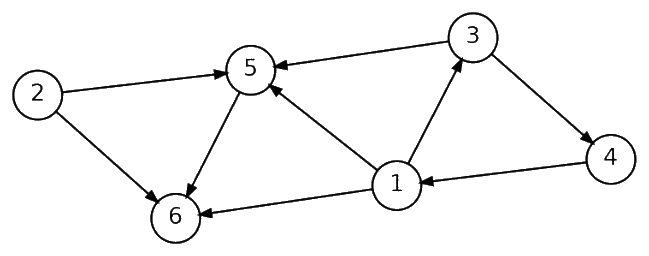

# 2023 CCF 非专业级别软件能力认证第一轮（CSP-S1）提高级 C++语言试题

认证时间：2023 年 9 月 16 日 14:30~16:30

考生注意事项：

- 试题纸共有 13 页，答题纸共有 1 页，满分 100 分。请在答题纸上作答，写在试题纸上的一律无效。
- 不得使用任何电子设备（如计算器、手机、电子词典等）或查阅任何书籍资料。

## 一、单项选择题

> 共 15 题，每题 2 分，共计 30 分；每题有且仅有一个正确选项。

### 第 1 题

<!-- qid: csp-s1-2023-001 | type: single_choice | score: 2 | answer: B | tags: topic:basics -->

在 Linux 系统终端中，以下哪个命令用于创建一个新的目录？（ ）

- A. newdir
- B. mkdir
- C. create
- D. mkfolder

> **题解**
> 答案：B
> 解释：`mkdir` 是 make directory 的缩写，用于在 Linux 终端里新建目录，选 B。`newdir`、`create`、`mkfolder` 都不是 Linux 的合法命令，只是照着中文意思拼出来的干扰项。

### 第 2 题

<!-- qid: csp-s1-2023-002 | type: single_choice | score: 2 | answer: A | tags: topic:combinatorics -->

0，1，2，3，4 中选取 4 个数字，能组成（ ）个不同四位数。（注：最小的四位数是 1000，最大的四位数是 9999。）

- A. 96
- B. 18
- C. 120
- D. 84

> **题解**
> 答案：A
> 解释：首位不能是 0，所以首位有 1、2、3、4 共 4 种选法；首位定下来之后，剩下三位由其余 4 个数字任意排列，有 4 × 3 × 2 = 24 种，合计 4 × 24 = 96，选 A。C 项 120 是 5 个数字里取 4 个的全排列数（没有排除以 0 开头的 24 个数）；B 项 18、D 项 84 都不是按「首位特殊」这一步算出来的。

### 第 3 题

<!-- qid: csp-s1-2023-003 | type: single_choice | score: 2 | answer: A | tags: feat:formula,topic:complexity -->

假设 $n$ 是图的顶点的个数，$m$ 是图的边的个数，为求解某一问题有下面四种不同时间复杂度的算法。对于 $m = \Theta(n)$ 的稀疏图而言，下面的四个选项，哪一项的渐近时间复杂度最小。（ ）

- A. $O(m\sqrt{\log n \cdot \log\log n})$
- B. $O(n^2 + m)$
- C. $O(n^2/\log m + m\log n)$
- D. $O(m + n\log n)$

> **题解**
> 答案：A
> 解释：把 m = Θ(n) 代进去看四个选项的量级：B 是 Θ(n²)，C 是 Θ(n²/log n + n log n) = Θ(n²/log n)，D 是 Θ(n log n)，而 A 是 n·√(log n · log log n)。比较 A 与 D：D / A = log n / √(log n log log n) = √(log n / log log n) → ∞，说明 A 比 D 增长更慢，故 A 最小，选 A。B、C 都是二次量级，只差一个对数因子，远大于 A。

### 第 4 题

<!-- qid: csp-s1-2023-004 | type: single_choice | score: 2 | answer: C | tags: feat:formula,topic:sim -->

假设有 $n$ 根柱子，需要按照以下规则依次放置编号为 1、2、3、...的圆环：每根柱子的底部固定，顶部可以放入圆环；每次从柱子顶部放入圆环时，需要保证任何两个相邻圆环的编号之和是一个完全平方数。请计算当有 4 根柱子时，最多可以放置（ ）个圆环。

- A. 7
- B. 9
- C. 11
- D. 5

> **题解**
> 答案：C
> 解释：同一根柱子上相邻两个圆环的编号之和必须是完全平方数，而编号按从小到大依次放入，所以每根柱子从下往上编号递增。用 DFS 穷举所有放法（每一步把当前编号放到任一能接的柱子顶端，「能接」就是「顶端编号 + 当前编号是完全平方数」，接不上就回溯）：1 到 11 能全部放下（四根柱子可以放成 1-3-6-10、2-7-9、4-5-11 和单独的 8），从 12 起无解。12 放不下是因为柱子不够：12 只能接在 4 的上面（12 + 4 = 16，另一个能配成 25 的 13 还没出现），而 5 只能接在 4 上或另起一根、11 又只能接在 5 上，所以 4 和 5-11 至少占两根；8 只能接在 1 上，于是 1 那一根要么把 1 留着当柱顶、3-6-10 另占一根，要么放成 1-8、3-6-10 再另占一根；再加上 2-7-9 一根，12 个数至少要 5 根柱子才排得下。所以最多 11 个，选 C；A 项 7、B 项 9、D 项 5 都小于实际可达的 11。

### 第 5 题

<!-- qid: csp-s1-2023-005 | type: single_choice | score: 2 | answer: B | tags: topic:ds -->

以下对数据结构的表述不恰当的一项是：（ ）。

- A. 队列是一种先进先出（FIFO）的线性结构
- B. 哈夫曼树的构造过程主要是为了实现图的深度优先搜索
- C. 散列表是一种通过散列函数将关键字映射到存储位置的数据结构
- D. 二叉树是一种每个结点最多有两个子结点的树结构

> **题解**
> 答案：B
> 解释：哈夫曼树的构造是反复合并权值最小的两棵树，用来得到最优前缀编码（数据压缩），与图的深度优先搜索毫无关系，所以 B 的说法不恰当。A 项队列先进先出、C 项散列表用散列函数把关键字映射到存储位置、D 项二叉树每个结点至多两个子结点，都是标准表述。

### 第 6 题

<!-- qid: csp-s1-2023-006 | type: single_choice | score: 2 | answer: A | tags: topic:graph -->

以下连通无向图中，（ ）一定可以用不超过两种颜色进行染色。

- A. 完全三叉树
- B. 平面图
- C. 边双连通图
- D. 欧拉图

> **题解**
> 答案：A
> 解释：完全三叉树一定是一棵树，树是无环连通图，按结点到根的深度奇偶染色就能用两种颜色（每条边连接深度相差 1 的两点），所以一定可以二染色，选 A。B 项平面图不一定二分，例如 K₄ 是平面图却含三角形；C 项边双连通图同样可以有奇环（一个三角形就是边双连通的）；D 项欧拉图也可以有奇环，都不是「一定」。

### 第 7 题

<!-- qid: csp-s1-2023-007 | type: single_choice | score: 2 | answer: C | tags: feat:formula,topic:string -->

最长公共子序列长度常常用来衡量两个序列的相似度。其定义如下：给定两个序列 $X = \{x_1, x_2, x_3, \cdots, x_m\}$ 和 $Y = \{y_1, y_2, y_3, \cdots, y_n\}$，最长公共子序列（LCS）问题的目标是找到一个最长的新序列 $Z = \{z_1, z_2, z_3, \cdots, z_k\}$，使得序列 $Z$ 既是序列 $X$ 的子序列，又是序列 $Y$ 的子序列，且序列 $Z$ 的长度 $k$ 在满足上述条件的序列里是最大的。（注：序列 $A$ 是序列 $B$ 的子序列，当且仅当在保持序列 $B$ 元素顺序的情况下，从序列 $B$ 中删除若干个元素，可以使得剩余的元素构成序列 $A$。）则序列“ABCAAAABA”和“ABABCBABA”的最长公共子序列长度为（ ）。

- A. 4
- B. 5
- C. 6
- D. 7

> **题解**
> 答案：C
> 解释：用最长公共子序列的动态规划：dp[i][j] 表示前 i 个字符与前 j 个字符的 LCS 长度，字符相同取 dp[i−1][j−1] + 1，不同则左右取大，算到 dp[9][9] = 6，选 C。这个长度也确实取得到：ABCABA 是 ABCAAAABA 的子序列（取第 1、2、3、4、8、9 位），也是 ABABCBABA 的子序列（取第 1、2、5、7、8、9 位）。A 项 4、B 项 5 都小于可达的 6，D 项 7 正是那个取不到的乐观值。

### 第 8 题

<!-- qid: csp-s1-2023-008 | type: single_choice | score: 2 | answer: B | tags: feat:formula,topic:prob -->

一位玩家正在玩一个特殊的掷骰子的游戏，游戏要求连续掷两次骰子，收益规则如下：玩家第一次掷出 $x$ 点，得到 $2x$ 元；第二次掷出 $y$ 点，当 $y=x$ 时玩家会失去之前得到的 $2x$ 元，而当 $y \ne x$ 时玩家能保住第一次获得的 $2x$ 元。上述 $x,y \in \{1,2,3,4,5,6\}$。例如：玩家第一次掷出 3 点得到 6 元后，但第二次再次掷出 3 点，会失去之前得到的 6 元，玩家最终收益为 0 元；如果玩家第一次掷出 3 点、第二次掷出 4 点，则最终收益是 6 元。假设骰子掷出任意一点的概率均为 1/6，玩家连续掷两次骰子后，所有可能情形下收益的平均值是多少？（ ）

- A. 7 元
- B. $\frac{35}{6}$ 元
- C. $\frac{16}{3}$ 元
- D. $\frac{19}{3}$ 元

> **题解**
> 答案：B
> 解释：按 36 种等可能的 (x, y) 求平均：y = x 的 6 种情形收益为 0，其余 30 种保住 2x，所以 E = (1/36) × Σ(2x × 5) = (10/36) × (1 + 2 + … + 6) = (10/36) × 21 = 35/6，选 B。A 项 7 是把「第一次点数的期望」乘以 2；C 项 16/3 与 D 项 19/3 都不是按「每个 x 有 5 个 y 保住收益」这一步算出来的。

### 第 9 题

<!-- qid: csp-s1-2023-009 | type: single_choice | score: 2 | answer: A | tags: topic:lang -->

假设我们有以下的 C++ 代码：

```
int a = 5, b = 3, c = 4;
bool res = a & b || c ^ b && a | c;
```

请问，`res` 的值是什么？（ ）

提示：在 C++ 中，逻辑运算的优先级从高到低依次为：逻辑非（!）、逻辑与（&&）、逻辑或（||）。位运算的优先级从高到低依次为：位非（~）、位与（&）、位异或（^）、位或（|）。同时，双目位运算的优先级高于双目逻辑运算；逻辑非和位非优先级相同，且高于所有双目运算符。

- A. true
- B. false
- C. 1
- D. 0

> **题解**
> 答案：A
> 解释：位运算优先级高于逻辑运算，所以原式等价于 `(a & b) || ((c ^ b) && (a | c))`。代入 a = 5、b = 3、c = 4：`a & b` = 1、`c ^ b` = 7、`a | c` = 5，于是 `7 && 5` 为真，整个表达式为 true，选 A。res 的类型是 bool，它的值就是 true；C 项的 1 是用 cout 输出 res 时屏幕上显示的样子，不是这个 bool 变量本身的值（B、D 两项则与计算结果相反）。

### 第 10 题

<!-- qid: csp-s1-2023-010 | type: single_choice | score: 2 | answer: C | tags: feat:formula,topic:sort -->

假设快速排序算法的输入是一个长度为 $n$ 的已排序数组，且该快速排序算法在分治过程总是选择第一个元素作为基准元素。以下哪个选项描述的是在这种情况下的快速排序行为？（ ）

- A. 快速排序对于此类输入的表现最好，因为数组已经排序。
- B. 快速排序对于此类输入的时间复杂度是 $O(n\log n)$。
- C. 快速排序对于此类输入的时间复杂度是 $O(n^2)$。
- D. 快速排序无法对此类数组进行排序，因为数组已经排序。

> **题解**
> 答案：C
> 解释：固定取第一个元素作基准时，对已排序数组的每一次划分都是「1 个元素 + 其余 n−1 个」，递归深度为 n，每层比较 O(n) 次，总比较次数 n + (n−1) + … + 1 = Θ(n²)，选 C。A 项说表现最好恰好说反了，这种输入正是快排的最坏情形；B 项 O(n log n) 是随机基准下的量级；D 项更不对，算法照样能排序，只是很慢。

### 第 11 题

<!-- qid: csp-s1-2023-011 | type: single_choice | score: 2 | answer: A | tags: topic:basics -->

以下哪个命令，能将一个名为“main.cpp”的 C++ 源文件，编译并生成一个名为“main”的可执行文件？（ ）

- A. `g++ -o main main.cpp`
- B. `g++ -o main.cpp main`
- C. `g++ main -o main.cpp`
- D. `g++ main.cpp -o main.cpp`

> **题解**
> 答案：A
> 解释：g++ 的命令行里 -o 后面跟输出文件名，其余参数是源文件，`g++ -o main main.cpp` 正是「拿 main.cpp 生成可执行文件 main」，选 A。B 项把 -o 的参数写成 main.cpp、源文件写成 main，输入输出颠倒；C 项把源文件当成 main，还会把输出写到 main.cpp 上；D 项输出名仍是 main.cpp，压根没有生成 main。

### 第 12 题

<!-- qid: csp-s1-2023-012 | type: single_choice | score: 2 | answer: C | tags: topic:tree -->

在图论中，树的重心是树上的一个结点，以该结点为根时，使得其所有的子树中结点数最多的子树的结点数最少。一棵树可能有多个重心。请问下面哪种树一定只有一个重心？（ ）。

- A. 4 个结点的树
- B. 6 个结点的树
- C. 7 个结点的树
- D. 8 个结点的树

> **题解**
> 答案：C
> 解释：树的重心最多有两个，而一旦有两个，它们必然相邻，删去它们之间的那条边后两侧子树各含 n/2 个结点，所以 n 必须是偶数。反过来，n 为奇数时重心只能有一个，四个选项里只有 7 是奇数，选 C。A 项不保险：路径 1-2-3-4 的两个重心就是 2 和 3；B 项 6 个结点的长链 1-2-…-6 重心是 3 和 4，D 项 8 个结点的长链重心是 4 和 5，都不唯一。

### 第 13 题

<!-- qid: csp-s1-2023-013 | type: single_choice | score: 2 | answer: C | images: q013-fig1.png | tags: feat:figure,topic:graph -->

如图是一张包含 6 个顶点的有向图，但顶点间不存在拓扑序。如果要删除其中一条边，使这 6 个顶点能进行拓扑排序，请问总共有多少条边可以作为候选的被删除边？（ ）



- A. 1
- B. 2
- C. 3
- D. 4

> **题解**
> 答案：C
> 解释：这张图里唯一的环是 1 → 3 → 4 → 1，其余顶点都不在环上，所以只要删掉这条环上的任意一条边，图就无环、可以拓扑排序；环上恰好 3 条边（1 → 3、3 → 4、4 → 1），候选就是这 3 条，选 C。删环外的边（如 2 → 5）环依然在，不能作为候选，所以 A 项 1、B 项 2、D 项 4 都不对。

### 第 14 题

<!-- qid: csp-s1-2023-014 | type: single_choice | score: 2 | answer: B | tags: feat:formula,topic:number -->

若 $n = \sum_{i=0}^{k} 16^i \cdot x_i$，定义 $f(n) = \sum_{i=0}^{k} x_i$；其中 $x_i \in \{0, 1, \cdots, 15\}$。对于给定自然数 $n_0$，存在序列 $n_0, n_1, n_2, \cdots, n_m$，其中对于 $1 \le i \le m$ 都有 $n_i = f(n_{i-1})$，且 $n_m = n_{m-1}$，称 $n_m$ 为 $n_0$ 关于 $f$ 的不动点。问在 $100_{16}$ 至 $1A0_{16}$ 中，关于 $f$ 的不动点为 9 的自然数个数为（ ）。

- A. 10
- B. 11
- C. 12
- D. 13

> **题解**
> 答案：B
> 解释：f 是「十六进制各位数字之和」。迭代时数位和与 n 对 15 同余，而数位和又迅速变小，所以最终一定停在 1 到 15 中与 n 同余的那个数上；不动点为 9 等价于 n 是模 15 余 9 的数。在 0x100 到 0x1A0（256 到 416）里这样的数依次是 264、279、…、414，共 (414 − 264) / 15 + 1 = 11 个，选 B（例如 264 = 0x108，1 + 0 + 8 = 9）。A 项 10、C 项 12、D 项 13 都只是在这一段里数错了个数。

### 第 15 题

<!-- qid: csp-s1-2023-015 | type: single_choice | score: 2 | answer: A | tags: feat:formula,topic:complexity -->

现在用如下代码来计算 $x^n$，其时间复杂度为（ ）。

```
double quick_power(double x, unsigned n) {
    if (n == 0) return 1;
    if (n == 1) return x;
    return quick_power(x, n / 2)
        * quick_power(x, n / 2)
        * ((n & 1) ? x : 1);
}
```

- A. $O(n)$
- B. $O(1)$
- C. $O(\log n)$
- D. $O(n\log n)$

> **题解**
> 答案：A
> 解释：函数每次把 n 折半，但同一层里两处 `quick_power(x, n / 2)` 都要真算一遍（没有记忆化），调用次数满足 T(n) = 2T(n/2) + O(1)，解出来是 Θ(n)。实测调用次数恰好是 2n − 1：n = 1 时 1 次、n = 2 时 3 次、n = 4 时 7 次、n = 1048576 时 2097151 次，随 n 线性增长，选 A。C 项 O(log n) 只看到「每次折半」，漏了同一层要算两遍；B 项 O(1)、D 项 O(n log n) 都不符合这个递推。

## 二、阅读程序

> 程序输入不超过数组或字符串定义的范围；判断题正确填 √，错误填 ×；除特殊说明外，判断题 1.5 分，选择题 3 分，共计 40 分。

### (1)

<!-- group: 阅读程序(1) -->

```cpp
 01  #include <iostream>
 02  using namespace std;
 03
 04  unsigned short f(unsigned short x) {
 05      x ^= x << 6;
 06      x ^= x >> 8;
 07      return x;
 08  }
 09
 10  int main() {
 11      unsigned short x;
 12      cin >> x;
 13      unsigned short y = f(x);
 14      cout << y <<endl;
 15      return 0;
 16  }
```

假设输入的 $x$ 是不超过 65535 的自然数，完成下面的判断题和单选题：

> **程序说明**
> 这段程序读入一个不超过 65535 的自然数，对它做两次异或移位后输出：先按位异或上自己左移 6 位的结果，再异或上自己右移 8 位的结果。要点在于运算都落在 16 位无符号短整型上：`x << 6` 会先把 x 提升成 32 位来算，但结果写回 `unsigned short` 时只保留低 16 位，所以整个函数是 16 位到 16 位的可逆变换。理解本组题要抓住两点：一是第 5、6 行都只是把结果写回 x，可以按 16 位逐位手算，不必纠缠类型提升的细节；二是第 6 行的 `x >> 8` 只影响低 8 位，这正是「输出为 0 只能来自输入为 0」这一判断的关键。

#### 判断题

##### 第 16 题

<!-- qid: csp-s1-2023-016 | type: true_false | score: 1.5 | answer: T | tags: topic:bit -->

当输入非零时，输出一定不为零。（ ）

> **题解**
> 答案：√
> 解释：第 5 行把 x 左移 6 位再异或回去，低 6 位完全不受影响，因此可以从低位往高位逐位还原，是 16 位上的可逆变换；第 6 行的 `x >> 8` 只影响低 8 位，输出的高 8 位就等于这一行之前的高 8 位。若输出为 0，则高 8 位为 0，说明第 6 行之前的高 8 位也是 0，此时低 8 位根本没被动过、也为 0，于是第 6 行之前的 x 就是 0，再由第一步可逆推出输入只能是 0。也就是说只有输入 0 才输出 0，主张成立，填 √。穷举 0 到 65535 全部 65536 个输入，输出为 0 的只有 0 一个，65536 个输出互不相同，与上述推理一致。

##### 第 17 题

<!-- qid: csp-s1-2023-017 | type: true_false | score: 2 | answer: F | tags: topic:bit -->

（2 分）将 `f` 函数的输入参数的类型改为 `unsigned int`，程序的输出不变。（ ）

> **题解**
> 答案：×
> 解释：参数改成 `unsigned int` 之后，第 5、6 行的中间结果都在 32 位上算，不再每次回落到 16 位，只到返回时才截断成 `unsigned short`，结果会变。实测 65536 个输入里有 64512 个的输出发生了变化，最早的例子是 x = 1024：原程序输出 1028（中间值 0x404），改后中间值 66820（0x10504），截断后是 1284。所以主张为假，填 ×。

##### 第 18 题

<!-- qid: csp-s1-2023-018 | type: true_false | score: 1.5 | answer: T | tags: topic:bit -->

当输入为“65535”时，输出为“63”。（ ）

> **题解**
> 答案：√
> 解释：直接手算：65535 = 0xFFFF，第 5 行要异或的 `x << 6` 在 16 位下是 0xFFC0，`0xFFFF ^ 0xFFC0 = 0x003F`；第 6 行 `0x003F >> 8 = 0`，异或后仍是 0x003F = 63。实跑输出 63，与题面一致，填 √。

##### 第 19 题

<!-- qid: csp-s1-2023-019 | type: true_false | score: 1.5 | answer: F | tags: topic:bit -->

当输入为“1”时，输出为“64”。（ ）

> **题解**
> 答案：×
> 解释：手算：1 = 0x0001，第 5 行 `1 ^ (1 << 6) = 1 ^ 64 = 65`，即 0x0041；第 6 行 `0x0041 >> 8 = 0`，所以输出 65 而不是题面说的 64。实跑输出正是 65，主张不成立，填 ×。

#### 单选题

##### 第 20 题

<!-- qid: csp-s1-2023-020 | type: single_choice | score: 3 | answer: B | tags: topic:bit -->

当输入为“512”时，输出为（ ）。

- A. “33280”
- B. “33410”
- C. “33106”
- D. “33346”

> **题解**
> 答案：B
> 解释：512 = 0x0200。第 5 行：`x << 6 = 0x8000`，异或得 0x8200 = 33280；第 6 行：`0x8200 >> 8 = 0x82 = 130`，再异或得 0x8282 = 33410。实跑输出 33410，选 B。A 项 33280 正好是只做完第 5 行的中间值（漏掉了第 6 行），C 项 33106、D 项 33346 只是低位上的干扰值。

##### 第 21 题

<!-- qid: csp-s1-2023-021 | type: single_choice | score: 3 | answer: D | tags: feat:lineref,topic:bit -->

当输入为“64”时，执行完第 5 行后 `x` 的值为（ ）。

- A. “8256”
- B. “4130”
- C. “4128”
- D. “4160”

> **题解**
> 答案：D
> 解释：输入 64 = 0x0040，第 5 行要算 `x ^= x << 6`：`x << 6 = 64 × 64 = 4096 = 0x1000`，异或得 0x1040 = 4160，选 D。A 项 8256 = 0x2040 相当于把 x 左移了 7 位，B 项 4130、C 项 4128 则是 0x1000 上的低位噪声，都不等于 64 ^ 4096。

### (2)

<!-- group: 阅读程序(2) -->

```cpp
 01  #include <iostream>
 02  #include <cmath>
 03  #include <vector>
 04  #include <algorithm>
 05  using namespace std;
 06
 07  long long solve1(int n) {
 08      vector<bool> p(n+1, true);
 09      vector<long long> f(n+1, 0), g(n+1, 0);
 10      f[1] = 1;
 11      for (int i = 2; i * i <= n; i++) {
 12          if (p[i]) {
 13              vector<int> d;
 14              for (int k = i; k <= n; k *= i) d.push_back(k);
 15              reverse(d.begin(), d.end());
 16              for (int k : d) {
 17                  for (int j = k; j <= n; j += k) {
 18                      if (p[j]) {
 19                          p[j] = false;
 20                          f[j] = i;
 21                          g[j] = k;
 22                      }
 23                  }
 24              }
 25          }
 26      }
 27      for (int i = sqrt(n) + 1; i <= n; i++) {
 28          if (p[i]) {
 29              f[i] = i;
 30              g[i] = i;
 31          }
 32      }
 33      long long sum = 1;
 34      for (int i = 2; i <= n; i++) {
 35          f[i] = f[i / g[i]] * (g[i] * f[i] - 1) / (f[i] - 1);
 36          sum += f[i];
 37      }
 38      return sum;
 39  }
 40
 41  long long solve2(int n) {
 42      long long sum = 0;
 43      for (int i = 1; i <= n; i++) {
 44          sum += i * (n / i);
 45      }
 46      return sum;
 47  }
 48
 49  int main() {
 50      int n;
 51      cin >> n;
 52      cout << solve1(n) << endl;
 53      cout << solve2(n) << endl;
 54      return 0;
 55  }
```

假设输入的 $n$ 是不超过 1000000 的自然数，完成下面的判断题和单选题：

> **程序说明**
> 这段程序用两种办法算同一个量：1 到 n 每个数的约数之和再加总。`solve1` 走「筛法 + 递推」：先用埃氏筛式的标记求出每个数的最小质因子 f 和它含有的最大质数幂 g，再按第 35 行的公式 f[i] = f[i / g[i]] × (g[i] × f[i] − 1) / (f[i] − 1) 逐个算出约数和并累加；`solve2` 反过来数「i 是哪些数的约数」，第 44 行 `i * (n / i)` 一次算完 i 的全部贡献。输入是一个不超过 1000000 的 n，输出两行，分别是两种算法的结果。理解本组题要抓住两点：一是两者结果恒等，第二行永远等于第一行；二是第 15 行的 `reverse` 让 i 的幂从大到小处理，f、g 才取到正确的值，删掉它结果就变。

#### 判断题

##### 第 22 题

<!-- qid: csp-s1-2023-022 | type: true_false | score: 1.5 | answer: F | tags: feat:lineref,topic:number -->

将第 15 行删去，输出不变。（ ）

> **题解**
> 答案：×
> 解释：第 15 行的 reverse 把 i 的各次幂从大到小排列，先标记 i 的最大幂的倍数，每个合数才会被它含有的最大 i 幂标上——g[j] 取到的才是正确的幂次，第 35 行的约数和递推才成立。删掉之后按 i、i²、… 从小到大标记，所有 i 的倍数一律拿到 g[j] = i，f 就算错了。实跑 n = 4 时输出从 15（= 1 + 3 + 4 + 7，正是 1 到 4 的约数之和之和）变成 17（其中 f[4] 从 7 变成 9）；n 从 1 到 100000 里有 99997 个 n 的输出发生了变化。故主张为假，填 ×。

##### 第 23 题

<!-- qid: csp-s1-2023-023 | type: true_false | score: 1.5 | answer: F | tags: topic:number -->

当输入为“10”时，输出的第一行大于第二行。（ ）

> **题解**
> 答案：×
> 解释：两个函数算的是同一个量（1 到 n 每个数的约数之和再加总），所以输出的两行必然相等，「第一行大于第二行」永远不成立。实测 n = 10 时两行都是 87，也就是 1 + 3 + 4 + 7 + 6 + 12 + 8 + 15 + 13 + 18 = 87。主张为假，填 ×。

##### 第 24 题

<!-- qid: csp-s1-2023-024 | type: true_false | score: 2 | answer: T | tags: topic:number -->

（2 分）当输入为“1000”时，输出的第一行与第二行相等。（ ）

> **题解**
> 答案：√
> 解释：同样因为两行求的是同一个量，第二行恒等于第一行；实测 n = 1000 时两行都是 823081（正是 1 到 1000 每个数的约数之和再加总）。主张成立，填 √。

#### 单选题

##### 第 25 题

<!-- qid: csp-s1-2023-025 | type: single_choice | score: 3 | answer: D | tags: feat:formula,topic:complexity -->

`solve1(n)` 的时间复杂度为（ ）。

- A. $\Theta(n\log^2 n)$
- B. $\Theta(n)$
- C. $\Theta(n\log n)$
- D. $\Theta(n\log\log n)$

> **题解**
> 答案：D
> 解释：solve1 的主体是埃氏筛式的标记：外层只跑到 √n，但对每个素数 i 都要遍历它各次幂的倍数，总工作量相当于 Σ(1/i + 1/i² + …) × n，对素数求和约为 n × log log n；第 27、34 行那两轮是 O(n)，被它吸收。所以是 Θ(n log log n)，选 D。C 项 Θ(n log n) 多算了一个 log 因子（每个素数贡献的是 n/i 而不是 n log n），B 项则把筛法的对数因子整个漏掉了。

##### 第 26 题

<!-- qid: csp-s1-2023-026 | type: single_choice | score: 3 | answer: B | tags: feat:formula,topic:complexity -->

`solve2(n)` 的时间复杂度为（ ）。

- A. $\Theta(n^2)$
- B. $\Theta(n)$
- C. $\Theta(n\log n)$
- D. $\Theta(n\sqrt{n})$

> **题解**
> 答案：B
> 解释：solve2 只有一个 1 到 n 的单重循环，循环体是常数时间（第 44 行做一次除法、一次乘法、一次加法），所以是 Θ(n)，选 B。A、C、D 都把它当成了带嵌套循环或带对数因子的循环。

##### 第 27 题

<!-- qid: csp-s1-2023-027 | type: single_choice | score: 3 | answer: B | tags: topic:number -->

输入为“5”时，输出的第二行为（ ）。

- A. “20”
- B. “21”
- C. “22”
- D. “23”

> **题解**
> 答案：B
> 解释：n = 5 时第二行是 Σ i × (n / i) = 1×5 + 2×2 + 3×1 + 4×1 + 5×1 = 21（C++ 整除，5/3、5/4、5/5 都等于 1），选 B。这个和也等于 1 到 5 的约数之和再加总：1 + 3 + 4 + 7 + 6 = 21。A 项 20、C 项 22、D 项 23 是就地把某一项算错的结果。

### (3)

<!-- group: 阅读程序(3) -->

```cpp
 01  #include <vector>
 02  #include <algorithm>
 03  #include <iostream>
 04
 05  using namespace std;
 06
 07  bool f0(vector<int>& a, int m, int k) {
 08      int s = 0;
 09      for (int i = 0, j = 0; i < a.size(); i++) {
 10          while (a[i] - a[j] > m) j++;
 11          s += i - j;
 12      }
 13      return s >= k;
 14  }
 15
 16  int f(vector<int>& a, int k) {
 17      sort(a.begin(), a.end());
 18
 19      int g = 0;
 20      int h = a.back() - a[0];
 21      while (g < h) {
 22          int m = g + (h - g) / 2;
 23          if (f0(a, m, k)) {
 24              h = m;
 25          } else {
 26              g = m + 1;
 27          }
 28      }
 29
 30      return g;
 31  }
 32
 33  int main() {
 34      int n, k;
 35      cin >> n >> k;
 36      vector<int> a(n, 0);
 37      for(int i = 0; i < n; i++) {
 38          cin >> a[i];
 39      }
 40      cout<< f(a, k) << endl;
 41      return 0;
 42  }
```

假设输入总是合法的且 $|a[i]|\le10^8$、$n\le10000$ 和 $1\le k\le n(n-1)/2$，完成下面的判断题和单选题：

> **程序说明**
> 这段程序求「第 k 小的数对之差」：输入 n、k 与 n 个整数，输出一个整数。做法是二分答案——`f0(a, m, k)` 用双指针统计差值不超过 m 的数对有多少个、是否达到 k 个；`f` 先排序，再在 0 到「最大值减最小值」之间二分出使这个统计成立的最小 m，那个 m 就是第 k 小的差值。理解本组题要抓住两点：一是 `f0` 里的下标 j 只朝一个方向移动，所以每次统计是 O(n)，配上排序与二分，整个 f 是 Θ(n log(nA))（A 是答案范围）；二是二分边界怎么收缩决定了答案对不对，把 `h = m`、`g = m + 1` 稍作改动，输出就可能整体偏一位。

#### 判断题

##### 第 28 题

<!-- qid: csp-s1-2023-028 | type: true_false | score: 1.5 | answer: T | tags: feat:lineref,topic:bisect -->

将第 24 行的“m”改为“m - 1”，输出有可能不变，而剩下情况为少 1。（ ）

> **题解**
> 答案：√
> 解释：第 24 行 h = m 的作用是「保留边界 m」，改成 h = m − 1 之后二分区间里不再包含 m，只有答案恰好卡在那个被排除的值上才会受影响，因此输出要么不变、要么正好少 1。实测 4000 组随机数据（n 在 2 到 8 之间，`|a[i]|` 不超过 12）：2794 组输出不变，1206 组恰好少 1，没有出现其它差值。主张成立，填 √。

##### 第 29 题

<!-- qid: csp-s1-2023-029 | type: true_false | score: 1.5 | answer: T | tags: feat:lineref,topic:bisect -->

将第 22 行的“g + (h - g) / 2”改为“(h + g) >> 1”，输出不变。（ ）

> **题解**
> 答案：√
> 解释：对 g ≤ h 的非负整数，g + (h − g) / 2 与 `(h + g) >> 1` 都等于 ⌊(g + h) / 2⌋，两式恒等，输出一定不变。实测 4000 组随机数据全部得到相同输出；题面给的 `|a[i]|` 不超过 10⁸，h + g 也不会溢出 int。主张成立，填 √。

##### 第 30 题

<!-- qid: csp-s1-2023-030 | type: true_false | score: 1.5 | answer: T | tags: topic:bisect -->

当输入为“5 7 2 -4 5 1 -3”，输出为“5”。（ ）

> **题解**
> 答案：√
> 解释：这道题要真把程序跑一遍：输入 5 个数 2、−4、5、1、−3 与 k = 7，排序后是 −4、−3、1、2、5，两两差值从小到大为 1、1、3、4、4、5、5、6、8、9，第 7 小的是 5，程序输出正是 5（这个程序求的就是第 k 小的数对之差）。主张成立，填 √。

#### 单选题

##### 第 31 题

<!-- qid: csp-s1-2023-031 | type: single_choice | score: 3 | answer: C | tags: feat:formula,topic:complexity -->

设 `a` 数组中最大值减最小值加 1 为 $A$，则 `f` 函数的时间复杂度为（ ）。

- A. $\Theta(n\log A)$
- B. $\Theta(n^2\log A)$
- C. $\Theta(n\log(nA))$
- D. $\Theta(n\log n)$

> **题解**
> 答案：C
> 解释：f 的时间由三部分构成：排序 O(n log n)；二分的轮数由答案范围决定，最大差值不超过 A − 1，所以是 O(log A) 轮；每轮 f0 里 j 只单向右移，是 O(n)。合起来 O(n log n + n log A) = Θ(n log(nA))，选 C。A 项 Θ(n log A) 漏掉了排序，D 项 Θ(n log n) 漏掉了二分，B 项则是把两层复杂度乘了起来。

##### 第 32 题

<!-- qid: csp-s1-2023-032 | type: single_choice | score: 3 | answer: B | tags: feat:lineref,topic:bisect -->

将第 10 行中的“>”替换为“>=”，那么原输出与现输出的大小关系为（ ）。

- A. 一定小于
- B. 一定小于等于且不一定小于
- C. 一定大于等于且不一定大于
- D. 以上三种情况都不对

> **题解**
> 答案：B
> 解释：把第 10 行的判定从「差值大于 m 才继续右移 j」放宽成「差值大于等于 m 就右移」，j 只会走得更远，f0 统计出的对数 s 只会更小、更难达到 k 个，于是二分收敛到的答案只会变大或不变。所以原输出一定小于等于现输出，而且不一定严格小于。实测 4000 组随机数据：1106 组两者相等、2894 组现输出更大、0 组现输出更小，选 B。A 项「一定小于」错在相等的情形确实存在，C 项方向正好相反。

##### 第 33 题

<!-- qid: csp-s1-2023-033 | type: single_choice | score: 3 | answer: B | tags: topic:bisect -->

当输入为“5 8 2 -5 3 8 -12”时，输出为（ ）。

- A. “13”
- B. “14”
- C. “8”
- D. “15”

> **题解**
> 答案：B
> 解释：输入 5 个数 2、−5、3、8、−12 与 k = 8。排序后是 −12、−5、2、3、8，两两差值从小到大为 1、5、6、7、7、8、13、14、15、20，第 8 小的是 14，程序输出 14，选 B。C 项 8 是第 6 小的差值，A 项 13、D 项 15 分别是第 7 小和第 9 小的差值。

## 三、完善程序

> 单选题，每小题 3 分，共计 30 分。

### (1)

<!-- group: 完善程序(1) -->

（第 $k$ 小路径）给定一张 $n$ 个点 $m$ 条边的有向无环图，顶点编号从 0 到 $n-1$。对于一条路径，我们定义“路径序列”为该路径从起点出发依次经过的顶点编号构成的序列。求所有至少包含一个点的简单路径中，“路径序列”字典序第 $k$ 小的路径。保证存在至少 $k$ 条路径。上述参数满足 $1 \le n, m \le 10^5$ 和 $1 \le k \le 10^{18}$。

在程序中，我们求出从每个点出发的路径数量。超过 $10^{18}$ 的数都用 $10^{18}$ 表示。然后我们根据 $k$ 的值和每个顶点的路径数量，确定路径的起点，然后可以类似地依次求出路径中的每个点。

试补全程序。

```cpp
 01  #include <iostream>
 02  #include <algorithm>
 03  #include <vector>
 04
 05  const int MAXN = 100000;
 06  const long long LIM = 1000000000000000000ll;
 07
 08  int n, m, deg[MAXN];
 09  std::vector<int> E[MAXN];
 10  long long k, f[MAXN];
 11
 12  int next(std::vector<int> cand, long long &k) {
 13      std::sort(cand.begin(), cand.end());
 14      for (int u : cand) {
 15          if (①) return u;
 16          k -= f[u];
 17      }
 18      return -1;
 19  }
 20
 21  int main() {
 22      std::cin >> n >> m >> k;
 23      for (int i = 0; i < m; ++i) {
 24          int u, v;
 25          std::cin >> u >> v; // 一条从 u 到 v 的边
 26          E[u].push_back(v);
 27          ++deg[v];
 28      }
 29      std::vector<int> Q;
 30      for (int i = 0; i < n; ++i)
 31          if (!deg[i]) Q.push_back(i);
 32      for (int i = 0; i < n; ++i) {
 33          int u = Q[i];
 34          for (int v : E[u]) {
 35              if (②) Q.push_back(v);
 36              --deg[v];
 37          }
 38      }
 39      std::reverse(Q.begin(), Q.end());
 40      for (int u : Q) {
 41          f[u] = 1;
 42          for (int v : E[u]) f[u] = ③;
 43      }
 44      int u = next(Q, k);
 45      std::cout << u << std::endl;
 46      while (④) {
 47          ⑤;
 48          u = next(E[u], k);
 49          std::cout << u << std::endl;
 50      }
 51      return 0;
 52  }
```

> **程序说明**
> 这段程序求有向无环图中字典序第 k 小的路径序列。它先用 Kahn 算法求出拓扑序，再倒着处理每个点，按 f[u] = 1 + Σ f[v] 算出从 u 出发的路径条数（超过 10¹⁸ 的一律记作 10¹⁸）；然后从起点起逐点确定这条路径：`next` 把候选点排序后依次比较，落在哪个点的路径段里就返回哪个点，否则减去该点的路径数。输入是 n、m、k 与 m 条有向边，输出这条路径依次经过的顶点编号，每行一个。理解本组题要抓住两点：一是 f[u] 里的那个 1 就是「只含 u 一个点的路径」，所以定下起点后还要把 k 减 1 才能继续往下接；二是拓扑序必须倒着处理，算 f[u] 时它的所有后继才已经算好。

##### 第 34 题

<!-- qid: csp-s1-2023-034 | type: single_choice | score: 3 | answer: B | tags: feat:circnum,topic:dp -->

①处应填（ ）

- A. `k >= f[u]`
- B. `k <= f[u]`
- C. `k > f[u]`
- D. `k < f[u]`

> **题解**
> 答案：B
> 解释：next 要在候选点里挑出「第 k 条路径」的起点：候选点按编号从小到大排好，编号 u 名下恰好有 f[u] 条路径，所以 k ≤ f[u] 时就落在 u 上并返回，否则说明这 f[u] 条全都排在前面，把 k 减去 f[u] 再试下一个候选。故 ① 填 `k <= f[u]`，选 B。A 项 `k >= f[u]` 会在 k 大于 f[u] 时也返回 u，把后面候选点的路径错认成 u 的；C、D 项用严格不等号，会漏掉 k 恰好等于 f[u] 的那一条。把 4 个候选代进程序、对 382 张随机 DAG 与暴力解（枚举全部简单路径的顶点序列再按字典序排序）对拍，只有 ①B ②A ③A ④D ⑤C 这一组在 382 例上全部吻合。

##### 第 35 题

<!-- qid: csp-s1-2023-035 | type: single_choice | score: 3 | answer: A | tags: feat:circnum,topic:graph -->

②处应填（ ）

- A. `deg[v] == 1`
- B. `deg[v] == 0`
- C. `deg[v] > 1`
- D. `deg[v] > 0`

> **题解**
> 答案：A
> 解释：第 32 到 38 行是 Kahn 拓扑排序：处理 u 时要把它所有后继 v 的入度减 1，而 ② 写在 `--deg[v]` 之前，此刻 deg[v] 还没减，所以 deg[v] == 1 正好表示「这是 v 最后一个还没处理的前驱」，v 可以入队了，选 A。B 项 `deg[v] == 0` 永远不会成立（此刻 v 至少还有 u 这条入边）；C 项 `deg[v] > 1` 会在还有多个前驱没处理时就入队；D 项 `deg[v] > 0` 更是把每个后继都塞进队列，顺序就乱了。对 382 张随机 DAG 对拍：填 B 只有 27 例正确、C 82 例、D 249 例，只有 A 全部正确。

##### 第 36 题

<!-- qid: csp-s1-2023-036 | type: single_choice | score: 3 | answer: A | tags: feat:circnum,topic:dp -->

③处应填（ ）

- A. `std::min(f[u] + f[v], LIM)`
- B. `std::min(f[u] + f[v] + 1, LIM)`
- C. `std::min(f[u] * f[v], LIM)`
- D. `std::min(f[u] * (f[v] + 1), LIM)`

> **题解**
> 答案：A
> 解释：f[u] 要统计从 u 出发的路径条数：既包括只有 u 一个点的平凡路径（1 条，第 41 行的初值），也包括「u 后面接上一条从某个后继 v 出发的路径」的那些，所以 f[u] = 1 + Σ f[v]，即第 42 行对每个后继累加 f[v]，写成 `std::min(f[u] + f[v], LIM)`，选 A（题目要求超过 10¹⁸ 的记作 10¹⁸，上限由 LIM 兜住；两项之和最多 2 × 10¹⁸，long long 装得下）。B 项每个后继都多加了一个 1，等于把平凡路径重复计入；C、D 项用乘法，把「接在不同后继后面」的路径数当成了笛卡尔积，与路径的拼接方式不符。对 382 张随机 DAG 对拍：填 B、C、D 分别只有 158、79、275 例正确，只有 A 全部正确。

##### 第 37 题

<!-- qid: csp-s1-2023-037 | type: single_choice | score: 3 | answer: D | tags: feat:circnum,topic:dp -->

④处应填（ ）

- A. `u != -1`
- B. `!E[u].empty()`
- C. `k > 0`
- D. `k > 1`

> **题解**
> 答案：D
> 解释：这个循环决定「还要不要继续往下走」。k 表示在当前起点名下数第 k 条路径：k = 1 对应的正是最短的那条——只有起点一个点的平凡路径（它是所有以该点为起点的路径中最小的，因为别的路径都以它为前缀），此时路径已经结束；`k > 1` 才说明还要往后接。故 ④ 填 `k > 1`，选 D。A 项 `u != -1` 在这里恒成立（u 是刚输出的合法顶点）；B 项 `!E[u].empty()` 会把没有出边的顶点也拉进去取下一个点（next 返回 −1，多输出一个 −1）；C 项 `k > 0` 会在 k = 1 时继续走。对 382 张随机 DAG 对拍：填 A、B、C 分别只有 0、230、0 例正确，只有 D 全部正确。

##### 第 38 题

<!-- qid: csp-s1-2023-038 | type: single_choice | score: 3 | answer: C | tags: feat:circnum,topic:dp -->

⑤处应填（ ）

- A. `k += f[u]`
- B. `k -= f[u]`
- C. `--k`
- D. `++k`

> **题解**
> 答案：C
> 解释：进入下一层之前要先把「以当前点为终点的平凡路径」这一条扣掉：以当前点 u 为起点的路径里，第 1 条是平凡的 [u]，第 2 到第 f[u] 条才是「u 接上某个后继」的路径，所以 k 要减 1，减完之后的 k 才是拿去在 E[u] 里找下一个点的序号。故 ⑤ 填 `--k`，选 C。A、B 项加减的是 f[u]，那是 next 内部处理候选点时才做的事，放在这里会让序号错位；D 项 `++k` 方向反了。对 382 张随机 DAG 对拍：填 A、B、D 分别只有 175、284、175 例正确，只有 C 全部正确。

### (2)

<!-- group: 完善程序(2) -->

（最大值之和）给定整数序列 $a_0, \ldots, a_{n-1}$，求该序列所有非空连续子序列的最大值之和。上述参数满足 $1 \le n \le 10^5$ 和 $1 \le a_i \le 10^8$。

一个序列的非空连续子序列可以用两个下标 $l$ 和 $r$（其中 $0 \le l \le r < n$）表示，对应的序列为 $a_l, a_{l+1}, \ldots, a_r$。两个非空连续子序列不同，当且仅当下标不同。

例如，当原序列为 `[1,2,1,2]` 时，要计算子序列 `[1]`、`[2]`、`[1]`、`[2]`、`[1,2]`、`[2,1]`、`[1,2]`、`[1,2,1]`、`[2,1,2]`、`[1,2,1,2]` 的最大值之和，答案为 18。注意 `[1,1]` 和 `[2,2]` 虽然是原序列的子序列，但不是连续子序列，所以不应该被计算。另外，注意其中有一些值相同的子序列，但由于他们在原序列中的下标不同，属于不同的非空连续子序列，所以会被分别计算。

解决该问题有许多算法，以下程序使用分治算法，时间复杂度 $O(n\log n)$。

试补全程序。

```cpp
 01  #include <iostream>
 02  #include <algorithm>
 03  #include <vector>
 04
 05  const int MAXN = 100000;
 06
 07  int n;
 08  int a[MAXN];
 09  long long ans;
 10
 11  void solve(int l, int r) {
 12      if (l + 1 == r) {
 13          ans += a[l];
 14          return;
 15      }
 16      int mid = (l + r) >> 1;
 17      std::vector<int> pre(a + mid, a + r);
 18      for (int i = 1; i < r - mid; ++i) ①;
 19      std::vector<long long> sum(r - mid + 1);
 20      for (int i = 0; i < r - mid; ++i) sum[i + 1] = sum[i] + pre[i];
 21      for (int i = mid - 1, j = mid, max = 0; i >= l; --i) {
 22          while (j < r && ②) ++j;
 23          max = std::max(max, a[i]);
 24          ans += ③;
 25          ans += ④;
 26      }
 27      solve(l, mid);
 28      solve(mid, r);
 29  }
 30
 31  int main() {
 32      std::cin >> n;
 33      for (int i = 0; i < n; ++i) std::cin >> a[i];
 34      ⑤;
 35      std::cout << ans << std::endl;
 36      return 0;
 37  }
```

> **程序说明**
> 这段程序用分治求一个序列所有非空连续子序列的最大值之和。`solve(l, r)` 处理半开区间 [l, r)：区间只剩一个元素时直接把它累加进答案；否则取中点 mid，把跨过中点的子区间按最大值的来源分成两类——来自左半边的（第 24 行用左侧当前最大值乘上个数）与来自右半边的（第 25 行用 pre 的前缀和做一次差分算完），再递归处理左右两半。输入是 n 与序列 a，输出一个整数。理解本组题要抓住两点：一是 `pre` 是 a[mid..r−1] 的前缀最大值、`sum` 是它的前缀和，第 22 行的指针 j 每层只向右移动，所以每层的统计合起来是线性的；二是分界点就是「右侧前缀最大值开始压过左侧最大值」的那个位置，第 24、25 行分别负责分界点两侧。

##### 第 39 题

<!-- qid: csp-s1-2023-039 | type: single_choice | score: 3 | answer: D | tags: feat:circnum,topic:divide -->

①处应填（ ）

- A. `pre[i] = std::max(pre[i - 1], a[i - 1])`
- B. `pre[i + 1] = std::max(pre[i], pre[i + 1])`
- C. `pre[i] = std::max(pre[i - 1], a[i])`
- D. `pre[i] = std::max(pre[i], pre[i - 1])`

> **题解**
> 答案：D
> 解释：pre 是把 a[mid..r−1] 整段拷贝出来，第 18 行要把它变成前缀最大值：pre[i] 应当等于 a[mid..mid+i] 里的最大值，也就是 `std::max(pre[i], pre[i - 1])`（pre[i] 的原值就是 a[mid + i]），选 D。A 项比的是 a[i−1]、C 项比的是 a[i]，都取自中点左边、不属于这一段；B 项把结果写进 pre[i + 1]，第 1 个元素永远进不了比较（pre[1] 不会与 pre[0] 取最大值）。对 400 组随机数组与暴力解（枚举所有非空连续子序列取最大值求和）对拍：填 A、B、C 分别只有 188、66、211 例正确，只有 D 全部正确。

##### 第 40 题

<!-- qid: csp-s1-2023-040 | type: single_choice | score: 3 | answer: B | tags: feat:circnum,topic:divide -->

②处应填（ ）

- A. `a[j] < max`
- B. `a[j] < a[i]`
- C. `pre[j - mid] < max`
- D. `pre[j - mid] > max`

> **题解**
> 答案：B
> 解释：第 22 行的 while 让 j 单向右移，停在「右侧前缀最大值开始压过左侧最大值」的那个分界点：分界点之前的右端点，子区间最大值由左半边的 max 决定（第 24 行按个数乘 max），分界点及之后的由右侧的 pre 决定（第 25 行用前缀和差分）。而 a[i] 是刚纳入左边区间的元素，它本身可能就是新的左端最大值，所以比较对象要写成 a[i]，即 `a[j] < a[i]`，选 B；这两行还写在 `max = std::max(max, a[i])` 之前，拿旧的 max 去比就会漏掉 a[i]。对 400 组随机数组对拍：改填 A、C、D 分别只有 56、56、56 例正确，只有 B 在 400 例上全部正确。

##### 第 41 题

<!-- qid: csp-s1-2023-041 | type: single_choice | score: 3 | answer: A | tags: feat:circnum,topic:divide -->

③处应填（ ）

- A. `(long long)(j - mid) * max`
- B. `(long long)(j - mid) * (i - l) * max`
- C. `sum[j - mid]`
- D. `sum[j - mid] * (i - l)`

> **题解**
> 答案：A
> 解释：第 24 行统计的是「右端点还没越过分界点」的那 j − mid 个子区间：它们的最大值都由左侧当前的 max 提供，每个贡献 max，合计 `(long long)(j - mid) * max`，选 A。B 项多乘了左端点的个数 (i − l)；C 项 `sum[j - mid]` 是右侧前缀和里的一小段，与这些「左侧主导」的区间无关；D 项把两者又乘到了一起。另外这个 long long 强制转换不能省：j − mid 最大约 10⁵、max 最大 10⁸，乘积会超过 int。对 400 组随机数组对拍：填 B、C、D 分别只有 61、56、56 例正确，只有 A 全部正确。

##### 第 42 题

<!-- qid: csp-s1-2023-042 | type: single_choice | score: 3 | answer: C | tags: feat:circnum,topic:divide -->

④处应填（ ）

- A. `(long long)(r - j) * max`
- B. `(long long)(r - j) * (mid - i) * max`
- C. `sum[r - mid] - sum[j - mid]`
- D. `(sum[r - mid] - sum[j - mid]) * (mid - i)`

> **题解**
> 答案：C
> 解释：分界点 j 之后的右端点，子区间的最大值由右侧提供，就是 pre 的对应项，所以这部分贡献是 Σ pre[0..r−mid−1] 里从 j − mid 起的那一段，即 `sum[r - mid] - sum[j - mid]`，选 C（第 20 行已经提前把 pre 做成了前缀和，这里一次差分即可）。A、B 项用的是「个数乘 max」的形式，那是分界点之前那部分的算法；D 项又多乘了左端点的个数。对 400 组随机数组对拍：填 A、B、D 分别只有 56、63、198 例正确，只有 C 全部正确。

##### 第 43 题

<!-- qid: csp-s1-2023-043 | type: single_choice | score: 3 | answer: A | tags: feat:circnum,topic:divide -->

⑤处应填（ ）

- A. `solve(0, n)`
- B. `solve(0, n - 1)`
- C. `solve(1, n)`
- D. `solve(1, n - 1)`

> **题解**
> 答案：A
> 解释：solve 处理的是半开区间 [l, r)：递归出口是 l + 1 == r（只剩一个元素），中点取 (l + r) / 2，子调用是 solve(l, mid) 与 solve(mid, r)，所以整个数组对应的入口是 `solve(0, n)`，选 A。B 项 `solve(0, n - 1)` 把最后一个元素漏在区间外，C 项 `solve(1, n)` 漏掉第一个，D 项两个都漏——实测这三种填法在 400 组随机数组上没有一组与暴力解相符（0/400），而 A 全部相符。

