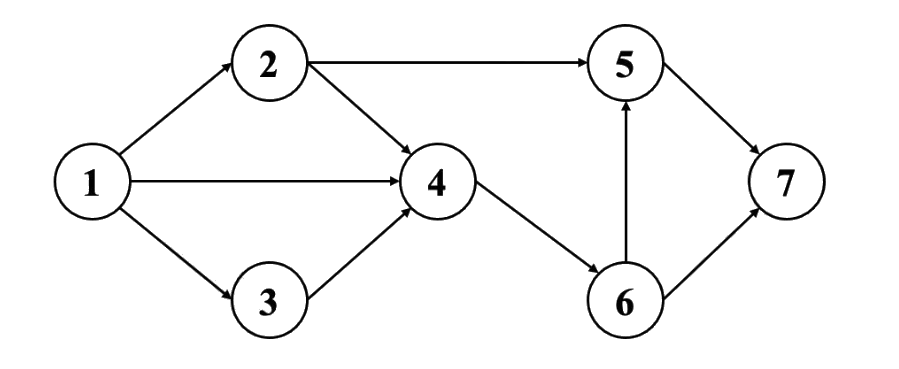

# 2024 CCF 非专业级别软件能力认证第一轮（CSP-S1）提高级 C++语言试题

认证时间：2024 年 9 月 21 日 14:30~16:30

考生注意事项：

- 试题纸共有 16 页，答题纸共有 1 页，满分 100 分。请在答题纸上作答，写在试题纸上的一律无效。
- 不得使用任何电子设备（如计算器、手机、电子词典等）或查阅任何书籍资料。

## 一、单项选择题

> 共 15 题，每题 2 分，共计 30 分；每题有且仅有一个正确选项。

### 第 1 题

<!-- qid: csp-s1-2024-001 | type: single_choice | score: 2 | answer: A | tags: topic:basics -->

在 Linux 系统中，如果你想显示当前工作目录的路径，应该使用哪个命令？（ ）

- A. pwd
- B. cd
- C. ls
- D. echo

> **题解**
> 答案：A
> 解释：`pwd` 是 print working directory 的缩写，作用就是打印当前工作目录的完整路径，选 A。`cd` 用来切换目录，`ls` 列出目录里的文件，`echo` 只是把参数输出到屏幕，三者都不会显示当前所在的路径。

### 第 2 题

<!-- qid: csp-s1-2024-002 | type: single_choice | score: 2 | answer: A | tags: feat:formula,topic:complexity -->

假设一个长度为 n 的整数数组中每个元素值互不相同，且这个数组是无序的。要找到这个数组中最大元素的时间复杂度是多少？（ ）

- A. $O(n)$
- B. $O(\log n)$
- C. $O(n \log n)$
- D. $O(1)$

> **题解**
> 答案：A
> 解释：数组是无序的，最大值可能落在任何位置，只有把所有元素都看一遍才能确定，而顺序扫描一遍就能做到，所以是 $O(n)$，选 A。B 项 $O(\log n)$ 要有序才能用二分达到；C 项 $O(n \log n)$ 是「先排序再取末尾」的做法，为找最大值多花了代价；D 项 $O(1)$ 意味着不看数据就知道答案，显然不成立。

### 第 3 题

<!-- qid: csp-s1-2024-003 | type: single_choice | score: 2 | answer: C | tags: topic:lang -->

在 C++中，以下哪个函数调用会造成栈溢出？（ ）

- A. `int foo() { return 0; }`
- B. `int bar() { int x = 1; return x; }`
- C. `void baz() { int a[1000]; baz(); }`
- D. `void qux() { return; }`

> **题解**
> 答案：C
> 解释：`baz()` 没有递归终止条件，每次调用都会在栈上再压一个栈帧，而它的局部数组 `int a[1000]` 又让每个栈帧占掉约 4 KB，函数会一直自我调用下去，直到把栈空间耗尽而崩溃，这就是栈溢出，选 C。A、B、D 三个函数只会被调用一次就直接返回，既不递归也没有大数组，都不会溢出。

### 第 4 题

<!-- qid: csp-s1-2024-004 | type: single_choice | score: 2 | answer: B | tags: topic:combinatorics -->

在一场比赛中，有 10 名选手参加，前三名将获得金、银、铜牌。若不允许并列，且每名选手只能获得一枚奖牌，则不同的颁奖方式共有多少种？（ ）

- A. 120
- B. 720
- C. 504
- D. 1000

> **题解**
> 答案：B
> 解释：金、银、铜牌有先后次序，所以是排列而不是组合：金牌在 10 人里选 1 人，银牌在剩下的 9 人里选，铜牌在剩下的 8 人里选，共 10 × 9 × 8 = 720 种，选 B。A 项 120 = C(10,3) 是把三枚奖牌当成同一件事、忽略了金银铜的区别；C 项 504 = 9 × 8 × 7 少乘了一个因子；D 项 1000 = 10³ 相当于允许同一个人重复拿奖。

### 第 5 题

<!-- qid: csp-s1-2024-005 | type: single_choice | score: 2 | answer: B | tags: topic:ds -->

下面哪个数据结构最适合实现先进先出（FIFO）的功能？（ ）

- A. 栈
- B. 队列
- C. 线性表
- D. 二叉搜索树

> **题解**
> 答案：B
> 解释：先进先出（FIFO）要求在队尾插入、在队头删除，这正是队列的规则，选 B。栈的规则恰好相反，是后进先出（LIFO）；线性表只规定了元素的线性次序，没有限定从哪一端进出；二叉搜索树按关键字组织数据，与进出的先后无关。

### 第 6 题

<!-- qid: csp-s1-2024-006 | type: single_choice | score: 2 | answer: B | tags: feat:formula,topic:math -->

已知 $f(1) = 1$，且对于 $n \ge 2$ 有 $f(n) = f(n-1) + f(\lfloor n/2 \rfloor)$，则 $f(4)$ 的值为：（ ）

- A. 4
- B. 5
- C. 6
- D. 7

> **题解**
> 答案：B
> 解释：把 n 依次代进去算：$f(2)=f(1)+f(1)=1+1=2$，$f(3)=f(2)+f(\lfloor 3/2\rfloor)=f(2)+f(1)=2+1=3$，$f(4)=f(3)+f(\lfloor 4/2\rfloor)=f(3)+f(2)=3+2=5$，选 B。A、C、D 三项分别对应漏算一项、多算一项，以及把 $f(\lfloor n/2\rfloor)$ 误当成 $f(n-2)$ 的结果。

### 第 7 题

<!-- qid: csp-s1-2024-007 | type: single_choice | score: 2 | answer: D | tags: topic:graph -->

假设有一个包含 n 个顶点的无向图，且该图是欧拉图。以下关于该图的描述中哪一项不一定正确？（ ）

- A. 所有顶点的度数均为偶数
- B. 该图连通
- C. 该图存在一个欧拉回路
- D. 该图的边数是奇数

> **题解**
> 答案：D
> 解释：欧拉图的定义就是「存在一条经过每条边恰好一次的欧拉回路」，这要求图连通且每个顶点的度数都是偶数，所以 A、B、C 三项对欧拉图必然成立。边数由各顶点度数之和的一半决定，度数全为偶数并不能固定边数的奇偶：三角形的每个顶点度数为 2、边数是 3（奇数），四元环的每个顶点度数也是 2、边数却是 4（偶数）。所以「边数是奇数」不一定正确，选 D。

### 第 8 题

<!-- qid: csp-s1-2024-008 | type: single_choice | score: 2 | answer: A | tags: topic:bisect -->

对数组进行二分查找的过程中，以下哪个条件必须满足？（ ）

- A. 数组必须是有序的
- B. 数组必须是无序的
- C. 数组长度必须是 2 的幂
- D. 数组中的元素必须是整数

> **题解**
> 答案：A
> 解释：二分查找每次拿中间元素与目标比较，再决定往左半还是右半继续找，这个判断只有在数组按关键字有序时才成立，所以必须有序，选 A。B 项与事实相反；二分只依赖「有序」这一条，与长度是不是 2 的幂、元素是不是整数都无关，C、D 两项不成立。

### 第 9 题

<!-- qid: csp-s1-2024-009 | type: single_choice | score: 2 | answer: B | tags: topic:number -->

考虑一个自然数 n 以及一个模数 m，你需要计算 n 的逆元（即 n 在模 m 意义下的乘法逆元）。下列哪种算法最为适合？（ ）

- A. 使用暴力法依次尝试
- B. 使用扩展欧几里得算法
- C. 使用快速幂法
- D. 使用线性筛法

> **题解**
> 答案：B
> 解释：扩展欧几里得算法解的是 $ax+by=\gcd(a,b)$，把 a 取成 n、b 取成 m，得到的 x 就是 n 在模 m 下的乘法逆元（要求 $\gcd(n,m)=1$），而且对任意模数都成立，选 B。C 项快速幂配合费马小定理只在 m 为素数时才能求逆元；A 项暴力枚举效率太低；D 项线性筛是用来筛素数的，与求逆元无关。

### 第 10 题

<!-- qid: csp-s1-2024-010 | type: single_choice | score: 2 | answer: D | tags: feat:formula,topic:ds -->

在设计一个哈希表时，为了减少冲突，需要使用适当的哈希函数和冲突解决策略。已知某哈希表中有 n 个键值对，表的装载因子为α（0 < α ≤1）。在使用开放地址法解决冲突的过程中，最坏情况下查找一个元素的时间复杂度为（ ）。

- A. $O(1)$
- B. $O(\log n)$
- C. $O(1 / (1 - \alpha))$
- D. $O(n)$

> **题解**
> 答案：D
> 解释：开放地址法在冲突后要沿探测序列一路找下一个空位；如果所有键都挤在同一段位置上，查找就得把整条探测序列走完，最坏情况下等于把 n 个位置都访问一遍，所以是 $O(n)$，选 D。A 项 $O(1)$ 与 C 项 $O(1/(1-\alpha))$ 描述的是理想情况下、与装载因子有关的平均查找长度，不是最坏情况；B 项 $O(\log n)$ 是平衡树或二分的量级，与逐位探测的过程无关。

### 第 11 题

<!-- qid: csp-s1-2024-011 | type: single_choice | score: 2 | answer: A | tags: topic:tree -->

假设有一棵 h 层的完全二叉树，该树最多包含多少个结点？

- A. 2^h-1
- B. 2^(h+1)-1
- C. 2^h
- D. 2^(h+1)

> **题解**
> 答案：A
> 解释：完全二叉树第 1 层 1 个结点、第 2 层 2 个、……、第 $h$ 层最多 $2^{h-1}$ 个，全部填满时结点总数是 $1+2+\cdots+2^{h-1}=2^h-1$，选 A。B 项 $2^{h+1}-1$ 是 h+1 层的结点数；C 项 $2^h$ 比正确答案多 1；D 项 $2^{h+1}$ 是第 h+1 层的结点数。

### 第 12 题

<!-- qid: csp-s1-2024-012 | type: single_choice | score: 2 | answer: C | tags: topic:combinatorics -->

设有一个 10 个顶点的完全图，每两个顶点之间都有一条边。有多少个长度为 4 的环？（ ）

- A. 120
- B. 210
- C. 630
- D. 5040

> **题解**
> 答案：C
> 解释：先在 10 个顶点里选出 4 个作为环上的顶点，有 C(10,4) = 210 种；4 个顶点排成一个环、不计方向和起点，各有 $(4-1)!/2 = 3$ 种。总数 210 × 3 = 630，选 C。A 项 120 = C(10,3) 只选了 3 个顶点；B 项 210 只选出顶点、没有排成环；D 项 5040 = 10 × 9 × 8 × 7 把方向与起点也算了进去。

### 第 13 题

<!-- qid: csp-s1-2024-013 | type: single_choice | score: 2 | answer: B | tags: feat:formula,topic:math -->

对于一个整数 n，定义 $f(n)$ 为 n 的各位数字之和。问使 $f(f(x))=10$ 的最小自然数 $x$ 是多少？（ ）

- A. 29
- B. 199
- C. 299
- D. 399

> **题解**
> 答案：B
> 解释：先看里层：要让 $f(f(x))=10$，就得让 $f(x)$ 是一个数位和为 10 的数，其中最小的是 19。再找数位和为 19 的最小自然数：两位数的数位和最多 9+9=18，不够，所以至少要三位；三位数要最小，百位取 1，于是十位与个位之和必须是 18，只能都取 9，得到 199，选 B。A 项 29 的数位和是 11、$f(11)=2$；C 项 299 的数位和是 20、$f(20)=2$；D 项 399 的数位和是 21、$f(21)=3$，代入都不等于 10。

### 第 14 题

<!-- qid: csp-s1-2024-014 | type: single_choice | score: 2 | answer: C | tags: feat:formula,topic:combinatorics -->

设有一个长度为 n 的 01 字符串，其中有 k 个 1，每次操作可以交换相邻两个字符。在最坏情况下将这 k 个 1 移到字符串最右边所需要的交换次数是多少？（ ）

- A. $k$
- B. $k*(k-1)/2$
- C. $(n-k)*k$
- D. $(2n-k-1)*k/2$

> **题解**
> 答案：C
> 解释：最坏情况是 k 个 1 全都挤在字符串最左边、所有 0 都在右边。这时每个 1 都要越过它右边的全部 $n-k$ 个 0 才能到最右端，而 1 与 1 之间不用交换，所以总交换次数就是 $k(n-k)$，选 C。A 项 $k$、B 项 $k(k-1)/2$ 都与 0 的个数无关；D 项 $(2n-k-1)k/2$ 相当于让每个 1 越过的 0 数各不相同，而实际上每个 1 越过的都是全部 $n-k$ 个 0。

### 第 15 题

<!-- qid: csp-s1-2024-015 | type: single_choice | score: 2 | answer: D | images: q015-fig1.png | tags: feat:figure,topic:graph -->

如图是一张包含 7 个顶点的有向图。如果要删除其中一些边，使得从节点 1 到节点 7 没有可行路径，且删除的边数最少，请问总共有多少种可行的删除边的集合？（ ）



- A. 1
- B. 2
- C. 3
- D. 4

> **题解**
> 答案：D
> 解释：从 1 到 7 的通路只有两条主干：经由 4 到 6 到 7 的，和 2 到 5 到 7 的。删一条边不够——1 到 4 有三条并行通路（`1→4`、`1→2→4`、`1→3→4`），6 到 7 也有两条（`6→7`、`6→5→7`），删掉任何一条都能被绕开，所以最小删除边数是 2。穷举所有删两条边的方案，能切断全部通路的恰好 4 组：`{1→2, 4→6}`、`{2→5, 4→6}`、`{4→6, 5→7}`、`{5→7, 6→7}`——前两组用 `4→6` 堵住经由 4 的全部通路，再用 `1→2`（或 `2→5`）堵住直通支路 `2→5`；第三组用 `4→6` 与 `5→7` 分别堵住「经 4 到 6」和「2 到 5 到 7」；第四组干脆把 7 的两条入边 `5→7`、`6→7` 全删掉。所以方案数为 4，选 D。

## 二、阅读程序

> 程序输入不超过数组或字符串定义的范围；判断题正确填 √，错误填 ×；除特殊说明外，判断题 1.5 分，选择题 3 分，共计 40 分。

### (1)

<!-- group: 阅读程序(1) -->

```cpp
 01  #include <iostream>
 02  using namespace std;
 03
 04  const int N = 1000;
 05  int c[N];
 06
 07  int logic(int x, int y) {
 08      return (x & y) ^ ((x ^ y) | (~x & y));
 09  }
 10  void generate(int a, int b, int *c) {
 11      for (int i = 0; i < b; i++) {
 12          c[i] = logic(a, i) % (b + 1);
 13      }
 14  }
 15  void recursion(int depth, int *arr, int size) {
 16      if (depth <= 0 || size <= 1) return;
 17      int pivot = arr[0];
 18      int i = 0, j = size - 1;
 19      while (i <= j) {
 20          while (arr[i] < pivot) i++;
 21          while (arr[j] > pivot) j--;
 22          if (i <= j) {
 23              int temp = arr[i];
 24              arr[i] = arr[j];
 25              arr[j] = temp;
 26              i++; j--;
 27          }
 28      }
 29      recursion(depth - 1, arr, j + 1);
 30      recursion(depth - 1, arr + i, size - i);
 31  }
 32
 33  int main() {
 34      int a, b, d;
 35      cin >> a >> b >> d;
 36      generate(a, b, c);
 37      recursion(d, c, b);
 38      for (int i = 0; i < b; ++i) cout << c[i] << " ";
 39      cout << endl;
 40  }
```

> **程序说明**
> 这段程序读入三个整数 a、b、d，先用 `c[i] = logic(a, i) % (b + 1)` 把长度 b 的数组 c 填满，再用 `recursion` 对 c 做一趟「带深度限制的快速排序式划分」——以区间首元素为枢轴，把区间分成左右两半后递归下去，每进入一层深度就减 1，减到 0 就停手——最后输出整个数组。输入是 a、b、d，输出是长度 b 的数组。理解这一组要抓住两点：一是 `logic` 化简之后等价于按位或，它只负责生成数据，与被排序的算法无关；二是递归深度是有限的，d 不够时排序会被提前打断、输出不一定有序，而 d 不小于 b 时每个分支都能排到底。另外每次递归都要把当前区间扫一遍，工作量由 b 与 d 共同决定，不是线性的。

#### 判断题

##### 第 16 题

<!-- qid: csp-s1-2024-016 | type: true_false | score: 1.5 | answer: T | tags: topic:sort -->

当 1000≥d≥b 时，输出的序列是有序的。（ ）

> **题解**
> 答案：√
> 解释：`recursion` 是一趟快速排序式的划分：以区间首元素为枢轴，把区间分成左右两半后再对两半递归。深度限制只影响递归层数，而每次划分后左右两半都比原区间短（左半含枢轴但至少缩掉一个元素，右半同理），所以长度 b 的区间最坏也只需 b−1 层就能排到只剩一个元素；题面给的 d ≥ b 让深度限制永远不会截断任何分支，因此输出一定有序。用对拍扫描验证：a 取 0 到 2000、b 取 1 到 1000、d 取 b 到 1000 共 265040 组输入，输出无序的 0 例，故主张成立，填 √。

##### 第 17 题

<!-- qid: csp-s1-2024-017 | type: true_false | score: 1.5 | answer: F | tags: topic:sim -->

当输入"5 5 1"时，输出为"1 1 5 5 5"。（ ）

> **题解**
> 答案：×
> 解释：先算 `generate`：a = 5 时 `logic(5,i)` 就是 5 与 i 按位或，i 从 0 到 4 依次得 5、5、7、7、5，对 b+1 = 6 取模后数组是 `5 5 1 1 5`。d = 1 表示只做一层划分：枢轴取 c[0] = 5，第一轮内部循环把 c[1] 与 c[3]（值分别是 5 与 1）交换，数组变成 `5 1 1 5 5`，之后 i、j 交错、循环结束，再递归时深度已为 0 直接返回。实跑输入 `5 5 1`，输出正是 `5 1 1 5 5`，与题面写的 `1 1 5 5 5` 不同，故主张为假，填 ×。

##### 第 18 题

<!-- qid: csp-s1-2024-018 | type: true_false | score: 1.5 | answer: F | tags: topic:complexity -->

假设数组 c 长度无限制，该程序所实现的算法的时间复杂度是 O(b)的。（ ）

> **题解**
> 答案：×
> 解释：把程序的运算量统计出来看：固定 b = 1000、d 取 1、2、512 时运算量依次是 1000、2000、381440，随 d 线性增长；让 d 取到 b（此时数组被完整排好），b = 62、124、248、496、992 对应的「运算量 ÷ b」是 31.97、62.98、124.99、248.99、496.99，几乎正好是 b/2，也就是运算量约为 $\frac{b\cdot d}{2}$ 的量级，是 $\Theta(b\cdot d)$（最坏时 $\Theta(b^2)$），而 $O(b)$ 要比它小得多。原因是每进入一层递归都要把当前区间完整扫一遍，工作量由 b 与 d 共同决定，不可能只由 b 决定。故主张为假，填 ×。

#### 单选题

##### 第 19 题

<!-- qid: csp-s1-2024-019 | type: single_choice | score: 3 | answer: B | tags: topic:bit -->

函数 `int logic(int x, int y)` 的功能是（ ）

- A. 按位与
- B. 按位或
- C. 按位异或
- D. 以上都不是

> **题解**
> 答案：B
> 解释：逐位代四个真值组合就能看出来：(0,0) 时 `x&y` 得 0、`(x^y)|(~x&y)` 得 0，异或得 0；(0,1) 时前者 0、后者 1，异或得 1；(1,0) 时前者 0、后者 1，异或得 1；(1,1) 时前者 1、后者 0，异或得 1。四种情况的结果都与「x 与 y 按位或」的对应位完全相同，所以整个表达式恒等于按位或，选 B。实跑把 8 位范围内全部 (x, y) 组合代进去比对，`logic(x,y)` 与 `x|y` 不等的组数为 0。A 项按位与在 (0,1) 这一位上就会给出 0，C 项按位异或在 (1,1) 这一位上会给出 0，都不符合。

##### 第 20 题

<!-- qid: csp-s1-2024-020 | type: single_choice | score: 4 | answer: C | tags: topic:sim -->

（4 分）当输入为“10 100 100”时，输出的第 100 个数是（ ）

- A. 91
- B. 94
- C. 95
- D. 98

> **题解**
> 答案：C
> 解释：输入 `10 100 100` 时 d = 100 ≥ b = 100，递归深度足够，程序把长度 100 的数组完整排好序，所以第 100 个数就是数组的最大值。实跑输出的末尾是 `… 91 91 91 91 94 94 94 94 95 95 95 95`，第 100 个数是 95，选 C。注意最大值并不是 100：数组由 `c[i] = (10|i) % 101` 生成，取值被模 101 压过，最大只到 95。A 项的 91 与 B 项的 94 确实出现在这个序列里，但位置分别是第 89~92 个和第 93~96 个，不是第 100 个数。

### (2)

<!-- group: 阅读程序(2) -->

```cpp
 01  #include <iostream>
 02  #include <string>
 03  using namespace std;
 04
 05  const int P = 998244353, N = 1e4+10, M = 20;
 06  int n, m;
 07  string s;
 08  int dp[1<<M];
 09
 10  int solve() {
 11      dp[0] = 1;
 12      for (int i = 0; i < n; ++i) {
 13          for (int j = (1<<(m-1))-1; j >= 0; --j) {
 14              int k = (j<<1)|(s[i]-'0');
 15              if (j != 0 || s[i] == '1')
 16                  dp[k] = (dp[k] + dp[j]) % P;
 17          }
 18      }
 19      int ans = 0;
 20      for (int i = 0; i < (1<<m); ++i) {
 21          ans = (ans + 1ll * i * dp[i]) % P;
 22      }
 23      return ans;
 24  }
 25  int solve2() {
 26      int ans = 0;
 27      for (int i = 0; i < (1<<n); ++i) {
 28          int cnt = 0;
 29          int num = 0;
 30          for (int j = 0; j < n; ++j) {
 31              if (i & (1<<j)) {
 32                  num = num * 2 + (s[j]-'0');
 33                  cnt++;
 34              }
 35          }
 36          if (cnt <= m) (ans += num) %= P;
 37      }
 38      return ans;
 39  }
 40
 41  int main() {
 42      cin >> n >> m;
 43      cin >> s;
 44      if (n <= 20) {
 45          cout << solve2() << endl;
 46      }
 47      cout << solve() << endl;
 48      return 0;
 49  }
```

假设输入的 s 是包含 n 个字符的 01 串，完成下面的判断题和单选题：

> **程序说明**
> 这段程序读入 n、m 和一个 01 串 s，用两种办法统计同一类量的和：`solve2()` 直接枚举 2ⁿ 个子集，挑出长度不超过 m 的子序列、把它们的二进制值相加；`solve()` 用动态规划做，`dp[j]` 记录「已经选出的数」的计数，每读一个字符就做一次 `j → (j << 1) | bit` 的转移，并用 `j != 0 || s[i] == '1'` 挡掉「从空状态接一个 0」的转移。n ≤ 20 时两行都输出，否则只输出 `solve()` 的结果。理解这一组要抓住两点：一是转移只从还没满 m 位的状态出发（循环上界是 `(1<<(m-1))-1`），所以时间复杂度是 $O(n\cdot 2^m)$；二是两行的统计范围并不相同，以 0 打头的子序列只会被其中一行算进去，这一组的极值要用穷举或对拍才能定下来。

#### 判断题

##### 第 21 题

<!-- qid: csp-s1-2024-021 | type: true_false | score: 1.5 | answer: T | tags: feat:formula,topic:complexity,topic:dp -->

假设数组 dp 长度无限制，函数 `solve()` 所实现的算法的时间复杂度是 $O(n*2^m)$。（ ）

> **题解**
> 答案：√
> 解释：`solve()` 的主体是「对串的每个位置（n 次）× 对每个还没满 m 位的状态（`(1<<(m-1))` 个）」的二重循环，末尾再花 `1<<m` 的代价求和，所以时间复杂度是 $O(n\cdot 2^m)$。状态数组 `dp` 的大小只与 m 有关、与 n 无关，n 只出现在最外层循环里。故主张成立，填 √。

##### 第 22 题

<!-- qid: csp-s1-2024-022 | type: true_false | score: 1.5 | answer: T | tags: topic:sim -->

输入“11 2 10000000001”时，程序输出两个数 32 和 23。（ ）

> **题解**
> 答案：√
> 解释：n = 11 ≤ 20，所以程序会把 `solve2()` 与 `solve()` 的结果分两行输出。两行算的不是同一批子序列：`solve2()` 直接枚举 $2^n$ 个子集，把长度不超过 m 的子序列的值相加；`solve()` 用动态规划累加，它挡掉了「选出的第一位是 0」的那些子序列。实跑输入 `11 2` 和串 `10000000001`，输出的正是 `32` 和 `23` 两个数，与题面所述的两个数完全一致，故主张成立，填 √。

##### 第 23 题

<!-- qid: csp-s1-2024-023 | type: true_false | score: 2 | answer: T | tags: feat:formula,topic:dp -->

（2 分）在 n≤10 时，`solve()` 的返回值始终小于 $4^{10}$。（ ）

> **题解**
> 答案：√
> 解释：`solve()` 的返回值是一批子序列的二进制值之和：每个被计入的值都由不超过 n 位拼成，所以不超过 $2^n-1\le 1023$；被计入的子序列也不超过 $2^n-1\le 1023$ 个，于是返回值不超过 1023 × 1023 = 1046529，仍然小于 $4^{10}=1048576$。实跑对 n ≤ 10 的全部 $2^n$ 个 01 串穷举（m 取 n 与 20 各一遍），最大值是 58025，出现在全 1 串 `1111111111`（n = 10）时，同样远小于 $4^{10}$。故主张成立，填 √。

#### 单选题

##### 第 24 题

<!-- qid: csp-s1-2024-024 | type: single_choice | score: 3 | answer: B | tags: topic:sim -->

当 n = 10 且 m = 10 时，有多少种输入使得两行的结果完全一致？（ ）

- A. 1024
- B. 11
- C. 10
- D. 0

> **题解**
> 答案：B
> 解释：两行算的不是同一批子序列：`solve()` 的转移条件写成 `j != 0 || s[i] == '1'`，从「还没选出任何数」的状态接一个 `0` 的转移被挡掉了，所以它只统计「选出的第一位就是 1」的子序列；`solve2()` 直接枚举全部子集，把「选出的第一位是 0」的那些也算进去（这些子序列的值与前导零无关，但会被重复计数）。只有全 0 串和形如 `1^k 0^(10-k)` 的串（k = 1 到 10），「第一位是 0」的子序列全都只由 0 组成、值恒为 0，两行才恰好相等。实跑穷举 n = 10、m = 10 的全部 1024 个输入，两行结果一致的恰好是这 11 个，选 B。A 项 1024 是输入总数，C 项 10、D 项 0 都与实测不符。

##### 第 25 题

<!-- qid: csp-s1-2024-025 | type: single_choice | score: 3 | answer: C | tags: topic:dp -->

当 n <= 6 时，`solve()` 的最大可能返回值为（ ）

- A. 65
- B. 211
- C. 665
- D. 2059

> **题解**
> 答案：C
> 解释：n ≤ 6 时串长最多 6，被计入的值都不超过 $2^6-1=63$，返回值是这些值之和，串越长、能选的位数越多、和就越大。实跑把 n ≤ 6 的全部 $2^n$ 个 01 串与 m 从 1 到 12 全部试一遍，最大返回值是 665，出现在 s = `111111`、m = 6 时（此时每个位置都选得上，取值最大），选 C。A 项 65 是 n = 4 时的最大值，B 项 211 是 n = 5 时的最大值，两者都比 n ≤ 6 的上限小；D 项 2059 要到 n = 8 才可能出现，超出了 n ≤ 6 的范围。

##### 第 26 题

<!-- qid: csp-s1-2024-026 | type: single_choice | score: 3 | answer: C | tags: topic:dp -->

若 n = 8, m = 8，`solve` 和 `solve2` 的返回值的最大可能的差值为（ ）

- A. 1477
- B. 1995
- C. 2059
- D. 2187

> **题解**
> 答案：C
> 解释：第一行是 `solve2()`、第二行是 `solve()`，两者的差别只在「选出的第一位是 0」的子序列是否被计入，所以串首的 0 越多、差值越大。实跑把 n = 8、m = 8 的全部 256 个输入穷举，最大差值出现在 s = `01111111`（首位是 0、其余全是 1）时：`solve2()` = 4118、`solve()` = 2059，差值 2059，选 C。A 项 1477、B 项 1995、D 项 2187 都不等于实测的最大差值。

### (3)

<!-- group: 阅读程序(3) -->

```cpp
 01  #include <iostream>
 02  #include <cstring>
 03  #include <algorithm>
 04  using namespace std;
 05
 06  const int maxn = 1000000+5;
 07  const int P1 = 998244353, P2 = 1000000007;
 08  const int B1 = 2, B2 = 31;
 09  const int K1 = 0, K2 = 13;
 10
 11  typedef long long ll;
 12
 13  int n;
 14  bool p[maxn];
 15  int p1[maxn], p2[maxn];
 16
 17  struct H {
 18      int h1, h2, l;
 19      H(bool b = false) {
 20          h1 = b + K1;
 21          h2 = b + K2;
 22          l = 1;
 23      }
 24      H operator + (const H & h) const {
 25          H hh;
 26          hh.l = l + h.l;
 27          hh.h1 = (1ll * h1 * p1[h.l] + h.h1) % P1;
 28          hh.h2 = (1ll * h2 * p2[h.l] + h.h2) % P2;
 29          return hh;
 30      }
 31      bool operator == (const H & h) const {
 32          return l == h.l && h1 == h.h1 && h2 == h.h2;
 33      }
 34      bool operator < (const H & h) const {
 35          if (l != h.l) return l < h.l;
 36          else if (h1 != h.h1) return h1 < h.h1;
 37          else return h2 < h.h2;
 38      }
 39  } h[maxn];
 40
 41  void init() {
 42      memset(p, 1, sizeof(p));
 43      p[0] = p[1] = false;
 44      p1[0] = p2[0] = 1;
 45      for (int i = 1; i <= n; ++i) {
 46          p1[i] = (1ll * B1 * p1[i-1]) % P1;
 47          p2[i] = (1ll * B2 * p2[i-1]) % P2;
 48          if (!p[i]) continue;
 49          for (int j = 2 * i; j <= n; j += i) {
 50              p[j] = false;
 51          }
 52      }
 53  }
 54
 55  int solve() {
 56      for (int i = n; i; --i) {
 57          h[i] = H(p[i]);
 58          if (2 * i + 1 <= n) {
 59              h[i] = h[2 * i] + h[i] + h[2 * i + 1];
 60          } else if (2 * i <= n) {
 61              h[i] = h[2 * i] + h[i];
 62          }
 63      }
 64      cout << h[1].h1 << endl;
 65      sort(h + 1, h + n + 1);
 66      int m = unique(h + 1, h + n + 1) - (h + 1);
 67      return m;
 68  }
 69
 70  int main() {
 71      cin >> n;
 72      init();
 73      cout << solve() << endl;
 74  }
```

> **程序说明**
> 这段程序读入 n，先由 `init()` 用筛法标出 2 到 n 之间的素数（`p[i]` 为真表示 i 是素数），并预处理出 `p1[i] = B1^i`、`p2[i] = B2^i`；再由 `solve()` 把下标 1 到 n 按堆式（i 的左右儿子是 `2*i` 与 `2*i+1`）看成一棵完全二叉树，自底向上把每个结点的 01 串拼起来——合并式是 `h[i] = h[2*i] + h[i] + h[2*i+1]`，也就是「左子树的串 + 结点本身 + 右子树的串」——算出双重哈希值后输出 `h[1].h1` 作为第一行，再对所有结点的（长度、h1、h2）三元组排序去重，把不同的个数作为第二行输出。理解这一组的关键是：`h[1]` 就是整棵树的中序 01 串，在本题参数（`K1 = 0`、`B1 = 2`）下它的 `h1` 恰好等于这个 01 串的二进制值；第二行统计的是不同子树的种类数。

#### 判断题

##### 第 27 题

<!-- qid: csp-s1-2024-027 | type: true_false | score: 1.5 | answer: T | tags: feat:formula,topic:complexity,topic:tree -->

假设程序运行前能自动将 maxn 改为 n+1，所实现的算法的时间复杂度是 $O(n \log n)$。（ ）

> **题解**
> 答案：√
> 解释：`init()` 做两件事：递推算出 `p1[i] = B1^i`、`p2[i] = B2^i`，这是 $O(n)$；以及埃氏筛，只有素数 i 才跑内层循环，总工作量是 $\sum_{p\le n} n/p = O(n\log\log n)$，比 $O(n\log n)$ 还小。`solve()` 里的 `sort` 是 $O(n\log n)$，合并与哈希都是线性的。两段合起来是 $O(n\log n)$，故主张成立，填 √。

##### 第 28 题

<!-- qid: csp-s1-2024-028 | type: true_false | score: 1.5 | answer: F | tags: topic:complexity -->

时间开销的瓶颈是 `init()` 函数。（ ）

> **题解**
> 答案：×
> 解释：`init()` 只做一次线性递推加一遍埃氏筛，而 `solve()` 除了 $O(n)$ 的合并之外还要做一次 $O(n\log n)$ 的排序，排序这部分更重。实跑把两段分别计时：n = 200000、400000、800000、1000000 时 `solve()` 的耗时分别是 `init()` 的 2.97、2.79、2.72、3.19 倍，瓶颈稳定落在 `solve()` 上，不是 `init()`，故主张为假，填 ×。

##### 第 29 题

<!-- qid: csp-s1-2024-029 | type: true_false | score: 1.5 | answer: T | tags: topic:sim -->

若修改常数 B1 或 K1 的值，该程序可能会输出不同的结果。（ ）

> **题解**
> 答案：√
> 解释：`h1` 是把 01 串按「每一位乘上 $B1$ 的幂再累加」算出来的哈希值：`B1` 是进制，`K1` 是每个单字符的初始偏移，改动其中任何一个，所有结点（包括 `h[1]`）的哈希值都会变，而输出的第一行正是 `h[1].h1`。实跑把常数改掉、其余一字不动：n = 16 时 `B1 = 2, K1 = 0` 输出第一行 2842，`B1 = 3, K1 = 0` 输出 203502，`B1 = 2, K1 = 5` 输出 330517，`B1 = 7, K1 = 9` 输出 94557835，确实会变，故主张成立，填 √。

#### 单选题

##### 第 30 题

<!-- qid: csp-s1-2024-030 | type: single_choice | score: 3 | answer: C | tags: topic:tree -->

在 `solve()` 函数中，`h[]` 的合并顺序可以看作是：（ ）

- A. 二叉树的 BFS 序
- B. 二叉树的先序遍历
- C. 二叉树的中序遍历
- D. 二叉树的后序遍历

> **题解**
> 答案：C
> 解释：`solve()` 里每次合并都写成 `h[i] = h[2*i] + h[i] + h[2*i+1]`，也就是把「左子树的串 + 结点本身 + 右子树的串」首尾相接，这正是二叉树中序遍历的定义，所以 `h[1]` 最终得到的是整棵树的中序 01 串，选 C。注意外层循环 `for (int i = n; i; --i)` 让 i 从大到小，只是为了自底向上计算、保证算 i 时两个儿子都已经算好，它描述的是计算的先后，不是拼出来的串的顺序——按下标递减算恰恰是 BFS 序的逆序，所以 A 项也不成立。用字符串版程序复现验证：n = 10 时 `h[1]` 合并出的串是 `0001010011`，与中序遍历逐字符相同（先序遍历是 `0100010101`、后序是 `0000110110`、按下标 1 到 n 是 `0110101000`），B、D 两项分别是先序与后序的说法，都不符合代码。
> 争议：官方答案文件给的是 A（二叉树的 BFS 序），与卷面代码不符。判据是「合并出来的那个串到底是哪种序」：代码写的是 `h[2*i] + h[i] + h[2*i+1]`，即「左 + 自身 + 右」，这正是中序遍历的定义，而后序应当是 `h[2*i] + h[2*i+1] + h[i]`。把同样的合并过程用字符串重放，n = 10 与 n = 16 时 `h[1]` 都与中序串逐字符相同，是结构事实。这一对答案自身也矛盾：若按 BFS 序（A），第 31 题就应得 424（B 项）；若按中序（C），第 31 题才是 83（A 项）；官方却给了「第 30 题 A、第 31 题 C」，等于两题用了两种不同的序，任何一种统一读法都得不到这一对。本卷按卷面代码取 C。

##### 第 31 题

<!-- qid: csp-s1-2024-031 | type: single_choice | score: 3 | answer: A | tags: topic:tree -->

输入“10”，输出的第一行是？（ ）

- A. 83
- B. 424
- C. 54
- D. 110101000

> **题解**
> 答案：A
> 解释：输入 10 时按堆式下标建出一棵 10 个结点的完全二叉树，中序遍历得到下标序列 `8,4,9,2,10,5,1,6,3,7`；`p[]` 标记下标是不是素数（2、3、5、7 是素数），把序列里的下标逐个代进去得 01 串 `0001010011`，它的二进制值就是 83，所以输出的第一行是 83，选 A。因为 `K1 = 0`、`p1[k] = 2^k`，哈希 `h1` 恰好等于这个 01 串的二进制值，并非巧合。实跑输入 `10`，输出的两行是 `83` 和 `7`。选项 C 的 54 是后序序列 `0000110110` 的值，B 与 D 的 424 是按下标 1 到 10 的顺序取值的结果，都是干扰项。
> 争议：官方答案文件给的是 C（54），与卷面代码实跑不符。判据是硬件事实：把卷面程序原样编译运行，输入 `10`，输出的第一行是 `83`，而 83 只对应选项 A；54 是后序遍历序列 `0000110110` 的值，不是这个程序的输出。这一点与第 30 题互为印证——`h[1]` 合并出的串就是中序串 `0001010011`，其二进制值正是 83。官方那一对答案（第 30 题 A、第 31 题 C）在任何统一读法下都自相矛盾：按中序读，第 31 题该选 A（83）；按后序读，第 30 题该选 D，两者不能同时成立。本卷按卷面代码取 A。

##### 第 32 题

<!-- qid: csp-s1-2024-032 | type: single_choice | score: 4 | answer: C | tags: topic:tree -->

（4 分）输入“16”，输出的第二行是？（ ）

- A. 7
- B. 9
- C. 10
- D. 12

> **题解**
> 答案：C
> 解释：输出的第二行是 `solve()` 的返回值，也就是去重后不同哈希值的个数：程序把 n 个结点各自的哈希三元组（长度、`h1`、`h2`）排序后用 `unique` 去重，返回剩下的个数。实跑输入 `16`，输出的两行是 `2842` 和 `10`，第二行是 10，选 C。A 项 7 是输入 `10` 时的结果（实跑 `10` 输出 `83` 和 `7`），与本题输入不符；B 项 9、D 项 12 都不是 n = 16 时的去重个数。

## 三、完善程序

> 单选题，每小题 3 分，共计 30 分。

### (1)

<!-- group: 完善程序(1) -->

（序列合并）有两个长度为 N 的单调不降序列 A 和 B，序列的每个元素都是小于 $10^9$ 的非负整数。在 A 和 B 中各取一个数相加可以得到 $N^2$ 个和，求其中第 $K$ 小的和。上述参数满足 $N <= 10^5$ 和 $1 <= K <= N^2$。

```cpp
 01  #include <iostream>
 02  using namespace std;
 03
 04  const int maxn = 100005;
 05
 06  int n;
 07  long long k;
 08  int a[maxn], b[maxn];
 09
 10  int* upper_bound(int *a, int *an, int ai) {
 11      int l = 0, r = ①;
 12      while (l < r) {
 13          int mid = (l+r)>>1;
 14          if (②) {
 15              r = mid;
 16          } else {
 17              l = mid + 1;
 18          }
 19      }
 20      return ③;
 21  }
 22
 23  long long get_rank(int sum) {
 24      long long rank = 0;
 25      for (int i = 0; i < n; ++i) {
 26          rank += upper_bound(b, b+n, sum - a[i]) - b;
 27      }
 28      return rank;
 29  }
 30
 31  int solve() {
 32      int l = 0, r = ④;
 33      while (l < r) {
 34          int mid = ((long long)l+r)>>1;
 35          if (⑤) {
 36              l = mid + 1;
 37          } else {
 38              r = mid;
 39          }
 40      }
 41      return l;
 42  }
 43
 44  int main() {
 45      cin >> n >> k;
 46      for (int i = 0; i < n; ++i) cin >> a[i];
 47      for (int i = 0; i < n; ++i) cin >> b[i];
 48      cout << solve() << endl;
 49  }
```

> **程序说明**
> 题目给两个长度为 N 的单调不降序列 A、B，在 A、B 里各取一个数相加可以得到 $N^2$ 个和，要求其中第 K 小的和。程序用「二分答案 + 计数」解决：`get_rank(S)` 统计有多少对 (i, j) 满足 `a[i] + b[j] <= S`（对每个 a[i] 用二分找出 b 中第一个大于 `S - a[i]` 的位置，它前面的元素个数就是与这个 a[i] 配对的数对个数），然后二分 S，找到第一个使计数不小于 K 的 S，它就是第 K 小的和。理解这一组要抓住三点：一是手写的 `upper_bound` 找的是「第一个大于给定值的下标」并且返回指针；二是二分的上界必须取 `a[n-1] + b[n-1]` 这样真实的最大和，不能用与数据无关的常数；三是计数与判据要配套——`get_rank(mid) < k` 时把左界推到 `mid + 1`。对拍时元素要取满量程，否则常数型的干扰候选也能碰巧通过。

##### 第 33 题

<!-- qid: csp-s1-2024-033 | type: single_choice | score: 3 | answer: A | tags: feat:circnum,topic:bisect -->

①处应填

- A. `an-a`
- B. `an-a-1`
- C. `ai`
- D. `ai+1`

> **题解**
> 答案：A
> 解释：①是手写二分查找的右边界。函数签名是 `upper_bound(int *a, int *an, int ai)`，`a` 是首指针、`an` 是尾后指针，所以区间长度就是 `an-a`（A 项）。B 项 `an-a-1` 会让最后一个元素永远进不了二分的查找范围；C 项 `ai`、D 项 `ai+1` 是关键字的值而不是下标，与数组长度没有关系。实跑对拍 400 组：填 A 失败 0 组，填 B 失败 114 组，填 C 失败 298 组，填 D 失败 299 组。

##### 第 34 题

<!-- qid: csp-s1-2024-034 | type: single_choice | score: 3 | answer: A | tags: feat:circnum,topic:bisect -->

②处应填

- A. `a[mid] > ai`
- B. `a[mid] >= ai`
- C. `a[mid] < ai`
- D. `a[mid] <= ai`

> **题解**
> 答案：A
> 解释：②决定二分往哪一侧收。要返回的是「第一个大于 ai 的位置」，所以判断应是 `a[mid] > ai`（A 项）：此时 mid 可能就是答案，把右界收过来写 `r = mid`；否则答案在 mid 右边，写 `l = mid + 1`。B 项 `a[mid] >= ai` 得到的是「第一个不小于 ai 的位置」（即 lower_bound），会把与 ai 相等的元素也数进去，导致 `get_rank` 的计数偏大；C、D 两项的比较方向相反，会让二分跑到错误的一侧。实跑对拍 400 组：填 A 失败 0 组，B、C、D 分别失败 251、287、292 组。

##### 第 35 题

<!-- qid: csp-s1-2024-035 | type: single_choice | score: 3 | answer: A | tags: feat:circnum,topic:bisect -->

③处应填

- A. `a+l`
- B. `a+l+1`
- C. `a+l-1`
- D. `an-l`

> **题解**
> 答案：A
> 解释：③要返回的是指针。二分结束时 `l == r`，它就是第一个大于 ai 的下标，而数组首指针是 `a`，所以应返回 `a+l`（A 项）。B 项 `a+l+1` 整体往后偏一格，返回的元素本身可能就大于 ai，计数会多；C 项 `a+l-1` 往前偏一格，返回的元素不大于 ai，计数会少；D 项 `an-l` 是从尾后指针往回数，指向的位置与查找结果无关。实跑对拍 400 组：只有 A 失败 0 组，B、C、D 分别失败 294、240、285 组。

##### 第 36 题

<!-- qid: csp-s1-2024-036 | type: single_choice | score: 3 | answer: A | tags: feat:circnum,topic:bisect -->

④处应填

- A. `a[n-1]+b[n-1]`
- B. `a[n]+b[n]`
- C. `2 * maxn`
- D. `maxn`

> **题解**
> 答案：A
> 解释：④是二分答案的初始上界，应该取「可能的最大和」，也就是两个序列末项之和 `a[n-1]+b[n-1]`（A 项）。B 项 `a[n]+b[n]` 已经越过数组末尾（合法下标最大是 n−1），是越界读；C 项 `2*maxn` 与 D 项 `maxn` 都是与输入数据无关的常数，一旦真实的最大和超过它，答案就会被截断。实跑对拍时数据要取满量程（元素可以接近 $10^9$），否则这两个常数型候选会碰巧通过：用满量程元素、每组只替换这一空，A 失败 0 组，B、C、D 分别失败 142、200、200 组。

##### 第 37 题

<!-- qid: csp-s1-2024-037 | type: single_choice | score: 3 | answer: A | tags: feat:circnum,topic:bisect -->

⑤处应填

- A. `get_rank(mid) < k`
- B. `get_rank(mid) <= k`
- C. `get_rank(mid) > k`
- D. `get_rank(mid) >= k`

> **题解**
> 答案：A
> 解释：⑤是二分答案的判据。`get_rank(S)` 统计的是「两数之和不超过 S 的数对个数」；若 `get_rank(mid) < k`，说明不超过 mid 的数对还不到 K 个，第 K 小的和一定比 mid 大，于是把左界推到 `mid + 1`，也就是条件写成 `get_rank(mid) < k`（A 项）。B 项 `<= k` 会让 mid 停在更小的位置上，第 K 小的和被跳过；C、D 两项的 `>`、`>=` 方向相反，会把 `l = mid + 1` 用在该往左收的时候。实跑对拍 400 组：只有 A 失败 0 组，B、C、D 分别失败 204、300、300 组。

### (2)

<!-- group: 完善程序(2) -->

（次短路）已知一个有 n 个点 m 条边的有向图 G，并且给定图中的两个点 s 和 t，求次短路（长度严格大于最短路的最短路径）。如果不存在，输出一行“-1”。如果存在，输出两行，第一行表示次短路的长度，第二行表示次短路的一个方案。

```cpp
 01  #include <cstdio>
 02  #include <queue>
 03  #include <utility>
 04  #include <cstring>
 05  using namespace std;
 06
 07  const int maxn = 2e5+10, maxm = 1e6+10, inf = 522133279;
 08
 09  int n, m, s, t;
 10  int head[maxn], nxt[maxm], to[maxm], w[maxm], tot = 1;
 11  int dis[maxn<<1], *dis2;
 12  int pre[maxn<<1], *pre2;
 13  bool vis[maxn<<1];
 14
 15  void add(int a, int b, int c) {
 16      ++tot;
 17      nxt[tot] = head[a];
 18      to[tot] = b;
 19      w[tot] = c;
 20      head[a] = tot;
 21  }
 22
 23  bool upd(int a, int b, int d, priority_queue<pair<int, int>> &q) {
 24      if (d >= dis[b]) return false;
 25      if (b < n) ①;
 26      q.push(②);
 27      dis[b] = d;
 28      pre[b] = a;
 29      return true;
 30  }
 31
 32  void solve() {
 33      priority_queue<pair<int, int> > q;
 34      q.push(make_pair(0, s));
 35      memset(dis, ③, sizeof(dis));
 36      memset(pre, -1, sizeof(pre));
 37      dis2 = dis+n;
 38      pre2 = pre+n;
 39      dis[s] = 0;
 40      while (!q.empty()) {
 41          int aa = q.top().second; q.pop();
 42          if (vis[aa]) continue;
 43          vis[aa] = true;
 44          int a = aa % n;
 45          for (int e = head[a]; e; e = nxt[e]) {
 46              int b = to[e], c = w[e];
 47              if (aa < n) {
 48                  if (!upd(a, b, dis[a]+c, q))
 49                      ④;
 50              } else {
 51                  upd(n+a, n+b, dis2[a]+c, q);
 52              }
 53          }
 54      }
 55  }
 56
 57  void out(int a) {
 58      if (a != s) {
 59          if (a < n) out(pre[a]);
 60          else out(⑤);
 61      }
 62      printf("%d%c", a%n+1, " \n"[a == n+t]);
 63  }
 64
 65  int main() {
 66      scanf("%d%d%d%d", &n, &m, &s, &t);
 67      s--, t--;
 68      for (int i = 0; i < m; ++i) {
 69          int a, b, c;
 70          scanf("%d%d%d", &a, &b, &c);
 71          add(a-1, b-1, c);
 72      }
 73      solve();
 74      if (dis2[t] == inf) puts("-1");
 75      else {
 76          printf("%d\n", dis2[t]);
 77          out(n+t);
 78      }
 79  }
```

> **程序说明**
> 题目要在有向图上求 s 到 t 的次短路（长度严格大于最短路的最短路径）：不存在则输出一行 `-1`，存在则输出次短路的长度和一条方案。程序用「拆点」把每个点 i 拆成最短路层的 i 与次短路层的 `n+i`，两层共用一个优先队列和一个访问标记，只跑一遍 Dijkstra：找到一条更短的路到 b 时，b 原来的最短距离就成了次短路的候选，要把它推进第二层；最短路更新失败的那条边也可能是次短路，同样推进第二层。理解这一组要抓住三点：一是优先队列是最大堆，压入时要给距离取相反数才有「小根堆」的效果；二是距离数组的初值必须恰好等于 `inf`，程序最后靠 `dis2[t] == inf` 判断无解；三是输出方案时第二层结点的前驱要从 `pre2` 里取，用 `pre` 会打印出最短路，与上一行给出的长度自相矛盾。

##### 第 38 题

<!-- qid: csp-s1-2024-038 | type: single_choice | score: 3 | answer: A | tags: feat:circnum,topic:graph -->

①处应填（ ）

- A. `upd(pre[b], n+b, dis[b], q)`
- B. `upd(a, n+b, d, q)`
- C. `upd(pre[b], b, dis[b], q)`
- D. `upd(a, b, d, q)`

> **题解**
> 答案：A
> 解释：①要补上「把原来的最短距离退化成次短路的候选」这一步。`upd(a, b, d, q)` 里 `d < dis[b]` 表示找到了一条更短路到 b，而更新之前 `dis[b]` 还是旧值、`pre[b]` 还是旧前驱，于是「经 pre[b] 到 b 的那条老路」正好可以作为 b 的次短路候选，应把它推进第二层：`upd(pre[b], n+b, dis[b], q)`（A 项）。B 项 `upd(a, n+b, d, q)` 推的是新算出来的最短距离本身，会让次短路等于最短路；C 项 `upd(pre[b], b, dis[b], q)` 是拿更长的距离去更新第一层，`d >= dis[b]` 直接返回，什么也没做；D 项 `upd(a, b, d, q)` 又走了一遍第一层，等于空转。实跑对拍 400 组：A 失败 0 组，B 失败 327 组，C 失败 18 组，D 直接崩溃（栈溢出，退出码 -1073741571）。

##### 第 39 题

<!-- qid: csp-s1-2024-039 | type: single_choice | score: 3 | answer: A | tags: feat:circnum,topic:graph -->

②处应填（ ）

- A. `make_pair(-d, b)`
- B. `make_pair(d, b)`
- C. `make_pair(b, d)`
- D. `make_pair(-b, d)`

> **题解**
> 答案：A
> 解释：②决定入队时怎么取键。`priority_queue<pair<int,int>>` 默认是最大堆，要让距离小的先出队，就得把距离取相反数再压进去，即 `make_pair(-d, b)`（A 项）。B 项 `make_pair(d, b)` 让距离大的先出队，Dijkstra 的贪心前提被破坏，结果会错；C 项 `make_pair(b, d)`、D 项 `make_pair(-b, d)` 把两个分量颠倒，优先队列比较的是点的编号而不是距离，同样错。实跑对拍 400 组：A 失败 0 组，B 失败 3 组，C 失败 83 组，D 失败 81 组。

##### 第 40 题

<!-- qid: csp-s1-2024-040 | type: single_choice | score: 3 | answer: B | tags: feat:circnum,topic:graph -->

③处应填（ ）

- A. `0xff`
- B. `0x1f`
- C. `0x3f`
- D. `0x7f`

> **题解**
> 答案：B
> 解释：③是距离数组的初值。程序最后用 `dis2[t] == inf` 判断「不存在次短路」，所以填充的字节必须正好凑出 `inf` 的数值：`inf = 522133279`，它的十六进制是 `0x1F1F1F1F`，用 `0x1f` 逐字节填充正好得到它（B 项）。A 项 `0xff` 填出来是 -1；C 项 `0x3f` 填出 1061109567、D 项 `0x7f` 填出 2139062143，都比 `inf` 大，`dis2[t] == inf` 永远不会成立，明明不存在的次短路会被当成存在、输出错误的长度。实跑对拍 400 组：B 失败 0 组，A 失败 110 组，C、D 各失败 290 组。

##### 第 41 题

<!-- qid: csp-s1-2024-041 | type: single_choice | score: 3 | answer: A | tags: feat:circnum,topic:graph -->

④处应填（ ）

- A. `upd(a, n+b, dis[a]+c, q)`
- B. `upd(n+a, n+b, dis2[a]+c, q)`
- C. `upd(n+a, b, dis2[a]+c, q)`
- D. `upd(a, b, dis[a]+c, q)`

> **题解**
> 答案：A
> 解释：④处理的是「最短路更新失败」的情形。走到这里说明 `dis[a]+c` 没能改进 `dis[b]`，但这条边本身仍可能是一条比最短路长的候选，应当用它去更新 b 的第二层：`upd(a, n+b, dis[a]+c, q)`（A 项）。B 项 `upd(n+a, n+b, dis2[a]+c, q)` 与 `solve()` 里 else 分支的写法重复，用的是 a 的次短路距离，会漏掉「最短路加这条边」这一候选；C 项 `upd(n+a, b, ...)` 把第二层的距离写进第一层的结点，两层语义被搅乱；D 项 `upd(a, b, dis[a]+c, q)` 是把刚刚失败的那次调用又做了一遍，等于空转。实跑对拍 400 组：A 失败 0 组，B、C、D 各失败 92 组。

##### 第 42 题

<!-- qid: csp-s1-2024-042 | type: single_choice | score: 3 | answer: A | tags: feat:circnum,topic:graph -->

⑤处应填（ ）

- A. `pre2[a%n]`
- B. `pre[a%n]`
- C. `pre2[a]`
- D. `pre[a%n]+1`

> **题解**
> 答案：A
> 解释：⑤是从第二层结点往前回溯前驱。参数 a 是第二层的结点编号（n ≤ a < 2n），第二层的前驱数组是 `pre2`，它实际指向 `pre+n`；要找「编号为 a 的点在第一层里的对应编号」应是 `a%n`，所以填 `pre2[a%n]`（A 项）。B 项 `pre[a%n]` 取的是第一层的前驱，会打印出最短路的方案，与上一行给出（更长）的次短路长度自相矛盾——实跑把 ⑤ 换成 B 后，同一用例输出的长度是 6，路径却是长度为 2 的最短路 `1 2 5`；C 项 `pre2[a]` 的下标没有折回第一层，指到了别处；D 项 `pre[a%n]+1` 又把编号加了 1。实跑对拍 400 组：A 失败 0 组，B 失败 108 组，C、D 直接崩溃。

